# Invertebrate Intro Part 3 - Panarthropoda

[← Previous lecture](../02-insect-functional-diversity/README.md) · [Course index](../../README.md) · [Next lecture →](../04-invertebrate-intro-part-4-origin-of-insects/README.md)

**Slides + cleaned transcript** · 14 slides

English transcript with fillers and repeated false starts removed. Technical terms are corrected using the slides and context. Bracketed wording marks reconstruction or uncertainty. Slide boundaries are inferred from content; the transcripts have no slide timestamps.

[Original transcript](original-transcript.txt) · [Text-only version](cleaned-transcript.md) · [Editing notes](../../EDITING-NOTES.md) · [Correction record](corrections.md)

[Searchable slide text](slide-text.md). Click a slide image to open it at full size.

## Slides

[1](#slide-1) · [2](#slide-2) · [3](#slide-3) · [4](#slide-4) · [5](#slide-5) · [6](#slide-6) · [7](#slide-7) · [8](#slide-8) · [9](#slide-9) · [10](#slide-10) · [11](#slide-11) · [12](#slide-12) · [13](#slide-13) · [14](#slide-14)

## Slide 1

[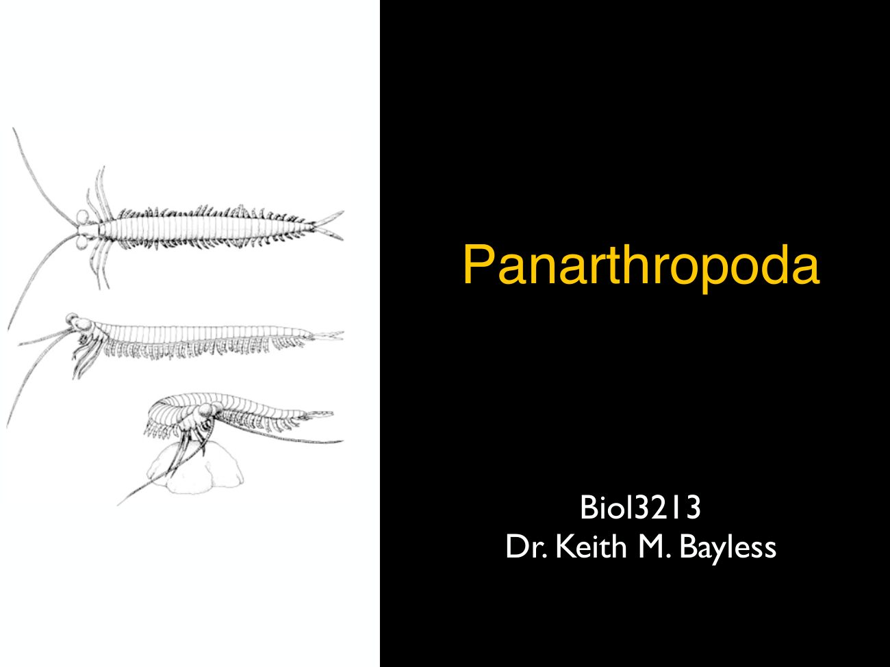](slides/slide-01.jpg)

Now we're moving out of the what and why to some extent and to more of the who and where will go into the major groups that are sister to insects, the most diverse terrestrial arthropods what are the characters uniting them and where they came from?

[↑ Slides](#slides) · [Course index](../../README.md)

## Slide 2

[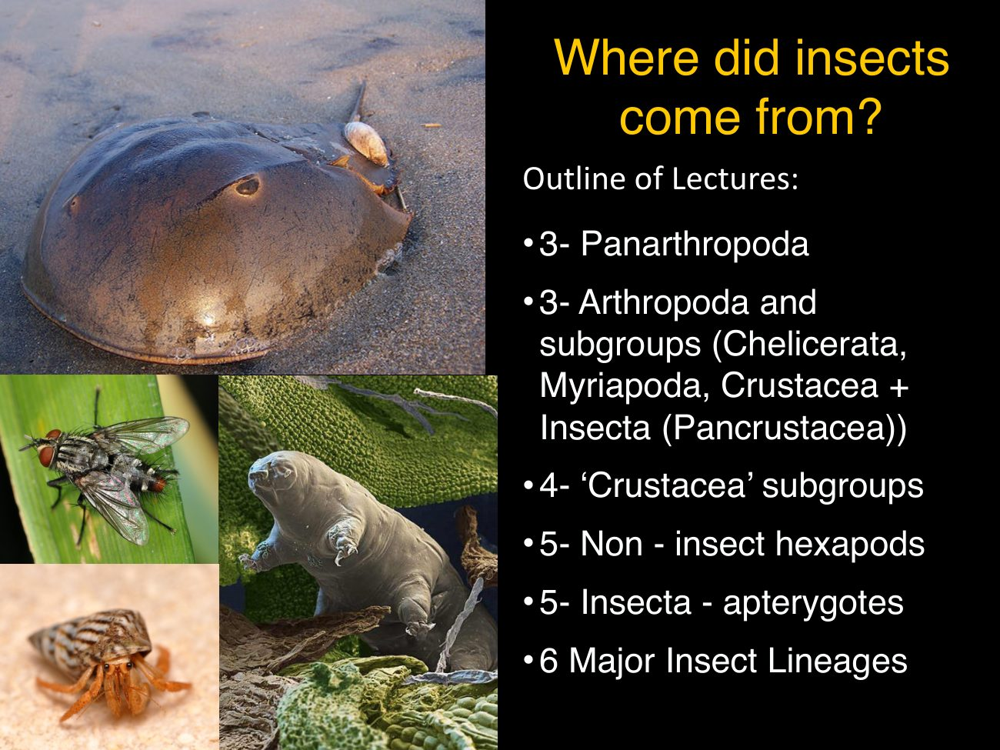](slides/slide-02.jpg)

So today I'll go over the pan arthropods up through the crustaceans. And the next set of lectures will discuss the non hexapod.

[↑ Slides](#slides) · [Course index](../../README.md)

## Slide 3

[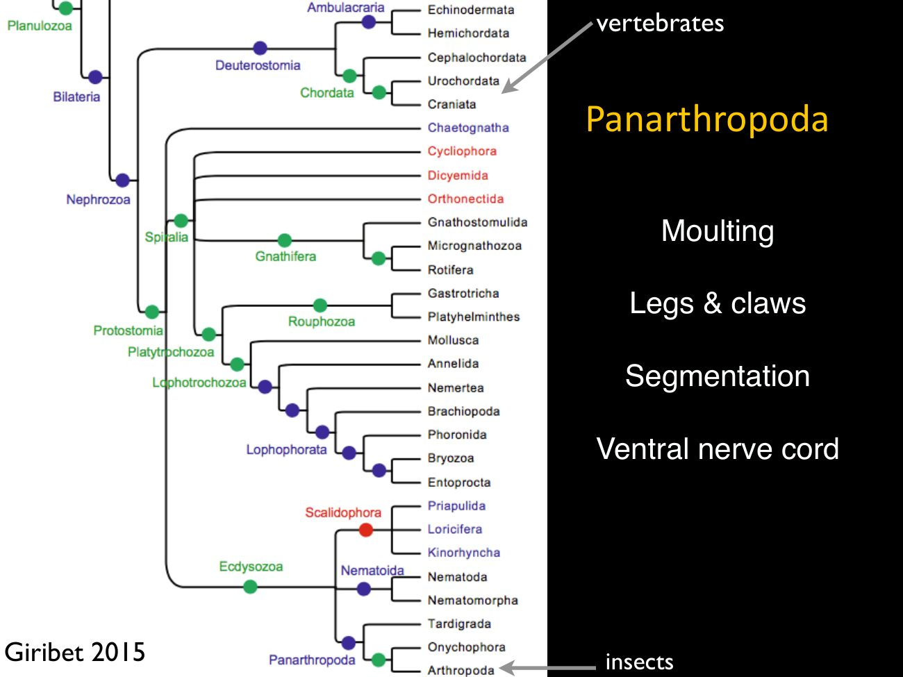](slides/slide-03.jpg)

Panarthropoda is a well established, superphylum a group of phyla. And here I just want to show how many animal phyla really exist and how distant these two really important lineages are so that the vertebrates you've covered so far are, deuterostomes [following word unclear], sister to the protostomes And there's a lot of phyla of protostomes, including the arthropods, which are in a group called Panarthropoda.

[↑ Slides](#slides) · [Course index](../../README.md)

## Slide 4

[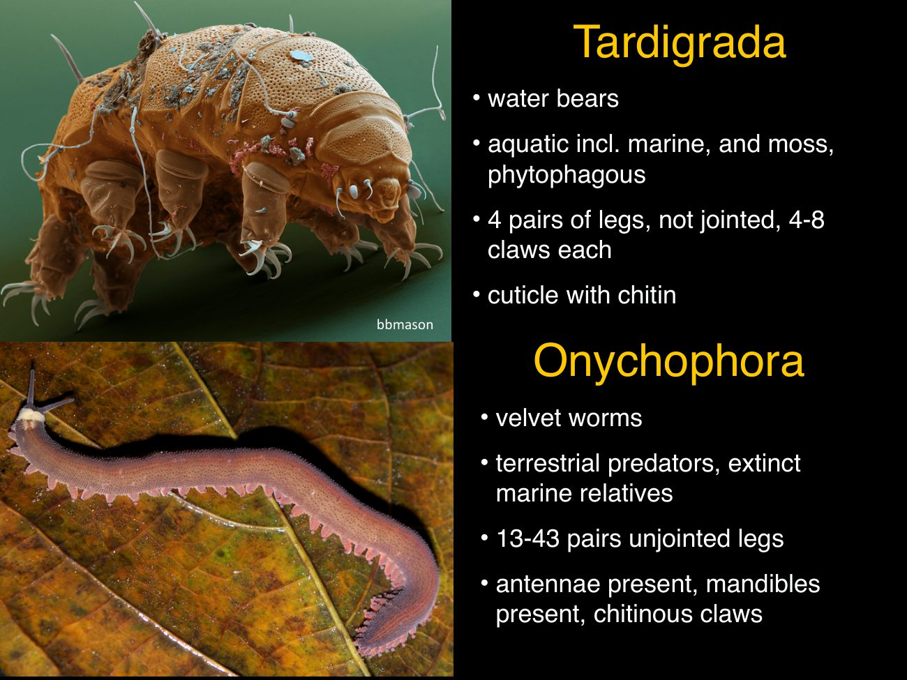](slides/slide-04.jpg)

The other major phyla in the Panarthropoda are the tardigrade. These are microscopic, plant feeding, animals, mostly aquatic. They kind of get somewhat terrestrial living in moss.

So what? What they share with arthropods is they also have legs, but they're not jointed. The legs have claws, and they include, chitin.

But the mouth parts and other structures are very different from insects and other arthropods. Another phyla in the Panarthropoda is the Onychophora, the velvet worms. This is also somewhat species poor.

These are all terrestrial. But there are marine extinct, species known. They have a lot of legs throughout the body, which again are unjointed and similar to some arthropods.

They have antenna, and they have, mandibles. And they have chitin, at least in their claws. So the arthropods, tardigrades and Onychophora form the Panarthropoda.

> **Editorial note:** Diet and habitat statements are retained from the lecture. Tardigrades are not all plant-feeding; marine tardigrades also exist.

[↑ Slides](#slides) · [Course index](../../README.md)

## Slide 5

[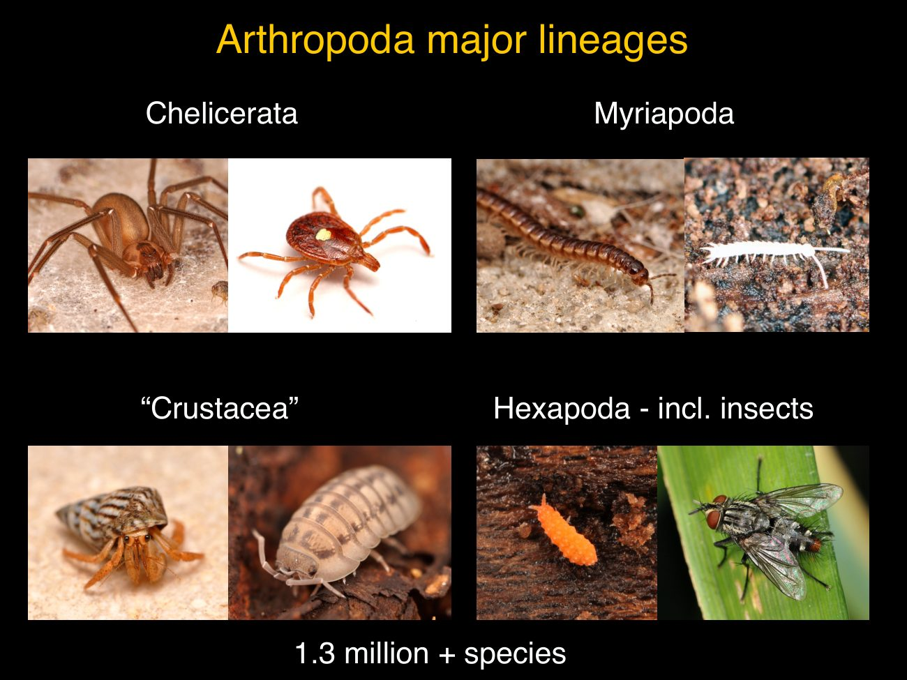](slides/slide-05.jpg)

What's going on inside the arthropods? There's four major lineages the chelicerates, which include arachnids, myriapods, the crustaceans and the hexapod, which include insects. Crustacea, however, is not monophyletic with respect to the hexapod and insects.

Those were derived from within, crustacean. There's some crustaceans that are more closely related to hexapod and other crustaceans.

[↑ Slides](#slides) · [Course index](../../README.md)

## Slide 6

Here's a recent review, looking at overall arthropod relationships. So the chelicerates in red. There's a lot of controversy as to the relationships of the classes, and that will be covered, a bit later in the semester by Dave Roll.

Then the myriapods are sister to the crustaceans plus hexapod. That's the Mandibulata. They all have mandibles.

Chelicerates do not; they have chelicerae? The crust are not monophyletic and the hex pods, come out within them.

[↑ Slides](#slides) · [Course index](../../README.md)

## Slide 7

[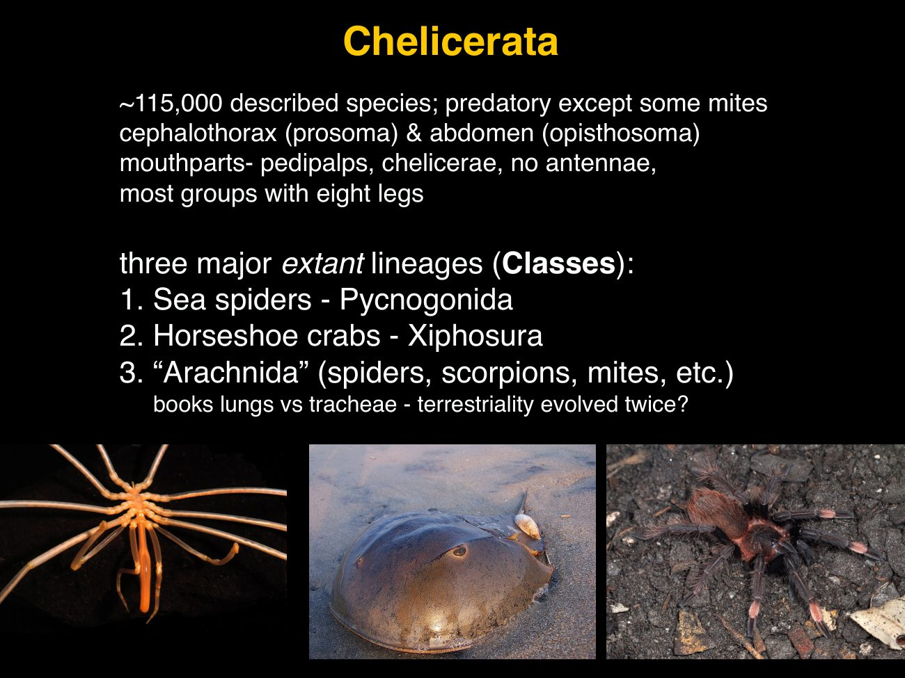](slides/slide-07.jpg)

The chelicerates are extremely diverse and important. These are the sister to the rest of the living arthropods. It's a tonne of species.

Generally, they are predatory, but there's some mites that are aquatic and also some that are, plant feeding. The three major lineages of chelicerates are the sea spiders, which are marine. There's some around Australia, the horseshoe crabs which do not occur in Australia, but they are in nearby in Southeast Asia.

And then the arachnids are almost all, terrestrial predatory. And they have a very high amount of morphological disparity. Which kind of suggests that even terrestrial in the arachnids might have evolved multiple times the chelicerates.

Their tagma is a cephalothorax. So that's the head and thorax together. And then the abdomen, their mouth parts, they do not have antennae or mandibles.

Instead, they have pedipalps and chelicerates so different, ancestral leg structures in the, ground plan arthropod have evolved into mouth parts and chelicerates, as compared to insects.

[↑ Slides](#slides) · [Course index](../../README.md)

## Slide 8

[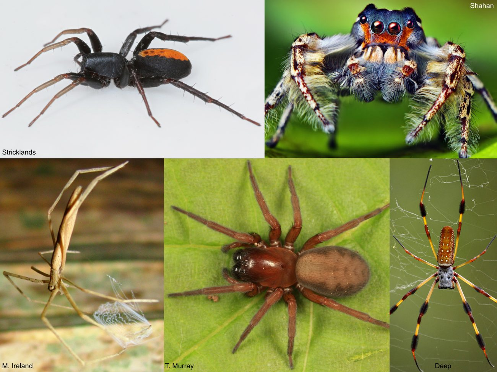](slides/slide-08.jpg)

Just want to go through some of the diversity of, major sister groups just to show some nice pictures. These are all, arachnids. These are spiders.

Are, they form webs. They're predatory. This is one of the most diverse groups of arachnids.

[↑ Slides](#slides) · [Course index](../../README.md)

## Slide 9

[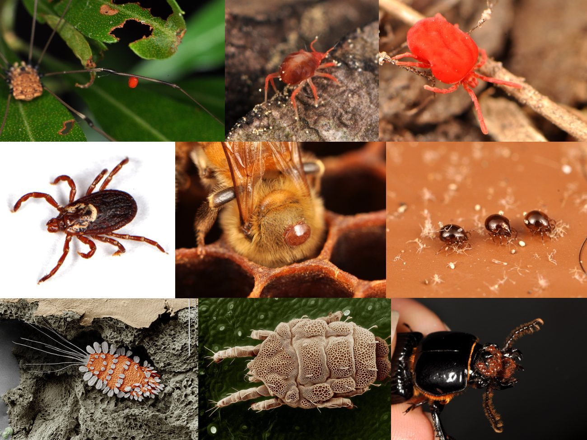](slides/slide-09.jpg)

The other really diverse group of arachnids are the mites, which might not be monophyletic. The, they're They're all just very reduced arachnids. Some are parasitic, some are free living.

Some are aquatic, including marine. Some live in plants, extremely diverse and important and poorly studied. Group.

[↑ Slides](#slides) · [Course index](../../README.md)

## Slide 10

[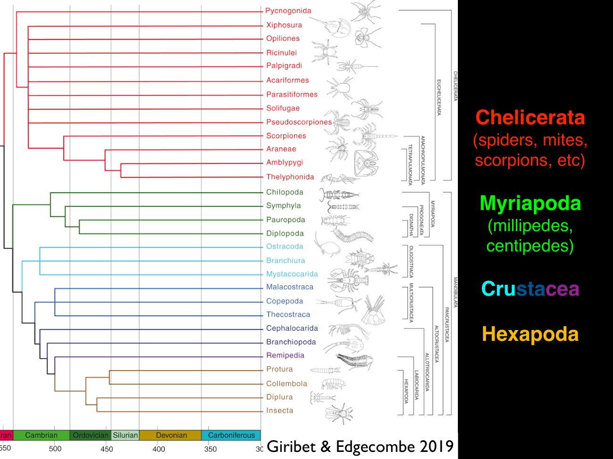](slides/slide-10.jpg)

So now we'll move on to the myriapods. This is another, major. Super class of arthropods.

[↑ Slides](#slides) · [Course index](../../README.md)

## Slide 11

[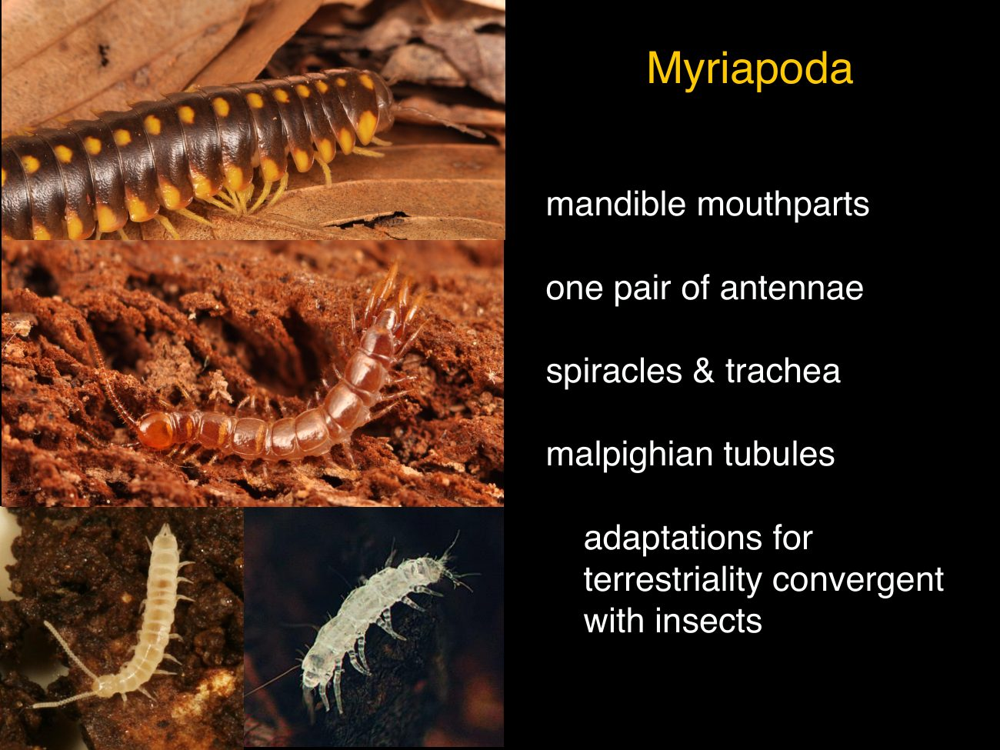](slides/slide-11.jpg)

And these have mandibles. They have one pair of antenna, just like insects. They're all terrestrial.

So they also have spiracles and tracheae. Whereas, chelicerates, have chelicerates that are terrestrial have a different system called book lungs. Myriapods also have Malpighian tubules.

These all are actually, convergent adaptations of insects. They did not, evolve once. Instead, all of these characters, that are adapted for terrestrial evolved independently in myriapods and in insects, particularly Malpighian tubules, uniramous appendages.

And, spiracles and trachea.

[↑ Slides](#slides) · [Course index](../../README.md)

## Slide 12

[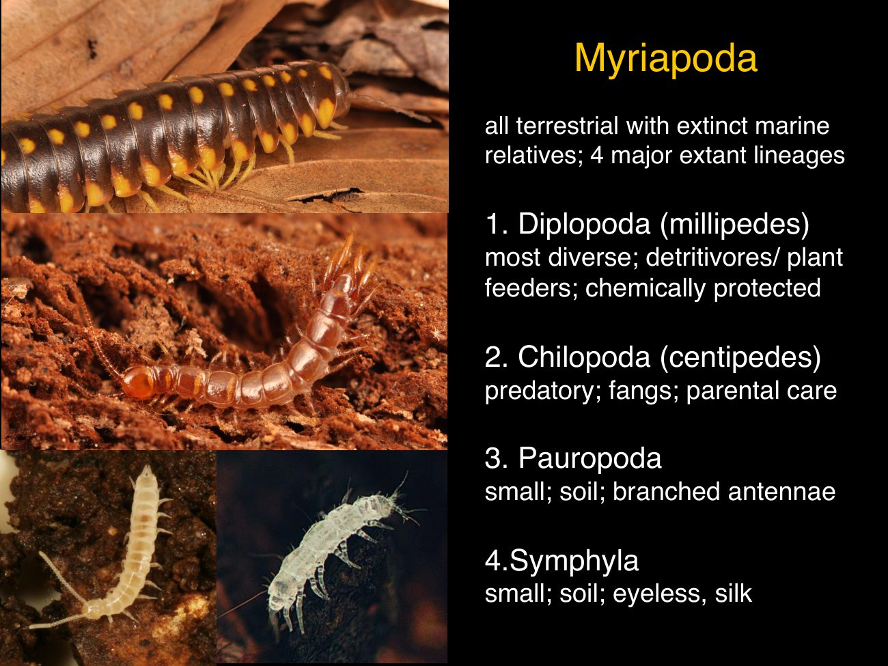](slides/slide-12.jpg)

Myriapods are split into four, major lineages. Those are the Diplopoda, the millipedes. That's the most diverse group of myriapods.

They're, almost all, detritivore or feed on plants. They could be quite large or really small in the leaf litter. A lot of them are chemically protected or protected by different types of setae or body projections.

The chilopods are Centipedes. That's another major group of myriapods. They're all predatory, and their mandibles are reduced.

And the first legs, are evolved into these fangs that catch that can envenomate prey. Chilopods also have parental care. They care for their eggs and young, then the two other major groups of myriapods are very small in body size and very poorly studied, but probably quite diverse.

We need to discover more about them. One is the pauropods. These are, small and have branched antennae.

That's one on the right side. And then the Symphyla, which are also smaller in soil. And they don't have eyes.

Symphylans are quite different from other myriapods. They produce silk, and they also have a very strange developmental character. Where each life stage adds a pair of legs.

[↑ Slides](#slides) · [Course index](../../README.md)

## Slide 13

[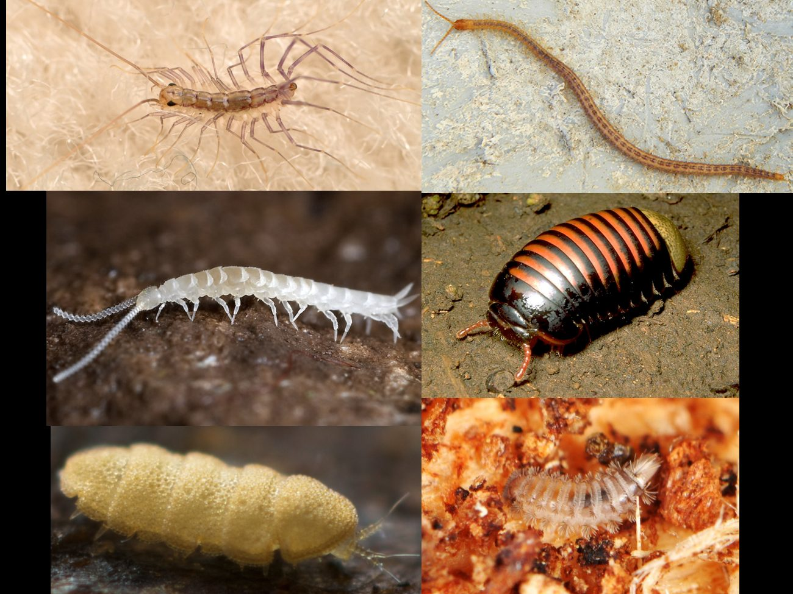](slides/slide-13.jpg)

I want to show some more pictures of myriapods. The top are a couple of Centipedes. One's a house centipede.

That's kind of an urban associate in a lot of the world. It kills pests. The really long one.

There is a geophilomorph centipede that they live under rocks or predators, and then the there's pill millipedes below that, and bristle millipedes are showing different adaptations. Millipedes have for, protection for not becoming prey and the other two on the side are another symphylan and pauropod, Small living in soil but still, relatively diverse and cute.

[↑ Slides](#slides) · [Course index](../../README.md)

## Slide 14

[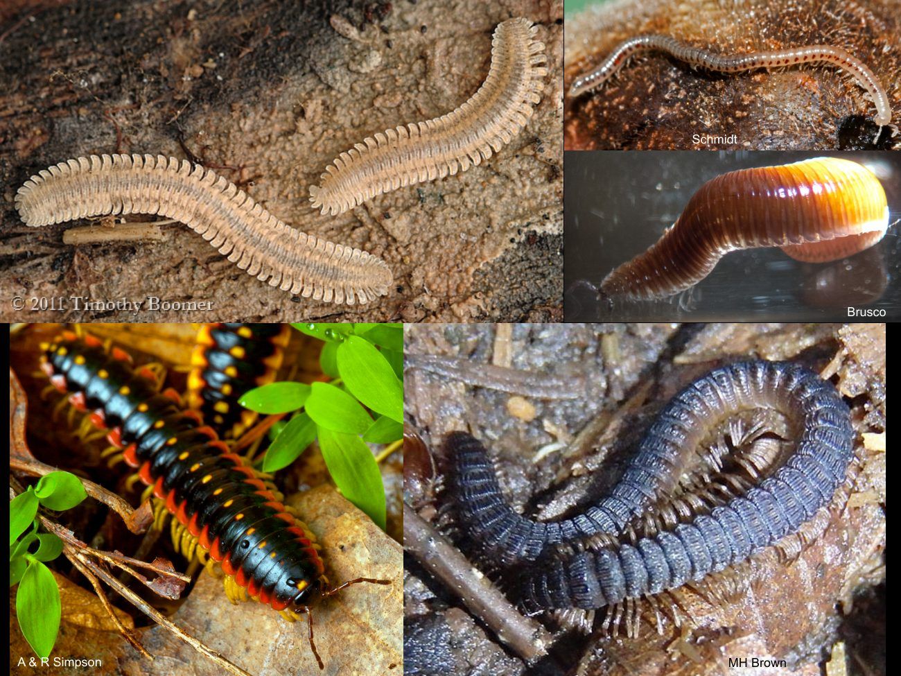](slides/slide-14.jpg)

I just want to show a couple more millipedes. So there's some really flat ones, that live under the rocks. There's, extremely long ones.

There's one from Western Australia. That is the true millipede has over 1000 legs. Some of the legs are somewhat reduced and they look more like a worm.

Often the brightly coloured large millipedes are heavily chemically protected with a whole suite of, nasty chemicals. And, some have different [unclear: cuticular sculpture] and structures on the body. A really diverse group, and deserves a lot more study, particularly in Australia.

[↑ Slides](#slides) · [Course index](../../README.md)

## Source notice

this material has been reproduced and communicated to you by or on behalf of the Australian National University in accordance with section 113 P of the Copyright Act 1968. The material in this communication may be subject to copyright Under the act, any further reproduction or communication of this material by you must be consistent with the provisions of the act. Do not reproduce this material. Do not remove this notice.

[← Previous lecture](../02-insect-functional-diversity/README.md) · [Course index](../../README.md) · [Next lecture →](../04-invertebrate-intro-part-4-origin-of-insects/README.md)
