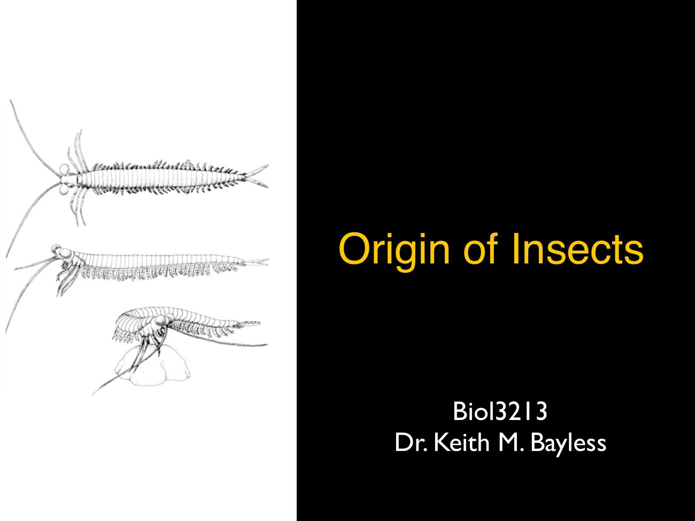
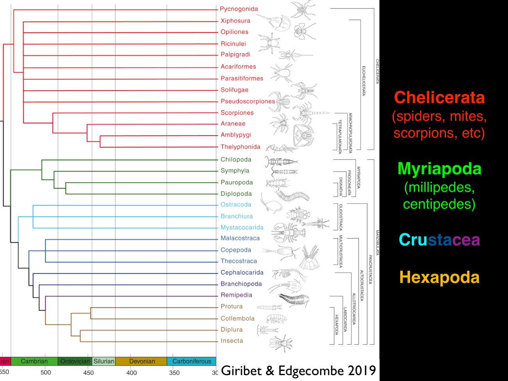
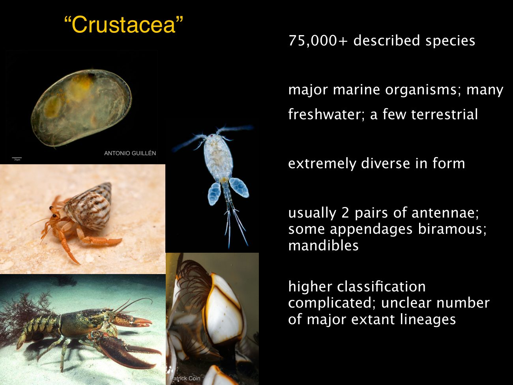
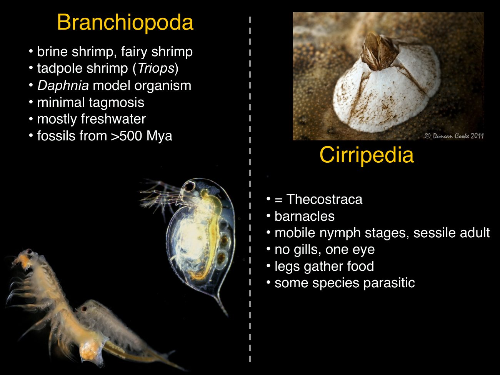
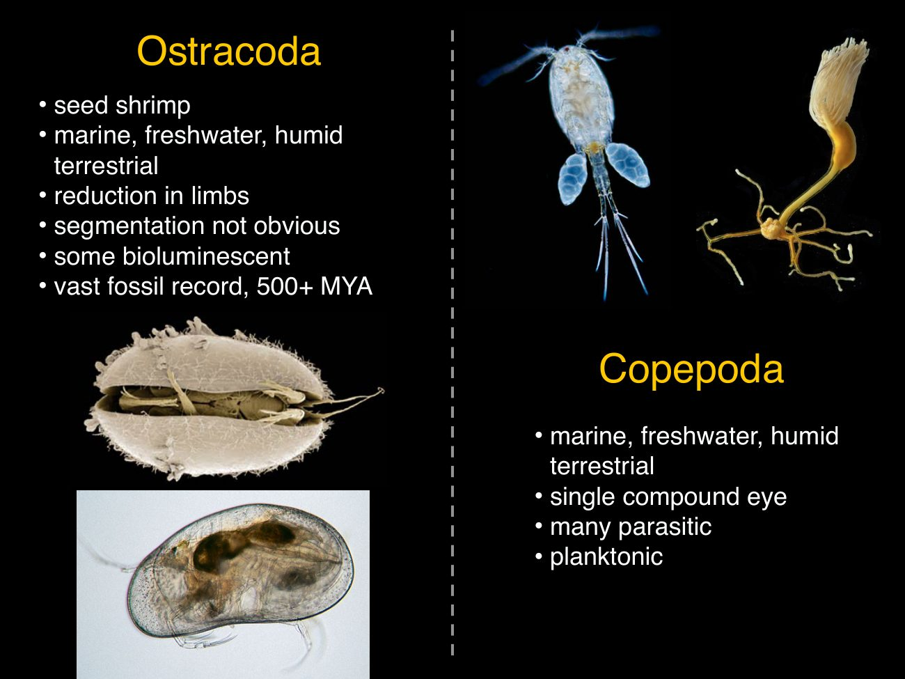
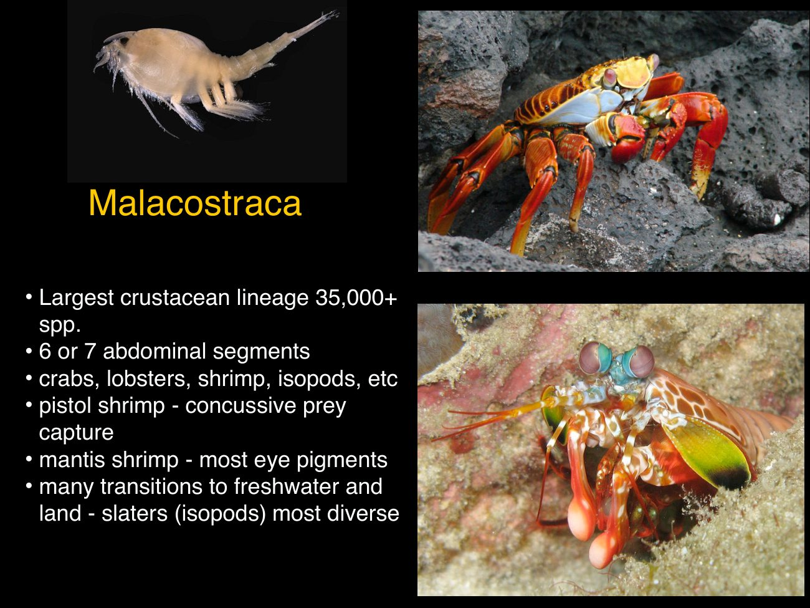
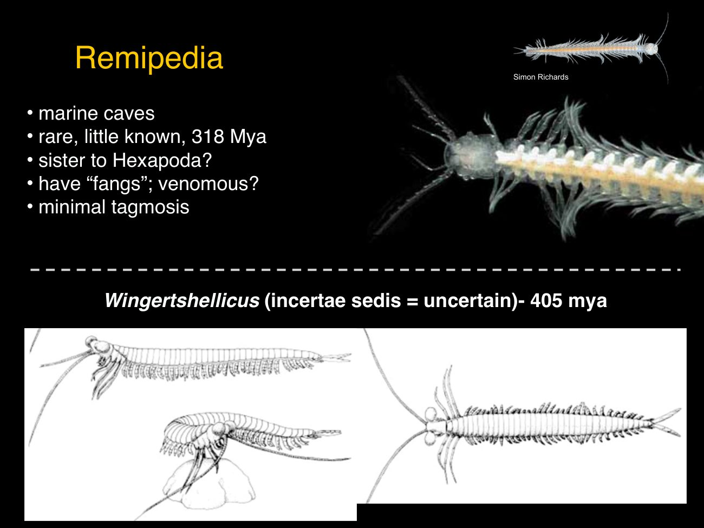
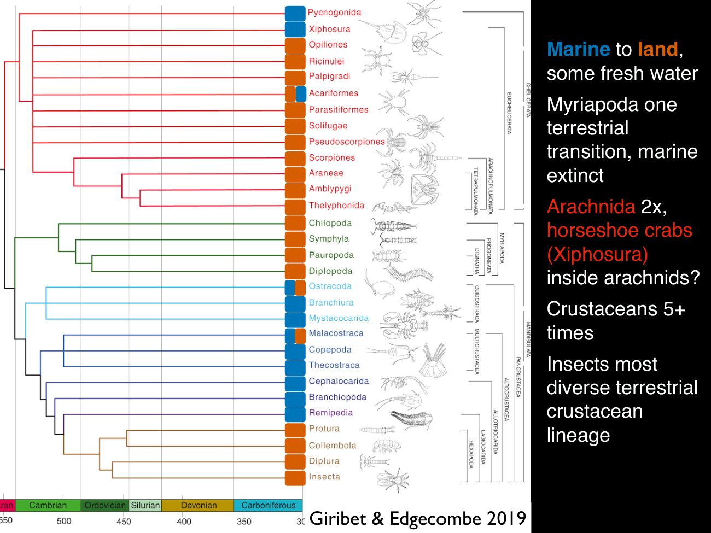
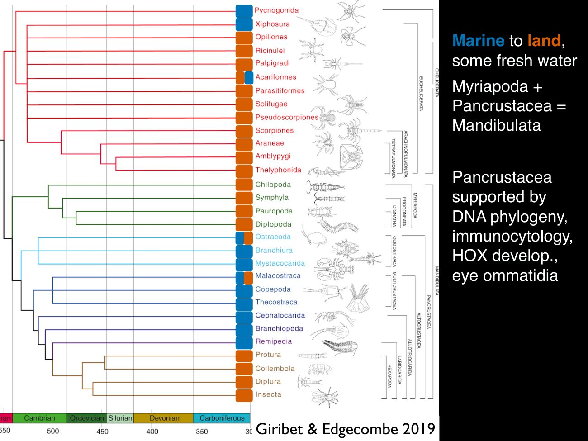

# Invertebrate Intro Part 4 - Origin of Insects

[← Previous lecture](../03-invertebrate-intro-part-3-panarthropoda/README.md) · [Course index](../../README.md) · [Next lecture →](../05-invertebrate-intro-part-5-hexapoda-and-non-pterygotes/README.md)

**Slides + cleaned transcript** · 10 slides

English transcript with fillers and repeated false starts removed. Technical terms are corrected using the slides and context. Bracketed wording marks reconstruction or uncertainty. Slide boundaries are inferred from content; the transcripts have no slide timestamps.

[Original transcript](original-transcript.txt) · [Text-only version](cleaned-transcript.md) · [Editing notes](../../EDITING-NOTES.md) · [Correction record](corrections.md)

[Searchable slide text](slide-text.md). Click a slide image to open it at full size.

## Slides

[1](#slide-1) · [2](#slide-2) · [3](#slide-3) · [4](#slide-4) · [5](#slide-5) · [6](#slide-6) · [7](#slide-7) · [8](#slide-8) · [9](#slide-9) · [10](#slide-10)

## Slide 1

We're going to continue on moving closer to successive sister groups to the insects to understand where this mega radiation originated.

[↑ Slides](#slides) · [Course index](../../README.md)

## Slide 2

As we've seen before, insects are arthropods. They're in the Panarthropoda. Other major arthropods are the chelicerates, myriapods and Crustacea, but hexapod, including insects derived from within crustaceans so that the term for that is the Pancrustacea.

So we're going to talk about some pan crustaceans that are not hexapod or insects.

[↑ Slides](#slides) · [Course index](../../README.md)

## Slide 3

Crustacea, quote unquote. It was, a major group for a long time until, evidence showed that it was not monophyletic. It's incredibly diverse, only really, surpassed by things like arachnids, mollusks and insects.

They are some of the most major marine organisms, incredibly diverse in freshwater environments as well. And some have evolved Terrestrial, multiple lineages have, but none as successful as, the insect lineage. They are incredibly div diverse in form some crustaceans, you can kind of see the ancestral segmentation the way you can see in a lot of insects or myriapods.

But other crustaceans are heavily, derived morphologically. And the segmentation is unclear. They usually have two pairs of antennas, so they have biramous appendages and crustaceans also have mandibles, the same as myriapods and, hexapod.

The higher level classification is unclear. There's some parasitic ones that are, heavily derived and modified that are, difficult to place in the phylogeny. And even the overall major extant lineages is unclear.

As there's some groups that are very difficult to obtain and study.

[↑ Slides](#slides) · [Course index](../../README.md)

## Slide 4

I'll go through some of the major lineages of crustacean Branchiopoda the fairy shrimp or brine shrimp. These include Triops, the tadpole shrimp, which is a common, shrimp that appears in ephemeral bodies of water. Also, a branchiopod is Daphnia, which are fresh water, crustaceans that are very easy to rear and a lot of, experimental work is done on them as genetic and ecological model organisms, since they're easy to rear and have fast generation times branchiopods.

Except for Daphnia, which are kind of strange looking. Overall, there's not as much tagmosis. You can see, legs along the body that are not very differentiated, so they have a head.

Obviously, there are marine ones, but mostly diverse in freshwater environments and very old fossils of, fairy shrimp and relatives. Another major lineage of crust is the Cirripedia or Thecostraca. These are the barnacles.

These are very strongly derived in their adult stage. They are sessile. They have they don't have gills.

They have one eye that they can look through. And they, gather food in the water with their legs. But the nymphs, the immature stages of cirripedes are much more, crustacean appearing.

They float around to find, a suitable habitat for the adults. There's some, bizarre parasitic, relatives of this group, so that's where the difference in the name comes from. Whether or not you include the parasitic lineage is the Cirripedia or Thecostraca, but the There's clearly this major lineage of crustacean, which includes the barnacles.

[↑ Slides](#slides) · [Course index](../../README.md)

## Slide 5

Another major lineage of crustacean are the ostracods. These are the seed shrimp. They're found in all, major environments Marine fresh water or in soil.

They have, a carapace, a bivalve carapace that folds over the body and, very few limbs compared to other crust. So it's kind of hard to tell what the segmentation or the tagmosis is. When you see an ostracod, they're incredibly diverse and very important in the fossil record.

They are well understood from fossils and are used to date, fossil strata. Some are bioluminescent. These are some of the organisms that will luminesce when you're swimming or have a boat in the water.

There's also algae and other organisms that do it, but an incredibly diverse and important group of organisms along with the ostracods. Another major lineage of, crustacean are the copepods. Some of these are, quite, indicative looking with this, median eye and, holding the eggs, with [unclear] antennae and a tail.

These are major components of the oceanic plankton, but there's a number of lineages that are parasitic and really bizarre in form and difficult to place these similar to ostracods. These can be found in freshwater or in humid soil.

[↑ Slides](#slides) · [Course index](../../README.md)

## Slide 6

The largest crustacean lineage, which includes many of the our most well known crustaceans for, human diet and pets. And, large and beautiful animals is the Malacostraca. This includes, the shrimp and lobsters and slaters and a lot of major subgroups of crustacean that are all held together.

They have some major similarities. Six or seven abdominal segments. There's usually, an obvious head and thorax.

This includes some really bizarre, lineages. Like the pistol shrimp, which have concussive prey capture in their claws to, cause a shock wave and capture prey Mantis shrimp are another example in the Malacostraca. They have the most eye pigments of any known organism.

They have the most complicated vision. A lot of these, lineages have some species that are terrestrial or some terrestrial crabs and a few terrestrial shrimp. But the most diverse, of course, is within, Isopoda.

They those that includes the slaters, another major group of, terrestrial malacostracans is the amphipods. But they've evolved terrestrial multiple times in these different groups, but, and really unclear number of times, probably many times, but none of them are quite as successful as the insects. Although slaters are very diverse as well.

[↑ Slides](#slides) · [Course index](../../README.md)

## Slide 7

The last major lineage of crustaceans I'll discuss is the remipedes. These are really bizarre. Only recently discovered in the last 40 years or so, they are only found in marine caves.

So, cave diving is one of the most dangerous hobbies. But this is something that cave divers, can use to justify their pastime. They're very poorly known.

But there's some very old fossils, and, it's relatively clear, based on developmental and DNA phylogeny evidence that remipedes constitute a group A along with a few other poorly known crustaceans that are closer to hexapod than they are to any other, crustacean. They have, venomous fangs or they're predatory. And you could see a head that looks somewhat like an insect head looking at it, except for the biramous antennae.

But beyond that, the rest of the thorax and abdomen is, very minimal specialisation across the segments. There's a there's a fossil that I've been showing in the previous slides. The correct name is Wingertshellicus, but, a synonym is Devonohexapodus.

And that was used as an ex, as an example of why insects are closer to myriapods. But that, fossil has been reappraised and it's really quite conclusive that insects are hexapod that are derived from within the crustacean.

[↑ Slides](#slides) · [Course index](../../README.md)

## Slide 8

So to call back to this, figure, what I wanted to illustrate here is the, terres the terrestrial and marine transitions.

[↑ Slides](#slides) · [Course index](../../README.md)

## Slide 9

So the ancestral arthropod pan arthropod is likely Marine. There's no marine tardigrades or onychophorans, but there's fossil Marine onychophorans. However, there's Marine, chelicerates, the sea spiders and, Xiphosura the horseshoe crabs and a number of the crustacean groups are still marine, although they have secondarily moved to fresh water to terrestrial.

Whereas clearly in the true insects, they are, terrestrial or perhaps fresh water. The association between insects and marine environments is relatively rare, and that's because insects are actually the most diverse cry, terrestrial crustacean lineage.

> **Editorial note:** The source says there are no marine tardigrades. That is a factual error rather than a recoverable transcription mistake: marine tardigrades exist. The lecturer’s claim is retained.

[↑ Slides](#slides) · [Course index](../../README.md)

## Slide 10

So that the Myriapoda and Pancrustacea. That's the Mandibulata and, Pancrustacea. The lineage is supported by, a number of, lines of evidence, including, the way immune cells are built, the development of Hox genes.

They have similar eye ommatidia, and now we can understand that insects are really, derived terrestrial crustaceans, which are a major lineage of the arthropods and the pan arthropods.

[↑ Slides](#slides) · [Course index](../../README.md)

## Source notice

this material has been reproduced and communicated to you by or on behalf of the Australian National University In accordance with section 113 P of the Copyright Act 1968. The material in this communication may be subject to copyright under the act, any further reproduction or communication of this material by you must be consistent with the provisions of the act. Do not reproduce this material. Do not remove this notice.

[← Previous lecture](../03-invertebrate-intro-part-3-panarthropoda/README.md) · [Course index](../../README.md) · [Next lecture →](../05-invertebrate-intro-part-5-hexapoda-and-non-pterygotes/README.md)
