# Invertebrate Intro Part 6 - Major Insect Lineages

[← Previous lecture](../05-invertebrate-intro-part-5-hexapoda-and-non-pterygotes/README.md) · [Course index](../../README.md) · [Next lecture →](../07-invertebrate-intro-part-7-insect-overview-aquatics-paleoptera-plecoptera/README.md)

**Slides + cleaned transcript** · 19 slides

English transcript with fillers and repeated false starts removed. Technical terms are corrected using the slides and context. Bracketed wording marks reconstruction or uncertainty. Slide boundaries are inferred from content; the transcripts have no slide timestamps.

[Original transcript](original-transcript.txt) · [Text-only version](cleaned-transcript.md) · [Editing notes](../../EDITING-NOTES.md) · [Correction record](corrections.md)

[Searchable slide text](slide-text.md). Click a slide image to open it at full size.

## Slides

[1](#slide-1) · [2](#slide-2) · [3](#slide-3) · [4](#slide-4) · [5](#slide-5) · [6](#slide-6) · [7](#slide-7) · [8](#slide-8) · [9](#slide-9) · [10](#slide-10) · [11](#slide-11) · [12](#slide-12) · [13](#slide-13) · [14](#slide-14) · [15](#slide-15) · [16](#slide-16) · [17](#slide-17) · [18](#slide-18) · [19](#slide-19)

## Slide 1

[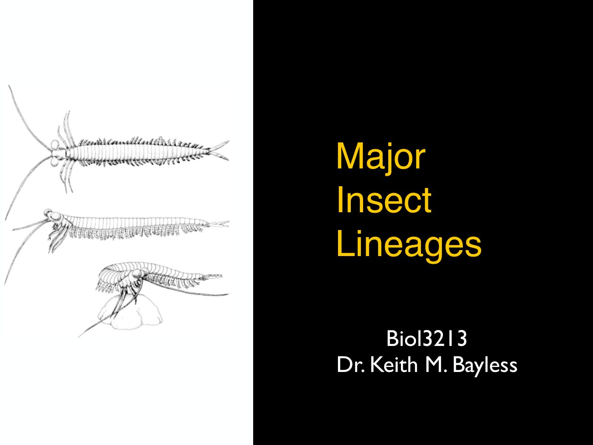](slides/slide-01.jpg)

OK, we're going to wrap up this section on the, introduction to arthropods and invertebrates and also plan out the next few lectures and practicals on, insects. So this lecture will concern an overall kind of a fly's eye view of the structure and relationships of insects. Just talking about the major groups and the further lectures will get in to the orders in some family.

[↑ Slides](#slides) · [Course index](../../README.md)

## Slide 2

[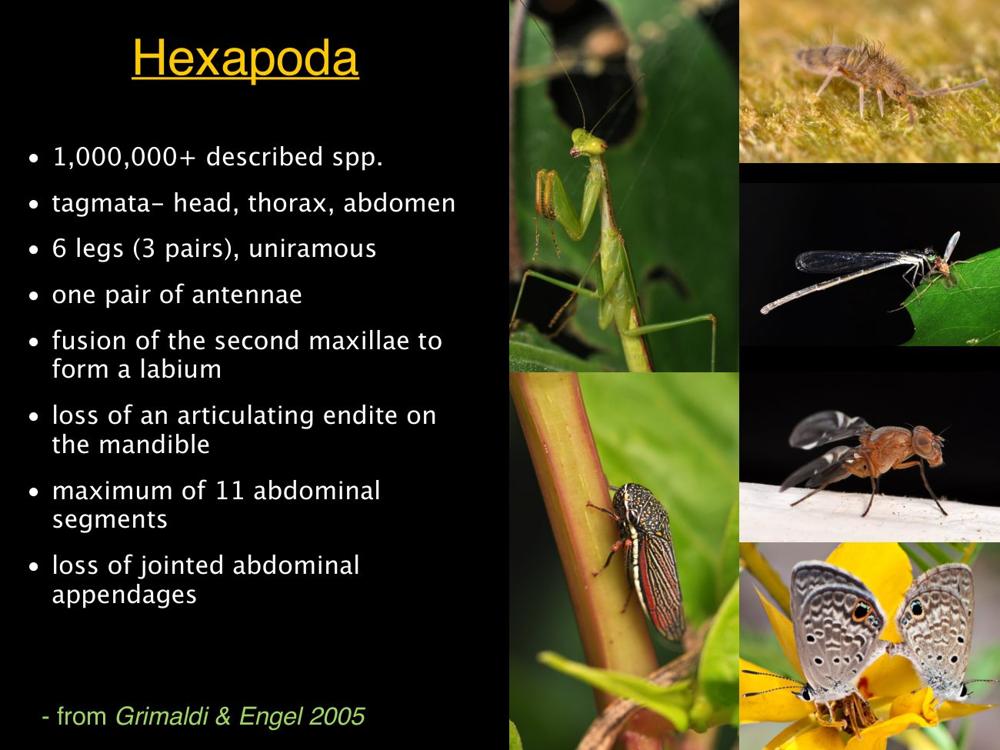](slides/slide-02.jpg)

So we've already learned about the hexapod. So this group has over a million known species. These have a head, thorax and abdomen those conserve tagmata six legs and three pairs.

They all are uniramous one pair of antennae. The, maxilla is present. The parts are the clypeus mandible, maxilla and labium and the labium is always fused medially.

I think back to that. The first, lecture those head diagrams. The mandible never has any palp or articulations.

There's only, 11 abdominal segments or fewer. Unlike a lot of crustaceans and abdominal appendages might be present, particularly in the terminalia. But they're never jointed.

[↑ Slides](#slides) · [Course index](../../README.md)

## Slide 3

[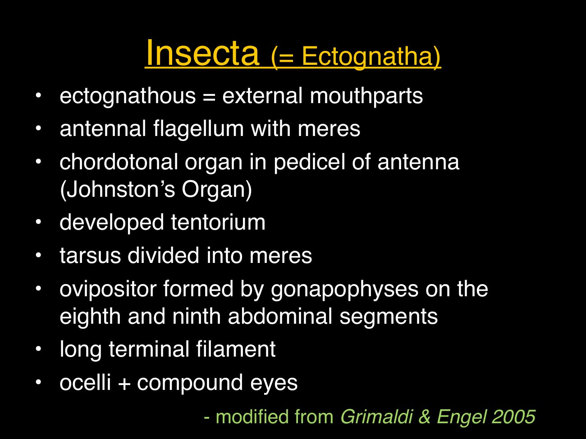](slides/slide-03.jpg)

So the hexapod that were not insects those were the Collembola, Protura and Diplura. We learned about them in the last lecture. And then we move on to the insects, which are also called Ectognatha, because they have their mouth parts visible externally, whereas Collembola, Protura and Diplura don't.

So in these groups, the, antennal flagellum is articulated into meres. So the antenna is the scape, pedicel and flagellum, and only the flagellum will have further articulations. In the base of the antenna, there is a sensory organ called the Johnston's organ.

All insects have a tentorium. So what that means is that inside the head, some of those phragmata and apophyses, that we learned about they fuse together and form kind of internal, skeleton inside the head, which allows for muscle attachments for the mouth parts. And, all of these have their tarsus, the that part of their leg is in five or fewer.

Meres is broken into articulation, so the leg is right to Coxa femur, tibia, tarsus and only the tarsus can be further divided into meres. True insects have an ovipositor, so those, abdominal appendages at the end of the abdomen can be modified into an ovipositor. There's a terminal filament along with the two cerci and a lot of insects, and they have both compound eyes and they have three or fewer ocelli.

So that's different than the non insect hexapod.

[↑ Slides](#slides) · [Course index](../../README.md)

## Slide 4

[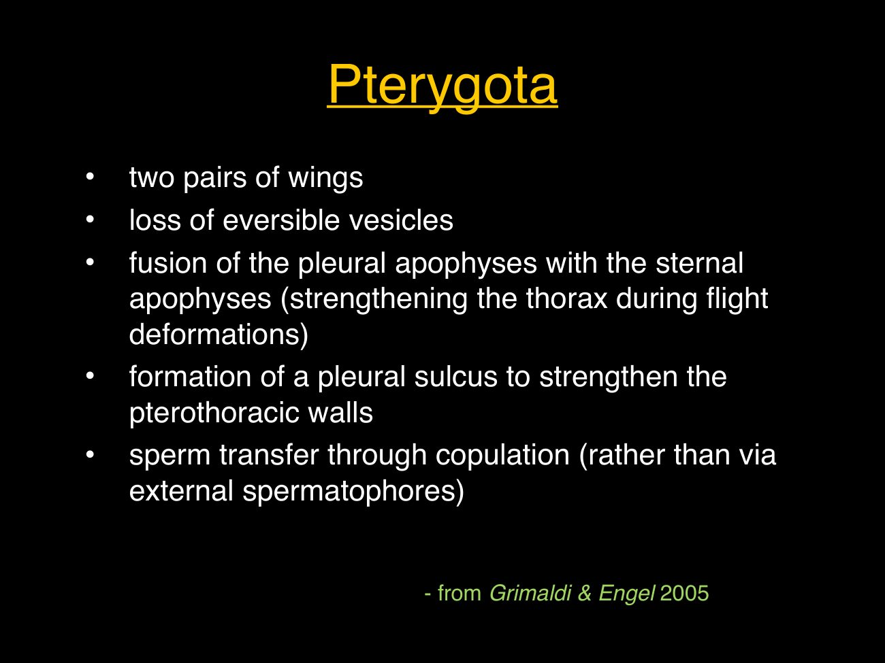](slides/slide-04.jpg)

Within the insects, some are winged. The major, evolutionary events in insects was the, evolution of the wings. So all extent, insects have two pairs of wings.

And they are not associated with, eversible vesicles so near the wings or on the abdomen that's a structure that's present in a lot of the non insects. So, for instance, the abdominal styli, in Archaeognatha would have, eversible vesicles Another major, evolution is in the thorax. Inside the thorax, the sclerites have fused into different structures to allow for, muscle attachments and to strengthen the thorax as it is deformed during flight as the wings beat up and down.

And the last major, evolutionary event here, as compared to non winged insects, is there that there is direct copulation. So, silver fish and, bristle tails their fertilisation external. The females lay eggs, and the males inseminate that clutch of eggs, whereas all winged insects have direct copulation in various ways.

> **Editorial note:** The source generalises about two wing pairs and describes external fertilisation. Wing loss and reduction occur, and indirect transfer via spermatophores is not equivalent to fertilising eggs after laying.

[↑ Slides](#slides) · [Course index](../../README.md)

## Slide 5

[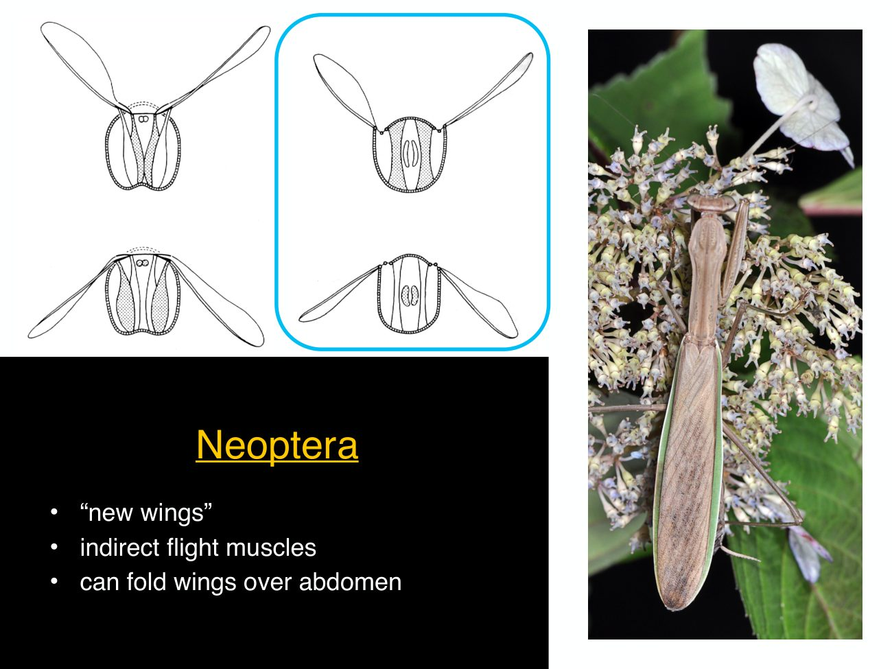](slides/slide-05.jpg)

Within the winged insects, there's a major lineage called the Neoptera. So what that means is that in all insects, except for Dragonflies and may flies, the muscles of the thorax do not power flight. Instead, they deform the thorax, and the deformation of the thorax itself moves the wings.

So there are muscles that can change the direction of the wings. But the powering of flight is done by pulling when you pull the thorax, up and down. So dorsoventrally, then the wings go up.

And when you pull your muscles, anteroposteriorly, then the wings go down. So, if you think about it like a box when the top and bottom of the box are squished, then the side of the box goes out that push the wings up when the side of the box go in and the top and bottom of the box go up and the wings go down. So those are referred to as indirect flight muscles and also in the Neoptera.

Along with that, the wings can fold over the body, whereas in other wing insects, they can't.

[↑ Slides](#slides) · [Course index](../../README.md)

## Slide 6

[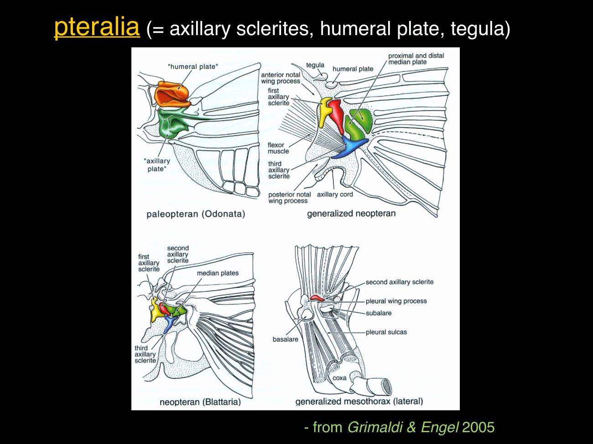](slides/slide-06.jpg)

All this is performed by, muscles that are attached to very specific sclerites at the base of the wing called the pteralia. So PT that's Greek for wing. So that's what that's referring to.

And these, sclerites at the base of the wing. The pteralia, also called axillary sclerites, are really different across insects. But there's a set number of them that, help the wing fold and help the wing, go in different directions as they are flying.

[↑ Slides](#slides) · [Course index](../../README.md)

## Slide 7

[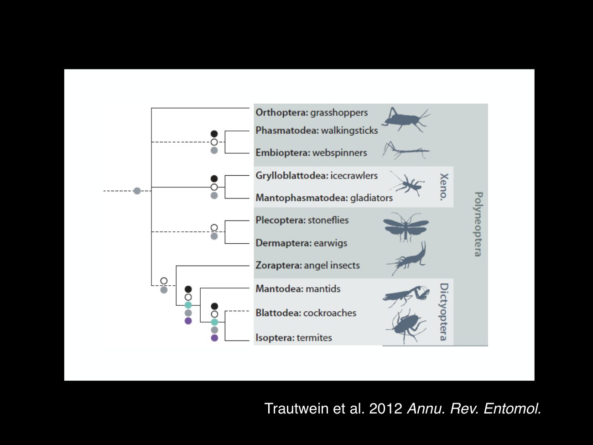](slides/slide-07.jpg)

So another, major subgroup of the Neoptera. So, insects. Some have wings, some don't.

The winged insects are called, the Pterygota within. Pterygota. Some can fold their wings over the body.

That's Neoptera within Neoptera.

[↑ Slides](#slides) · [Course index](../../README.md)

## Slide 8

[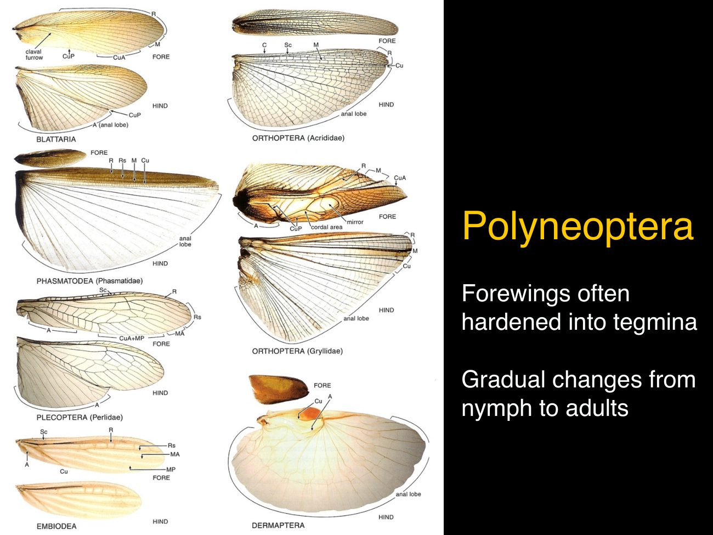](slides/slide-08.jpg)

There's one major lineage called Polyneoptera. These are generally kind of large bodied things like grasshoppers. Their forewings are generally hardened, but can still be used for flights and in for flight in some cases.

And in Polyneoptera Opera, generally, the nymph and adults are similar looking. You can see the wing pads, developing. You can kind of see the adult characters, along the nymphal stages along the development.

[↑ Slides](#slides) · [Course index](../../README.md)

## Slide 9

[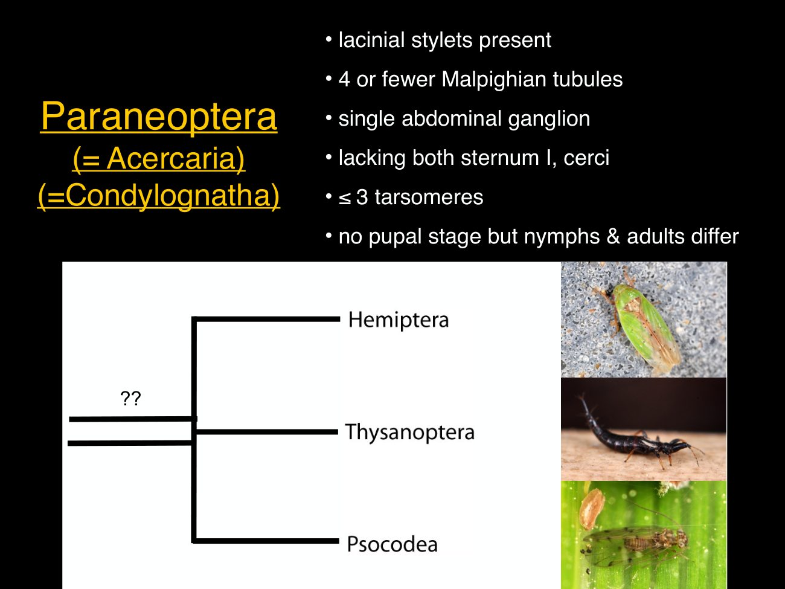](slides/slide-09.jpg)

Another major lineage of Neoptera is called the Paraneoptera. It has a few other names, So these are bugs, thrips and lice. These do not have chewing mouth parts.

Unlike almost all Polyneoptera do have, chewing mouth parts. Instead, they have various types of [unclear term] or stylets of sucking mouth parts. Their Malpighian tubules and nervous system are reduced.

They don't have cerci, and they have three or fewer tarsomeres, whereas most other insects will have five or potentially fewer. And in this group of insects, they don't have a pupal stage. They're not holometabolous, But, often the nymphs in adults will be very different in appearance.

So they still have, direct development. There's not a metamorphosis, but the nymphs and adults could be quite different looking.

[↑ Slides](#slides) · [Course index](../../README.md)

## Slide 10

[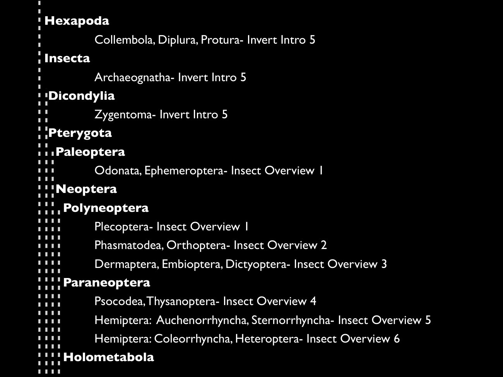](slides/slide-10.jpg)

So what does that mean for the orders that we're going to cover? So we've already done the non insect hexapod and the non winged insects. So that's, hexapods: Collembola [list incomplete].

And insects within the insects We've talked about Archaeognatha which do not have dicondylic mandibles. No, then. Zygentoma which do not have wings.

They still have indirect fertilisation, but they have true chewing dicondylic mandibles th those are sister to the winged insects. The pterygotes, which include Odonata and Ephemeroptera are non neopteran pterygotes. So they do not have, they have They do not have indirect flight muscles.

In other words, they have direct flight muscles powering their wings. We'll talk about that in the next. A lecture along with an aquatic order of Polyneoptera the Plecoptera.

So Polyneoptera is one of the three major lineages of Neoptera. So those are winged insects where the wings can fold over the body. Polyneoptera includes Plecoptera.

Phasmatodea and Orthoptera are the walking sticks, grasshoppers, crickets. That'll be another lecture. Then Another group of Polyneoptera, includes the earwigs, Web spinners and Dictyoptera are the Mantis, Roaches and termites.

Then we'll get into the Paraneoptera. Psocodea are the lice. Thysanoptera are the thrips, And then we break up the Hemiptera into two, smaller lectures.

So that is, all of the insects that will cover up to the Holometabola where the diversity really skyrockets.

[↑ Slides](#slides) · [Course index](../../README.md)

## Slide 11

[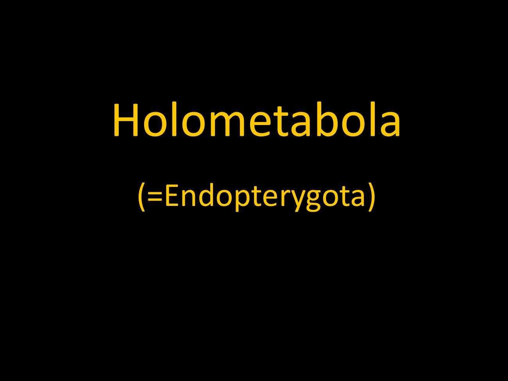](slides/slide-11.jpg)

So the Holometabola, also known as Endopterygota because the wings are developed inside the pupa.

[↑ Slides](#slides) · [Course index](../../README.md)

## Slide 12

[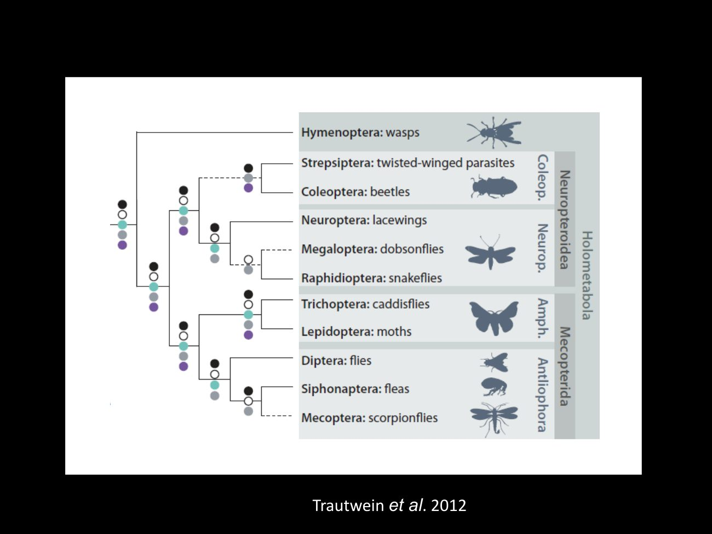](slides/slide-12.jpg)

This is a, review of the relationships of the holometabolous orders. So we're going to cover all the orders that occur in Australia. Which is all these, except for.

[↑ Slides](#slides) · [Course index](../../README.md)

## Slide 13

[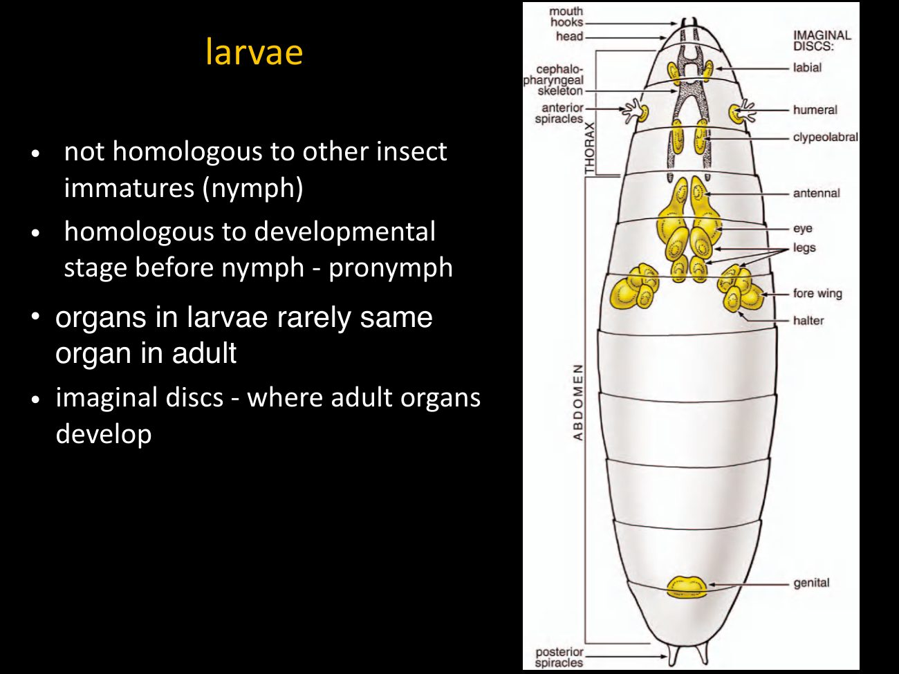](slides/slide-13.jpg)

So what is different about Holometabola, as compared to other insects is that they have, an egg larva, pupa and adult developmental stages. So the larva is not the same as the nymphs in the non holometabolous insects. Instead, it's a stage in between the egg and the nymph.

So, it's essentially almost like a, an slightly more mobile, highly evolved egg that can feed so in the larva, the adult organs are not, developed. They're not that they're present in the form of imaginal disc clumps of cells and those waiting until the pupal stage to develop.

> **Editorial note:** The larva–pronymph homology is a developmental interpretation presented in the lecture.

[↑ Slides](#slides) · [Course index](../../README.md)

## Slide 14

[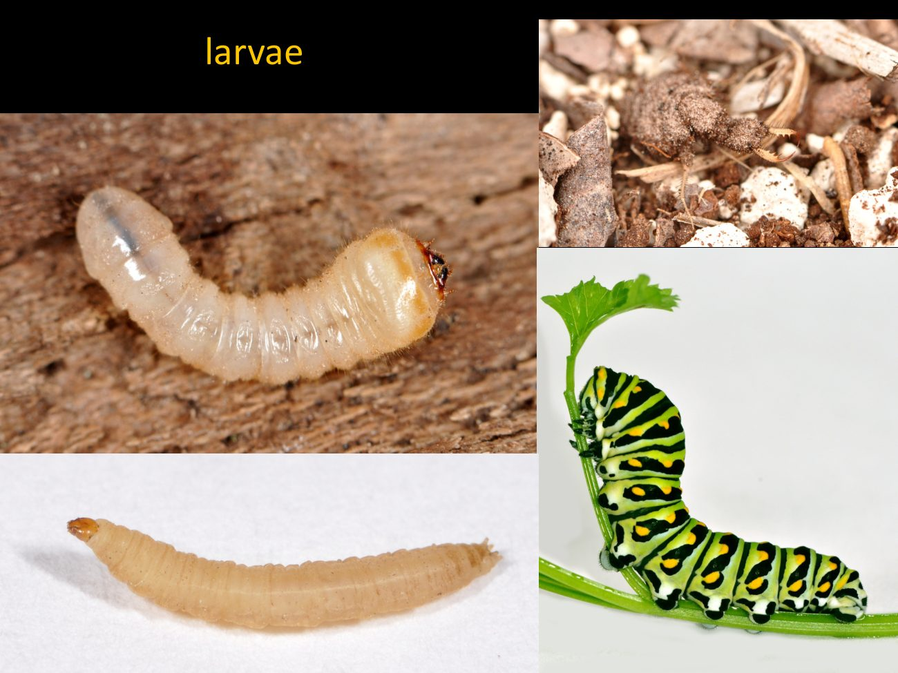](slides/slide-14.jpg)

Here's some examples of larvae. They're extremely different from the adults. This allows these insects to, take advantage of a diverse number of food resources from ephemeral patches of water or, annual plants.

Or there's a lot that are parasitoids that will attack other insects go down on the soil. Whereas the adults can, develop wings and fly away and find mates and new food sources. So this partitioning of the, ecological niches, between the developmental stages has contributed hugely to the diversification of this group of insects.

[↑ Slides](#slides) · [Course index](../../README.md)

## Slide 15

[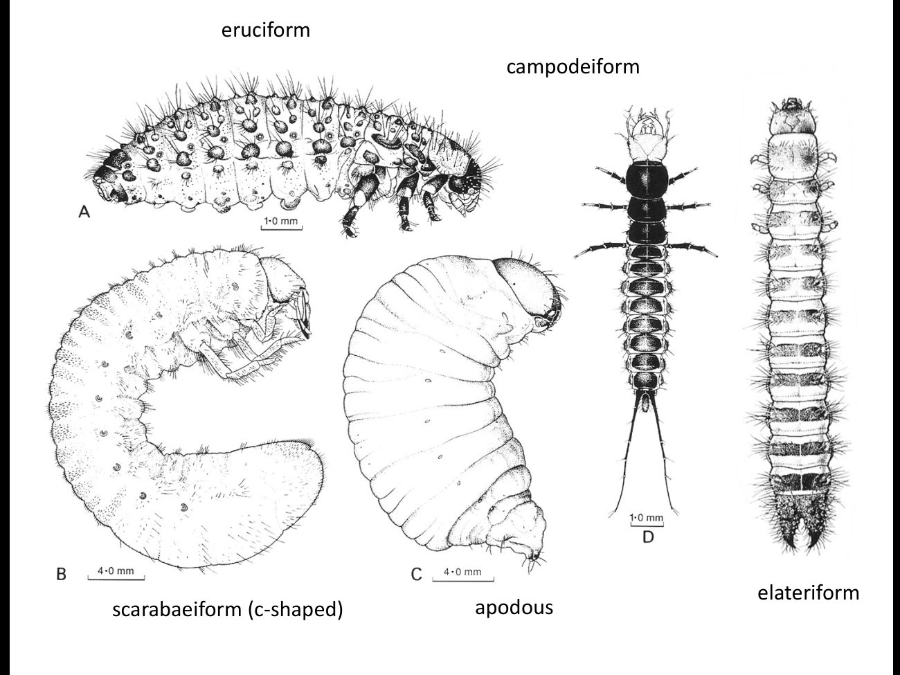](slides/slide-15.jpg)

We talk about some different forms of larvae, so caterpillar, like ones are called eruciform. There's some that are lacking legs. There are apodous larvae.

Some are C shaped down in the soil. There's a scarabaeiform, elateriform are ones with, that are long that live down the soil, have short leg, and then the campodeiform, have long longer legs and are running around more predatory so that campodeiform is a family of Diplura. So those kind of look like diplurans is the idea.

There.

[↑ Slides](#slides) · [Course index](../../README.md)

## Slide 16

[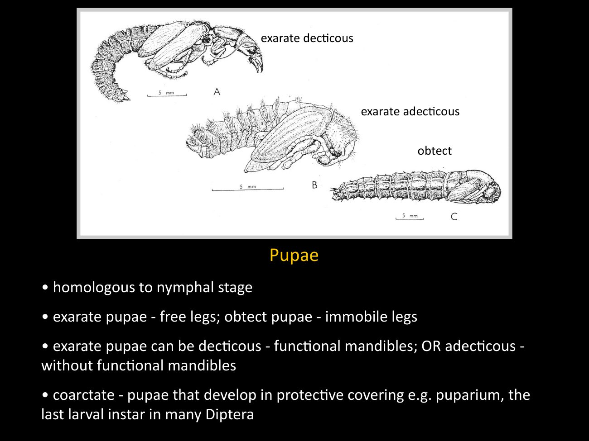](slides/slide-16.jpg)

Let me also explain about pupae. So this is the next stage after larvae and it is incredibly important in the development for these insects. So the pupae is actually what the nymphs are in other insects.

So essentially, they're nymphs that don't feed. They just, sit and develop the adult, morphological characteristics. But still, pupae are quite diverse.

Different species will have very different looking pupae. And there's some general, terms that might come up describing different types of pupae. So one is that whether they're exarate or obtect So what exarate means is when the pupa is developing, you can see the adult structures externally on the pupa, so you can see the wings, legs, mouth, parts and antennae.

So a lot of things like Megaloptera will be exarate. Another subcategory of that is decticous or adecticous. So that's whether their mouth parts are visible or not.

And Some pupae can actually move, to avoid predators or even defend themselves with their mandibles. So some are You can see the wings, the legs, but are adecticous. The mouth parts are not, visible.

And then a lot of other pupae are obtect or coarctate. So obtect means you can't see the legs, and other structures and coarctate means the pupation occurs within another structure using the last larval skin so you can't see any, part of the adult inside the pupal while it's pupating that occurs in a lot of flies.

> **Editorial note:** Decticous/adecticous distinguish functional versus nonfunctional mandibles, not merely whether mouthparts are visible. Exarate/obtect distinguish free versus closely attached appendages. The source’s simplified wording is retained.

[↑ Slides](#slides) · [Course index](../../README.md)

## Slide 17

[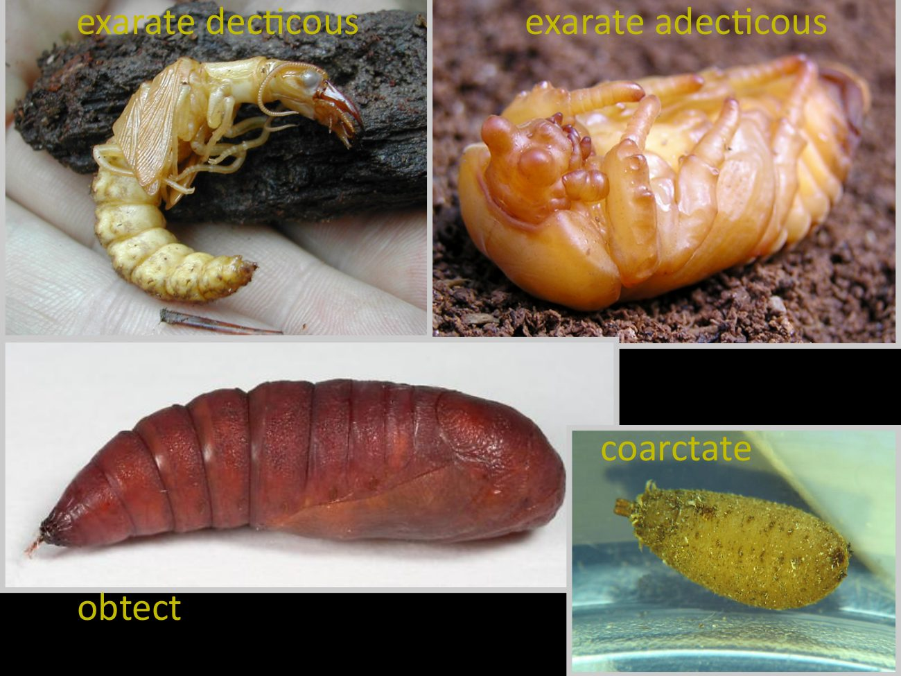](slides/slide-17.jpg)

So more examples. Exarate. You can see the legs and decticous the mandibles are out ate.

You can see the legs, but the mandibles are not visible obtect. You can kind of see the wing there, but overall, you can't really see any external structures of the adult and coarctate. It's essentially pupating inside a shell, the last larval skin, and you can't see the adult characteristics.

[↑ Slides](#slides) · [Course index](../../README.md)

## Slide 18

[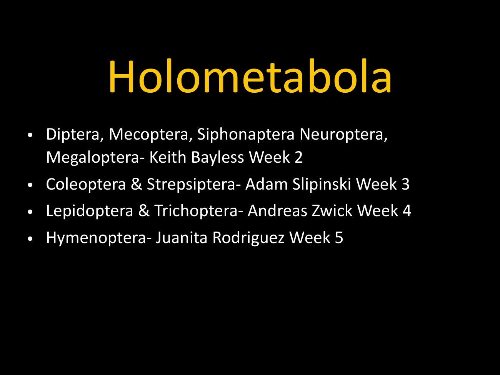](slides/slide-18.jpg)

So in the Holometabola, that's what most of the course, the remaining part of the course will be focused on next week we'll learn about flies and some relatives and then beetles the Coleoptera, then lepidoptera and relatives, the butterflies and moths and then Hymenoptera, the bees, wasps and ants.

[↑ Slides](#slides) · [Course index](../../README.md)

## Slide 19

[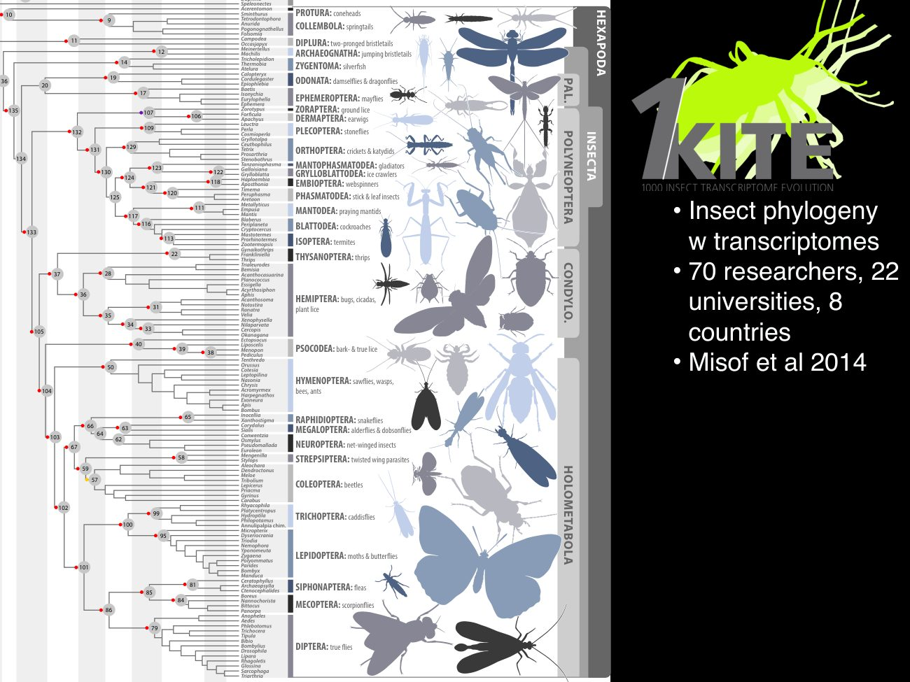](slides/slide-19.jpg)

So this will be something that comes up throughout the course, which is the largest phylogeny of insects in terms of, genes and representatives. And, overall, when you're looking through this, you can see those major groups [unclear name] is another term for Paraneoptera, then the holo metabolic. This really matches.

The overall classification we're discussing, except that in this the lice are not, close to the bugs. But that's, an unclear part of the, biology at the moment. But we're going to work our way through, the this all these insects with a lot of focus on the most diverse lineages in the Holometabola.

[↑ Slides](#slides) · [Course index](../../README.md)

## Source notice

this material has been reproduced and communicated to you by or on behalf of the Australian National University In accordance with section 113 P of the Copyright Act 1968. The material in this communication may be subject to copyright under the act. Any further reproduction or communication of this material by you must be consistent with the provisions of the act. Do not reproduce this material. Do not remove this notice.

[← Previous lecture](../05-invertebrate-intro-part-5-hexapoda-and-non-pterygotes/README.md) · [Course index](../../README.md) · [Next lecture →](../07-invertebrate-intro-part-7-insect-overview-aquatics-paleoptera-plecoptera/README.md)
