# Invertebrate Intro Part 7 - Insect Overview - Aquatics - Paleoptera, Plecoptera

[← Previous lecture](../06-invertebrate-intro-part-6-major-insect-lineages/README.md) · [Course index](../../README.md) · [Next lecture →](../08-invertebrate-intro-part-8-insect-overview-2-polyneoptera-1-phasmatodea-orthoptera/README.md)

**Slides + cleaned transcript** · 19 slides

English transcript with fillers and repeated false starts removed. Technical terms are corrected using the slides and context. Bracketed wording marks reconstruction or uncertainty. Slide boundaries are inferred from content; the transcripts have no slide timestamps.

[Original transcript](original-transcript.txt) · [Text-only version](cleaned-transcript.md) · [Editing notes](../../EDITING-NOTES.md) · [Correction record](corrections.md)

[Searchable slide text](slide-text.md). Click a slide image to open it at full size.

## Slides

[1](#slide-1) · [2](#slide-2) · [3](#slide-3) · [4](#slide-4) · [5](#slide-5) · [6](#slide-6) · [7](#slide-7) · [8](#slide-8) · [9](#slide-9) · [10](#slide-10) · [11](#slide-11) · [12](#slide-12) · [13](#slide-13) · [14](#slide-14) · [15](#slide-15) · [16](#slide-16) · [17](#slide-17) · [18](#slide-18) · [19](#slide-19)

## Slide 1

[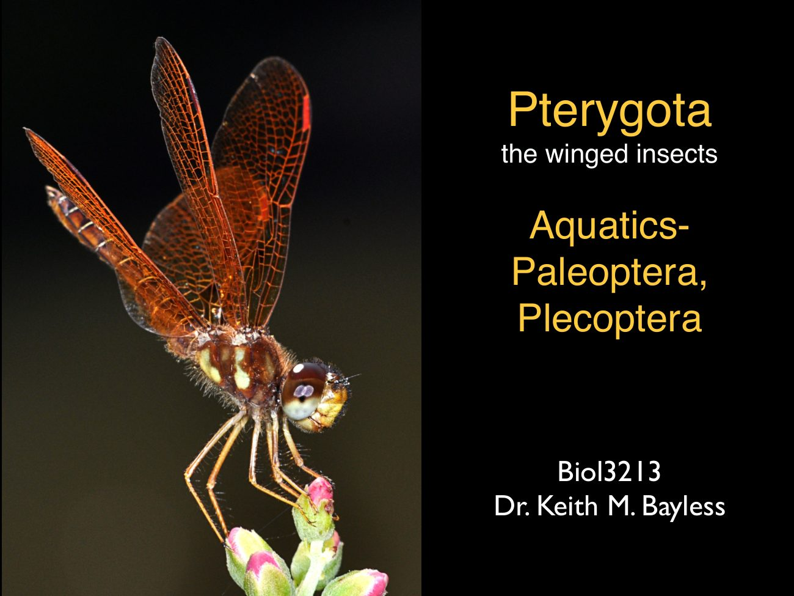](slides/slide-01.jpg)

Onto the winged insects. Now we will cover three orders representing two major lineages of wing winged insects that is the Odonata and Ephemeroptera which are part of the Palaeoptera and then the Plecoptera which are part of the Polyneoptera. All three of these have aquatic, immature aquatic nymphal stages or naiads if you are familiar with Greek mythology.

[↑ Slides](#slides) · [Course index](../../README.md)

## Slide 2

[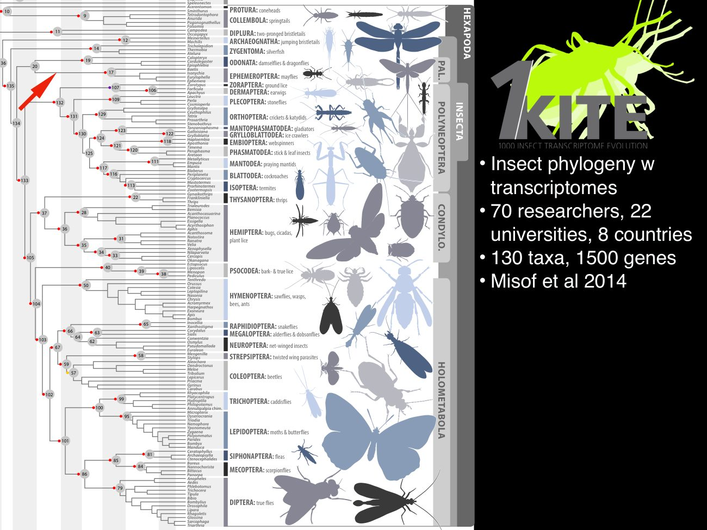](slides/slide-02.jpg)

So the Palaeoptera fall out here in the overall phylogeny of insects, sister to the Neoptera.

[↑ Slides](#slides) · [Course index](../../README.md)

## Slide 3

[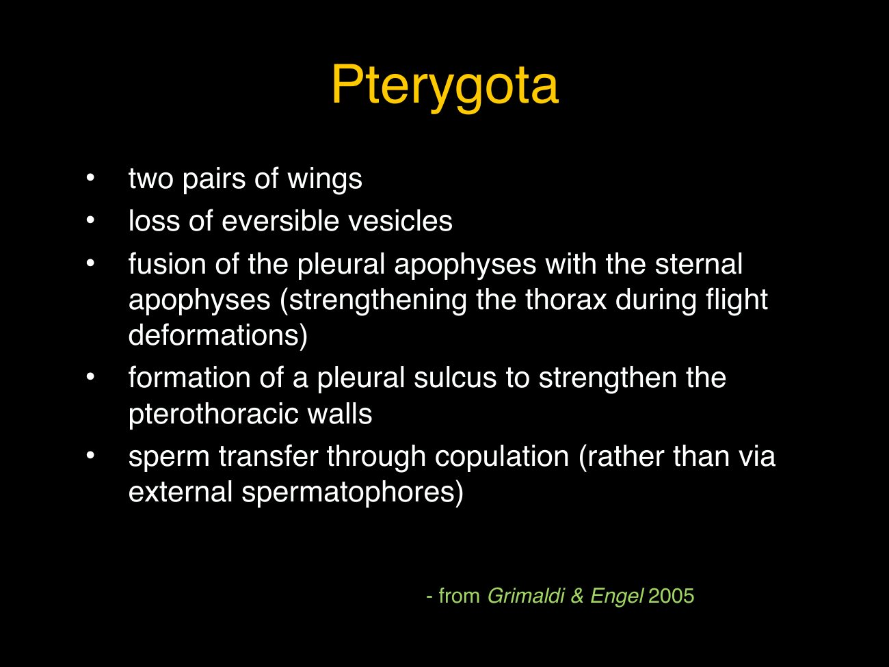](slides/slide-03.jpg)

As a reminder. The pterygotes, the winged insects, all extant species have two pairs of wings and they have, direct fertilisation. And the thorax is heavily modified to allow for muscle attachments to power flight.

> **Editorial note:** Two pairs of wings describes the ancestral winged condition, not every living pterygote: many lineages have reduced or lost wings.

[↑ Slides](#slides) · [Course index](../../README.md)

## Slide 4

[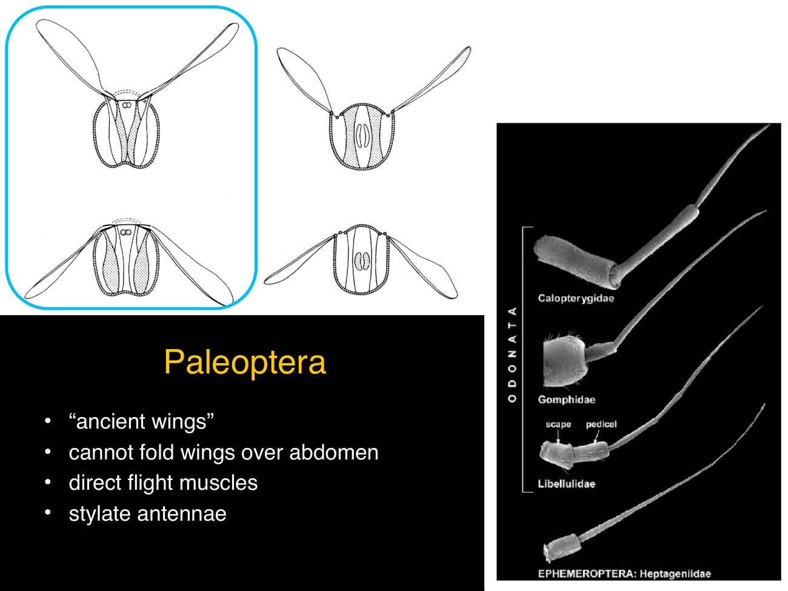](slides/slide-04.jpg)

In the Palaeoptera. That's the two orders we talk about first the Odonata and Ephemeroptera. They have direct flight muscles.

So there the muscles of the thorax connect to the base of the wing. And the contraction of those muscles are what powers flight. So they can't fold the wings back over each other over the abdomen.

But they are still very good flyers and very adept and still relatively diverse. Although the Neoptera that where they can fold the wings and they have indirect flight are much more diverse. All of these palaeopterans also share stylate antennae where the, scape, pedicel and flagellum are present.

But the flagellum is reduced into, a stylus.

[↑ Slides](#slides) · [Course index](../../README.md)

## Slide 5

[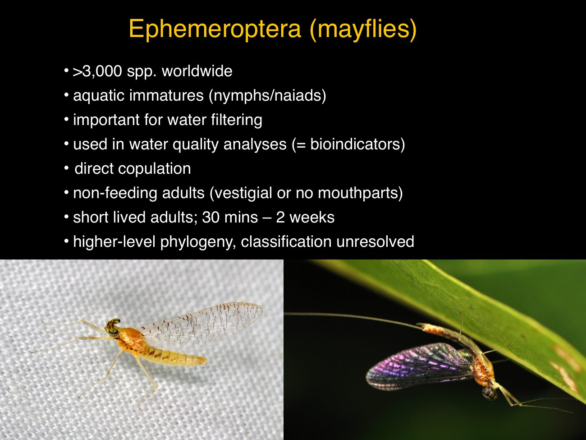](slides/slide-05.jpg)

Ephemeroptera is the first order, we will cover these have, aquatic immature, and they're quite diverse and important in mainly stream ecosystems. Many species are sensitive to the PH and other factors in the water, so they're used as bio indicators. Certain species or more diversity of Ephemeroptera can indicate that certain bodies of water are more or less, polluted.

These have direct copulation, between the males and females. But the final adult stage does not feed that reproductive adult stage often is very short lived, the may fly, terminology. It refers to the month that they come out in the Northern Hemisphere, but it's just generally kind of a term for something that, lives for a very short time.

However, the lifespan, including the larva sorry the nymph, the egg and the nymph can still be a year or longer. It's just the reproductive adult stage that's out for a short amount of time. May flies.

There's a lot of research left to be done on them. The family level classification is tumultuous.

[↑ Slides](#slides) · [Course index](../../README.md)

## Slide 6

[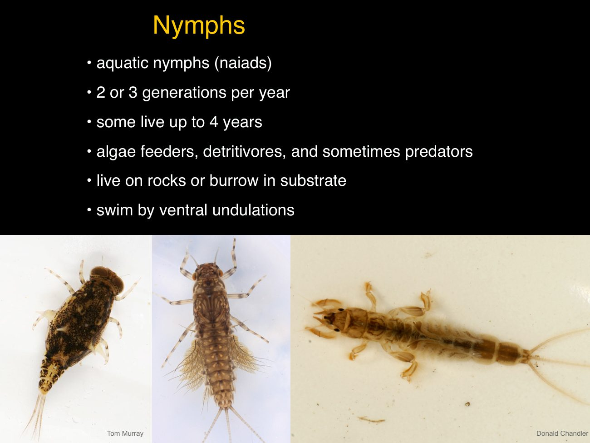](slides/slide-06.jpg)

Let's talk about the naiads. They can have two or three generations per year in, some ecosystems, depending on the species, but some can live up to four years in the same water source. Generally, they feed on algae or sift through, substrate in the water source for, the detritus to look for food sources.

And there's some predatory ones. That one, the longer one on the side is a predatory one with more strengthened mandibles. A lot of them will live kind of sitting on the rock swimming around or will burrow down into the substrate into the bottom of the stream or lake, and they swim by, undulating their abdomen.

You can see there's gills along the side of the abdomen.

[↑ Slides](#slides) · [Course index](../../README.md)

## Slide 7

[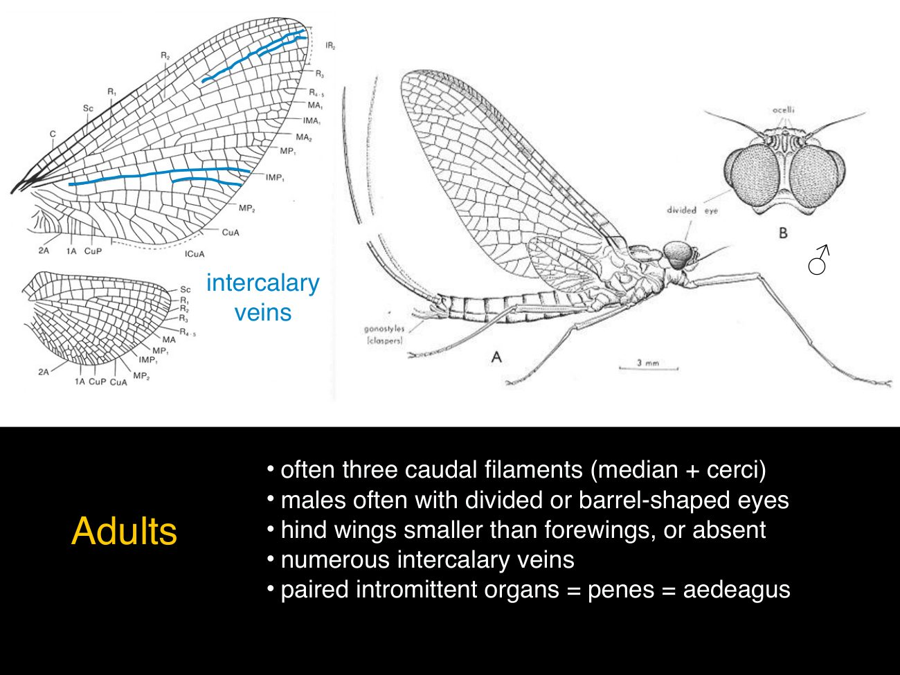](slides/slide-07.jpg)

The adults, are quite distinctive. They have three caudal filaments, so there's a medium filament along with the two cerci. The males often have a lot of, elaborate morphology for finding the females during mating, including different shaped eyes, for instance, barrels that will poke out one part of the eye to raise the surface.

The wing venation is, complex and complete with a lot of intercalary veins. Those are the things highlighted in blue, where in other words, if you follow a true wing vein from the margin to the base of the wing, you can see where the wing traces from. But intercalary veins end in the margin, but start just kind of in the middle of the, wing.

They also have paired intromittent organs. Unlike a lot of other insects that have direct copulation.

[↑ Slides](#slides) · [Course index](../../README.md)

## Slide 8

[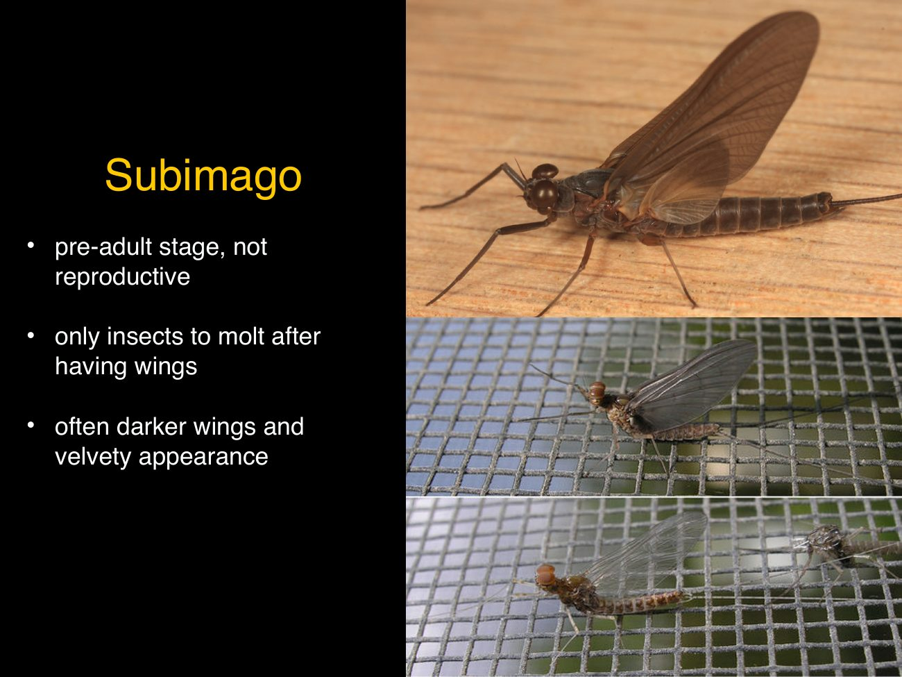](slides/slide-08.jpg)

May flies are unique among winged insects because there is a preadult stage that has wings and can fly these are the only insects where this is present. So this is called the sub imago. The imago is the adult.

So the, they moult after they've again after they've developed wings, they moult and only that second, wing stage can mate often. These subimagos are, kind of velvety and dark in the wings. Since they're going to moult again.

[↑ Slides](#slides) · [Course index](../../README.md)

## Slide 9

[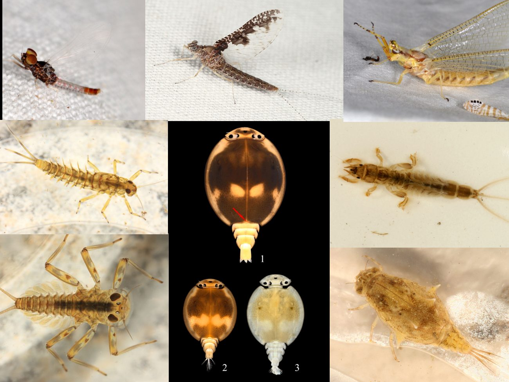](slides/slide-09.jpg)

Here's a slide just showing some of the diversity of, May flies. You can see some of the barrel eyes. Some are quite large and colourful, different wing patterns and the larvae, particularly that the nymphs are, quite diverse.

Some are heavily armoured. There's some that, kind of look like little disc crustaceans or something. That protect themselves sitting on the rocks, long legs, really diverse, immature stages in their water sources.

[↑ Slides](#slides) · [Course index](../../README.md)

## Slide 10

[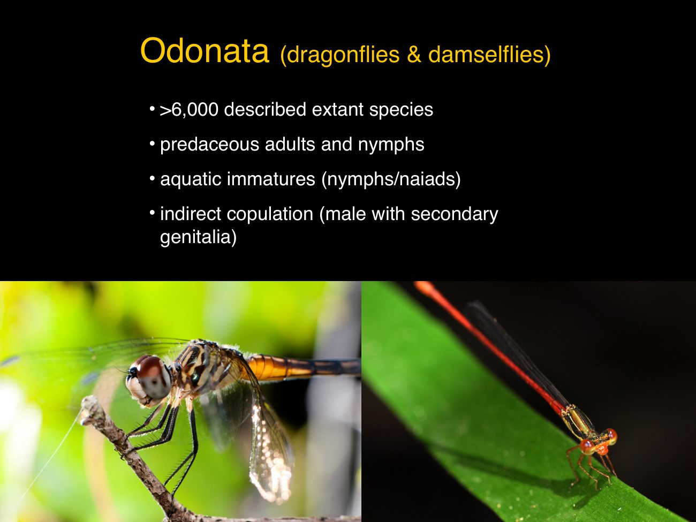](slides/slide-10.jpg)

That's it for the Ephemeroptera. So we'll move on to Odonata. They're a bit more diverse than Ephemeroptera, but also much better studied and very well appreciated.

These are the Dragonflies and damselflies. So those two represent two major lineages within Odonata, and the name is referring to the mandibles. They have strong mandibles, since the adults and nymphs are all predatory.

So these again have aquatic immatures and have, direct fertilisation. But it's indirect on the male's body, so I'll explain that in a subsequent slide, it's quite unique to Odonata.

[↑ Slides](#slides) · [Course index](../../README.md)

## Slide 11

[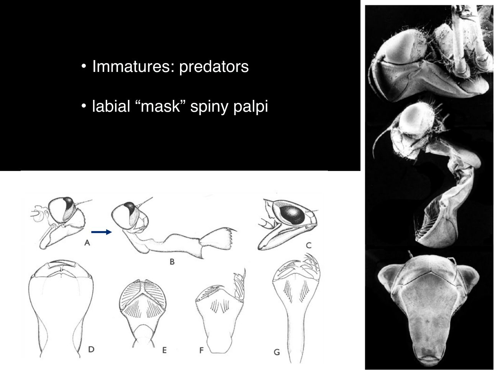](slides/slide-11.jpg)

The nymphs are predatory in water sources, and they catch prey through their heavily modified labial mask. So the labium is enlarged and elbowed, and the palpi are spiny, and they shoot the mask out from the base of their face to catch prey. So this is a character that's only found in Odonata, nymphs.

[↑ Slides](#slides) · [Course index](../../README.md)

## Slide 12

[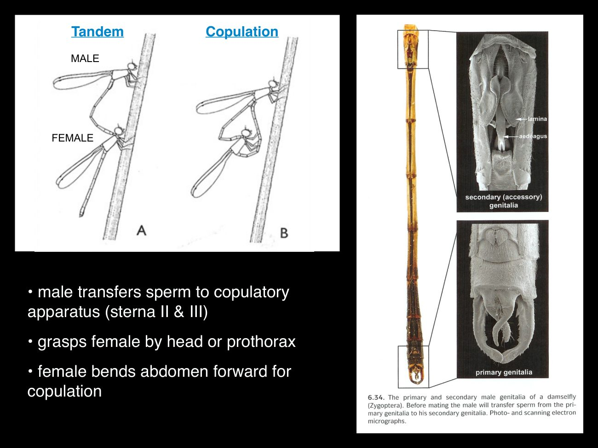](slides/slide-12.jpg)

That indirect, copulation, which is still a kind of direct fertilisation. I'll explain here quite a unique character for Dragonflies and damselflies. So what happens is that the sperm is produced in the posterior part of the abdomen of the male, as it is in all other insects.

But the rest of that abdomen instead, that the primary genitalia, is just clasps. What the male does is produces sperm and then flips his abdomen around and deposits the sperm and in the interior part of the abdomen, where there's the secondary accessory genitalia. And that's where the intromittent organ is placed.

So what the male then does is uses the primary genitalia to grab the female behind the head. And then the female, if she wants, will move her abdomen up to touch the anterior part on the male's abdomen, where the intromittent organ is placed. So when they're mating, they form this kind of heart shape.

And then often the male will keep holding on to the female until she lays the eggs that have been fertilised.

[↑ Slides](#slides) · [Course index](../../README.md)

## Slide 13

[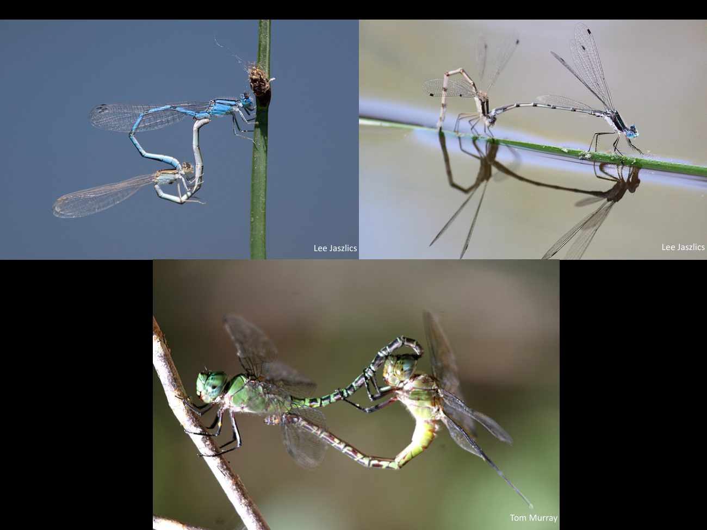](slides/slide-13.jpg)

Dragonflies and damselflies are really diverse. These are all Dragonflies. One major difference is that Dragonflies, when they're at rest, they don't fold their wings up.

Instead, their wings are held, to the side. These are all, very important predators in a lot of ecosystems. Very successful.

Excellent flyers, and also quite diverse and colour. Colourful and well appreciated.

[↑ Slides](#slides) · [Course index](../../README.md)

## Slide 14

[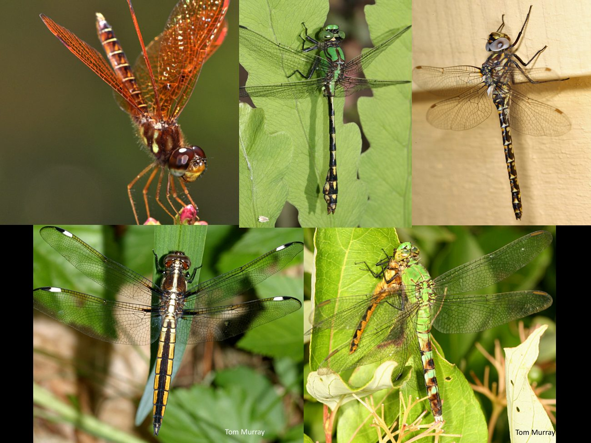](slides/slide-14.jpg)

The damsel flies, can fold their wings up, but not back over the body just up touching each other. Usually more slender and gracile. And they can catch prey that are sitting on substrates along with in the air.

[↑ Slides](#slides) · [Course index](../../README.md)

## Slide 15

[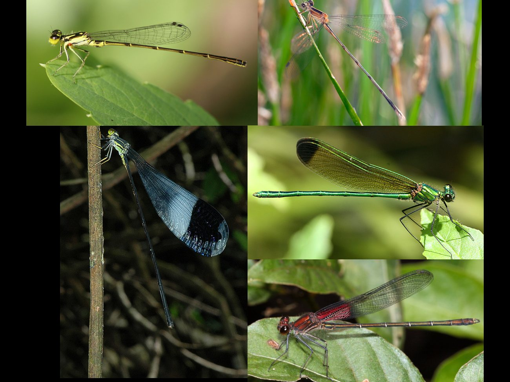](slides/slide-15.jpg)

*No separate passage can be confidently assigned to this slide. [Nearby discussion: slide 14](#slide-14).*

[↑ Slides](#slides) · [Course index](../../README.md)

## Slide 16

[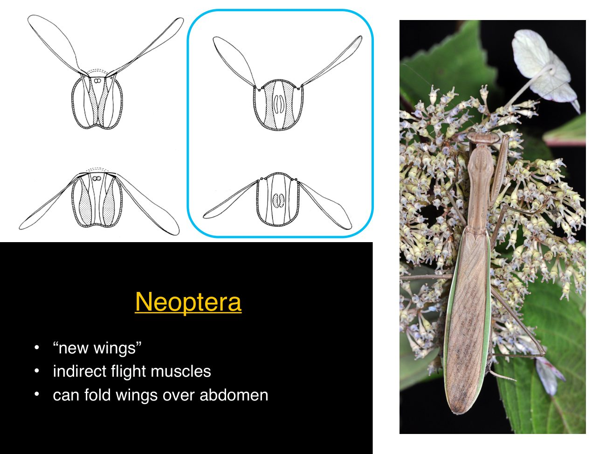](slides/slide-16.jpg)

So that's it for the Palaeoptera All other insects that we'll talk about are in the Neoptera So these have indirect flight muscles where the muscles, power flight by deforming the thorax itself and they can fold the wings back over the abdomen.

[↑ Slides](#slides) · [Course index](../../README.md)

## Slide 17

[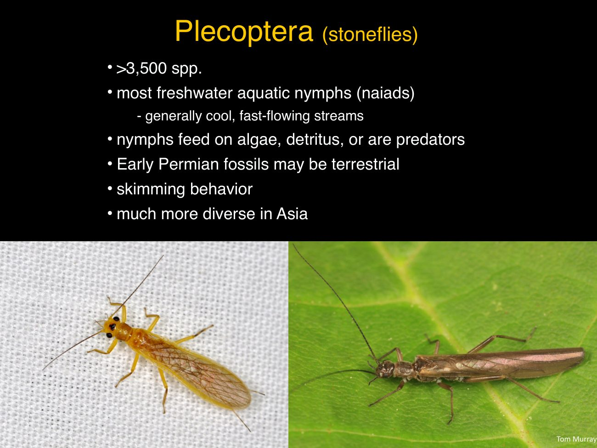](slides/slide-17.jpg)

So the order we'll talk about in Neoptera today is called Plecoptera. These also have aquatic immature, similar to May flies and Dragonflies. Some kind of get into muddy soil and stuff.

But generally they're freshwater, aquatic and streams. The nymphs again can feed on algae or general detritivore, or can be, predators. In some lineages, the earliest fossils may in fact be terrestrial, which would make sense as their other neopteran relatives or are terrestrial.

This is probably a secondary, reversion to aquatic immature. And there's there's plenty in Australia, but they're mostly diverse in Asia. The skimming is when the adults first emerge in the body of water, they can fly, but they also will use their wings to skate along the surface of the water.

[↑ Slides](#slides) · [Course index](../../README.md)

## Slide 18

[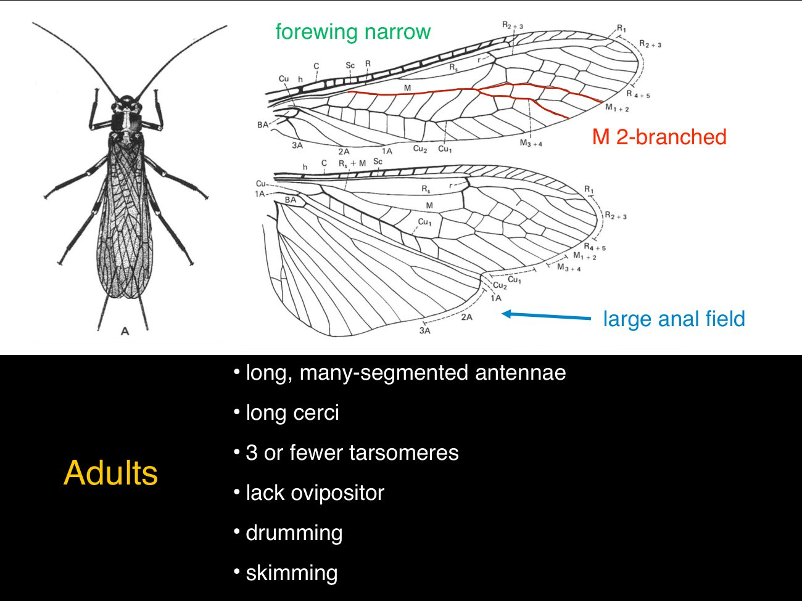](slides/slide-18.jpg)

Along with that, the adults are distinct because they have long antennae, long cerci, no median filament three or fewer tarsomeres, unlike five with a lot of insects. There's no true ovipositor, and the adults communicate with each other by drumming their abdomen on the surface of the water. And like I mentioned, the adults can skim along the water along with flying.

> **Editorial note:** The lecture says drumming occurs on the water surface. Stonefly courtship drumming commonly transmits vibrations through solid substrates; the source wording is retained.

[↑ Slides](#slides) · [Course index](../../README.md)

## Slide 19

[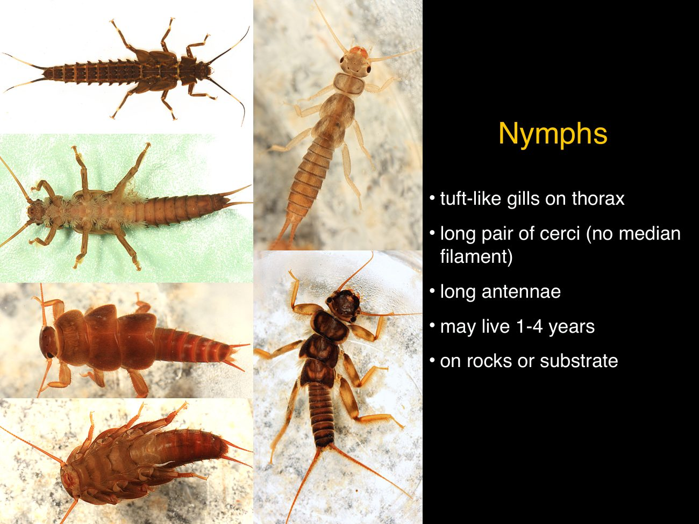](slides/slide-19.jpg)

The nymphs of Plecoptera, have gills on the thorax. Unlike most May flies where they're on the abdomen. They have the long cerci visible and long antennae and tend to be quite long lived, diverse in their overall appearance, living on rocks and in the bottom of streams.

So those are the three major, aquatic, non holometabolous. Orders of insects all quite important in their ecosystems, but quite diverse in their morphology and characteristics.

[↑ Slides](#slides) · [Course index](../../README.md)

## Source notice

this material has been reproduced and communicated to you by or on behalf of the Australian National University in accordance with Section 113 P of the Copyright Act 1968. The material in this communication may be subject to copyright Under the act, any further reproduction or communication of this material by you must be consistent with the provisions of the act. Do not reproduce this material. Do not remove this notice

[← Previous lecture](../06-invertebrate-intro-part-6-major-insect-lineages/README.md) · [Course index](../../README.md) · [Next lecture →](../08-invertebrate-intro-part-8-insect-overview-2-polyneoptera-1-phasmatodea-orthoptera/README.md)
