# Invertebrate Intro Part 8 - Insect Overview 2 - Polyneoptera 1 - Phasmatodea, Orthoptera

[← Previous lecture](../07-invertebrate-intro-part-7-insect-overview-aquatics-paleoptera-plecoptera/README.md) · [Course index](../../README.md) · [Next lecture →](../09-invertebrate-intro-part-9-insect-overview-3-polyneoptera-2-dictyoptera-etc/README.md)

**Slides + cleaned transcript** · 20 slides

English transcript with fillers and repeated false starts removed. Technical terms are corrected using the slides and context. Bracketed wording marks reconstruction or uncertainty. Slide boundaries are inferred from content; the transcripts have no slide timestamps.

[Original transcript](original-transcript.txt) · [Text-only version](cleaned-transcript.md) · [Editing notes](../../EDITING-NOTES.md) · [Correction record](corrections.md)

[Searchable slide text](slide-text.md). Click a slide image to open it at full size.

## Slides

[1](#slide-1) · [2](#slide-2) · [3](#slide-3) · [4](#slide-4) · [5](#slide-5) · [6](#slide-6) · [7](#slide-7) · [8](#slide-8) · [9](#slide-9) · [10](#slide-10) · [11](#slide-11) · [12](#slide-12) · [13](#slide-13) · [14](#slide-14) · [15](#slide-15) · [16](#slide-16) · [17](#slide-17) · [18](#slide-18) · [19](#slide-19) · [20](#slide-20)

## Slide 1

[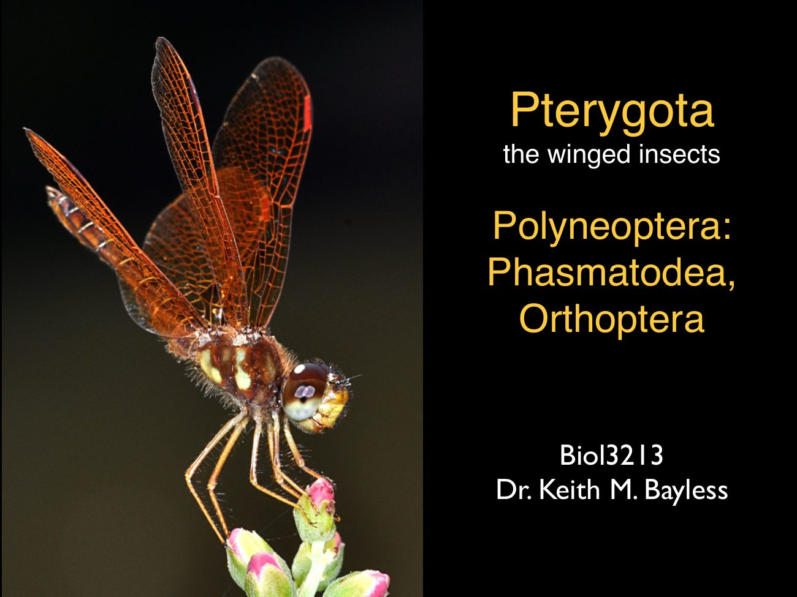](slides/slide-01.jpg)

On to additional groups of Neoptera in the Polyneoptera. We will cover two orders of, Polyneoptera.

[↑ Slides](#slides) · [Course index](../../README.md)

## Slide 2

[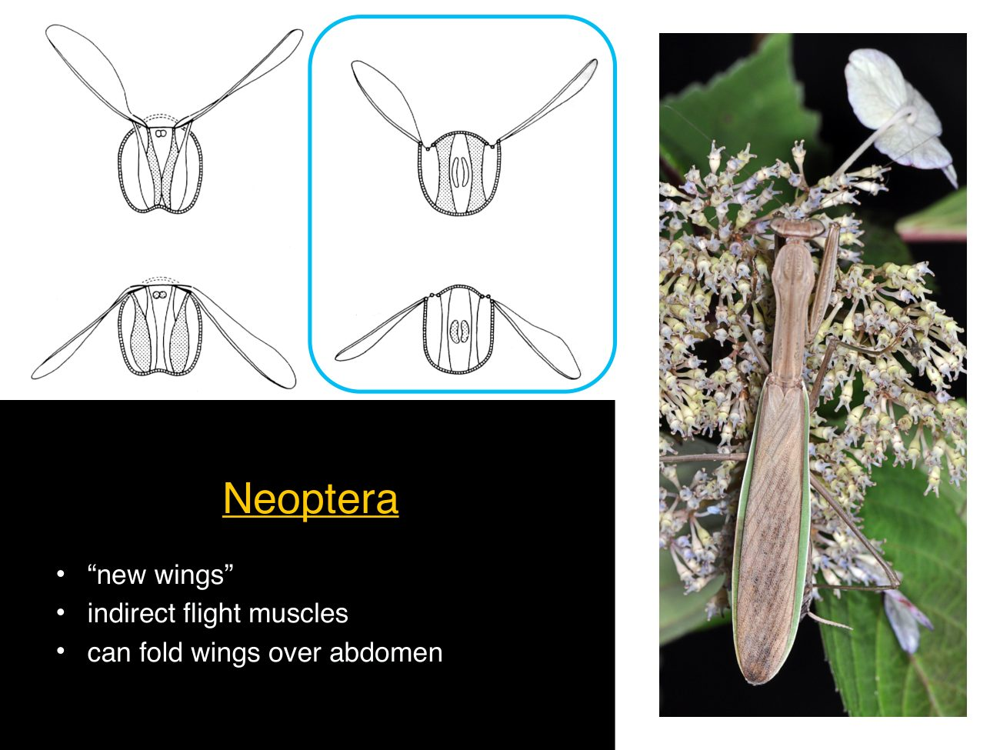](slides/slide-02.jpg)

As a reminder that Neoptera these are insects that have indirect flight muscles and can fold their wings back over the abdomen.

[↑ Slides](#slides) · [Course index](../../README.md)

## Slide 3

[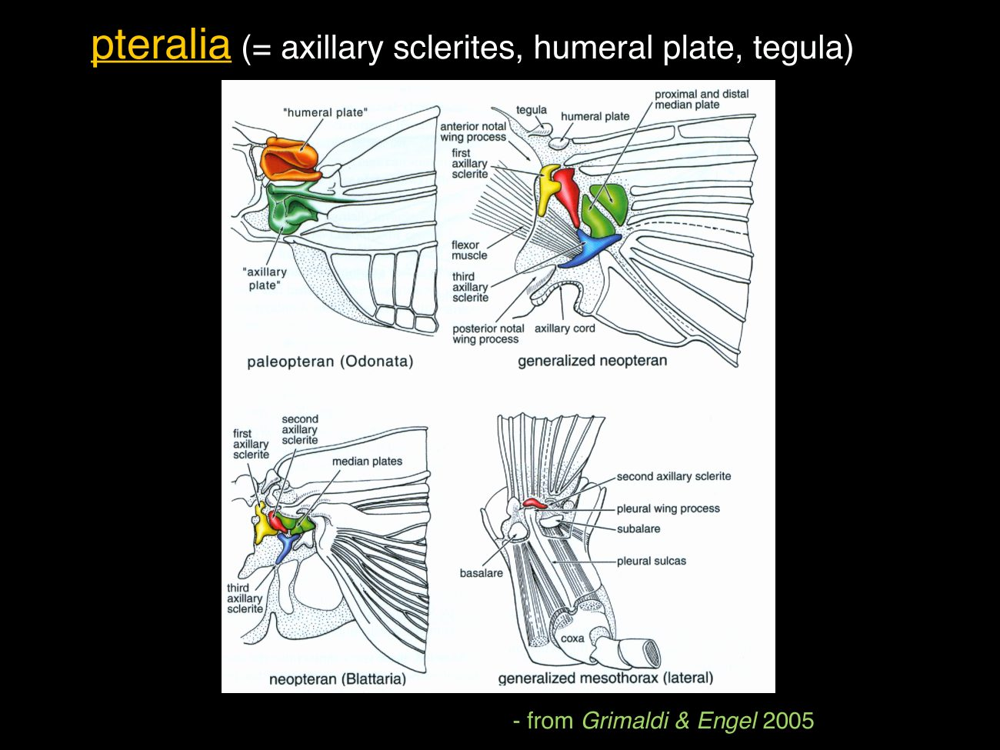](slides/slide-03.jpg)

This is accomplished by the plates that are present on the base of a wing is something like Odonata, instead being divided into various sclerites that have different shapes and muscle attachments. So some of these sclerites can help the wing fold back over the body, and some of them have muscle attachments that helped direct the wing as it's flying so it could change the angle of the wing. But the power of the wing, the up and down flapping, is done by the deformation of the thorax itself.

[↑ Slides](#slides) · [Course index](../../README.md)

## Slide 4

[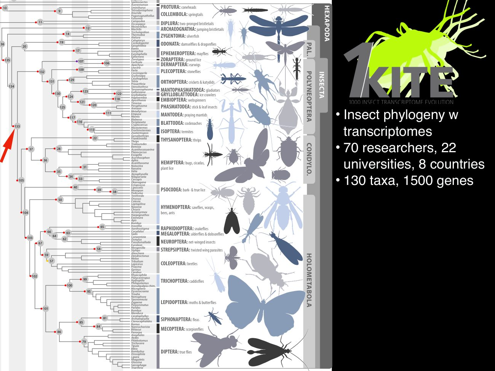](slides/slide-04.jpg)

So this is, the Neoptera, and we're going to get into the first major lineage of the Neoptera.

[↑ Slides](#slides) · [Course index](../../README.md)

## Slide 5

[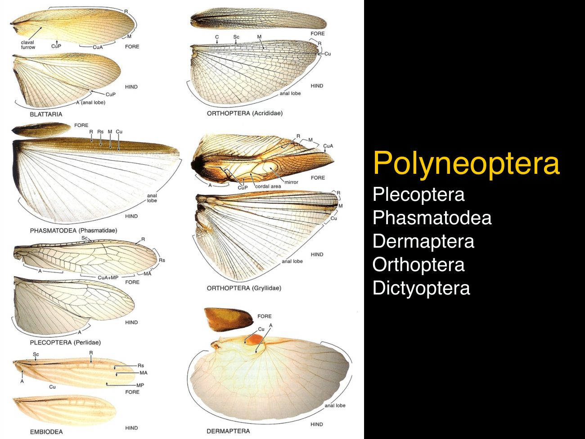](slides/slide-05.jpg)

Which is Polyneoptera Neoptera.

[↑ Slides](#slides) · [Course index](../../README.md)

## Slide 6

[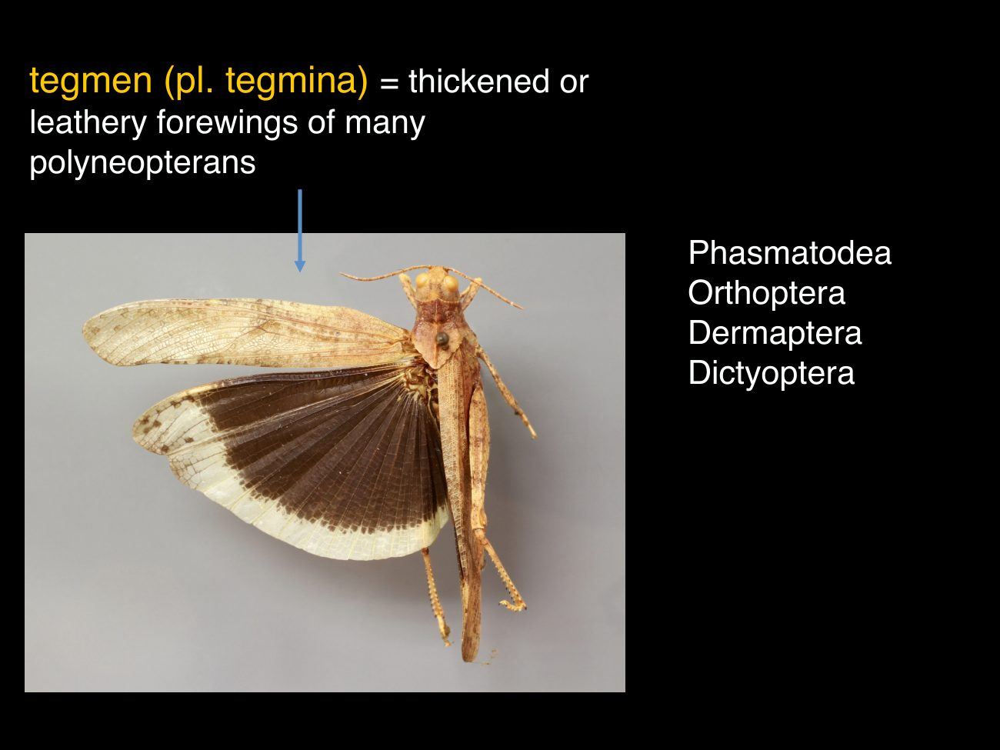](slides/slide-06.jpg)

So in Polyneoptera, the forewings are often thickened or reduced and look leathery and are held over the body for protection.

[↑ Slides](#slides) · [Course index](../../README.md)

## Slide 7

[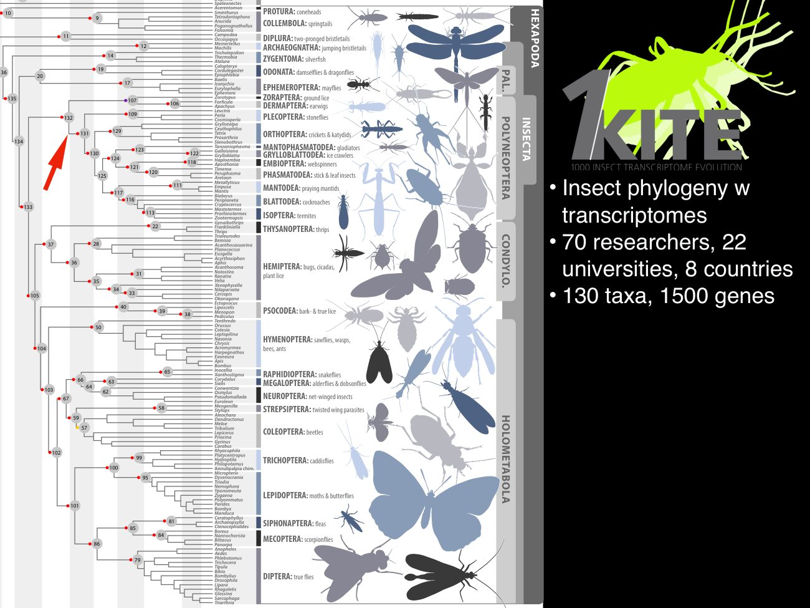](slides/slide-07.jpg)

So we'll get into, a couple of groups of the Polyneoptera otra over the next few lectures, we will not discuss, the Zoraptera or, Grylloblattodea [name uncertain] which don't occur in Australia.

[↑ Slides](#slides) · [Course index](../../README.md)

## Slide 8

[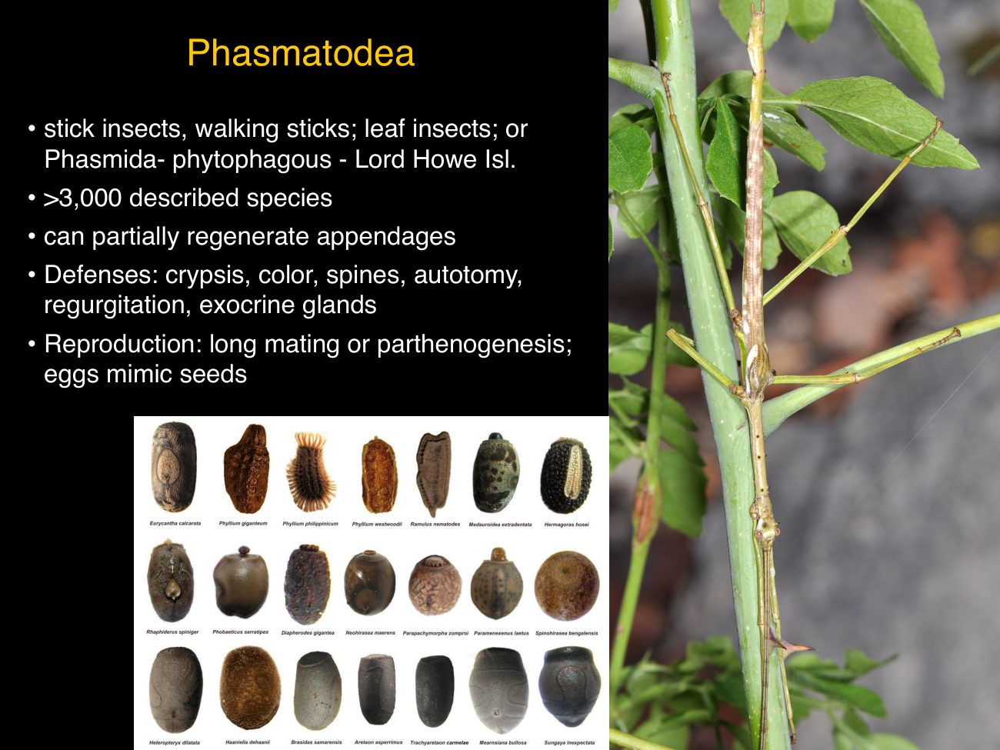](slides/slide-08.jpg)

Phasmatodea, the walking sticks or stick insects or leaf insects. These are very popular, insects. You can have them as pets.

A lot of the species. There's an endemic giant species on Lord Howe Island, which was rediscovered, with a collaboration of ANU and CSIRO scientists. They are quite diverse in their shape.

Some look like leaves. Some look like sticks. They're all, phytophagous.

And they can regenerate appendages if they're they're broken off the egg. Morphology is also diverse. Generally, their eggs are meant to mimic seeds of various plants, to help reduce, predation or parasitosis of defences to prevent predation.

So some, look like they're host plants. Other ones are, spiny and armoured. They can, lose legs on command or appendages on command, like some lizards do autotomy.

And some are chemically protected either through regurgitation or glands that can exude, nasty chemicals.

[↑ Slides](#slides) · [Course index](../../README.md)

## Slide 9

[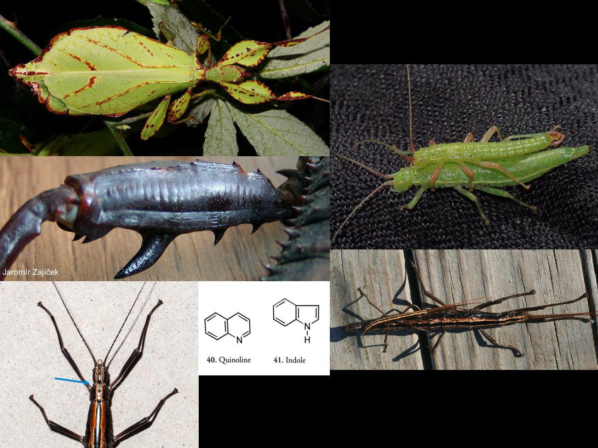](slides/slide-09.jpg)

So here's some examples of that, a leaf mimicking leaf insect, some with heavy spines for protection, a number that can spray noxious chemicals. Although not always noxious. There's one in far north Queensland that lives in Pandanus, where its chemical defence smells like peppermint, so don't get it in your eye.

But it is a, unusually pleasant smell. Some groups are a lot more reduced and look like a generalised, polyneopteran. But many are heavily, derived, and wings have been lost many different times throughout the evolution of stick insects.

So many are winged, and a lot are not as adults.

[↑ Slides](#slides) · [Course index](../../README.md)

## Slide 10

[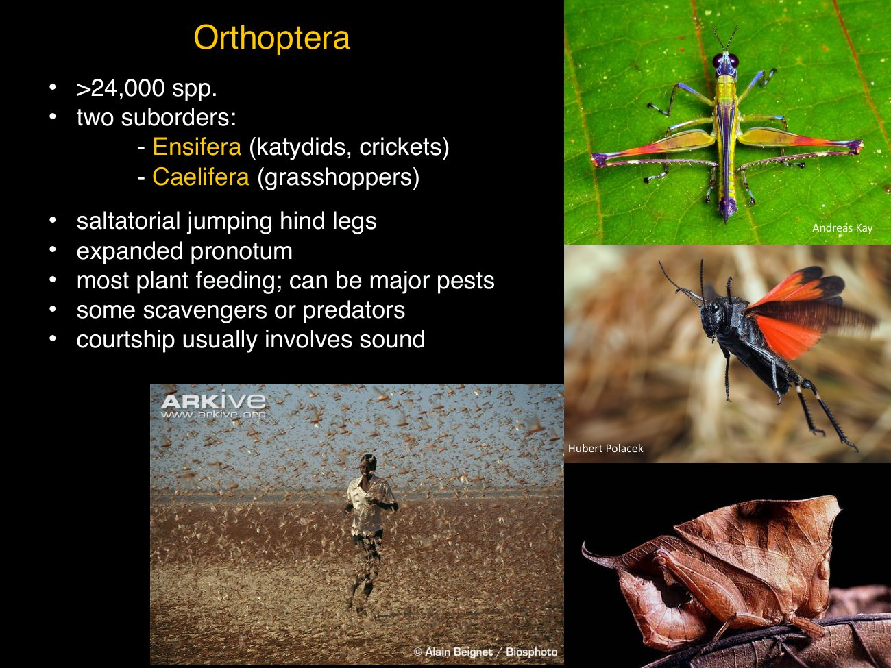](slides/slide-10.jpg)

The largest order, of Polyneoptera, the largest order outside of Hemiptera and the Holometabola is the Orthoptera. These are the grasshoppers, crickets, katydids and relatives. Their hind legs are always modified for jumping, and the pronotum is enlarged and goes over the head a bit and back over the wings of it.

Mostly, they feed on plants but are quite diverse. There are some that are scavengers and predators. And some of the plant feeding ones are pests.

Those are the Locusts that exhibit, polymorphism across generations, quite a complex life cycle. However, the nymphs and two adults are relatively similar looking. You can see the wing pads, and another major characteristic of Orthoptera is in most groups.

Their courtship, involves sound. They have to sing to each other to find mates.

[↑ Slides](#slides) · [Course index](../../README.md)

## Slide 11

[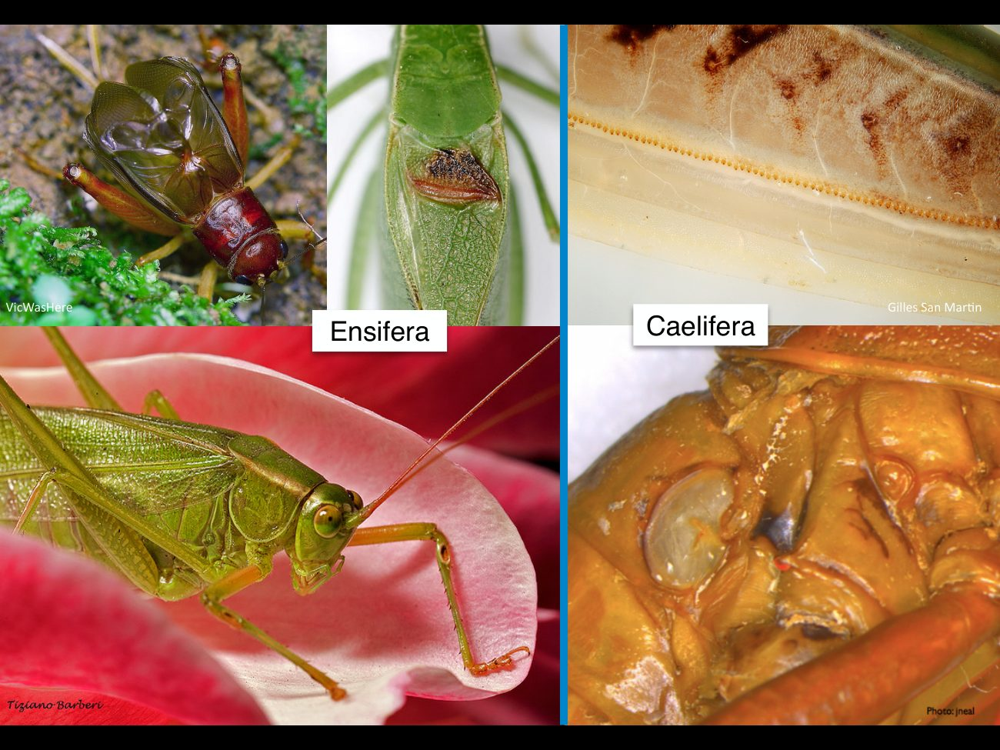](slides/slide-11.jpg)

The two major groups of Orthoptera, the Ensifera and Caelifera. So Ensifera are crickets and katydids they make sound by rubbing their wings and Caelifera the grasshoppers and relatives? Their legs are involved in producing sound, So even though most of them produce sound, they do it in quite different ways.

[↑ Slides](#slides) · [Course index](../../README.md)

## Slide 12

[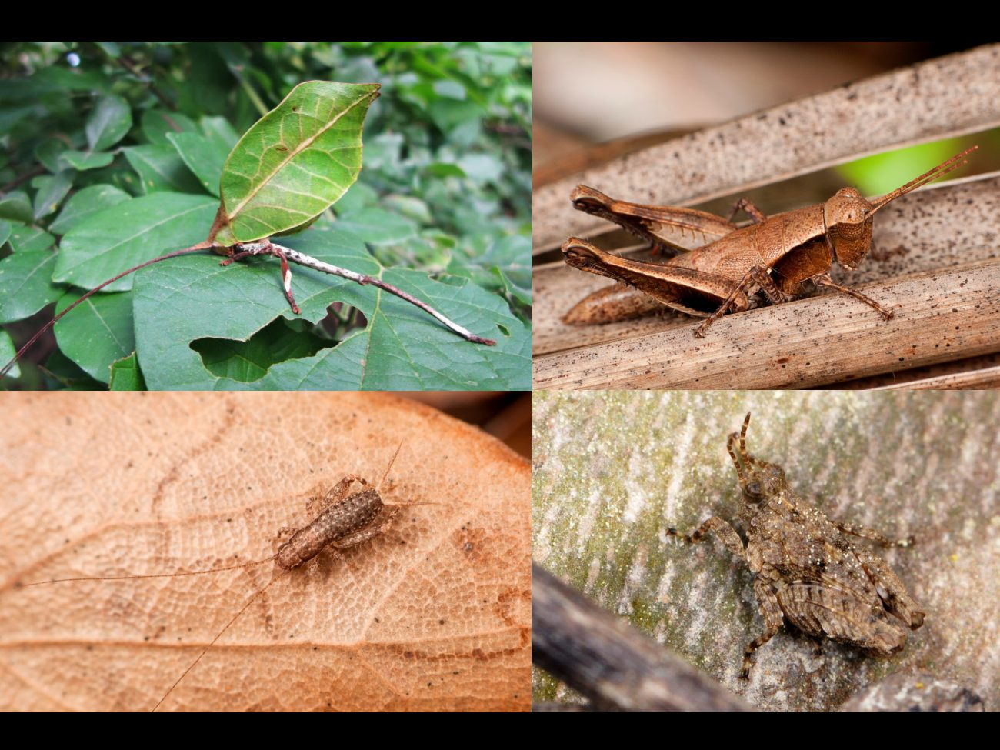](slides/slide-12.jpg)

Here's just some examples of, Orthoptera. Many of them are cryptic, similar to the walking sticks or leaf insects. They look like leaves or sticks.

They look like their host plant. Some are really cryptic down on the rocks or soil, or on the branches of trees.

[↑ Slides](#slides) · [Course index](../../README.md)

## Slide 13

[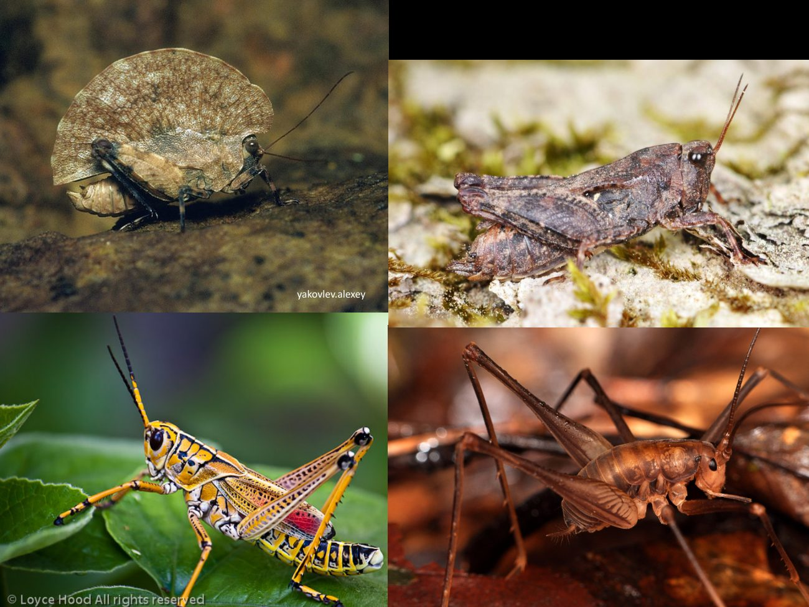](slides/slide-13.jpg)

Other ones that are chemically protected often by regurgitation are colourful, as a form of aposematism and other ones have strange body shapes. Probably to confuse predators. And many are subterranean and live in caves like the one on the bottom.

Right is a cave cricket.

[↑ Slides](#slides) · [Course index](../../README.md)

## Slide 14

[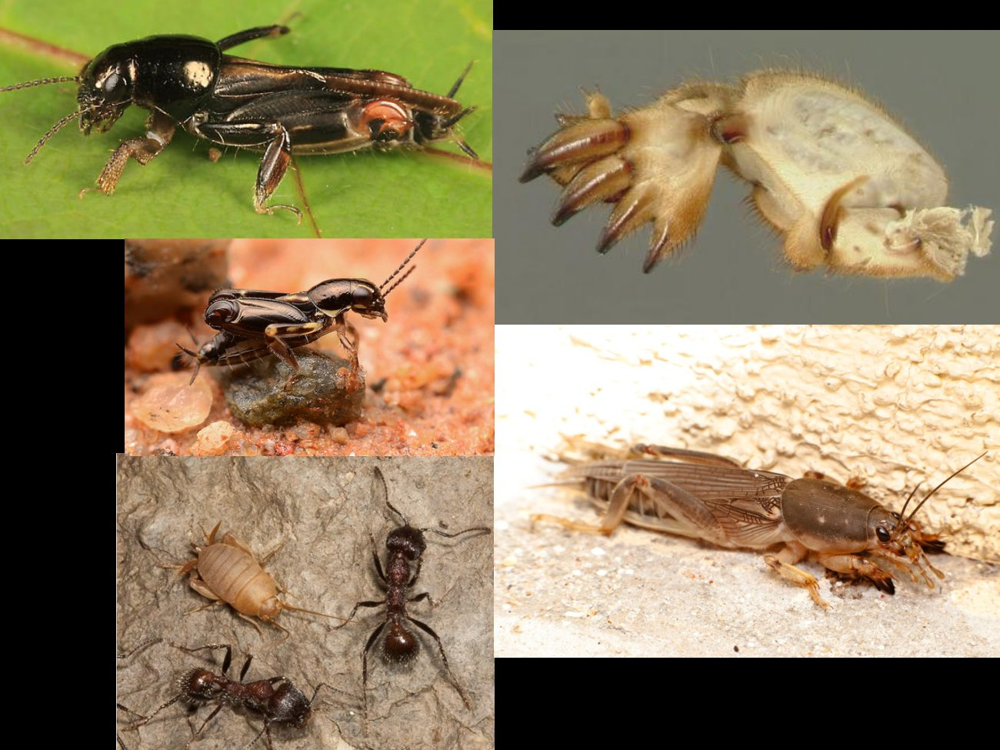](slides/slide-14.jpg)

Several different groups of Orthoptera independently have evolved, fossorial legs for digging. So these dig down into the soil and are either predators or, feed on plant roots or, scavengers. The one on the bottom left with the ants is a group of crickets that, live in ant nests.

And they're very heavily, derived morphologically modified for digging and living in the ant nests. So you can see that these are actually that those aren't fingers or tarsi. That's actually spines. .

Those are spines on the tibia that are modified for digging.

[↑ Slides](#slides) · [Course index](../../README.md)

## Slide 15

[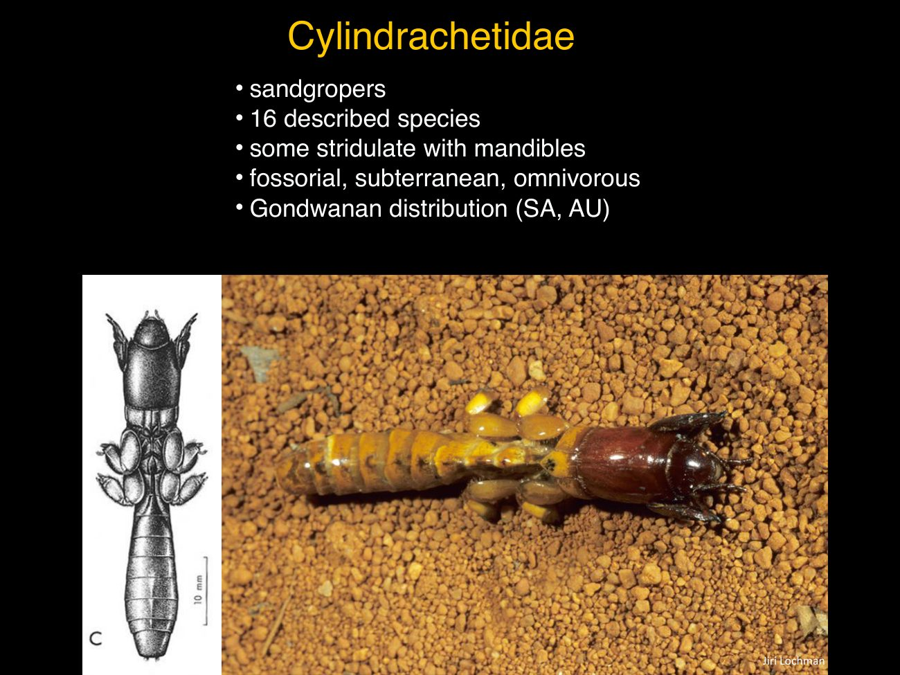](slides/slide-15.jpg)

So in the Orthoptera, since they're so diverse, I'm going to get into a couple, family level groups just to explain the importance at that level. The first is a real Australian, original, although also occurs in Argentina. The Cylindrachetidae These are the sand gropers.

They actually occur all throughout Australia, Papua New Guinea, except for Tasmania. But they are more diverse in W A, and that is where the name of the A FL, team comes from. So they have, stridulation often with their mandibles.

Since their wings are reduced, they live down in the soil. They're they're poorly known, probably omnivorous, but some might be plant pests. So that is the Australian sandgroper.

> **Editorial note:** The lecturer links “sandgropers” to an AFL team name. Sandgroper is a Western Australian nickname; the statement is retained but not treated as a transcription correction.

[↑ Slides](#slides) · [Course index](../../README.md)

## Slide 16

[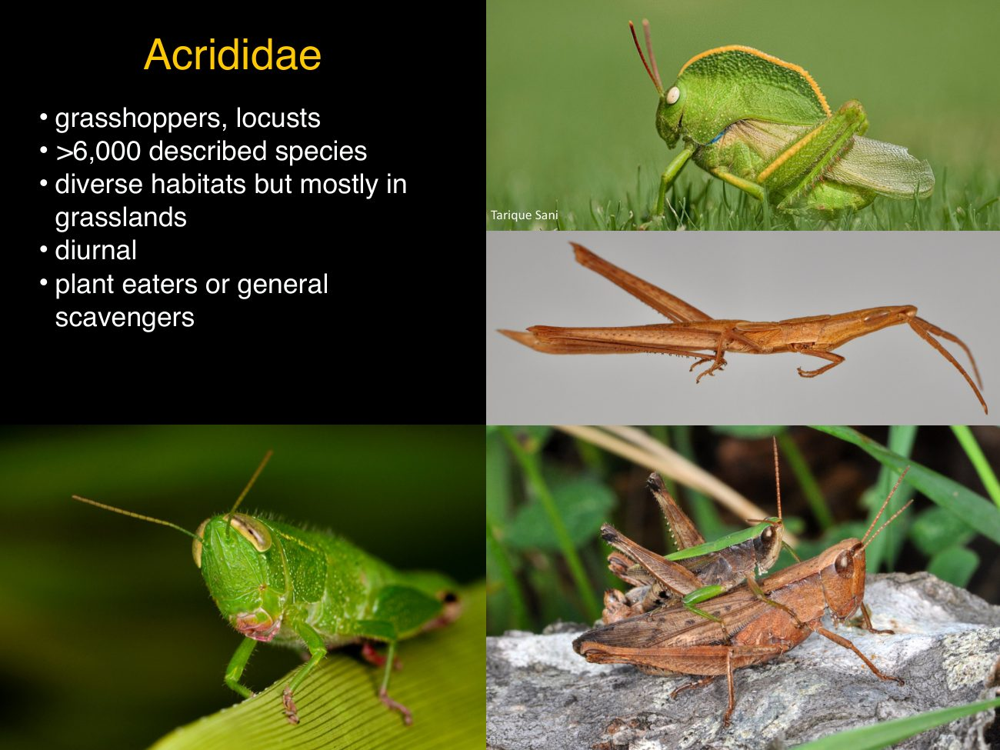](slides/slide-16.jpg)

Acrididae. The grasshoppers are really, diverse. These are in the Caelifera, so they make sound with their legs and wings.

They are, found in a lot of grassland habitats, but diverse, overall. And the Australian ones are particularly poorly known. There's just hundreds and hundreds of undescribed, Australian grasshoppers.

Some of them are scavengers, but this is the group that includes a locust that can be major plant pests.

[↑ Slides](#slides) · [Course index](../../README.md)

## Slide 17

[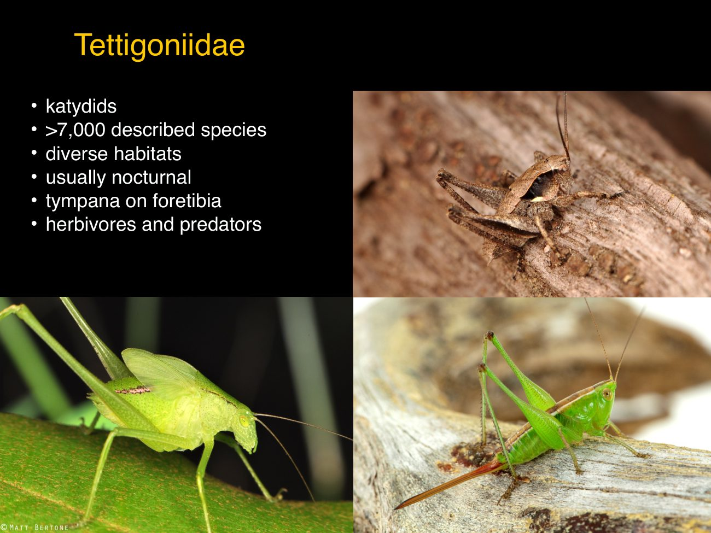](slides/slide-17.jpg)

Tettigoniidae are the katydids. That name comes from the song that they make. Some of these are predatory.

They have, tympana for hearing on their foretibiae. So that's an easy way to tell katydids. From other related, orthopterans.

They produce sound with their wings, but then they hear through an organ on their foretibiae. Often these are nocturnal, unlike grasshoppers, which are usually, diurnal.

[↑ Slides](#slides) · [Course index](../../README.md)

## Slide 18

[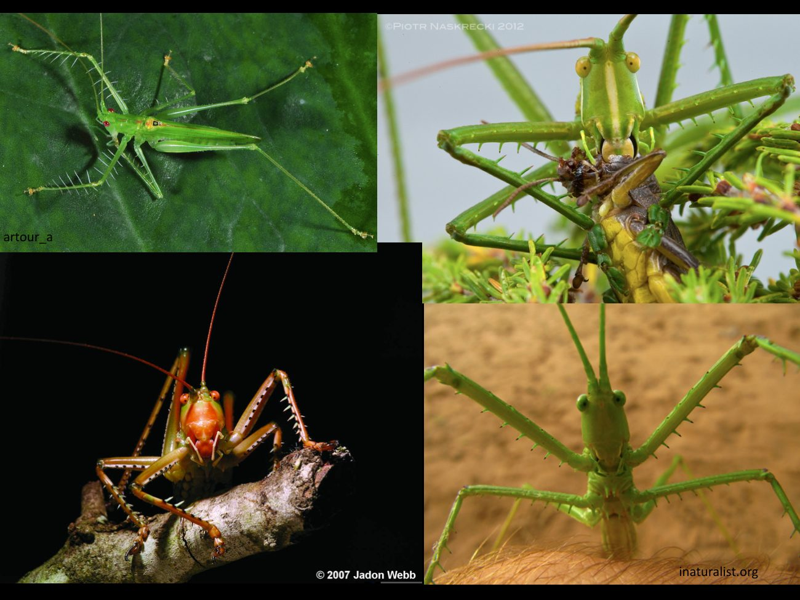](slides/slide-18.jpg)

The predatory katydids shown here are really, I think kind of primordial, nightmarish. They're they're huge and spiny and have huge mandibles. Something that a lot of other insects would be.

Not very happy to see out there. But they are, closely related to the plant feeding. Katydids.

[↑ Slides](#slides) · [Course index](../../README.md)

## Slide 19

[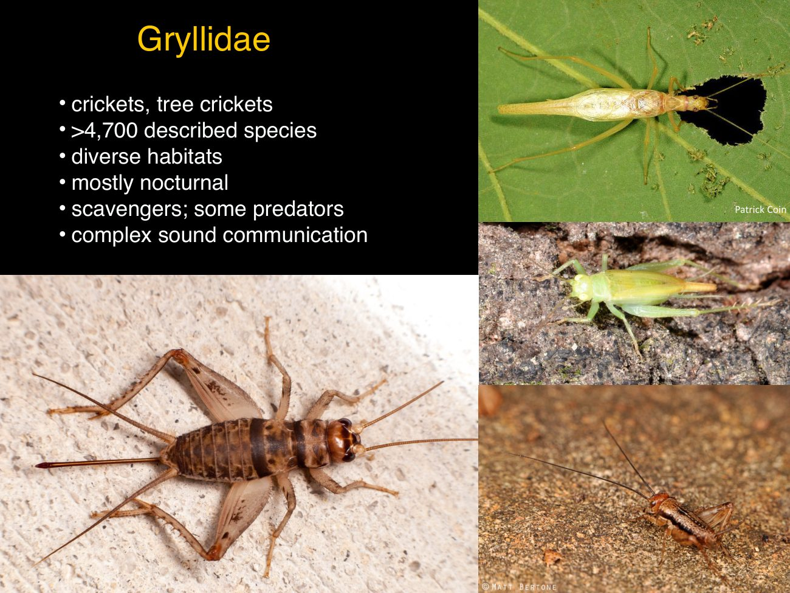](slides/slide-19.jpg)

The next group I cover of, these are in Ensifera, so they make sound with by rubbing their wings together are the true crickets Gryllidae. So we all should be familiar with crickets. We do a pinning, exam pinning practise on them in the practical.

So a lot of these Orthoptera, the wings are folded over the body, they are neopterans. However, you often need to see characters of the wings in order to identify some groups. So you might want to spread the wings gryllids.

The crickets are diverse, and they're mostly scavengers. And there's not as many that are plant feeding. But some tree crickets are, mostly nocturnal.

The tree crickets, some of them are diurnal. And these have the most, complex sound production. They're they're they're relatively well studied.

In terms of what the different songs mean. And also how they're affected by the weather and temperature. They have the two cerci.

And then the long thing in the middle is the ovipositor.

[↑ Slides](#slides) · [Course index](../../README.md)

## Slide 20

[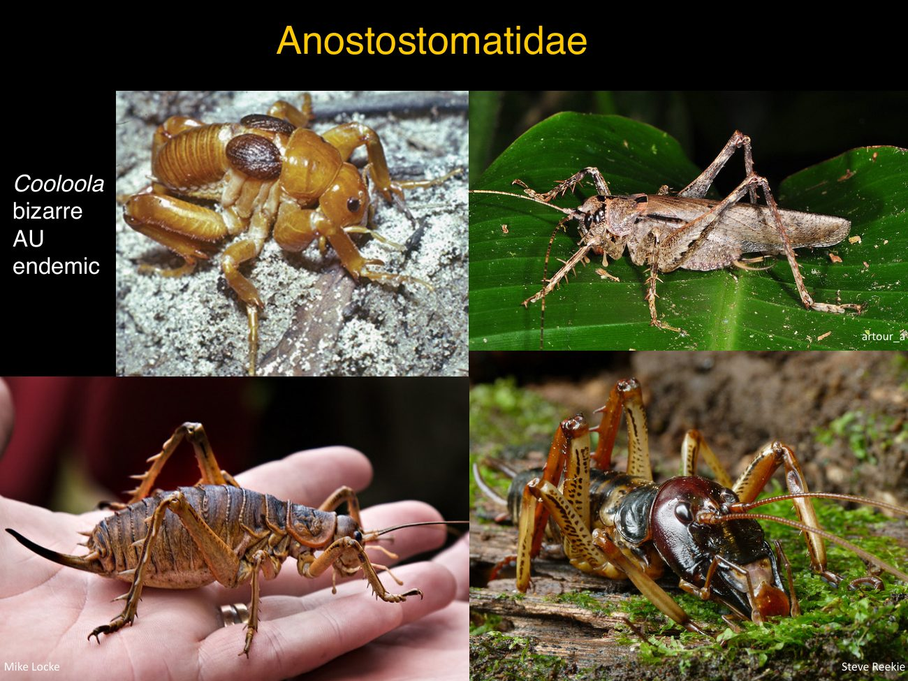](slides/slide-20.jpg)

The last group we'll talk about is another, at least, ANZAC pride kind of animal. These are the weta Anostostomatidae, these are most well known from New Zealand, but there's actually lots of WETA relatives in Australia, including this thing on the top side called Cooloola, which is a, subterranean weta digs down in the soil, endemic to Australia. But we are, really large and impressive of giant heads and variously modified legs.

They're actually found other places in the world, but Australia and New Zealand are where the most impressive weta and relatives are found.

[↑ Slides](#slides) · [Course index](../../README.md)

## Source notice

this material has been reproduced and communicated to you by or on behalf of the Australian National University in accordance with Section 113 P of the Copyright Act 1968. The material in this communication may be subject to copyright under the act. Any further reproduction or communication of this material by you must be consistent with the provisions of the act. Do not reproduce this material. Do not remove this notice

[← Previous lecture](../07-invertebrate-intro-part-7-insect-overview-aquatics-paleoptera-plecoptera/README.md) · [Course index](../../README.md) · [Next lecture →](../09-invertebrate-intro-part-9-insect-overview-3-polyneoptera-2-dictyoptera-etc/README.md)
