# Invertebrate Intro Part 9 - Insect Overview 3 - Polyneoptera 2 - Dictyoptera etc

[← Previous lecture](../08-invertebrate-intro-part-8-insect-overview-2-polyneoptera-1-phasmatodea-orthoptera/README.md) · [Course index](../../README.md) · [Next lecture →](../10-invertebrate-intro-part-10-insect-overview-4-paraneoptera-lice-thrips/README.md)

**Slides + cleaned transcript** · 18 slides

English transcript with fillers and repeated false starts removed. Technical terms are corrected using the slides and context. Bracketed wording marks reconstruction or uncertainty. Slide boundaries are inferred from content; the transcripts have no slide timestamps.

[Original transcript](original-transcript.txt) · [Text-only version](cleaned-transcript.md) · [Editing notes](../../EDITING-NOTES.md) · [Correction record](corrections.md)

[Searchable slide text](slide-text.md). Click a slide image to open it at full size.

## Slides

[1](#slide-1) · [2](#slide-2) · [3](#slide-3) · [4](#slide-4) · [5](#slide-5) · [6](#slide-6) · [7](#slide-7) · [8](#slide-8) · [9](#slide-9) · [10](#slide-10) · [11](#slide-11) · [12](#slide-12) · [13](#slide-13) · [14](#slide-14) · [15](#slide-15) · [16](#slide-16) · [17](#slide-17) · [18](#slide-18)

## Slide 1

[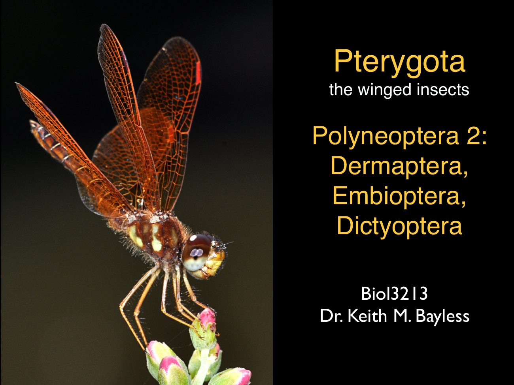](slides/slide-01.jpg)

Now we're going to wrap up the Polyneoptera as a re recap. These are multiple insect orders forming a large lineage that do not have true metamorphosis and mostly don't have aquatic immature except for Plecoptera. So they have a egg and nymph and adult.

And in the nymphal stages you can usually see the wing pads and adult characters developing externally.

[↑ Slides](#slides) · [Course index](../../README.md)

## Slide 2

[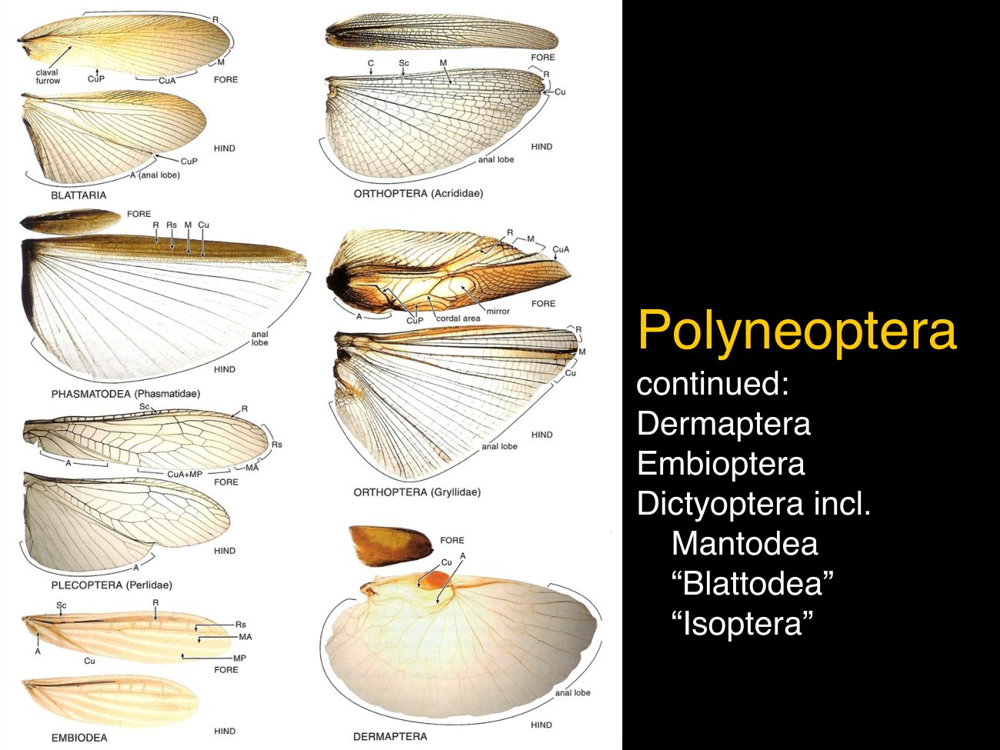](slides/slide-02.jpg)

So today we'll talk about, three more major groups of Polyneoptera Dermaptera, the earwigs and Embioptera, the Web spinners and then a large group that is either considered one or two or three orders, including Roaches, Mantis and termites. In Polyneoptera Often the hind wing is quite large, and the forewing is, reduced or, formed into a leathery structure called a tegmen.

[↑ Slides](#slides) · [Course index](../../README.md)

## Slide 3

[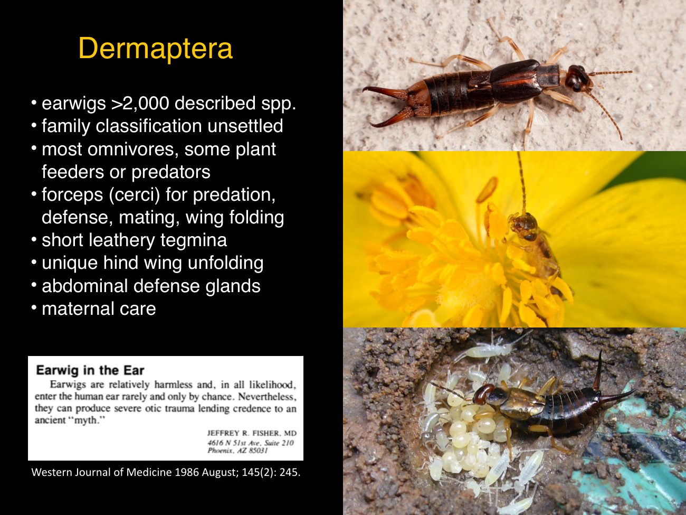](slides/slide-03.jpg)

So in the Dermaptera, that's true, and the hind wing can fold. So Dermaptera, the earwigs, they are relatively poorly studied. There's still a lot of disagreements about the higher level classification.

They're quite diverse in their ecology. Some of them feed on plants or are predators, but a lot of them are, scavengers or Omnivores, the major character telling apart earwigs. Almost all ear wigs are those enlarged cerci, So most insects have cerci.

But in ear wigs, those are, enlarged and hard and often used for piercing or grabbing those enlarged, cerci. The forceps can be used to help fold the wings under the tegmina. They're used in mating for the males to hold the females.

They can pinch and stab for defence, and predatory ones will catch their prey with them. They also have, various chemical defences. Often they're kind of smelly, and they exhibit, complex maternal care behaviour.

So the name earwig, isn't really true. They're not associated with ears in any way. If they got in your ear, it would be unpleasant, But there's no reason that they would, go for your ear.

[↑ Slides](#slides) · [Course index](../../README.md)

## Slide 4

[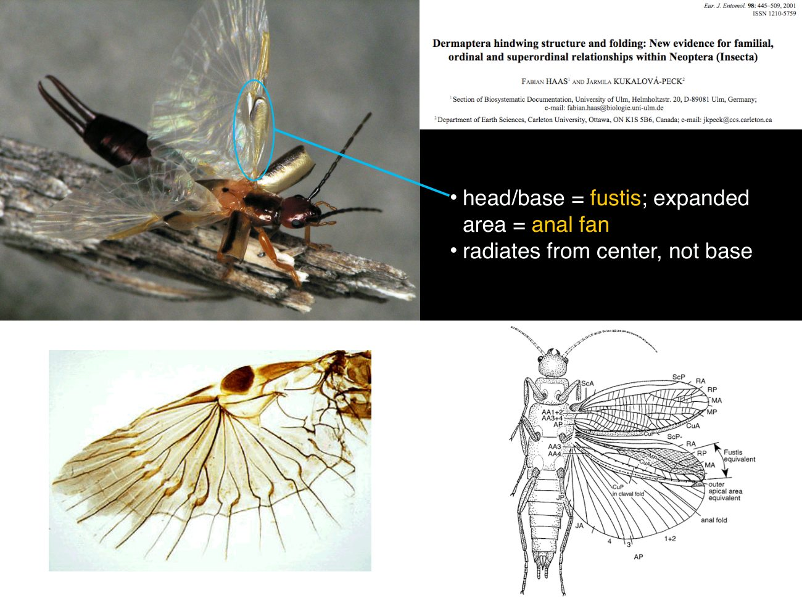](slides/slide-04.jpg)

So their wings are quite unique. There's some fossil, transitions. The forewing is reduced into this little square, tag.

And then the hind wing is enlarged used for flying. The most of the wing veins are smooshed up into that area in the hind wing, and the rest is a quite a large fan. And that fan folds similar to, a fan used for fanning folds one over the other and then in half and folds up under the hind wing.

The cerci use that hind wing folding.

[↑ Slides](#slides) · [Course index](../../README.md)

## Slide 5

[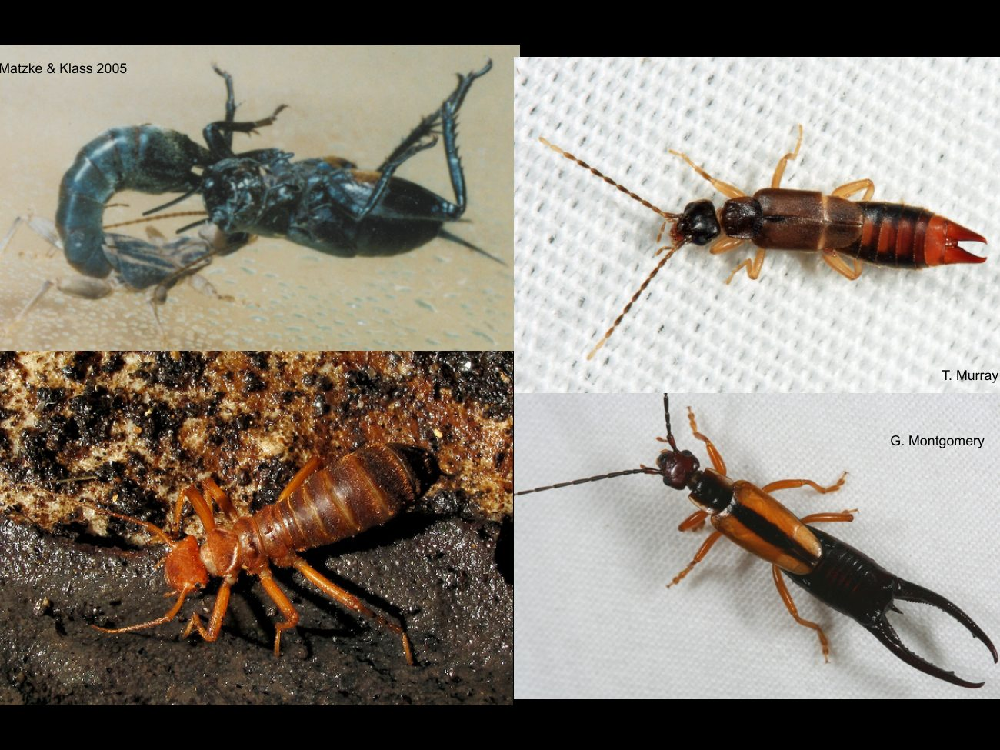](slides/slide-05.jpg)

Here's some more examples of some ear wigs. There's a predatory one, using its forceps at cerci to catch prey. There's there's a diverse, size of those forceps and different ones, and some, that one in the corner without large, visible forceps-like cerci is a parasite of bats.

[↑ Slides](#slides) · [Course index](../../README.md)

## Slide 6

[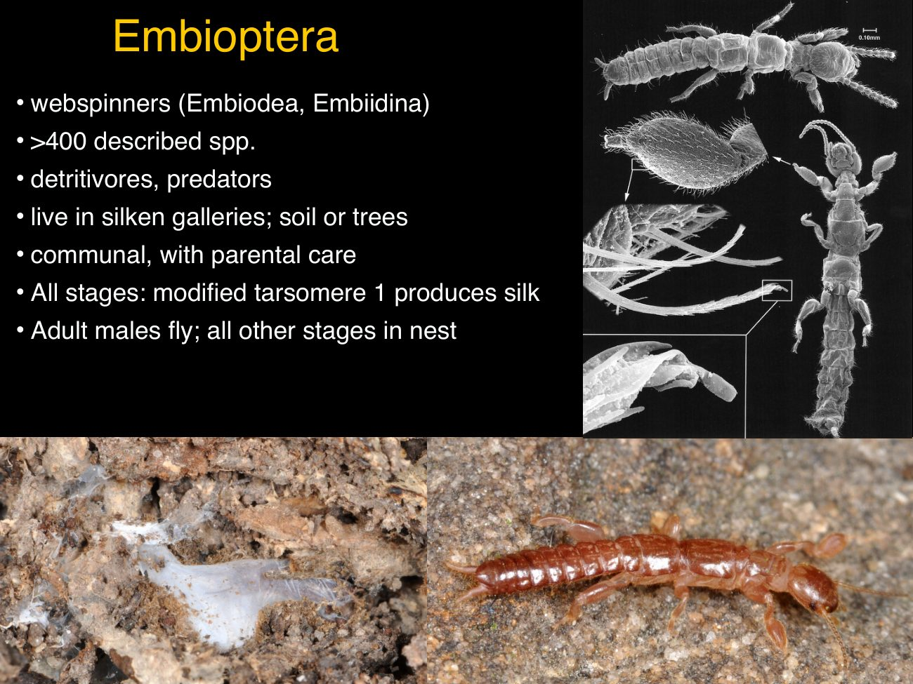](slides/slide-06.jpg)

Onto the Embioptera the Web spinners. This is a relatively small order, but again there's there's a lot left to be discovered. These all form silken galleries and produce silk with their, modified tarsomeres in their legs.

So the whole family, the males, females and nymphs live in those silken galleries. Only the males develop wings to fly to found new colonies. So those silken galleries will be on fallen logs or in the soil or on trees.

And some of them are predators hunting other animals in those substrates and other ones, are just kind of scavenging around. They're quite distinctive looking, insects. And there's some that can be found around Canberra.

More diverse in the tropics, a lot left to be discovered, and the name of the order is also a bit unclear. You'll see those other names Embiodea or Embiidina.

[↑ Slides](#slides) · [Course index](../../README.md)

## Slide 7

[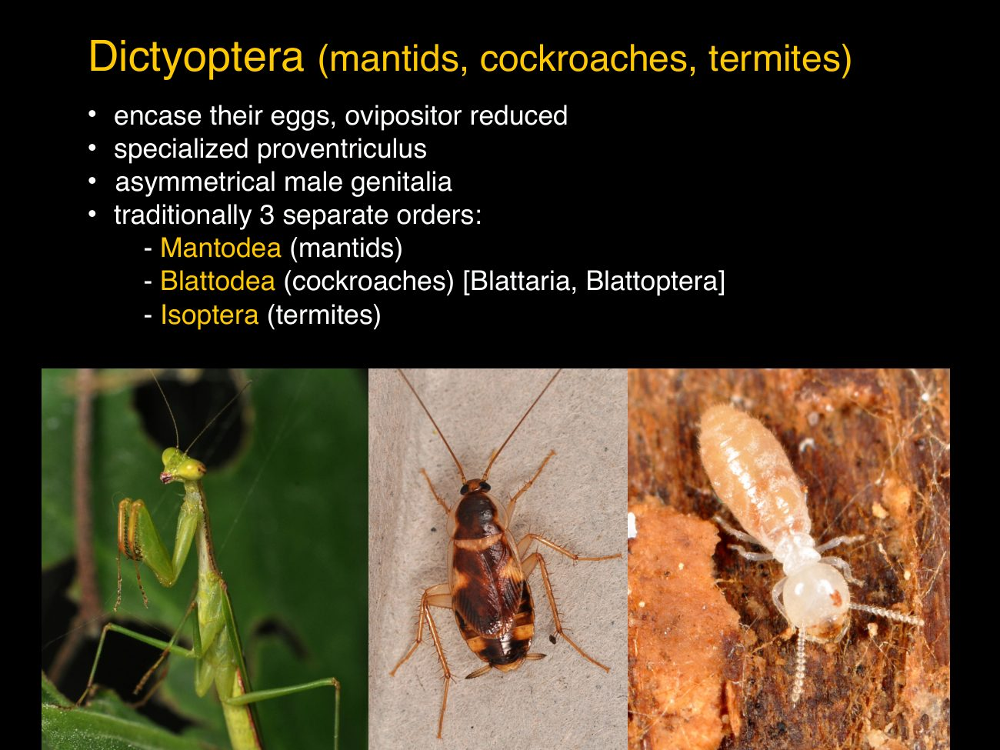](slides/slide-07.jpg)

OK, the last group of Polyneoptera that will cover is the Dictyoptera. So this either is, a group of orders or a single large order, which includes the Mantis, cockroaches and termites. These three groups of insects are united by a number of characters.

So the main one we'll talk about in the next slide is the ootheca, which is, a waxy structure that encloses the eggs. They also have, specialised digestive, structures particularly used in the termites to help them store symbiotic bacteria to digest wood. And they also have unusual, male genitalia.

[↑ Slides](#slides) · [Course index](../../README.md)

## Slide 8

[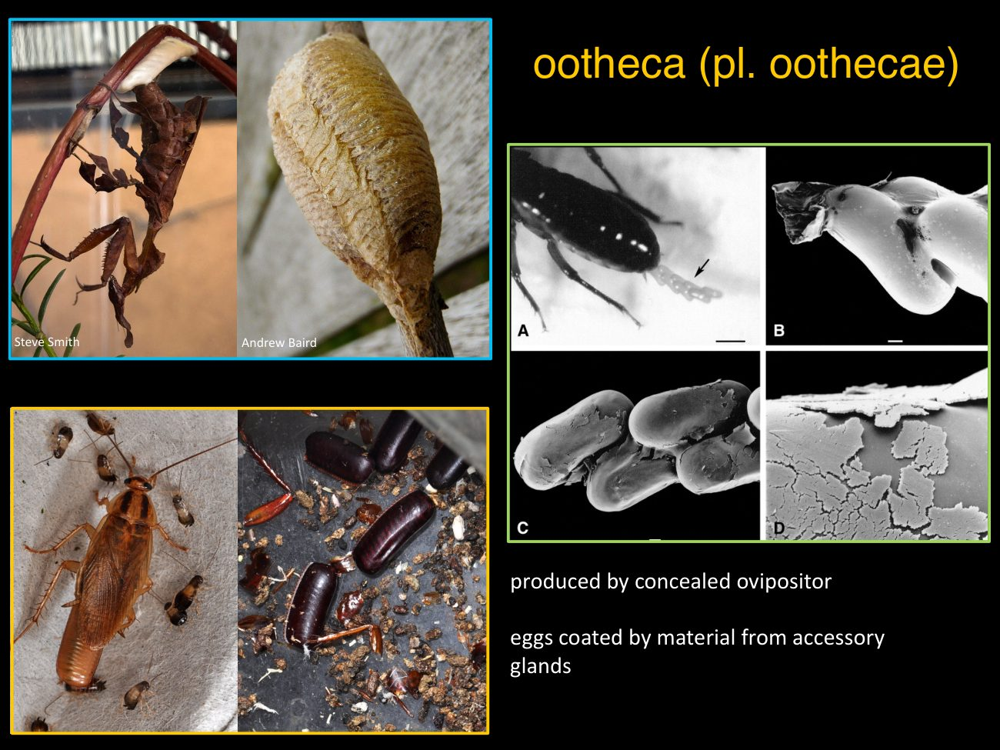](slides/slide-08.jpg)

So that so Mantis and cockroaches have very obvious oothecae. Mantises have these large, kind of styrofoam like waxy ones that you'll find on branches and cockroach Are these kind of black pill shaped ones? That will be sitting on the ground.

So each of those it's a protective case in closing many eggs. So this is a unique character for the Dictyoptera. And most termites do not have oothecae, except for, the sister group to the rest of the termites.

[↑ Slides](#slides) · [Course index](../../README.md)

## Slide 9

[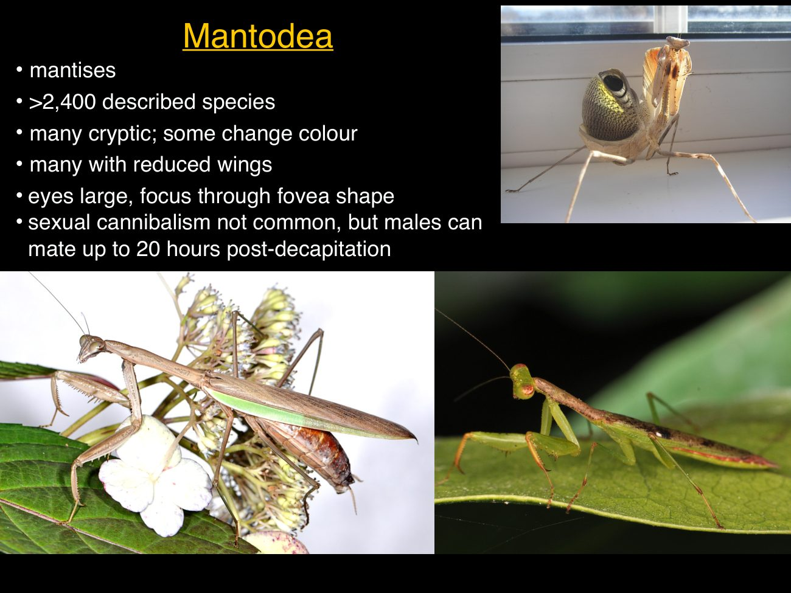](slides/slide-09.jpg)

We'll talk about the Mantis. Mantodea. These are, all predators.

They have modified raptorial fore legs to catch prey. A lot of them blend in with their environment, through various ways, looking like sticks or branches. But there's some metallic ones.

A lot of different Mantis have reduced wings that will live down in the leaf litter hunting prey. And this is another group where it's not too diverse in terms of what's known. But there's a lot left to be, discovered.

There's a lot of species that look very, similar externally, but have quite specialised, environmental niches. They catch prey through vision. They have, very, elaborated eyes, almost looking bifocal.

They can focus on things very well, And, in most mantises the trope of sexual cannibalism doesn't really happen, But, some of the common ones it does. But most species, it's it's not prevalent. But in the species where it does happen, essentially, the male will keep mating after the female has, decapitated.

So it's kind of a nuptial gift. The male is giving the female, in some cases.

[↑ Slides](#slides) · [Course index](../../README.md)

## Slide 10

[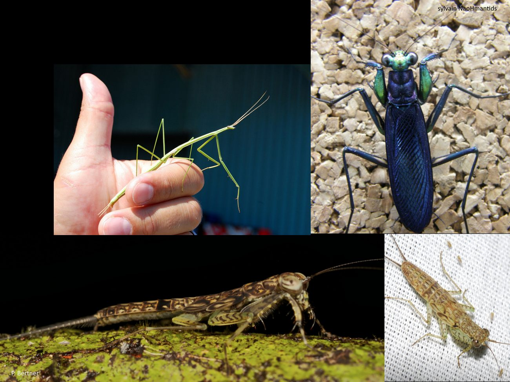](slides/slide-10.jpg)

Just some more examples of Mantis. Like I mentioned, there's some kind of metallic looking ones. There's some really, flattened wingless ones that live down in the leaf litter or holding onto, tree branches.

There's leaf shaped ones and the orchid mantises look like flowers. They're quite popular as pets. There's another kind of a mimic [exact term unclear].

So they're all predatory, but, we live in quite narrow, micro habitats looking for prey.

[↑ Slides](#slides) · [Course index](../../README.md)

## Slide 11

[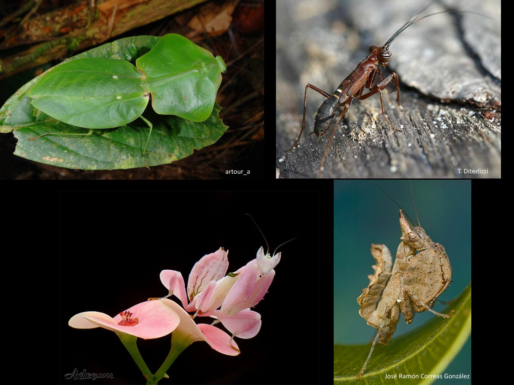](slides/slide-11.jpg)

*No separate passage can be confidently assigned to this slide. [Nearby discussion: slide 10](#slide-10).*

[↑ Slides](#slides) · [Course index](../../README.md)

## Slide 12

[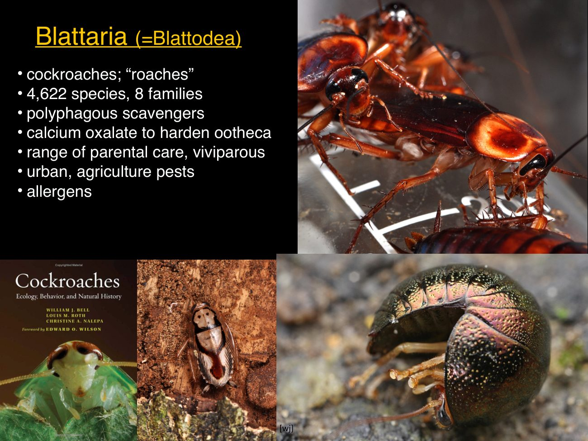](slides/slide-12.jpg)

Onto the cockroaches. So these are Blattaria or Blattodea. And, this is a major reason why the group is often just lumped altogether as Dictyoptera is because the cockroaches are not monophyletic with respect to the termites.

In other words, there's some cockroaches that are more closely related to, termites and some cockroaches versus other cockroaches. So termites, evolved from within what we would consider to be cockroaches, relatively diverse group and again a lot left to be discovered. Even though they're kind of large, charismatic insects, they're really diverse.

And Australia is a centre of diversity for cockroaches. Scavengers and most species tend to be quite, omnivorous, prolific in terms of what they go for. But some are more specialised.

Their ootheca is hardened, with calcium oxalate. And they have a range of different parental care behaviours and usually give birth to live young. Some.

There's some that are like into this pill shape. There's a lot that are flattened and have all sorts of, beautiful wing, patterns. They're easily kind of told apart because of that large shield like pronotum that goes over the head anteriorly.

Many species are considered pests they can, damage crops. Other ones are beneficial. Eating other.

Pest insects and the ones that are associated with human habitation are pest because of filth and also, allergens that they leave in the environment.

[↑ Slides](#slides) · [Course index](../../README.md)

## Slide 13

[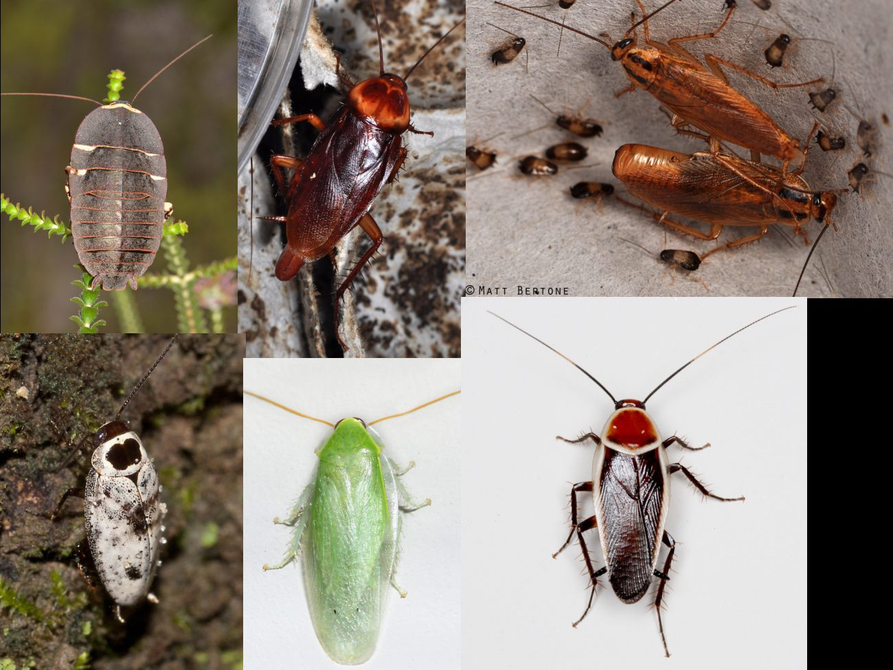](slides/slide-13.jpg)

Here's some more examples of some cockroaches, so, really diverse in Australia, there's a lot that live in dry areas that are quite specialised for burrowing in the sand. Often they will. They will care for their young, lobster Roaches are large and colourful pets really a diverse group.

[↑ Slides](#slides) · [Course index](../../README.md)

## Slide 14

[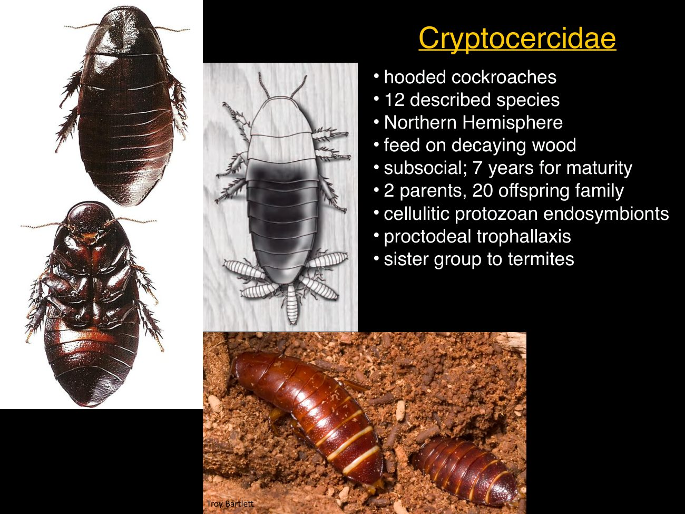](slides/slide-14.jpg)

I'll talk about one family of Roaches because it's important of cockroaches because it is important for, understanding the evolution of this group. And that is the Cryptocercidae. So these are cockroaches not found in Australia, only found in the Northern Hemisphere in the US and Eastern Asia.

But what they do is they live in rotten logs, they're subs social. The, males and females will be around the young, and they have the very long lived take years to develop. They have, endosymbiont protozoans inside their gut.

Inside the proventriculus that can digest cellulose. So all of these characters are shared with termites. And it's very clear now that this group of cockroaches is the sister group to the termites.

> **Editorial note:** The source places cellulose-digesting symbionts in the proventriculus. The relevant symbionts are primarily associated with the hindgut, as slide 16 states. This is a factual clarification, not a silent change to the lecture.

[↑ Slides](#slides) · [Course index](../../README.md)

## Slide 15

[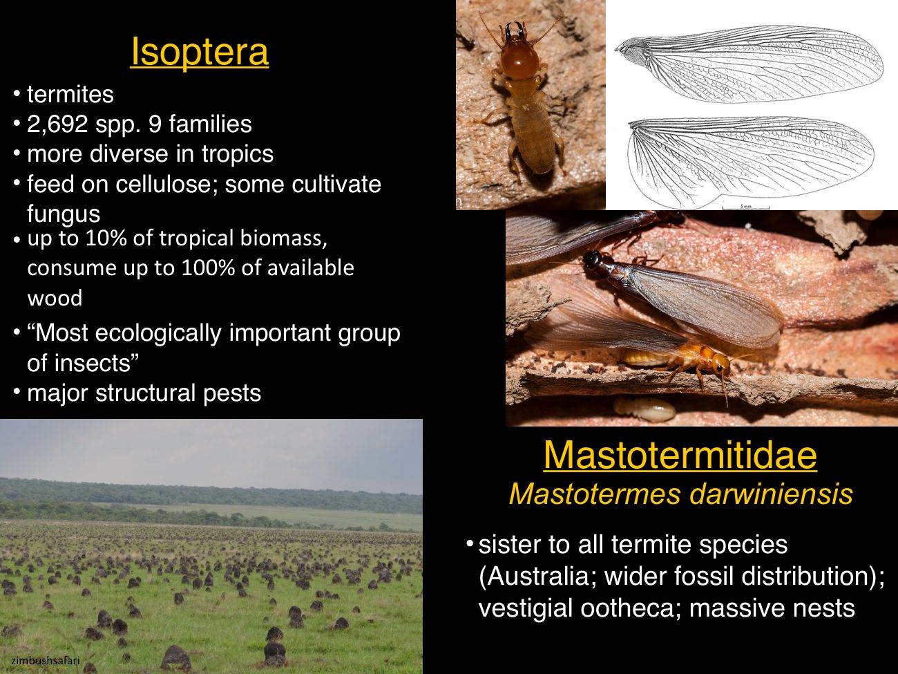](slides/slide-15.jpg)

The termites are, the last major lineage of Dictyoptera. Although they are, included within what we would consider cockroaches. Similar to those cryptocercid cockroaches.

They're, social Isoptera are eusocial. And the difference is that they These have reproductive division of labour, where there's a king and a queen that make young, whereas in Cryptocercidae, any of the members of the colony can reproduce. They feed on cellulose.

They have these, protozoan endosymbionts to digest cellulose, which is quite rare among insects. There's some other insects that can digest cellulose themselves, including silverfish. But termites, with this endosymbiosis, they're quite efficient at it.

So those endosymbiont live in the proventriculus, the fore gut, which is, moulted that the fore gut and hindgut of insects is removed. That the outer layer is removed during the moulting stage. So it's not an endoderm part of the developmental, tissue.

It is, a part of tissue that's lost during moulting. So those endosymbiotic bacteria are lost. Every moult, and what that means is that they need to find more bacteria, so that strongly contributed to the evolution of eusocial in termites.

These are, extremely ecologically important because they can digest so much cellulose in, grasslands in forests, they're extremely abundant and have a large impact on the ecosystem. They're not very diverse in terms of species. But they're they're really they have an outsized influence on, the physical structure and the nutrient uptake in their environments.

Along with that their major pests and some species because they can damage human made wooden structures, the sister group to all other termites. And the only termite with an ootheca is one species found in the Northern Territory in Australia in the Mastotermitidae.

> **Editorial note:** The foregut/proventriculus account conflicts with the hindgut account later in the lecture. Retained and flagged rather than presented as a verified transcription correction.

[↑ Slides](#slides) · [Course index](../../README.md)

## Slide 16

[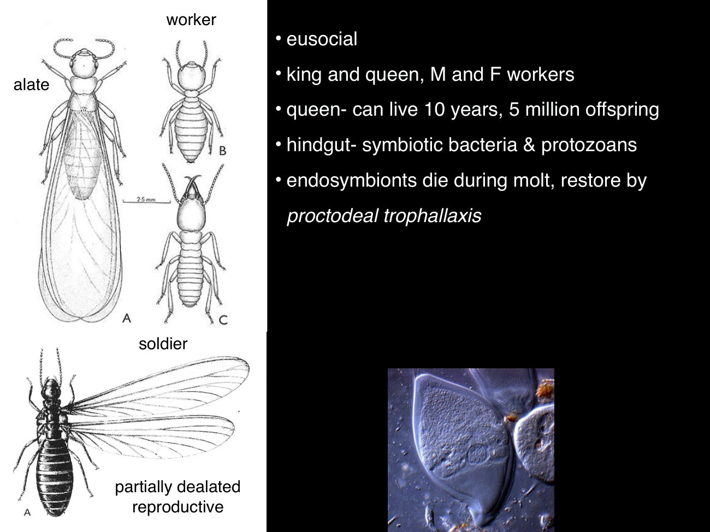](slides/slide-16.jpg)

Let's go back. Let's go on to talk about more, give more detail about their eusocial structure. So they have a king and a queen, which reproduce and the workers which are not reproductive, can be males or females.

The king and the queen live, a long time and can produce many offspring, in the hindgut, they keep their symbiotic bacteria which die during the moulting. So similar to Cryptocercidae, they have to pick up those bacteria again from their nest mates, the protozoans and bacteria.

[↑ Slides](#slides) · [Course index](../../README.md)

## Slide 17

[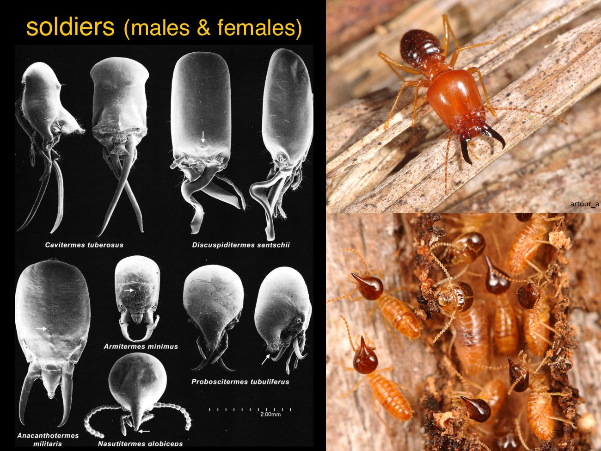](slides/slide-17.jpg)

Along with that reproductive division of labour, they also, have overlapping generations. Which is another, trait of eusocial. And, they have castes.

So there's workers and soldiers and some termites. The workers are heavily defended, and the soldiers have various, defences for to help the colony either spraying chemical defences or, enlarged mandibles to, chase off potential predators.

[↑ Slides](#slides) · [Course index](../../README.md)

## Slide 18

[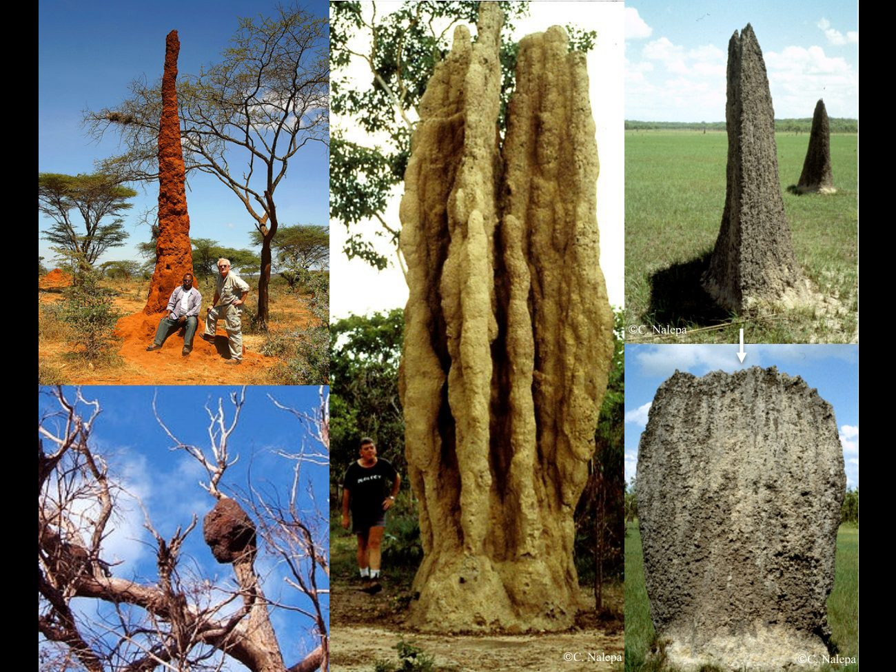](slides/slide-18.jpg)

Termites are, architects in along with digesting and processing nutrients. They create huge structures and, will allow air deep into the soil and, form these various nests, that could be quite large and are usually specific in shape to each species. So very important for their various ecosystems in several aspects.

[↑ Slides](#slides) · [Course index](../../README.md)

## Source notice

this material has been reproduced and communicated to you by or on behalf of the Australian National University in accordance with Section 113 P of the Copyright Act 1968. The material in this communication may be subject to copyright under the act. Any further reproduction or communication of this material by you must be consistent with the provisions of the act. Do not reproduce this material. Do not remove this notice.

[← Previous lecture](../08-invertebrate-intro-part-8-insect-overview-2-polyneoptera-1-phasmatodea-orthoptera/README.md) · [Course index](../../README.md) · [Next lecture →](../10-invertebrate-intro-part-10-insect-overview-4-paraneoptera-lice-thrips/README.md)
