# Invertebrate Intro Part 10 - Insect Overview 4 - Paraneoptera- lice, thrips

[← Previous lecture](../09-invertebrate-intro-part-9-insect-overview-3-polyneoptera-2-dictyoptera-etc/README.md) · [Course index](../../README.md) · [Next lecture →](../11-invertebrate-intro-part-11-insect-overview-5-hemiptera-1-scales-hoppers/README.md)

**Slides + cleaned transcript** · 18 slides

English transcript with fillers and repeated false starts removed. Technical terms are corrected using the slides and context. Bracketed wording marks reconstruction or uncertainty. Slide boundaries are inferred from content; the transcripts have no slide timestamps.

[Original transcript](original-transcript.txt) · [Text-only version](cleaned-transcript.md) · [Editing notes](../../EDITING-NOTES.md) · [Correction record](corrections.md)

[Searchable slide text](slide-text.md). Click a slide image to open it at full size.

## Slides

[1](#slide-1) · [2](#slide-2) · [3](#slide-3) · [4](#slide-4) · [5](#slide-5) · [6](#slide-6) · [7](#slide-7) · [8](#slide-8) · [9](#slide-9) · [10](#slide-10) · [11](#slide-11) · [12](#slide-12) · [13](#slide-13) · [14](#slide-14) · [15](#slide-15) · [16](#slide-16) · [17](#slide-17) · [18](#slide-18)

## Slide 1

[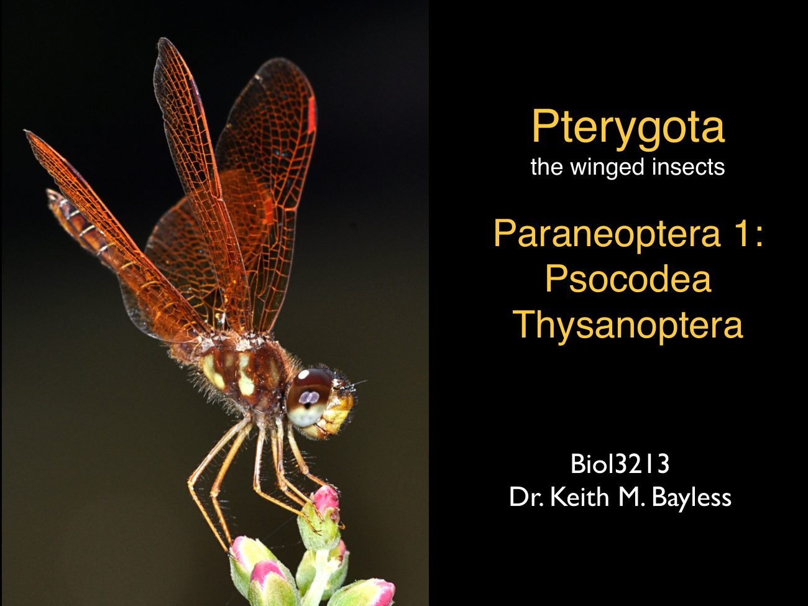](slides/slide-01.jpg)

Moving on to Paraneoptera This is another major lineage of insects that includes the lice, the thrips and the bugs. These are closely related to Holometabola the insects with true metamorphosis. But in Paraneoptera, these orders do not have true metamorphosis.

There's some amount of difference between the nymphs and the adults more so than in, grasshoppers say, but that there's no pupal stage.

[↑ Slides](#slides) · [Course index](../../README.md)

## Slide 2

[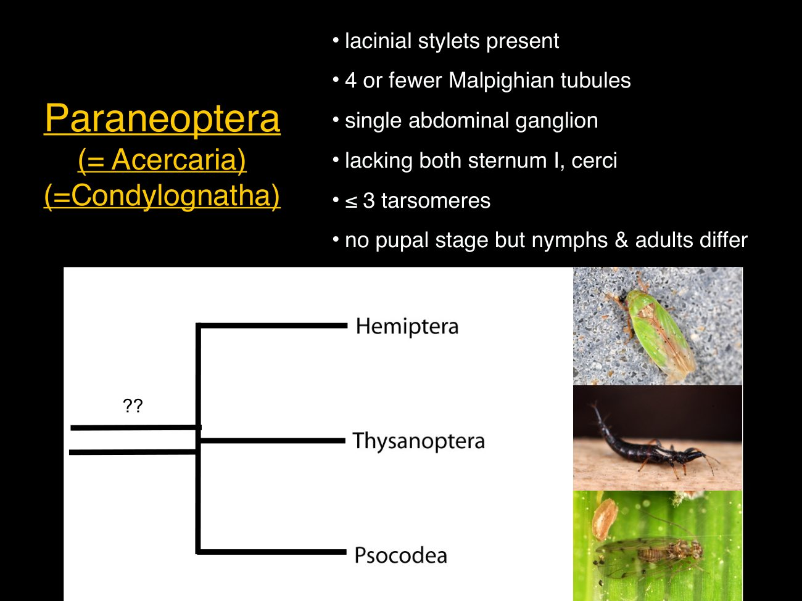](slides/slide-02.jpg)

This group there's a number of different names, but I think it's clean right now to just call it Paraneoptera. It includes, Hemiptera, the bugs, Thysanoptera, the thrips and Psocodea the lice. However, there's some controversy about the monophyly of Paraneoptera.

These groups are united by the mouth. Similarities in the mouth parts, reduced Malpighian tubules and nervous system. With no, they have no cerci.

They're they're lacking the sternite of the first abdominal segment. They all have three, or fewer tarsomeres. But otherwise, these three orders are, quite distinct and, diverse.

[↑ Slides](#slides) · [Course index](../../README.md)

## Slide 3

[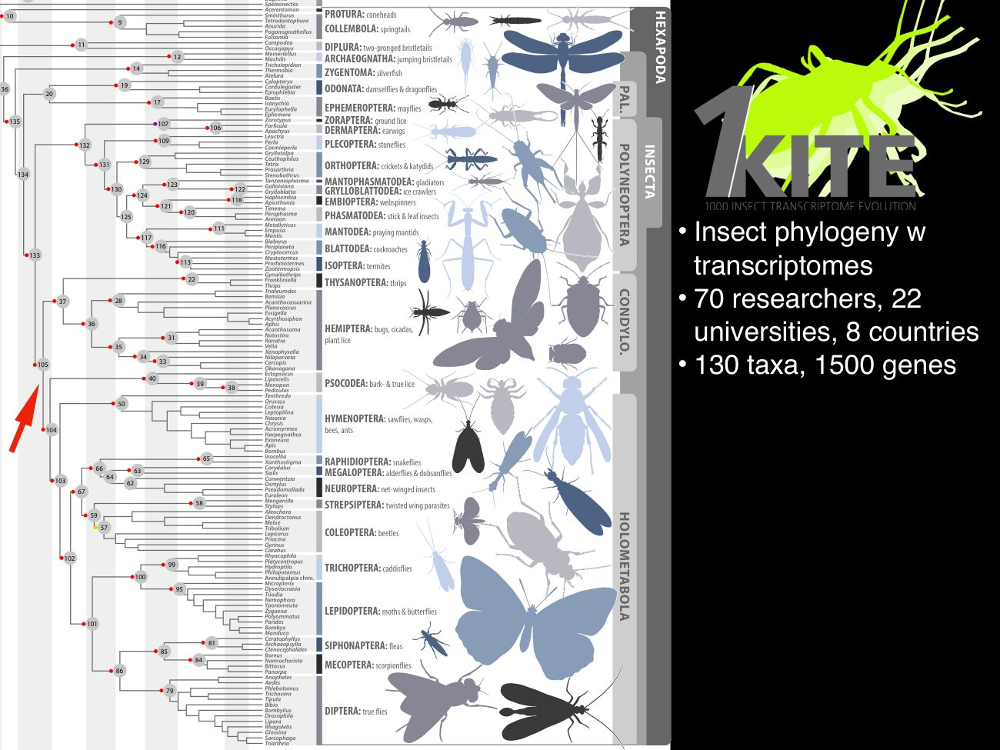](slides/slide-03.jpg)

So in the most recent comprehensive phylogeny of insects, the lice are sister to the Holometabola, and the thrips and bugs are sister groups. However, this, is being reconsidered and reanalyzed and is quite an uncertain, area of the phylogeny of insects.

[↑ Slides](#slides) · [Course index](../../README.md)

## Slide 4

[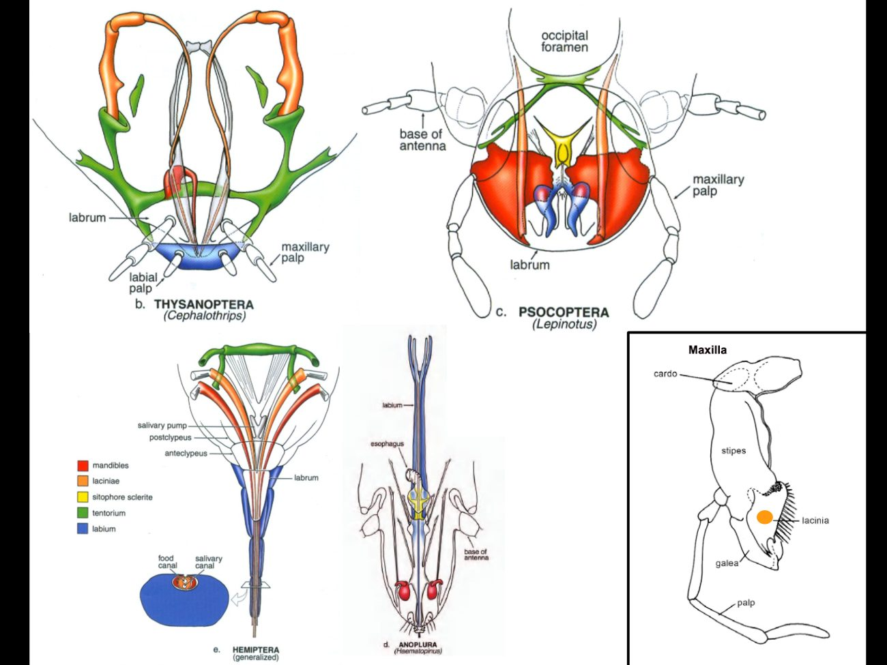](slides/slide-04.jpg)

As I mentioned before, these three groups all have, modified mouth parts for piercing and sucking. But those modifications are quite different in the different orders. So in, Thysanoptera, they are lacking the left mandibles.

So they have a three. The their piercing sucking rostrum is made up of three components in the lice. They have still have chewing mandibles.

But the laciniae, which are part of the labium, are, modified for piercing and sucking. And in the bugs, they have a very heavily modified and segmented rostrum where the external part of it is formed from the labium and then the, mandibles. And, parts of the, labium are evolved into four components of a piercing sucking tube.

> **Editorial note:** Thrips normally lack the right mandible, not the left. Laciniae belong to the maxillae, not the labium. These source claims are kept as lecture claims and flagged here.

[↑ Slides](#slides) · [Course index](../../README.md)

## Slide 5

[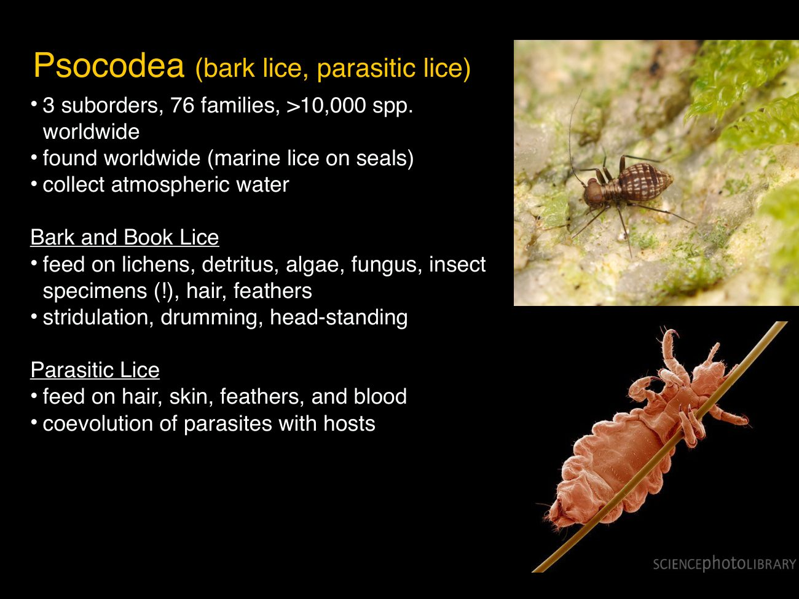](slides/slide-05.jpg)

So in this lecture, we'll talk about two of the orders. The smaller ones in the Paraneoptera the lice and the thrips. The lice.

Psocodea. It has been broken up into two or three orders in the past. It's it consists of free living book and bark lice.

So book lice, some of them live. There's a lot of species that live in nature often, especially with caves or in the soil. But then some are, pests in human habitation and can, eat various, dry items around the home, including damaging books.

But they're they're really common, in human habitation. But there's many other species in nature as well. So, that's the book lice is one major group and another major group are the bark lice?

Which some are, social in a sense and form large colonies. And all of them are quite, diverse in terms of what they eat. Often various types of dry, [unclear] materials.

Which leads them to damage some human items. And most of these lice have, social behaviours in terms of communication by stridulating or drumming. And then another major group of the, lice are the parasitic lice.

So this there's probably three major lineages parasitic lice, mostly more closely related to the book lice. And these, all feed on vertebrate hosts, mainly mammals and birds. And they can suck blood or otherwise feed on, exudates and hair in different parts of their host.

These are quite, specialised in terms of their host range. And none of them have wings. They have to be passed from host individuals.

And, an interesting, point is that some are truly marine as they attack seals. Most of these lice are very good at, eating dry, food sources because they can collect water from the atmosphere, unlike most other insects.

[↑ Slides](#slides) · [Course index](../../README.md)

## Slide 6

[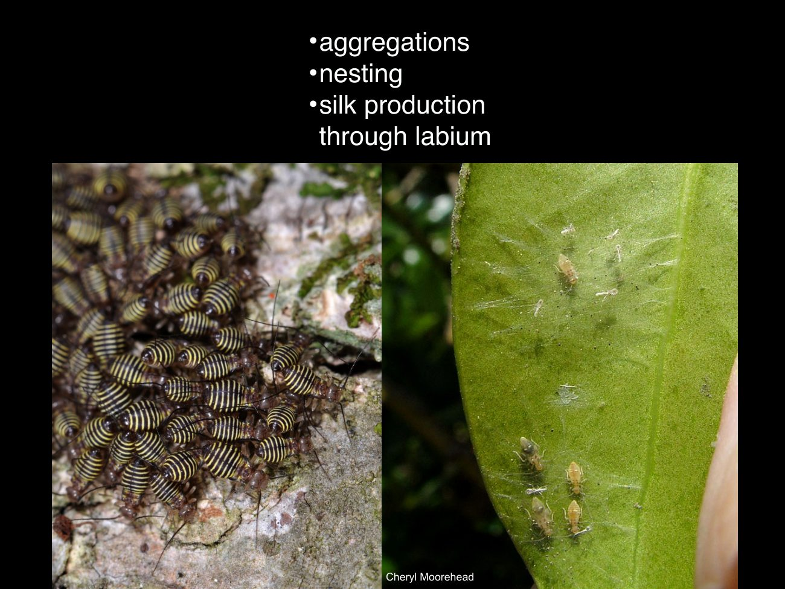](slides/slide-06.jpg)

So those bark lice, I was mentioning a lot of them kind of have social aggregations. Can form nests with silk. Often you'll see them under leaves or on tree trunks there.

There's some around Australia, but they're there's large, colourful ones in the tropics.

[↑ Slides](#slides) · [Course index](../../README.md)

## Slide 7

[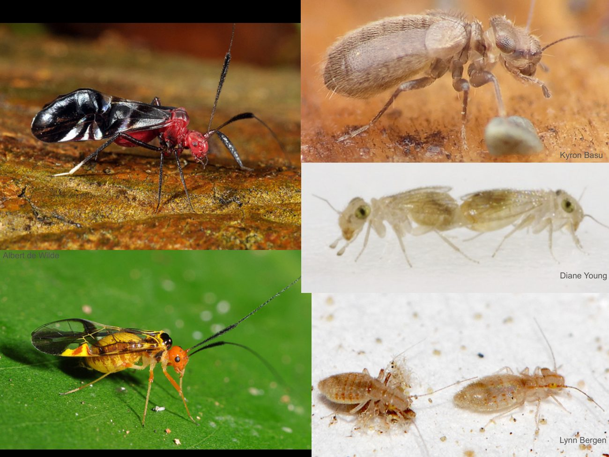](slides/slide-07.jpg)

Just giving some more examples of, some, bark lice and relatives. So there could be wingless, members of the bark lice or the book lice. But other ones are fully winged and can be large and colourful have long, antenna the wing.

The wing venation is very important to identify them.

[↑ Slides](#slides) · [Course index](../../README.md)

## Slide 8

[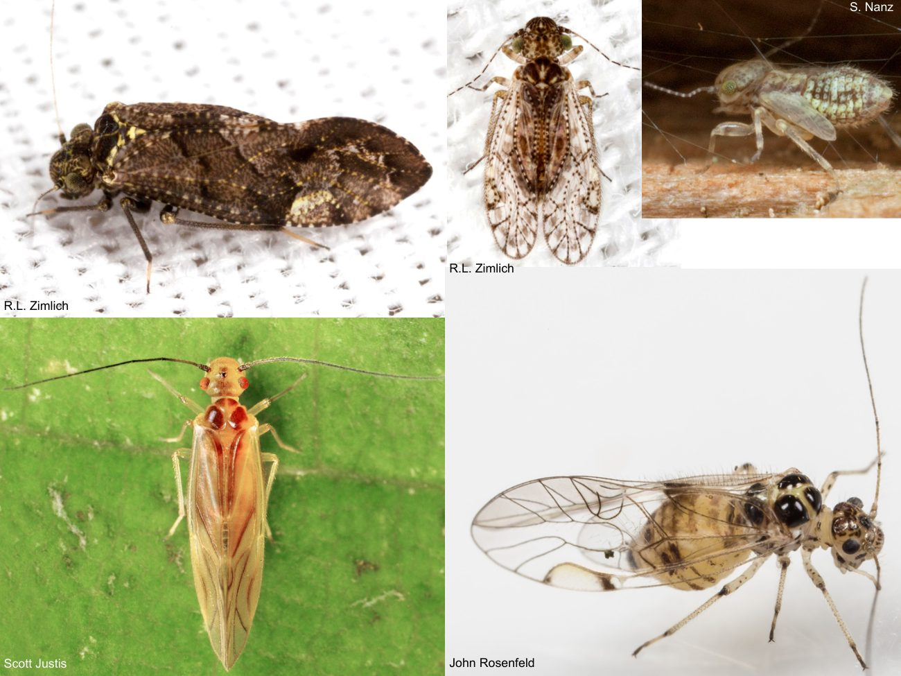](slides/slide-08.jpg)

Some more examples of, book and bark lice. Some are quite colourful. They're they're quite, diverse in Australia.

There's been some, good studies of them, but a lot more left to be discovered, for sure.

[↑ Slides](#slides) · [Course index](../../README.md)

## Slide 9

[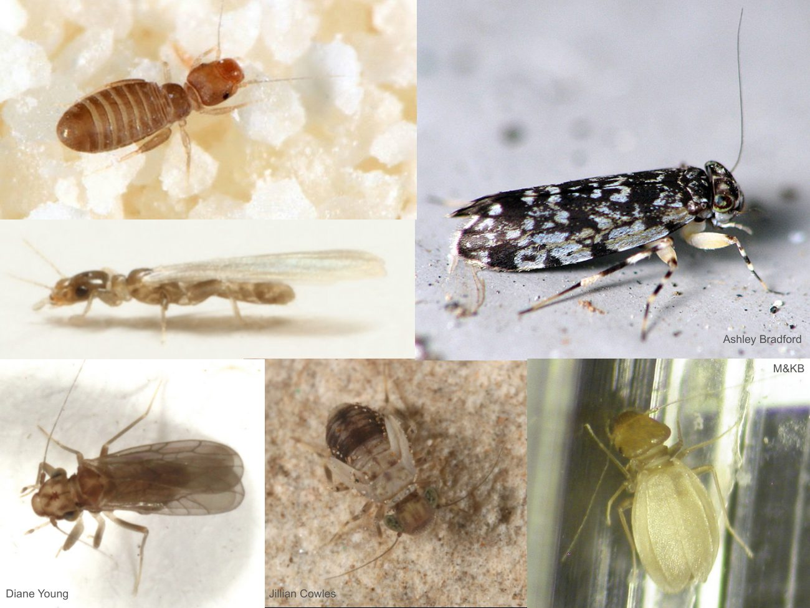](slides/slide-09.jpg)

And this last group are the book lice and relatives. So these are probably most closely related to most of the parasitic lice. However, the ones shown here are not blood sucking, but you can see they're flattened.

A lot of them have lost their wings. There's still some, colourful, scaly ones.

[↑ Slides](#slides) · [Course index](../../README.md)

## Slide 10

[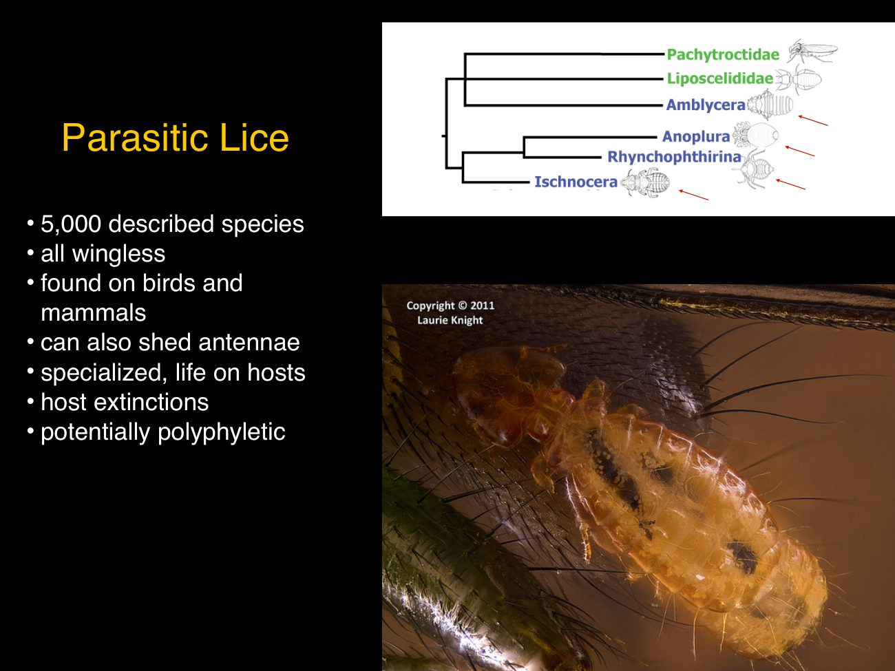](slides/slide-10.jpg)

And they are related to the parasitic ones. There's probably, which might have evolved multiple times, but they're all wingless. Found are birds and mammals.

And some of them can also lose their antennae once they find the host. They're they're quite host specific, which means that if a vertebrate goes extinct, probably the lice, that were on that vertebrate will also go extinct. And there's chewing and sucking lice, which, are probably not each other's closest relatives.

[↑ Slides](#slides) · [Course index](../../README.md)

## Slide 11

[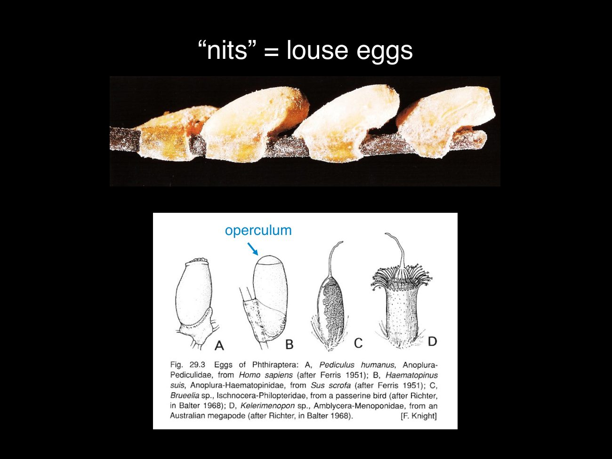](slides/slide-11.jpg)

Louse eggs are called nits. And they are. They're laid on the host itself, but they're quite diverse.

In appearance between different species.

[↑ Slides](#slides) · [Course index](../../README.md)

## Slide 12

[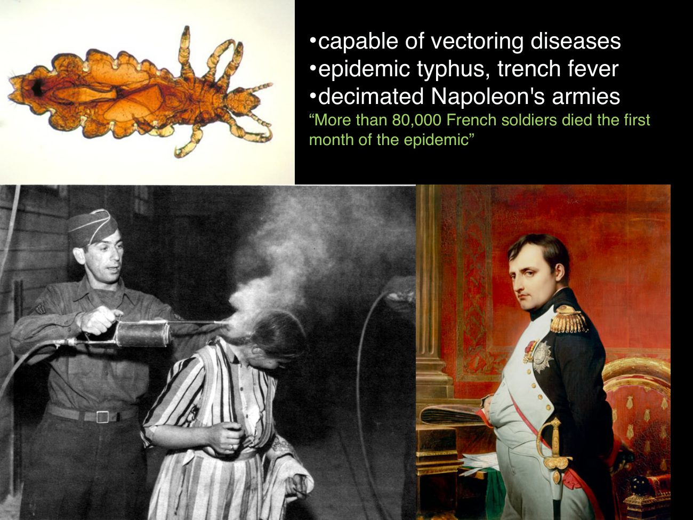](slides/slide-12.jpg)

They can vector diseases. Including typhus. Which has been a major.

Problem throughout history, deciding several, wars Because, in war, hygiene becomes a lot more difficult. So, human lice are more easily spread, and then can vector, diseases.

[↑ Slides](#slides) · [Course index](../../README.md)

## Slide 13

[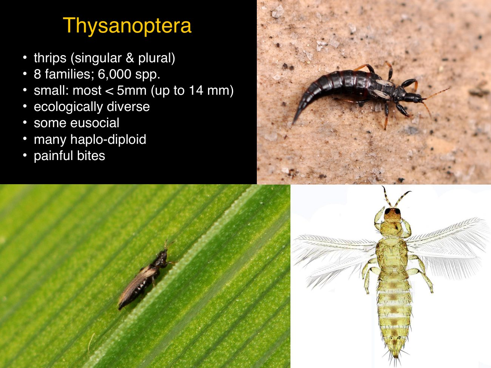](slides/slide-13.jpg)

OK, the last order we'll talk about today is the thrips, still quite a diverse, group and a lot left to be discovered because they're really small and difficult to study. These usually had to be slide mounted to be identified over 6000 species, and a lot left to be discovered. They are quite diverse in terms of what they do many are, phytophagous and could be, host specific.

But other ones are predatory or feed on fungus or saprophagous. Often they're found in, aggregations. And some are truly eusocial with, reproductive division of Labour, overlapping generations and cooperative brood care.

Most of the most well studied eusocial thrips are actually Australian. They live in the dry interior and, inside they form colonies inside stalks of plants. And they, can kind of use their eusocial to help better forage for water and food similar to which we'll learn about later.

Many thrips are haploid diploid. So, one sexual determination system genetically is because males are haploid don't have two copies of the genome, and females are diploid. So this leads to some thrips, essentially in the same family being more closely related to each other than others.

Which may be a factor, promoting the evolution of eusocial as we saw earlier. They have this kind of unique three pronged, piercing sucking mouth parts, which along with that, even though they're very small, if you grab one, they can bite, and it'll hurt.

[↑ Slides](#slides) · [Course index](../../README.md)

## Slide 14

[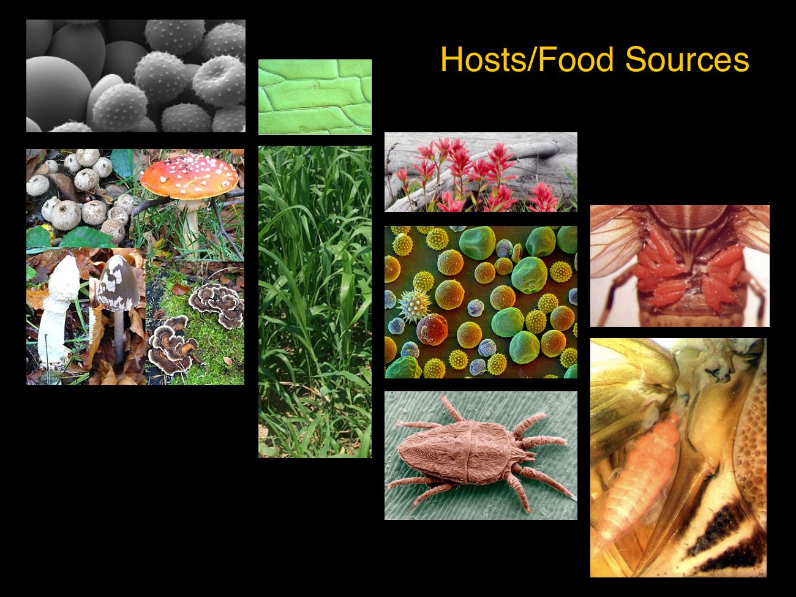](slides/slide-14.jpg)

So just to give some examples of the, ecological niches that thrips live in that their food sources, they do almost everything, attacking fungus. There's phytophagous ones. And what they do, the phytophagous ones, they have these tiny, sharp, stylets.

They actually will pierce each cell of the plant and empty the cell. So, along with that, a lot of the plant feeding ones are, dangerous, vectors of plant diseases. Many of them will be in the environment eating fungal spores or pollen.

And some are predators. Even though these are really tiny, they'll be predators of even smaller things like mites. And there's also thrips that are parasites, mainly parasites of other, insects.

A lot that are parasites of bugs.

[↑ Slides](#slides) · [Course index](../../README.md)

## Slide 15

[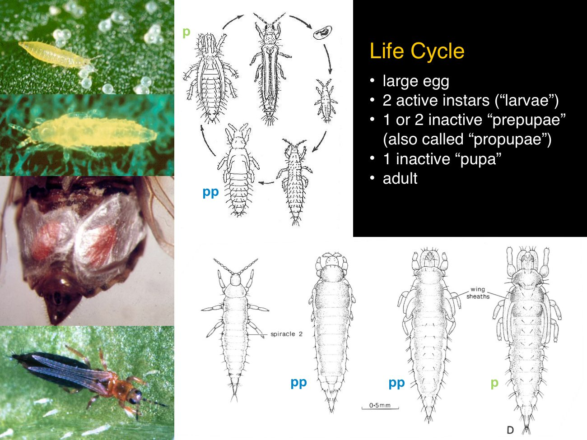](slides/slide-15.jpg)

Their, life cycle. So there's no pupal stage in thrips. However, there's some strong differences between the nymphs and adults.

And they have a stage, in between, the nymph and an adult stage called a pre pupa, where, and then a pupa, where they are inactive. But it's not a true, pupa as an holometabolous insects. But it's It's quite a distinctive and surprising convergence of that, life history.

[↑ Slides](#slides) · [Course index](../../README.md)

## Slide 16

[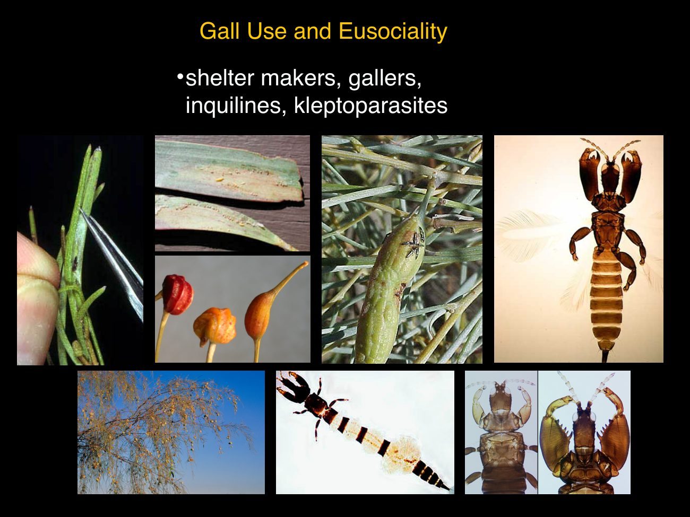](slides/slide-16.jpg)

As I mentioned, Eusocial thrips tend to be phytophagous and make galls live in stems, of plants, including in Australia. And they have similar to the termites we talked about in the last lecture. There's castes, including soldier thrips with these heavily armoured heads and legs.

[↑ Slides](#slides) · [Course index](../../README.md)

## Slide 17

[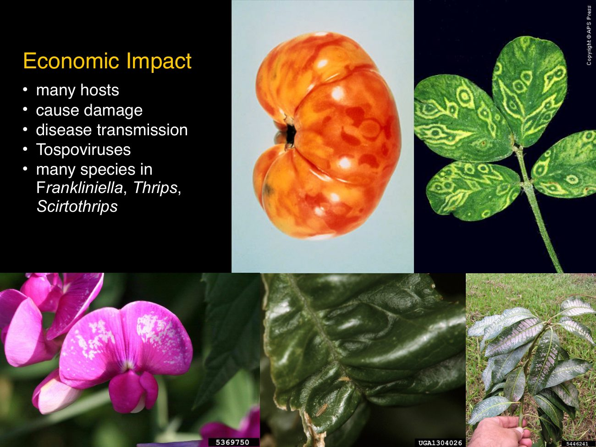](slides/slide-17.jpg)

And thrips the phytophagous ones, not the eusocial ones, but phytophagous ones, since they can be quite host specific and attack plants in a different way in terms of invading, individual cells or parts of the plants, they can vector major, plant diseases. Including things that damage, ornamental plants and tomatoes. There's a lot of species of thrips that do not have any economic impact.

But there's, some major, plant pests among the thrips.

[↑ Slides](#slides) · [Course index](../../README.md)

## Slide 18

[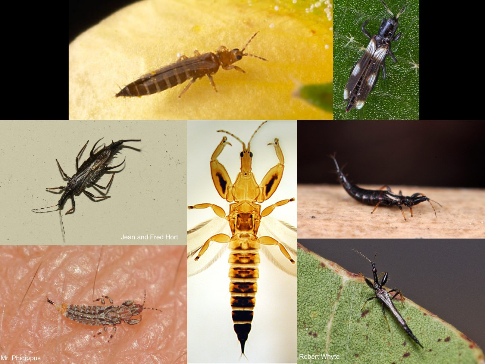](slides/slide-18.jpg)

Just to show some examples of the diversity of thrips, even though they're quite small. The actually the largest thrips in the world is really common. In Australia, it feeds on, fallen eucalyptus leaves.

You can find it in Canberra [following word unclear]. Anyway, some of them are heavily armoured. They have these narrow wings with fringes.

A lot of them can fly. And the modification of the wings are important for their identification. This, kind of tube like head that holds those, three stylets, that are used to pierce their food source.

[↑ Slides](#slides) · [Course index](../../README.md)

## Source notice

this material has been reproduced and communicated to you by or on behalf of the Australian National University in accordance with Section 113 P of the Copyright Act 1968. The material in this communication may be subject to copyright Under the act, any further reproduction or communication of this material by you must be consistent with the provisions of the act. Do not reproduce this material. Do not remove this notice.

[← Previous lecture](../09-invertebrate-intro-part-9-insect-overview-3-polyneoptera-2-dictyoptera-etc/README.md) · [Course index](../../README.md) · [Next lecture →](../11-invertebrate-intro-part-11-insect-overview-5-hemiptera-1-scales-hoppers/README.md)
