# Invertebrate Intro Part 11 - Insect Overview 5 - Hemiptera 1 - scales, hoppers

[← Previous lecture](../10-invertebrate-intro-part-10-insect-overview-4-paraneoptera-lice-thrips/README.md) · [Course index](../../README.md) · [Next lecture →](../12-invertebrate-intro-part-12-insect-overview-6-hemiptera-2-true-bugs/README.md)

**Slides + cleaned transcript** · 21 slides

English transcript with fillers and repeated false starts removed. Technical terms are corrected using the slides and context. Bracketed wording marks reconstruction or uncertainty. Slide boundaries are inferred from content; the transcripts have no slide timestamps.

[Original transcript](original-transcript.txt) · [Text-only version](cleaned-transcript.md) · [Editing notes](../../EDITING-NOTES.md) · [Correction record](corrections.md)

[Searchable slide text](slide-text.md). Click a slide image to open it at full size.

## Slides

[1](#slide-1) · [2](#slide-2) · [3](#slide-3) · [4](#slide-4) · [5](#slide-5) · [6](#slide-6) · [7](#slide-7) · [8](#slide-8) · [9](#slide-9) · [10](#slide-10) · [11](#slide-11) · [12](#slide-12) · [13](#slide-13) · [14](#slide-14) · [15](#slide-15) · [16](#slide-16) · [17](#slide-17) · [18](#slide-18) · [19](#slide-19) · [20](#slide-20) · [21](#slide-21)

## Slide 1

[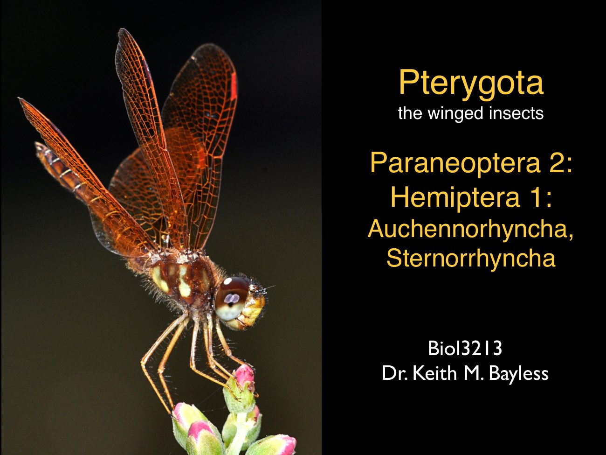](slides/slide-01.jpg)

We're going to go further into the Paraneoptera and talk about the bugs. Paraneoptera is this group of, three orders the bugs, lice and thrips that all have, piercing-sucking stylets. And they're closely related to the true, Holometabola [end of phrase unclear].

[↑ Slides](#slides) · [Course index](../../README.md)

## Slide 2

[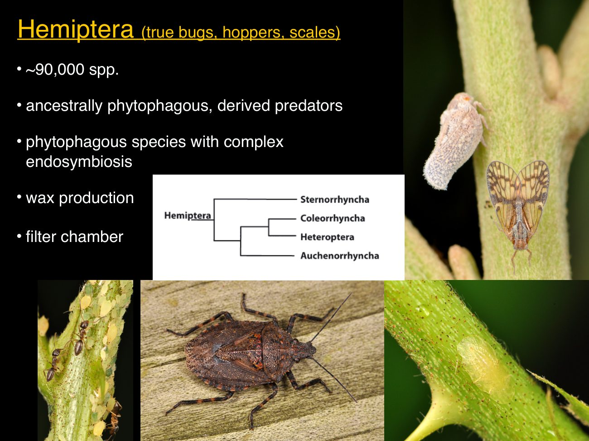](slides/slide-02.jpg)

It's the largest order outside of Holometabola, over 90,000 species. And we're going to kind of split this up into the major groups which have been considered orders at various times in the past. These include the true bugs, which will be the next lecture.

And today we'll talk about the hoppers and the scales, which are two other major lineages of Hemiptera. Most of them are plant feeding, but some, have, evolved to be predators or parasites. Often the plant feeding, species have very complex adaptations morphologically and associations with endosymbionts to better, adapt to their food sources.

Hemiptera can produce wax, which they often use for defence. And they have a filter chamber to help them digest liquid, diets. So the scales and relatives are sister to the rest.

Then the hoppers are sister to the, two groups we'll talk about in the next lecture.

[↑ Slides](#slides) · [Course index](../../README.md)

## Slide 3

[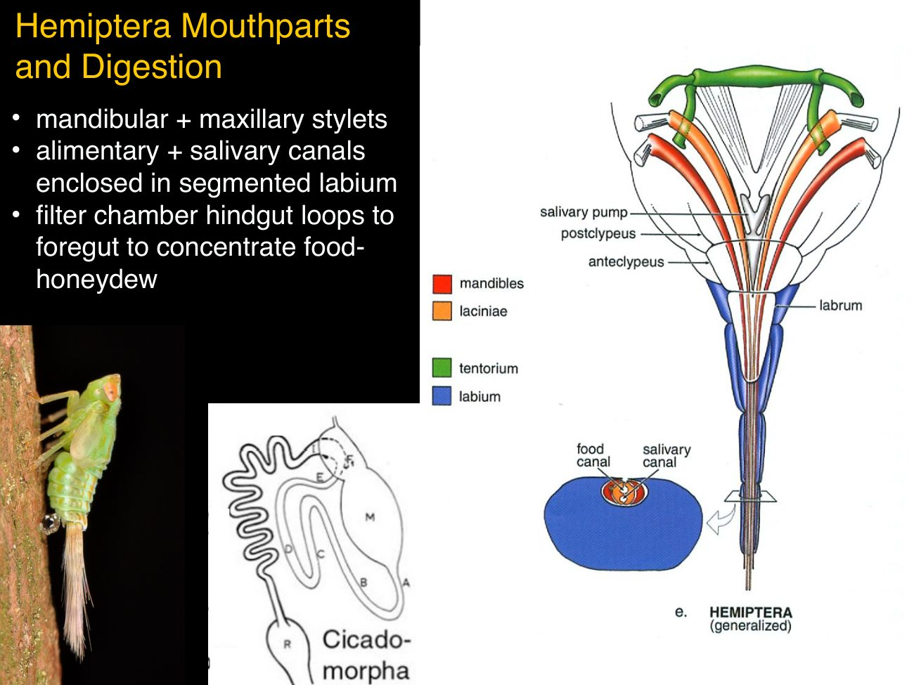](slides/slide-03.jpg)

Hemiptera, as we mentioned before, similar to other paraneopteran groups, have piercing sucking mouth parts of rostrum, in their rostrum. The external part is made from the labium. And it's segmented and can, move back and forth.

And the, piercing sucking stylets are formed from the mandibles and the laciniae, which are part of the labium. Those, four, stylets form a tube, which is enclosed in that protective, labium that is the form of the rostrum. Another major, specialised character in the digestion of in Hemiptera is the filter chamber.

So in the filter chamber, the hind gut loops back onto the fore gut and the reason it's doing that is to, filter out the water so these insects can have very dilute watery diets and are very efficient at filtering out the water and concentrating the nutrients in their liquid diets.

> **Editorial note:** Laciniae are parts of the maxillae, not the labium. The source’s anatomical claim is retained.

[↑ Slides](#slides) · [Course index](../../README.md)

## Slide 4

[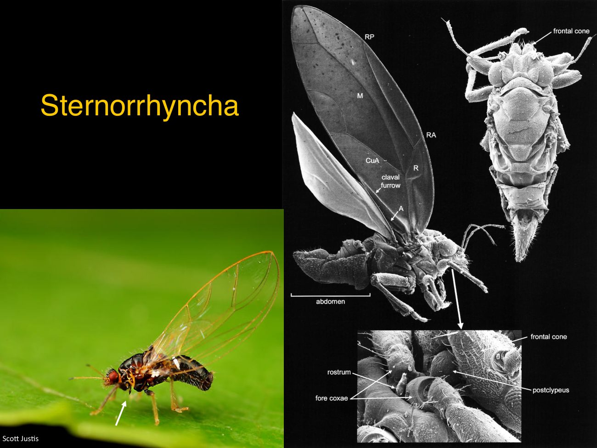](slides/slide-04.jpg)

We'll talk about the Sternorrhyncha, which are the scales and relative scales and plant lice and aphids. They tend to be quite small, a larger, forewing and hindwing. And the forewing is a bit heavier, and more heavily sclerotised.

But a lot of these have, secondary secondarily lost their wings.

[↑ Slides](#slides) · [Course index](../../README.md)

## Slide 5

[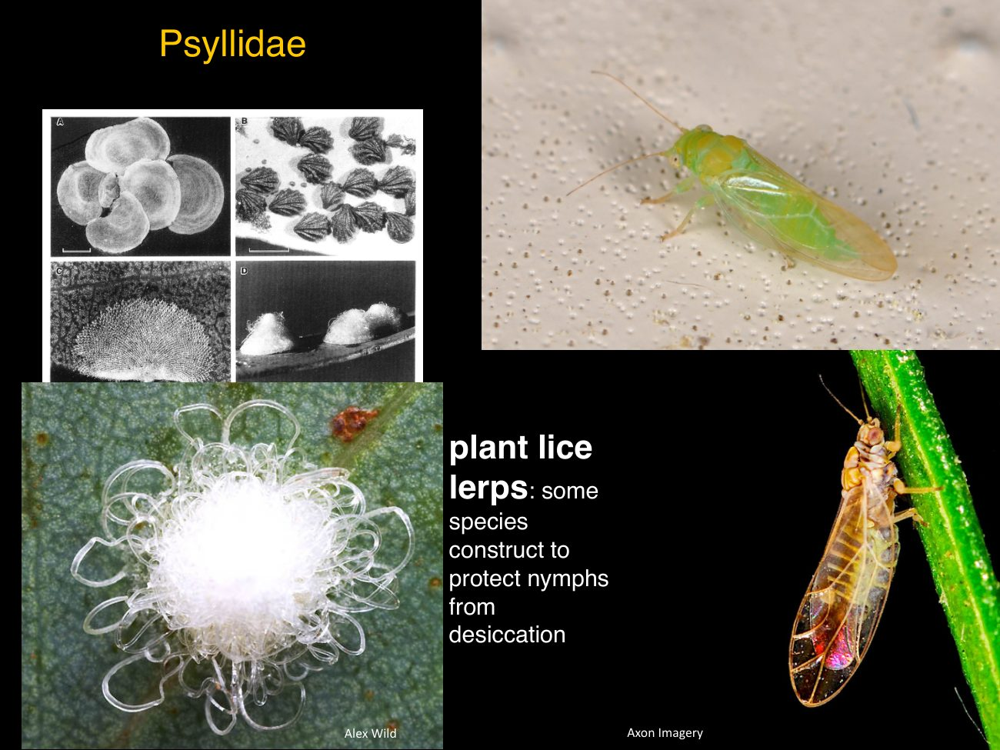](slides/slide-05.jpg)

We'll talk about a couple of families of scales and relatives. The first is Psyllidae, which are the plant lice. These are very diverse and important in Australia, particularly in, eucalyptus woodlands.

They're the adults are, the these, insects that feed on plants and the nymphs, form shells that are called lerps. These are formed from crystallised sugars that they get from their plant. Food source.

So, along with filtering out a lot of the water, these insects also have to filter out a lot of sugar in order to find nitrogenous compounds and protein. For digestion And Psyllidae use that sugar to, crystallise in various ways to form these lerps, which you can see on leaves of a lot of different eucalypt and other plants, in Australia and worldwide. And since they're made of sugar, the these, actual structures can be edible, so some birds and things will eat those.

But other things other predators will be deterred by the structure of those lerps. And they also, help prevent, desiccation. As the nymphs sits out in the sun on that leaf, they're protected under the, lerp cover.

[↑ Slides](#slides) · [Course index](../../README.md)

## Slide 6

[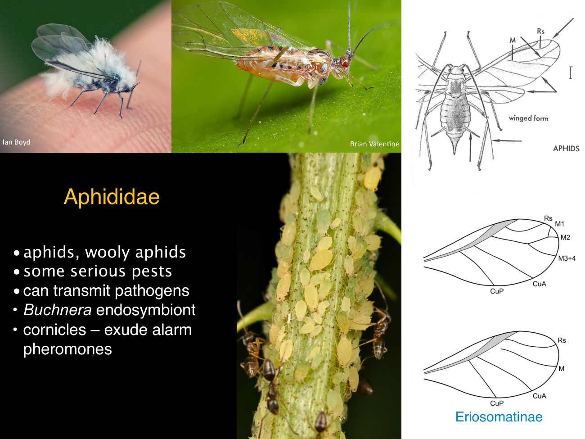](slides/slide-06.jpg)

That's the plant lice onto the aphids. So there's a few different families of aphids, but the largest ones is the largest. One is called Aphididae.

The most diverse and important group of aphids, including woolly aphids, that cover themselves in wax for protection. So these are all plant feeding, similar to the plant lice. And, they also are pests of some crops and ornamentals and, can transmit diseases to their host plants and can sometimes become so numerous that they physically damage their host plants.

Similar to a lot of other, Hemiptera they have liquid diets that are, very high in water. And then the next most common thing is sugar and lower in other major, chemicals needed for, cellular processes like proteins and nitrogenous compounds. So aphids have an endosymbionts called, which, helps them process sugar into other, necessary.

Biochemicals. You'll see other groups of Hemiptera use various other, types of endosymbiont, organisms to, deal with their unique, difficult, food source. Aphids also have cornicles, which are, these structures towards the end of the abdomen.

They are not [unclear structure], because they're not on the last abdominal segment, they are, they come out of the top of the abdomen and they're used for alarm pheromones and chemical defence.

[↑ Slides](#slides) · [Course index](../../README.md)

## Slide 7

[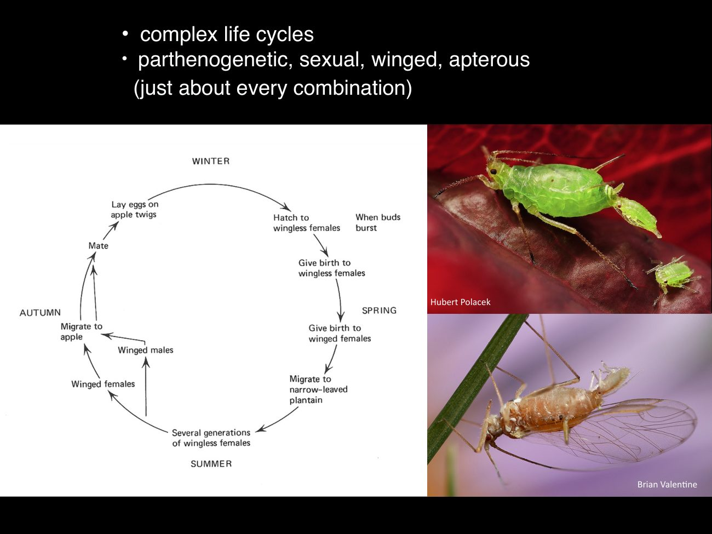](slides/slide-07.jpg)

So a aphids have really, complex life cycles and can reproduce, very quickly, and, can take over plants. And many of them are tended by, social Hymenoptera like ants, so they can use similar to the way the plant lice use the excess sugar to form those shells. Aphids will use excess sugar to feed both the Buchnera endosymbiont and, ants that are tending them.

So in aphids, they have a really complex life cycle, essentially where they, some parts of the year they will reproduce parthenogenetically. So the founding, female will lay a lot of eggs that become, females. And they reproduce very quickly that way.

And then another generation will have winged males and females, which leave the host plant mate and find new, food sources. And these are often, these cycle through the seasons, depending on, the parthenogenetic, or non parthenogenetic life cycles. And so the same species can have a lot of different appearances, winged or not winged, and sexually reproductive or parthenogenetic.

> **Editorial note:** Many aphids give birth to live young in parthenogenetic generations, as the slide shows; the transcript’s generalisation about laying eggs is retained as a lecture claim.

[↑ Slides](#slides) · [Course index](../../README.md)

## Slide 8

[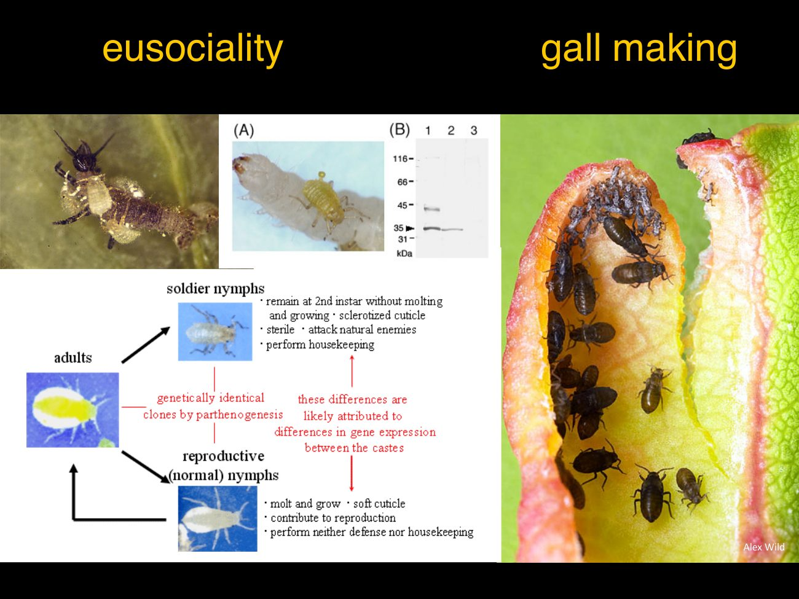](slides/slide-08.jpg)

Along with that, since some of them have these, unique, comp complex life cycles. There's also is eusociality present in aphids, which include, soldiers and non soldiers, mainly in the nymphs similar to eusocial thrips. These are often inside plants inside the galls and other aphids will also form galls that are not eusocial.

[↑ Slides](#slides) · [Course index](../../README.md)

## Slide 9

[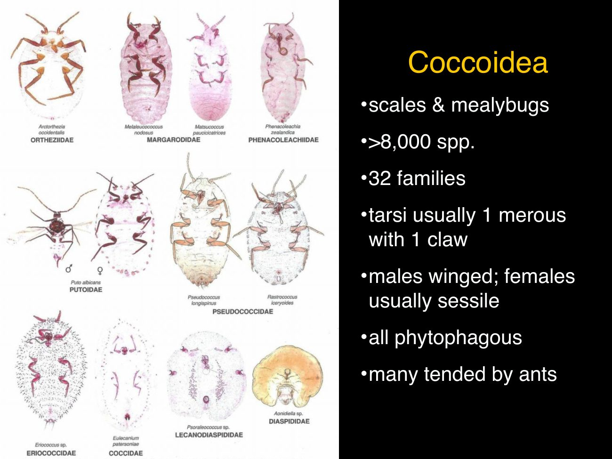](slides/slide-09.jpg)

The last major group of Sternorrhyncha, which is a major lineage of Hemiptera are the scales and relative scales and mealy bugs. So this is, a large group, including many families called Coccoidea. So, Coccidae [probable] is one group, one family of the scales.

But there's a lot of other important, families of scale insects. And the higher level classification is also, undergoing a lot of reconsideration. And is, a heavy area of publication.

So scales the is a really derived, really strange looking insects that often can be difficult to even tell. You're looking at an insect. Look at that.

That diaspidid in the bottom corner there. So they usually have reduced, tarsi and, tarsi. Generally, the females are heavily reduced and stay on the host plant.

And the males are winged to, leave the plant that they're on and find, mates on another plants. All scales are plant feeding and similar to the aphids. A lot of them are tended by ants, so they give sugar to the ants and the ants give them protection.

[↑ Slides](#slides) · [Course index](../../README.md)

## Slide 10

[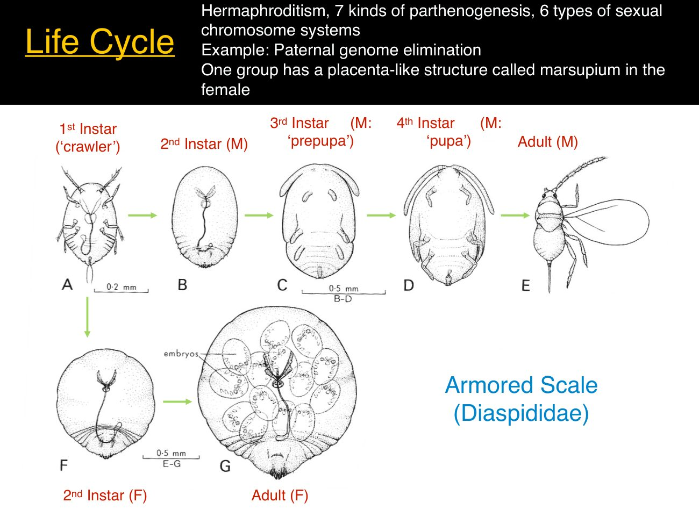](slides/slide-10.jpg)

The first instar of scales is, mobile. And we'll try to find other new host plant or a new part of the plant to attach. And then, the they will, attach to the plant.

Their stylets are very long and will go into the plant tissue and become, sessile similar to the thrips. There's kind of a, an analogous stage to a pupa, since there's such a strong morphological difference between nymphs and adults. The females, will stay on the plant, often forming a shell or protecting themselves with wax or different, biochemicals.

And the males will, moult into being winged and, fly off.

[↑ Slides](#slides) · [Course index](../../README.md)

## Slide 11

[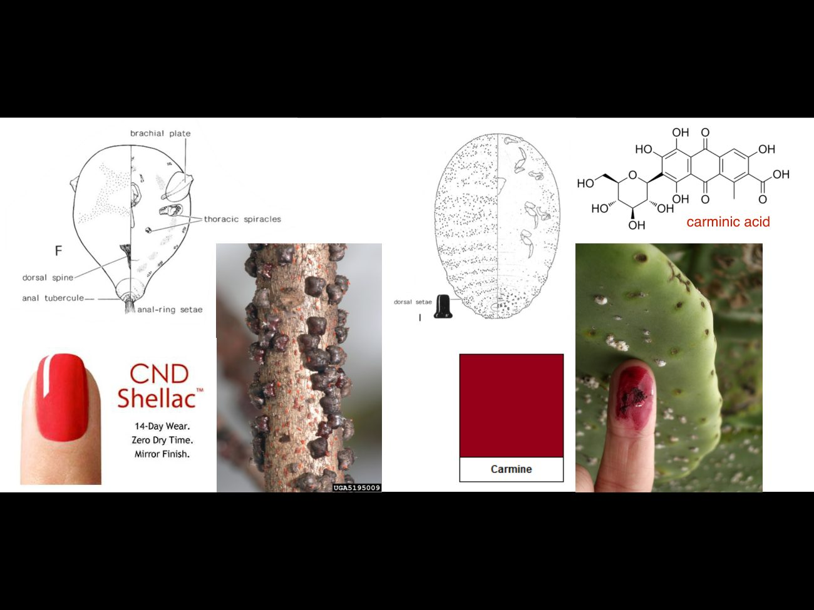](slides/slide-11.jpg)

So those, chemicals are used for defence or for, in internally in the scales. Have some, important properties. So there's two, major, bio byproducts of scales that are used commercially.

One of those is shellac. So there's a scale that forms this waxy, product that is processed into shellac and then another scale that forms Carmine, that this is a scale that attacks cactus in South America and that is used in red dye in a huge number of products. In, cosmetics and human food products.

[↑ Slides](#slides) · [Course index](../../README.md)

## Slide 12

[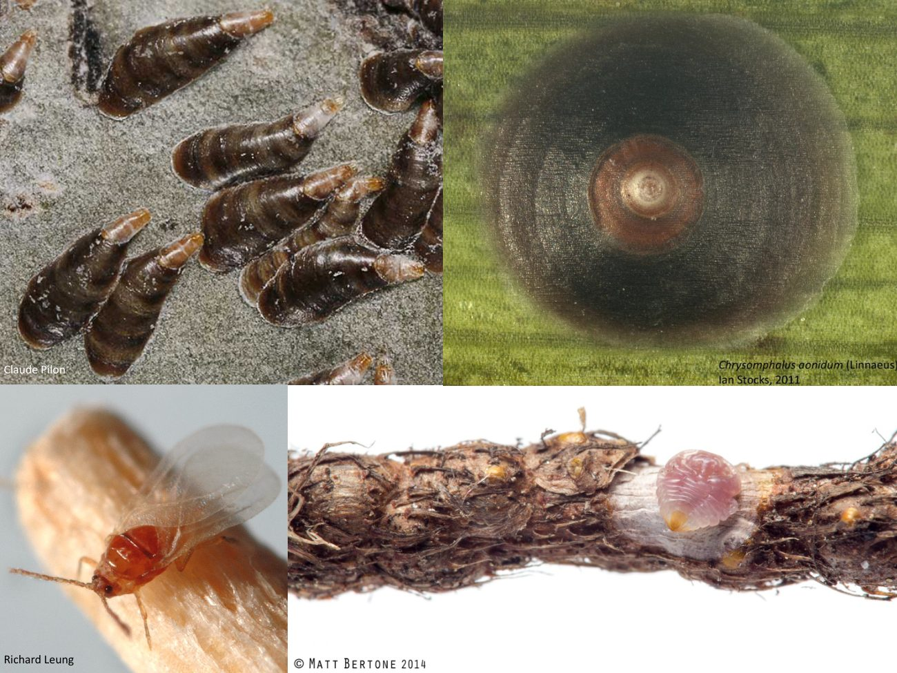](slides/slide-12.jpg)

Scales are really diverse in appearance. Often they cover themselves in some kind of shell. So this bottom one is a twig, covered in scale shells.

You can hardly tell that scales are there, since they're they're blending in. But if you break one off, you'll see that there's a female scale there. Other ones are heavily armoured.

Look looking like mollusk or something like that, or, covering themselves of wax or blending in with their host plant. And there's a male scale insect in the corner similar to true flies. Often male scale insects have their hind wings reduced and, only have forewings.

You can tell them apart from flies, since the wing venation is heavily reduced and the head will be really different, they'll have a different type of, sucking proboscis.

> **Editorial note:** Many adult male scales have reduced or nonfunctional mouthparts. The source’s proposed sucking-proboscis distinction from flies is not a general identification rule.

[↑ Slides](#slides) · [Course index](../../README.md)

## Slide 13

[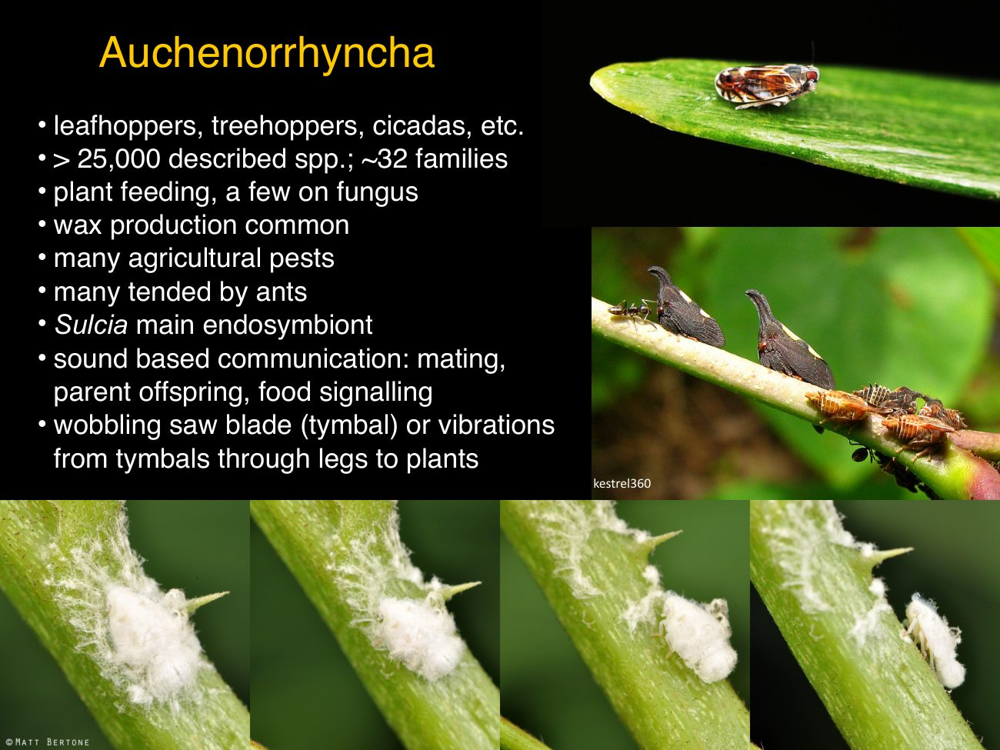](slides/slide-13.jpg)

[Transition from Sternorrhyncha: exact wording unclear], now we will go into the hoppers and relatives. This is another major lineage of the Hemiptera, really diverse and a lot of families. There's kind of two, major lineages within the Auchenorrhyncha, which is the leaf hoppers and cicadas and relatives and then the plant hoppers and relatives, almost all plant feeding.

There's, like a couple of major groups that have moved to fungus, and they live down in the leaf litter. A lot of these produce wax for protection or to help with desiccation. And a lot are, pests of, agricultural plant products.

Similar to the aphids and scales they can. They're tended by ants. They give sugar in exchange for, protection, but different than the aphids and relatives.

They have a, another, endosymbiont called Sulcia. That's that's used to, process sugar into other, major important carbohydrates and, biochemicals Auchenorrhyncha. A lot of them have sound based communication, so cicadas are an example.

But other groups of Auchenorrhyncha also, produce sound or drum on the their plants to communicate, so they will often live in a communal group and communicate, to each other via sound or substrate. Born communication, in cicadas. They have, the A tymbal to make those real really loud noises, and other groups will drum on their host plants.

[↑ Slides](#slides) · [Course index](../../README.md)

## Slide 14

[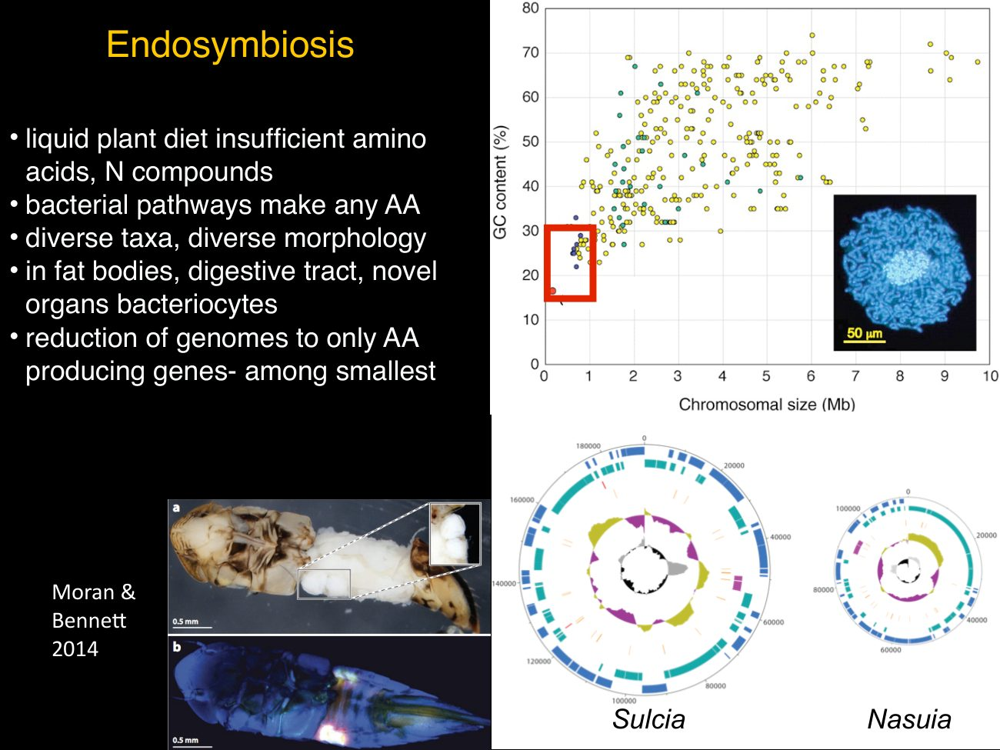](slides/slide-14.jpg)

Endosymbiosis is, a really important running theme throughout Hemiptera and in other, insects as well. So with through their bacterial endosymbionts, they can use their scant nitrogenous resources and, sugars and form almost any amino acid that they need. So there's it's very difficult to get proteins in the plant, xylem or phloem that they're consuming.

So they use endosymbiosis to augment their diets. Those endosymbionts There's a number of different, bacteria and fungus that have taken up those niches independently and generally, they become quite reduced, and some among some of the smallest genomes of any organisms. And some of them will be, associated only with certain tissues of the host inside special organs to accommodate those, endos.

[↑ Slides](#slides) · [Course index](../../README.md)

## Slide 15

[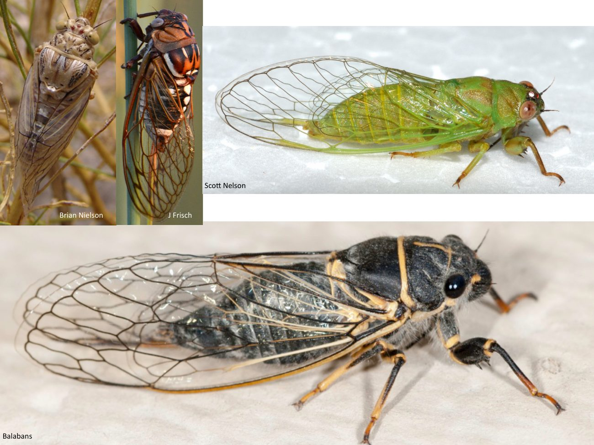](slides/slide-15.jpg)

Here's some examples of Auchenorrhyncha, the cicadas and relatives, these are really diverse. In Australia, there's a lot of important, higher level lineages. These are sound producing the larvae live in the soil attacking plant roots.

And the adults come out to, in the heat of the summer to make a lot of noise and find mates.

[↑ Slides](#slides) · [Course index](../../README.md)

## Slide 16

[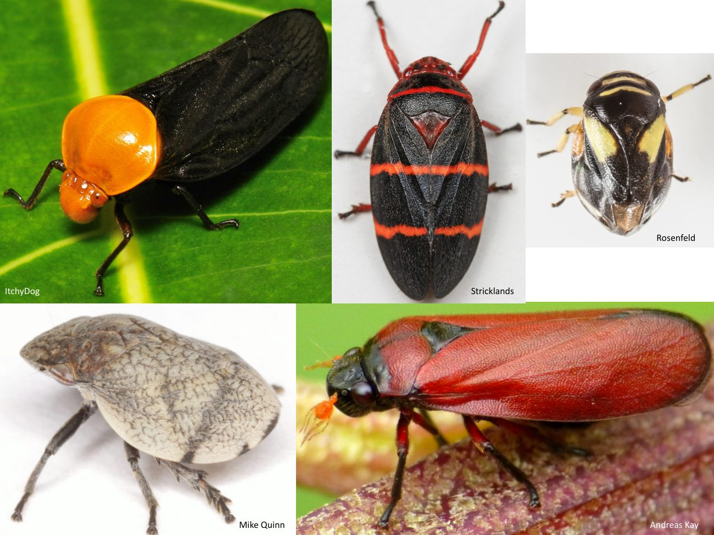](slides/slide-16.jpg)

Some other groups of Auchenorrhyncha. These are really colourful, frog hoppers that, their nymphs use wax and foam to protect themselves.

[↑ Slides](#slides) · [Course index](../../README.md)

## Slide 17

[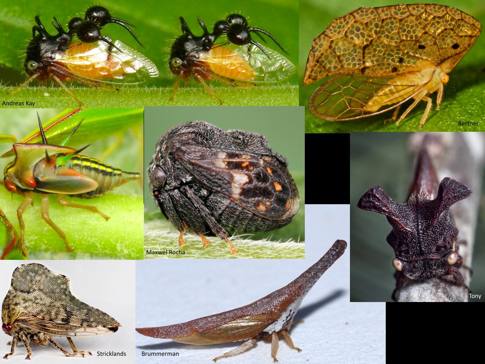](slides/slide-17.jpg)

The tree hoppers, it's the pronotum that is enlarged and covers the body and is modified at the various shapes for defence or for crypsis the nymphs of, tree hoppers. So one of those doesn't have developed wings and is, a nymph are still quite colourful and spiky and, protected. And in various ways, so These have wings that are held often enclosed under the pronotum or visible And then they sit and attack their plant hosts.

[↑ Slides](#slides) · [Course index](../../README.md)

## Slide 18

[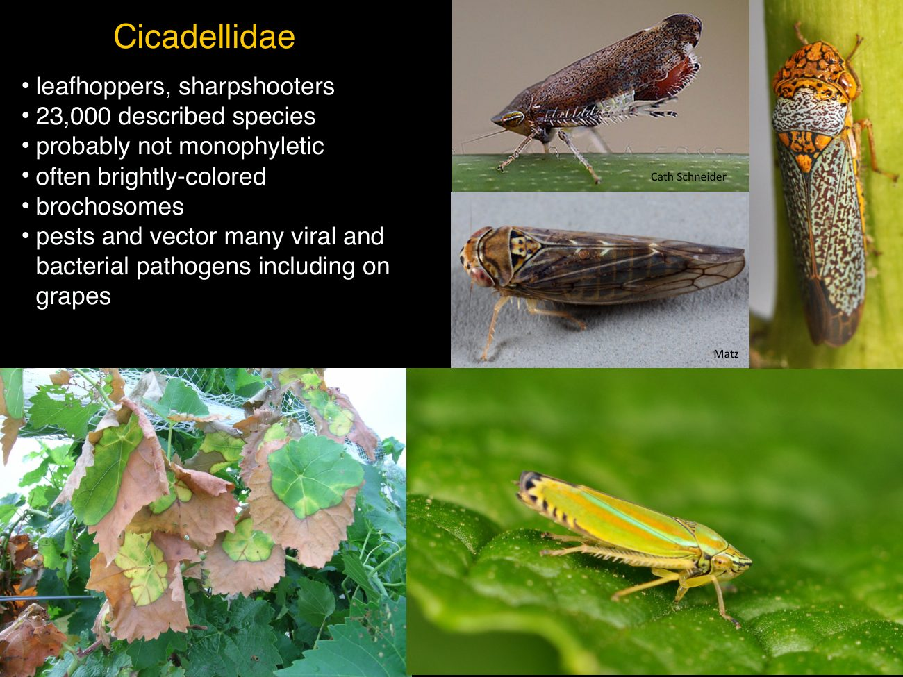](slides/slide-18.jpg)

One family that I'll mention in specific because it's really important are the Cicadellidae. So Cicadellidae is the most diverse family of organisms outside of Holometabola, insects. So over 20 23,000 species known and a lot more out there.

A lot to be described this huge group is probably not, a single natural group, But, more research is needed there to figure out the higher level classification of cicadellids. They protect themselves with these complex, carbohydrate spheres called brochosomes. There.

The many of them are quite host specific on their plants. And some are agricultural pests that can vector, viral and bacterial diseases to their host plants. So some of the major biosecurity threats in Australia are cicadellids that can, vector viruses that kill grapes.

But beyond that, even though they're often very small and some are nondescript, they're incredibly diverse and colourful. And, some are pretty charismatic.

> **Editorial note:** Brochosomes are generally described as protein-rich particles, not simply carbohydrate spheres. A major grape disease vectored by sharpshooters, Pierce’s disease, is caused by the bacterium Xylella fastidiosa rather than a virus. These are factual clarifications, not transcription substitutions.

[↑ Slides](#slides) · [Course index](../../README.md)

## Slide 19

[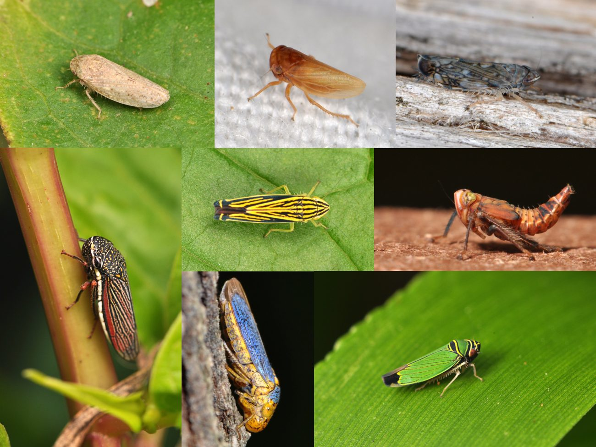](slides/slide-19.jpg)

Here's just some more examples of, some cicadellids. Some are cryptic on their leaf or their branch and other ones are quite, colourful maybe for, alarm Or, surprise. Surprising predators.

[↑ Slides](#slides) · [Course index](../../README.md)

## Slide 20

[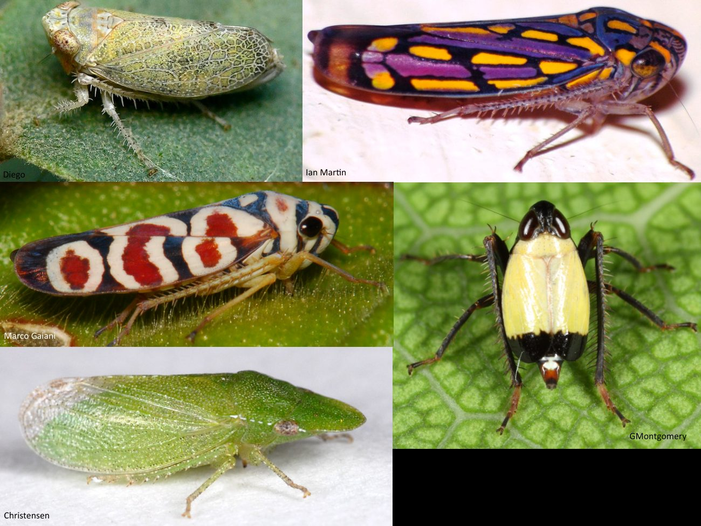](slides/slide-20.jpg)

Here's some really, elegant, colourful, cicadellids. And some have various, modified head shapes. Really, diverse group that needs a lot more study in Australia.

[↑ Slides](#slides) · [Course index](../../README.md)

## Slide 21

[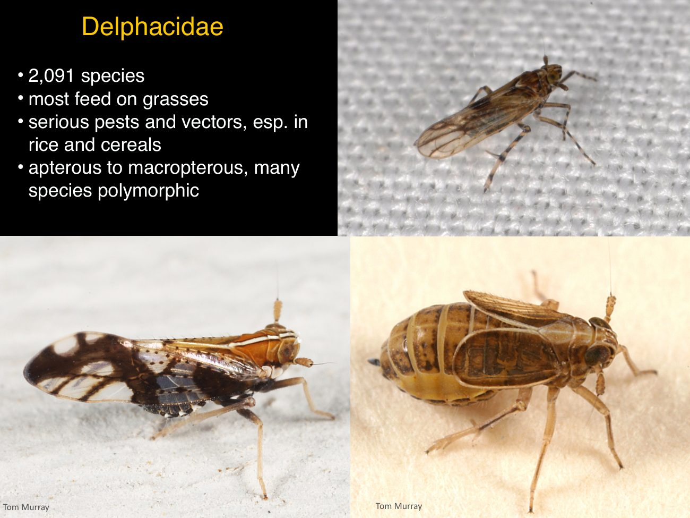](slides/slide-21.jpg)

I'll talk about one more family of Auchenorrhyncha because it includes some important pests, which are the Delphacidae. These are mostly feed on, monocots, including grasses. So, then they can vector viral diseases to their hosts.

So there's really important pests of particularly rice and grains, in the family Delphacidae. Some of these are, polymorphic where some generations will not have developed wings and the same species in other generations will develop wings to find new hosts, often kind of small, brown and more nondescript, but, really abundant and have a lot of, economic impact.

[↑ Slides](#slides) · [Course index](../../README.md)

## Source notice

this material has been reproduced and communicated to you by or on behalf of the Australian National University In accordance with section 103 P of the Copyright Act 1968. The material in this communication may be subject to copyright under the act. Any further reproduction or communication of this material by you must be consistent with the provisions of the act. Do not reproduce this material. Do not remove this notice.

[← Previous lecture](../10-invertebrate-intro-part-10-insect-overview-4-paraneoptera-lice-thrips/README.md) · [Course index](../../README.md) · [Next lecture →](../12-invertebrate-intro-part-12-insect-overview-6-hemiptera-2-true-bugs/README.md)
