# Invertebrate Intro Part 12 - Insect Overview 6 - Hemiptera 2 - true bugs

[← Previous lecture](../11-invertebrate-intro-part-11-insect-overview-5-hemiptera-1-scales-hoppers/README.md) · [Course index](../../README.md) · [Next lecture →](../13-invertebrate-intro-part-13-insect-overview-7-smaller-holometabolous-orders/README.md)

**Slides + cleaned transcript** · 19 slides

English transcript with fillers and repeated false starts removed. Technical terms are corrected using the slides and context. Bracketed wording marks reconstruction or uncertainty. Slide boundaries are inferred from content; the transcripts have no slide timestamps.

[Original transcript](original-transcript.txt) · [Text-only version](cleaned-transcript.md) · [Editing notes](../../EDITING-NOTES.md) · [Correction record](corrections.md)

[Searchable slide text](slide-text.md). Click a slide image to open it at full size.

## Slides

[1](#slide-1) · [2](#slide-2) · [3](#slide-3) · [4](#slide-4) · [5](#slide-5) · [6](#slide-6) · [7](#slide-7) · [8](#slide-8) · [9](#slide-9) · [10](#slide-10) · [11](#slide-11) · [12](#slide-12) · [13](#slide-13) · [14](#slide-14) · [15](#slide-15) · [16](#slide-16) · [17](#slide-17) · [18](#slide-18) · [19](#slide-19)

## Slide 1

[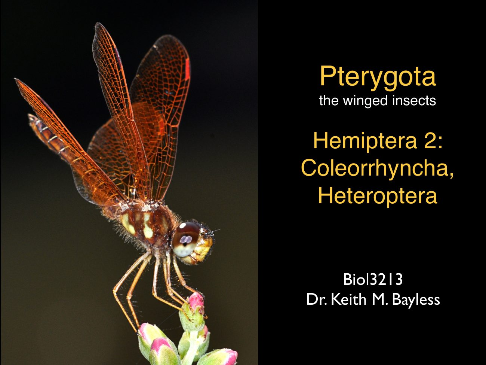](slides/slide-01.jpg)

We're going to wrap up the Hemiptera talking about the last two major lineages of Hemiptera, which will be the last group of Paraneoptera we'll discuss. And so this lecture is the last time we'll talk about insects that are not holometabolous.

[↑ Slides](#slides) · [Course index](../../README.md)

## Slide 2

[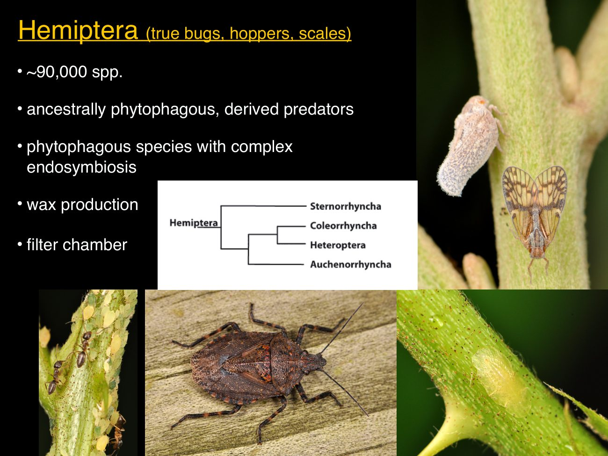](slides/slide-02.jpg)

The, I just I mentioned last time hugely diverse. Almost all our plant feeding except for some groups we'll talk about today and they tend to have, endosymbiosis, to process their, liquid based plant diet. And along with that, they produce wax and have a filter chamber to help them, process water and prevent desiccation.

[↑ Slides](#slides) · [Course index](../../README.md)

## Slide 3

[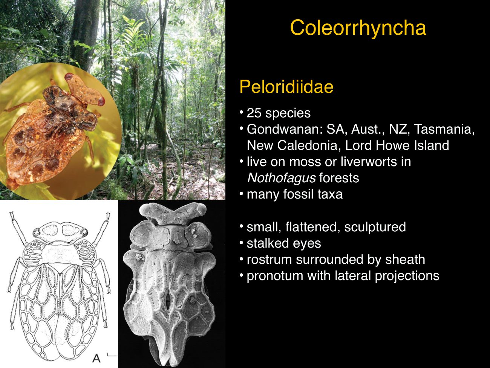](slides/slide-03.jpg)

Coleorrhyncha is a major lineage of Hemiptera, species poor, but this is a distinctive component of the Australian insect fauna. They're also found in New Zealand and, southern, South America and chile. These are, the moss bugs.

They have this, really cool, enlarged head where their eyes are really far apart and they live down on the moss, feeding on, their host plant in the leaf litter. So, a distinctive component of the Southern temperate rainforests, lots of fossils. So the ex extinct diversity is probably higher than the extant diversity.

And they're they're not very colourful, but they have all these different shapes. And rugosity [probable] and, projections on their wings and body one, just one family of Coleorrhyncha are sister to the Heteroptera.

[↑ Slides](#slides) · [Course index](../../README.md)

## Slide 4

[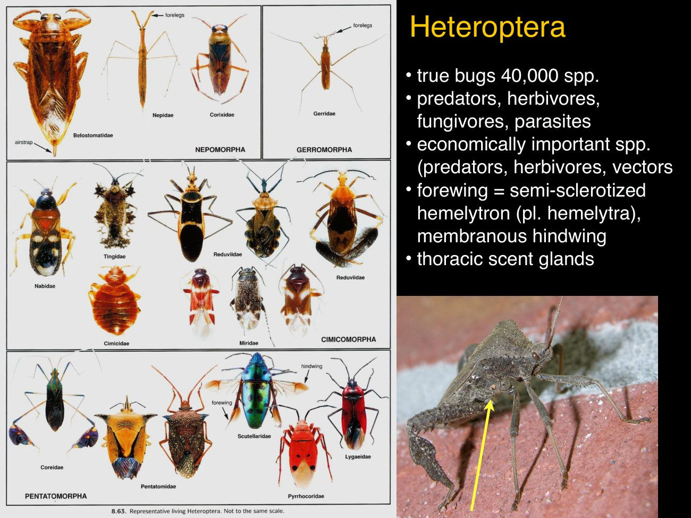](slides/slide-04.jpg)

So Heteroptera are the true bugs. This is a major lineage of the Hemiptera. Some of these are plant feeding, but a number of these, have, evolved to be predators and a few parasites as well.

Some that attack fungus is, along with that Some are economically important. Either for vectoring diseases or damaging plants, or being used for biocontrol the predatory species. A major character of Heteroptera is that the forewing, the proximal half of the forewing is hardened, so it's called the hemelytron: hemi-.

For half -elytron, is the shield. So, for instance, Beetles, their forewing is completely, a hardened shield called elytra. But in the true bugs, they instead have this hemelytron where approximately the wing is hardened.

And after that, the forewing is membranous. So they're still used for flights for flight. And the hind wing is membranous they have those large, that large rostrum for piercing and sucking their food source.

And another character in the he Heteroptera is many of them are chemically protected and have, scent glands on the thorax. We'll talk about just some subgroups of, the true bugs. Some are aquatic and predatory.

In other words, are plant feeding. We'll go through some of these subgroups of the true bugs.

[↑ Slides](#slides) · [Course index](../../README.md)

## Slide 5

[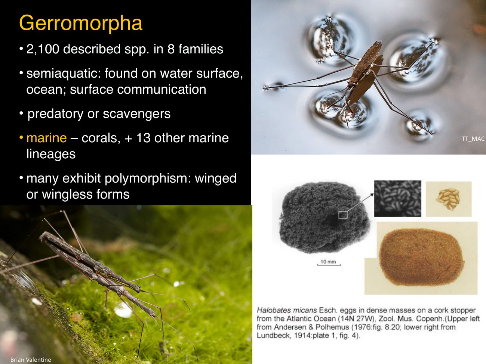](slides/slide-05.jpg)

Gerromorpha are, almost all aquatic or semi aquatic. They, mostly live on the surface of the water, so some of them are predators or scavengers, and they can communicate with each other by, waving and moving the surface of the water. There's some species that are truly marine and or even in the middle of the ocean.

And many of these are polymorphic where some will have, wings or not, depending on that generation.

[↑ Slides](#slides) · [Course index](../../README.md)

## Slide 6

[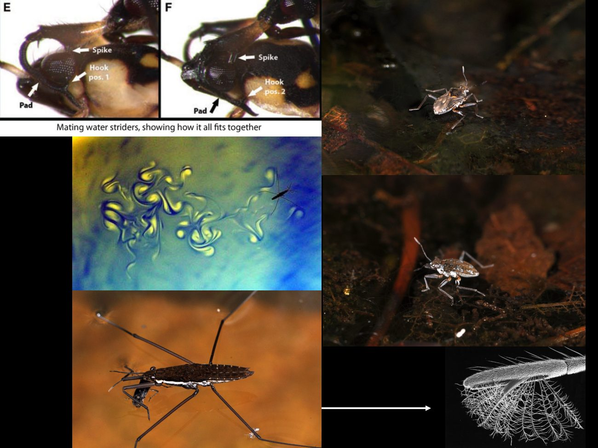](slides/slide-06.jpg)

These are really cool, bugs with a lot of strange, morphology for that semi aquatic life on the surface of the water, their middle and hind legs are often enlarged for skating. Other ones, are quite small. They have, modified forelegs for catching prey or for grabbing onto their mates.

And their tarsi, are modifying it to these fans for moving on the water. Really distinctive bugs.

[↑ Slides](#slides) · [Course index](../../README.md)

## Slide 7

[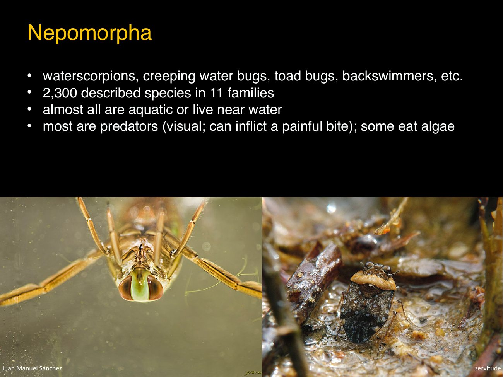](slides/slide-07.jpg)

Another major group of Heteroptera. It's an it's another, group of aquatic insects. So a reversal to that, aquatic habit that is the nepomorphs.

So that includes things like, back swimmers and water scorpions. These are almost all predatory, except for one group that, consume algae in the water. So their rostrum, is wider.

And they can just, suck down a whole, algal, mat cell, to consume. Some of them are on the edge of the water on the kind of muddy bank, but can swim quite well, and other ones live their whole life cycle in the water. What's quite distinctive about them versus other aquatic insects we've seen so far is that the adults as well as the immature, are in aquatic situations.

So Dragonflies stone flies, the adults leave the water and fly around to mate. But in these nepomorphan bugs, the adults can fly to find new bodies of water, but will also swim around and find food. In the water.

[↑ Slides](#slides) · [Course index](../../README.md)

## Slide 8

[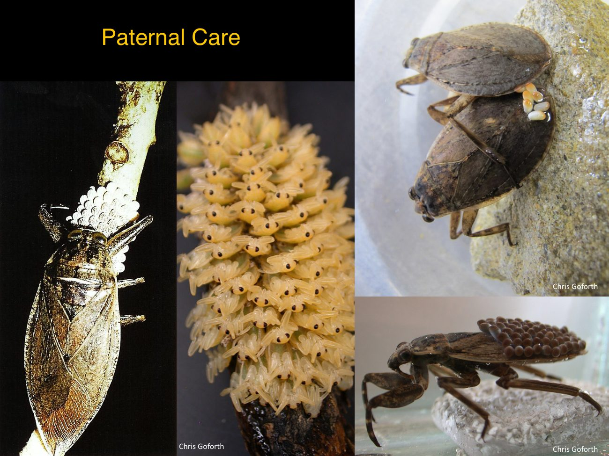](slides/slide-08.jpg)

Some of these exhibit paternal care. So the fathers are the ones, watching the young. And, essentially, the more eggs they guard or the more young that they care for, the more attractive they are to further potential mates.

So, a bit different than most other insects. But really interesting behaviour to study. And these are large, predatory aquatic bugs that have a nasty bite.

But are important predators in aquatic systems.

[↑ Slides](#slides) · [Course index](../../README.md)

## Slide 9

[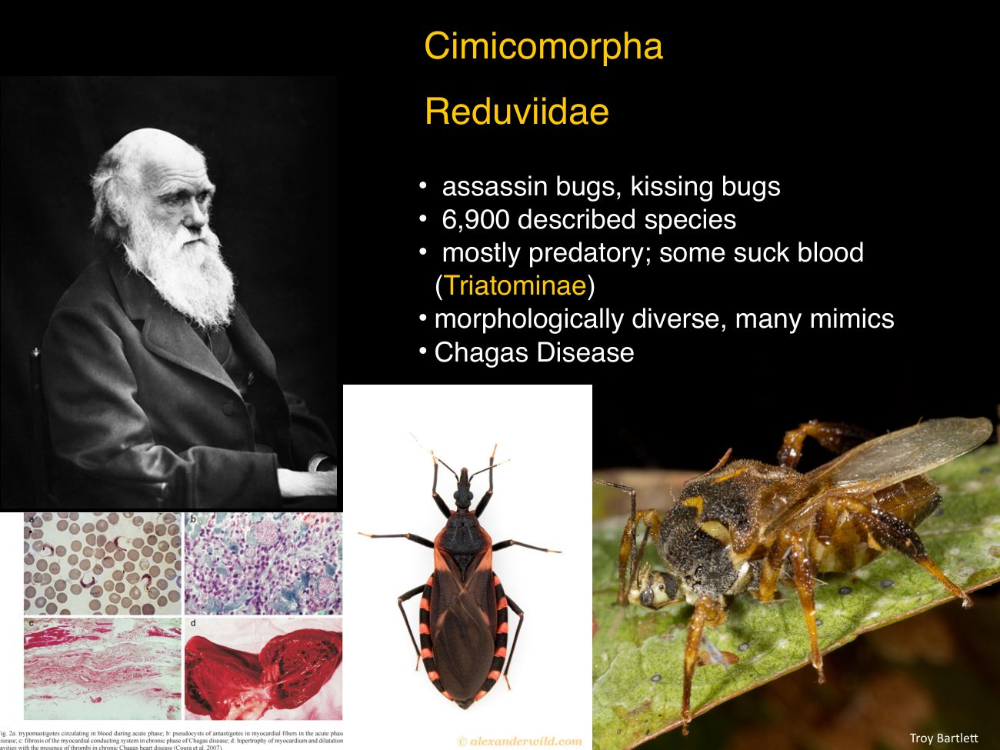](slides/slide-09.jpg)

Let's talk about another major group of the Heteroptera, and I'll give a few family names in these because there are some really important groups in the Cimicomorpha one family I'll talk about, the reduviids. These are all predatory, terrestrial, predatory bugs. And there's one major group of these reduviids that instead suck blood of, vertebrates and can vector diseases, mainly in South America.

But reduviids, its overall. They're really diverse. All kinds of different, shapes and colours a lot are, very small and cryptic and live in the leaf litter.

When Darwin visited Australia, he was, in a bit of a sour mood and, later died from what might have been disease that he picked up in South America, which would have been vectored by a reduviid, kissing bug. They're called since they often bite around the lips. But most other reduviids the assassin bugs are predators of insects.

> **Editorial note:** Darwin’s proposed Chagas disease is a historical hypothesis; the transcript already qualifies it as uncertain.

[↑ Slides](#slides) · [Course index](../../README.md)

## Slide 10

[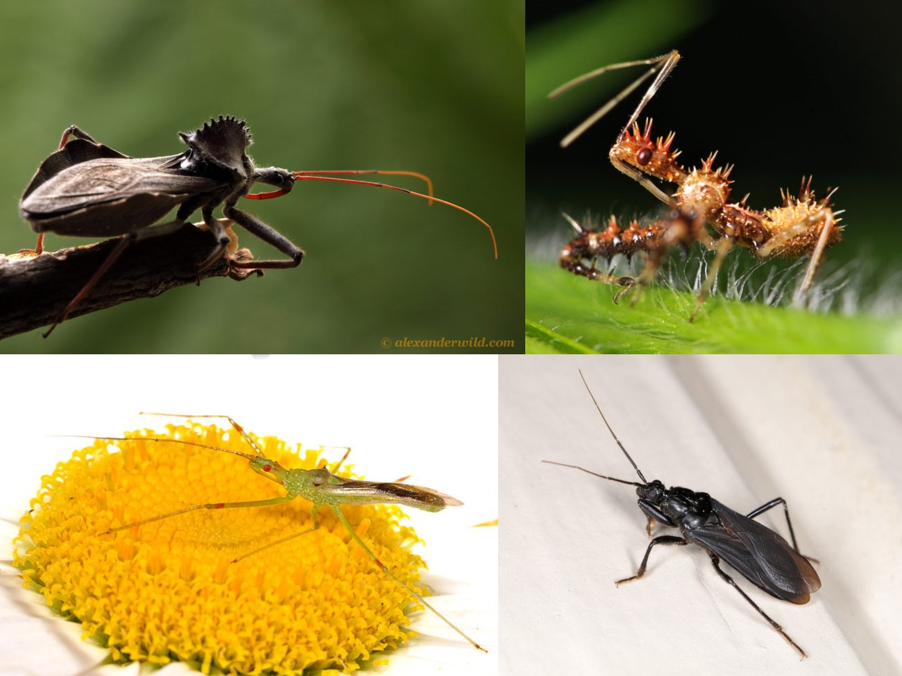](slides/slide-10.jpg)

Just to give some examples of the diversity of morphology of, assassin bugs that one in the top right corner is a nymph. It doesn't have wings, but it still is all spiky, heavily protected. A lot of these have different kinds of, projections and, spikes for protection.

They also can deliver painful bites, for defence, but they're mainly used to catch their prey. There's there's they often sit on flowers and try to catch pollinators.

[↑ Slides](#slides) · [Course index](../../README.md)

## Slide 11

[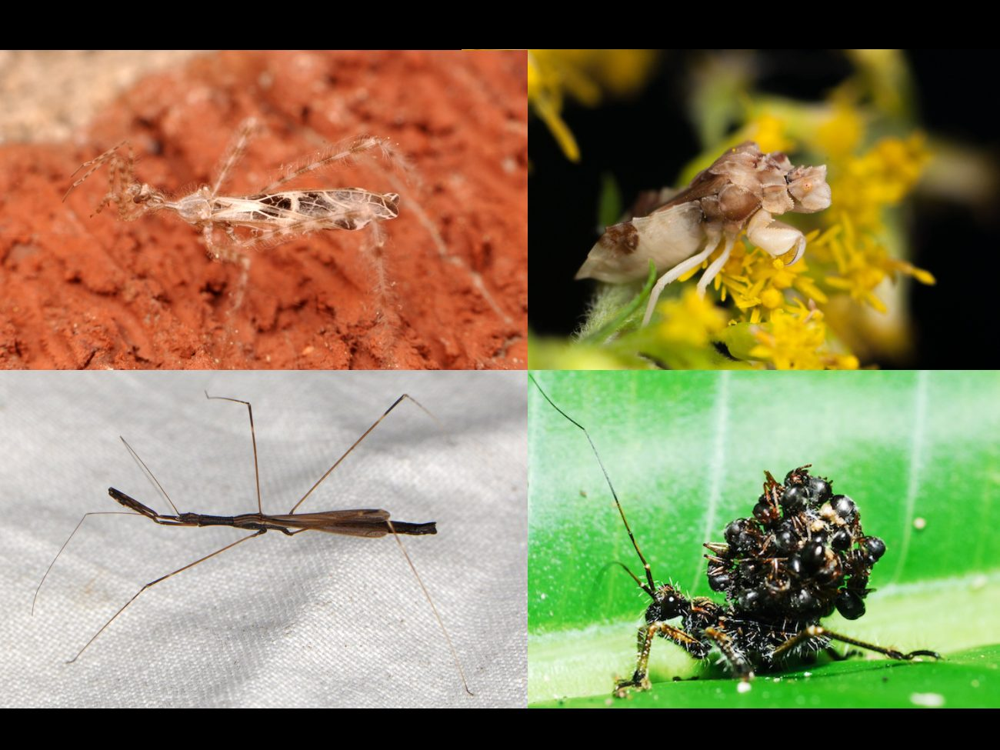](slides/slide-11.jpg)

Here's some more very specialised assassin bugs. The one that's that's very gracile and thin is a, assassin bug that hunts spiders. So they use those long legs to negotiate spider webs, and try to catch their prey.

Other ones are, cryptic with their flowers that they sit on to catch prey. And the one in the bottom corner is a nymph that, covers itself with the, carcasses of its prey. So it's it's it's the ants that it killed, takes those dead bodies and makes a shell out of it.

[↑ Slides](#slides) · [Course index](../../README.md)

## Slide 12

[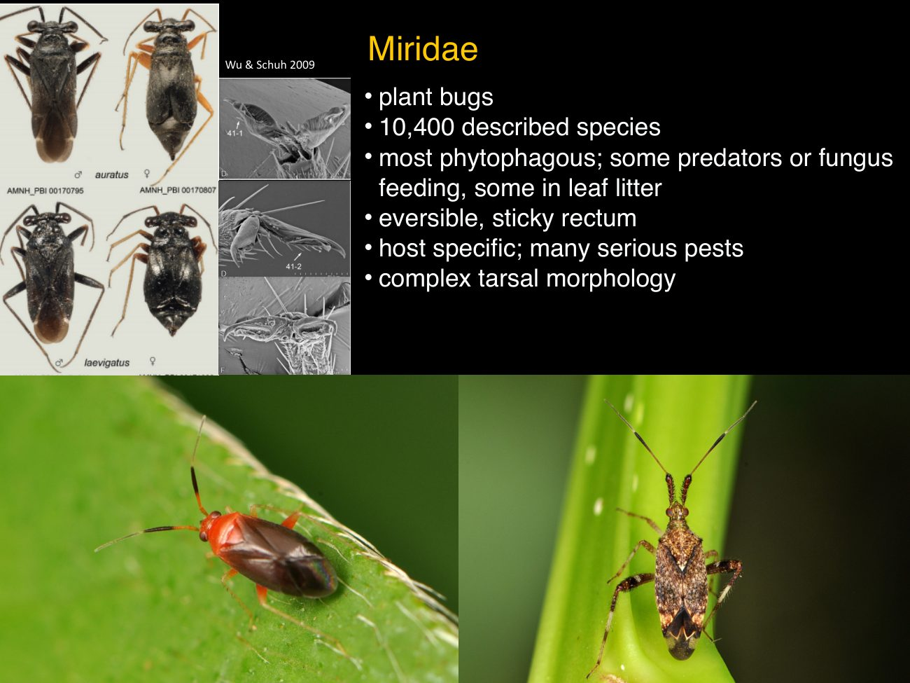](slides/slide-12.jpg)

Another major group of, heter Heteroptera related to the assassin bug are the plant bugs. This is a really diverse group, one of the most diverse groups of plant feeding insects. Other than Cicadellidae or, holometabolous families.

There's a few groups of plant bugs that are actually predators or eat fungus. But most of them are in plants and are quite host. Specific, very diverse.

In Australia, they're particularly diverse in, the arid parts of Australia. There's been a lot of, species discovery in Miridae and a lot more, out there to be discovered. Still, they have a complex tarsal morphology that's often used for identification.

That's how they, hold on to their plant hosts, which are which can be covered in trichomes. They're good at water management because they their, rectum is eversible. And they're, really diverse in their external morphology.

[↑ Slides](#slides) · [Course index](../../README.md)

## Slide 13

[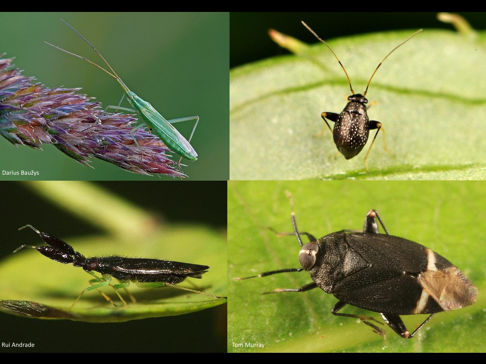](slides/slide-13.jpg)

Here's some examples. Some that are small and kind of like a flea can hop around along it, ones that blend in with the leaves. One's a crazy modified antennae.

[↑ Slides](#slides) · [Course index](../../README.md)

## Slide 14

[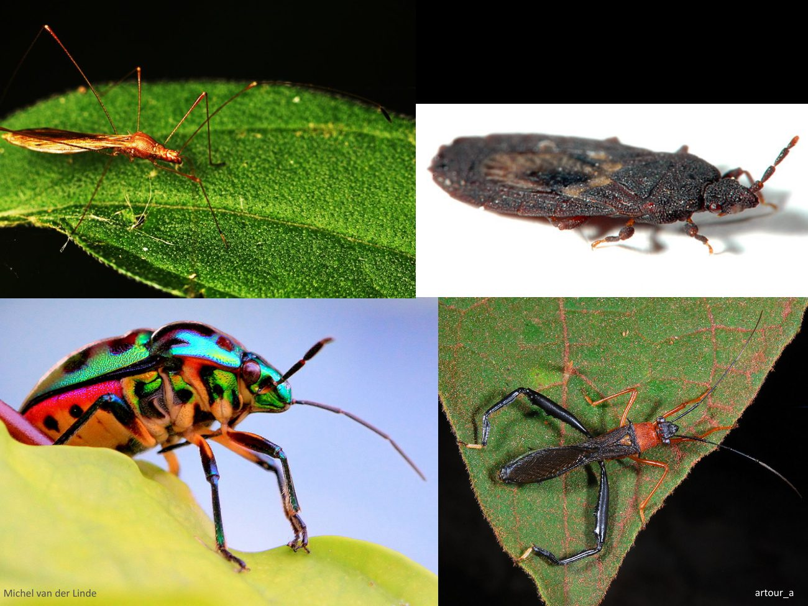](slides/slide-14.jpg)

So, that's it for the mirids. I just want to talk about a few other, give some other interesting examples of Heteroptera, including these, stink bugs and relatives that, have a lot of, plant feeding species and also predator, predatory species for biocontrol.

[↑ Slides](#slides) · [Course index](../../README.md)

## Slide 15

[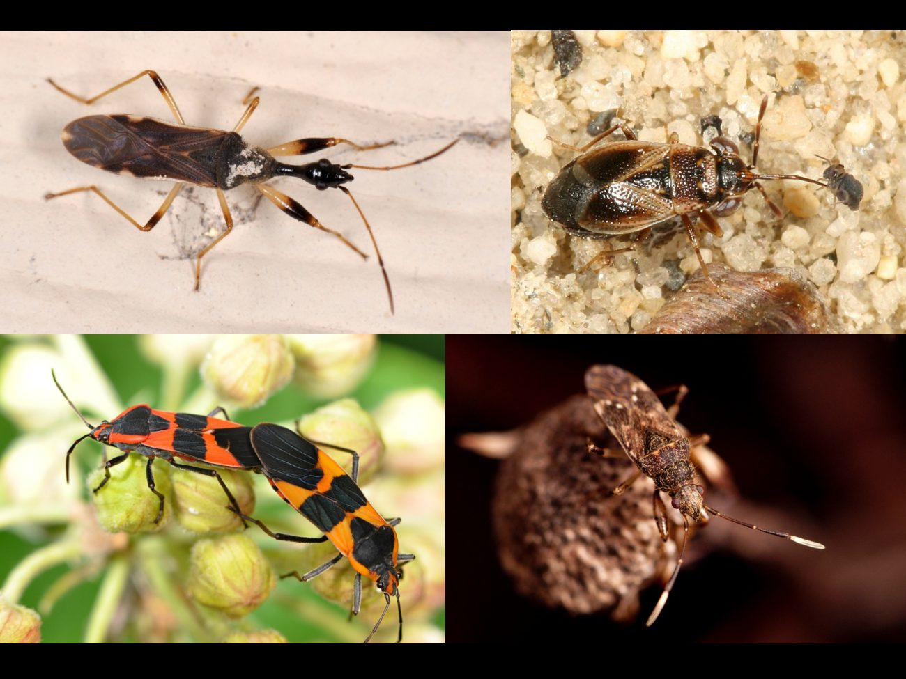](slides/slide-15.jpg)

There's flat bugs them under bark. There's seed bugs that, attack plants in various methods, some of which are also, alter. Alternatively, predatory.

[↑ Slides](#slides) · [Course index](../../README.md)

## Slide 16

[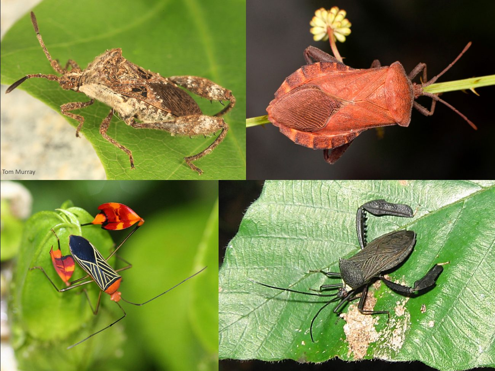](slides/slide-16.jpg)

Some of these bugs are very strongly chemically protected, which can lead to, them to be quite colourful. And, use that for aposematism to scare away predators.

[↑ Slides](#slides) · [Course index](../../README.md)

## Slide 17

[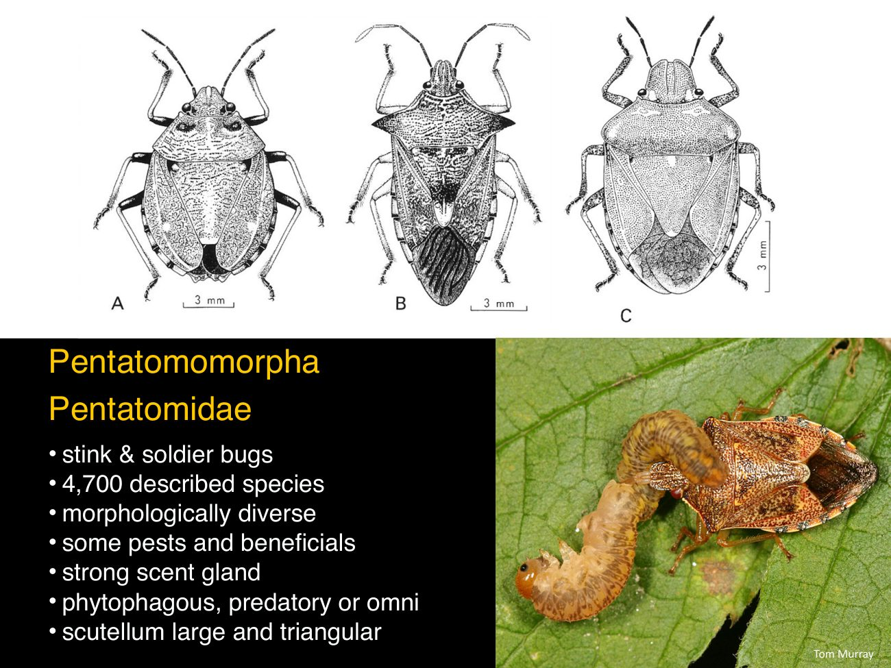](slides/slide-17.jpg)

So I just want to talk about the Pentatomidae. These are the stink bugs in another major lineage of the Heteroptera the predatory stink bugs are called soldier bugs, but they're all pretty stinky. So there's the soldier bug eating a sawfly larva there, generally similar in shape to have this kind of circular or shield like shape to them.

But, quite diverse, in terms of the projections and the colours and the size, and they're easy to tell from this large. Scutellum that is triangular and goes over the wings.

[↑ Slides](#slides) · [Course index](../../README.md)

## Slide 18

[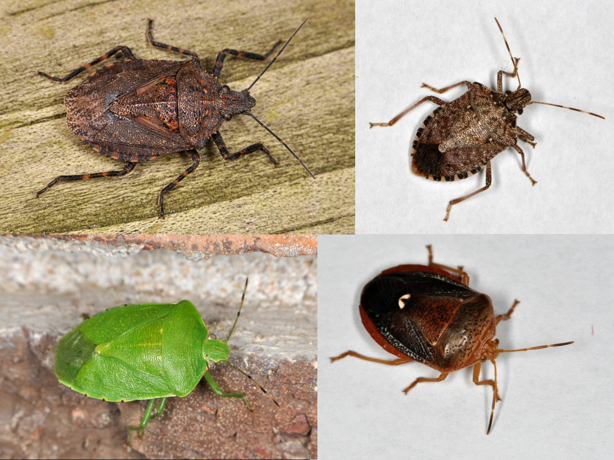](slides/slide-18.jpg)

Just give a couple more examples of stink bugs and their relatives, something you'll probably come across, easily as the spring comes along.

[↑ Slides](#slides) · [Course index](../../README.md)

## Slide 19

[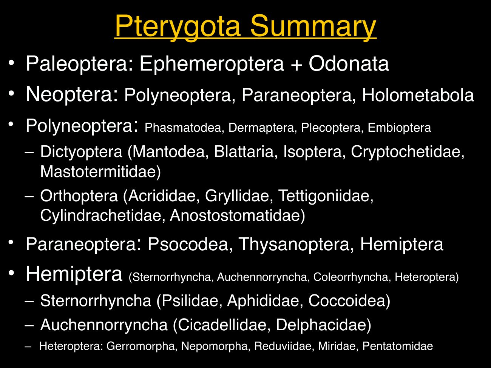](slides/slide-19.jpg)

So that's it for, Hemiptera, Heteroptera and Paraneoptera and I just want to give a summary of all the insect groups we talked about, so far, which we've covered essentially everything outside of the Holometabola, and that's where the real diversity lies. Although bugs, are very diverse as well. To the last few lectures, we talked about the Palaeoptera, which, have wings that can't fold over the body.

And they have aquatic nymphs, which Ephemeroptera, the mayflies, and Odonata, the dragonflies and damselflies, sisters of the Palaeoptera is the Neoptera, which most insects, includes most insects. And they can fold their wings back over the body, which allows them to, get into different, ecosystems and niches. So that includes the Polyneoptera, the Paraneoptera and the Holometabola, in Polyneoptera.

We talked about several, of the orders that occur in Australia, the largest of which is the Dictyoptera, which includes Manti, cockroaches and termites. They have oothecae to coat their eggs, and then Orthoptera which is the crickets and grasshoppers, then the Paraneoptera, which includes Psocodea, the lice, Thysanoptera, the thrips and the true bugs. Which is an incredibly diverse group.

The most diverse group outside of the Holometabola, which includes the scales and relatives, the hoppers and relatives and then the true bugs. And this is a list of the, major, families and subgroups we've covered throughout the last few lectures. So after this, we will get into the, true holometabolous insects.

> **Editorial note:** The summary slide has its own typographic errors: “Cryptochetidae” should be Cryptocercidae in the cockroach context, and “Psilidae” should be Psyllidae in the psyllid context. Slide images remain original.

[↑ Slides](#slides) · [Course index](../../README.md)

## Source notice

this material has been reproduced and communicated to you by or on behalf of the Australian National University In accordance with section 113 P of the Copyright Act 1968. The material in this communication may be subject to copyright under the act. Any further reproduction or communication of this material by you must be consistent with the provisions of the act. Do not reproduce this material. Do not remove this notice.

[← Previous lecture](../11-invertebrate-intro-part-11-insect-overview-5-hemiptera-1-scales-hoppers/README.md) · [Course index](../../README.md) · [Next lecture →](../13-invertebrate-intro-part-13-insect-overview-7-smaller-holometabolous-orders/README.md)
