# Invertebrate Intro Part 13 - Insect Overview 7 - Smaller Holometabolous orders

[← Previous lecture](../12-invertebrate-intro-part-12-insect-overview-6-hemiptera-2-true-bugs/README.md) · [Course index](../../README.md) · [Next lecture →](../14-onychophora/README.md)

**Slides + cleaned transcript** · 16 slides

English transcript with fillers and repeated false starts removed. Technical terms are corrected using the slides and context. Bracketed wording marks reconstruction or uncertainty. Slide boundaries are inferred from content; the transcripts have no slide timestamps.

[Original transcript](original-transcript.txt) · [Text-only version](cleaned-transcript.md) · [Editing notes](../../EDITING-NOTES.md) · [Correction record](corrections.md)

[Searchable slide text](slide-text.md). Click a slide image to open it at full size.

## Slides

[1](#slide-1) · [2](#slide-2) · [3](#slide-3) · [4](#slide-4) · [5](#slide-5) · [6](#slide-6) · [7](#slide-7) · [8](#slide-8) · [9](#slide-9) · [10](#slide-10) · [11](#slide-11) · [12](#slide-12) · [13](#slide-13) · [14](#slide-14) · [15](#slide-15) · [16](#slide-16)

## Slide 1

[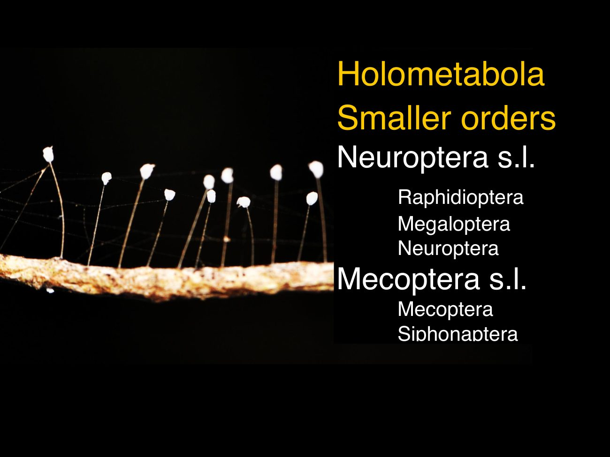](slides/slide-01.jpg)

We're going to breeze through some of the smaller orders of Holometabola. So these are orders that have true metamorphosis but are not in those big four, orders with more than 100,000 species. So these include, the Neuroptera lacewings and relatives.

And then I'll talk about, scorpion flies and fleas. There's two other smaller orders, to Strepsiptera, which are very close to beetles. So they'll be covered, during the beetles, lectures.

And then the Trichoptera the caddisflies which are clearly sister group to moths and butterflies. So they'll be discussed at that point. The Trichoptera the caddisflies are the largest of these smaller holometabolous orders.

[↑ Slides](#slides) · [Course index](../../README.md)

## Slide 2

[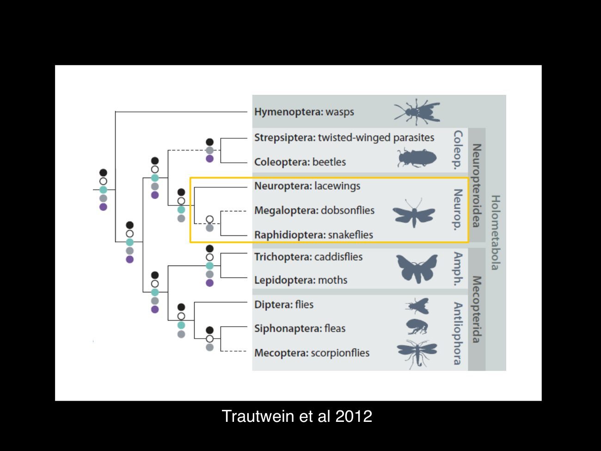](slides/slide-02.jpg)

So, as a recap where we are in the overall insect biology. These are, we're in the holometabolous insects, so that means they have an egg larva pupa in adult stages so that larva it's not homologous to the nymphs, as we've seen in all the other insects so far. And, a major innovation is that they could be quite morphologically different from the adults because the adult organs are kept as, kind of groups of cells called imaginal discs in the larva and only develop in the pupal stage.

Here's some examples of different larva morphology. Some are very reduced, with reduced heads. Other ones you can obviously see the mouth parts.

They can be predatory. Phytophagous [word uncertain]; extremely diverse in terms of what they eat, and then the larva and adults can, use different food sources or different parts of the environment. Which allows them to diversify.

The pupal stage is also diverse. And here's some examples to recap how the pupal stage looks in different groups of these, insects. Sometimes you can see the legs and mouth parts, and other times they're enclosed in the last larval skin.

> **Editorial note:** The larval homology interpretation is retained as presented in the lecture.

[↑ Slides](#slides) · [Course index](../../README.md)

## Slide 3

[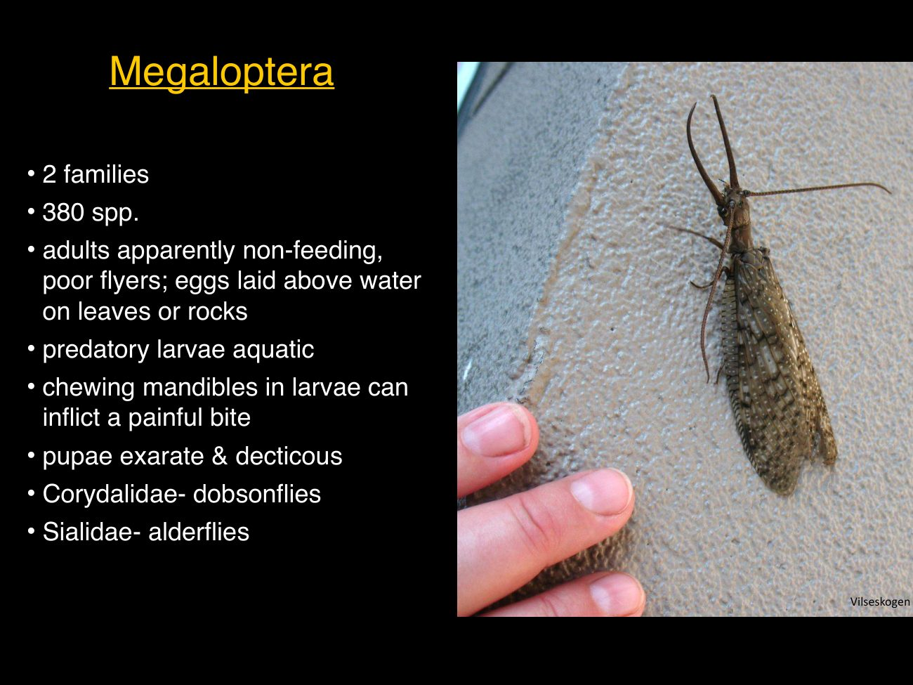](slides/slide-03.jpg)

So we'll talk about two, of the neuropteran orders Megaloptera and neuropterans. Megaloptera is one of the smallest holometabolous orders. Just two families and these similar to, Plecoptera and a lot of other, smaller orders.

They have aquatic larvae, aquatic, immature and terrestrial adults. So the immature live in flowing streams, and the adults, fly on to mate. These are quite large, impressive insects.

Some species that the males have these large ornamental mandibles for, competition. The larvae can bite and are often used for bait. And these are the best example of those, exarate and decticous pupae or even the pupae can kind of bite for defence, and you see all the legs and everything.

[↑ Slides](#slides) · [Course index](../../README.md)

## Slide 4

[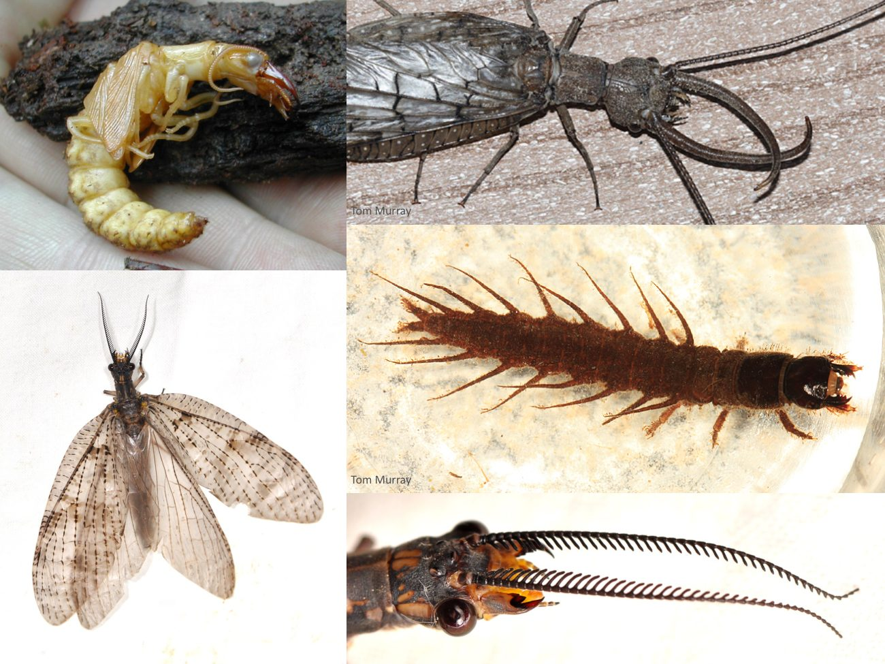](slides/slide-04.jpg)

So, the larvae don't look too different from the adults, but they still rearrange all their, organs. The eyes are different. You can see that those larvae have those long, gill filaments, or spikes for protection that are not in the adults.

A lot of these have large, ornamented antennae to find their mates. There's two families, Corydalidae and Sialidae [names supplied from slide], which, tend to be in quite well preserved. Aquatic ecosystems.

The larvae are called hellgrammites, often used for bait.

[↑ Slides](#slides) · [Course index](../../README.md)

## Slide 5

[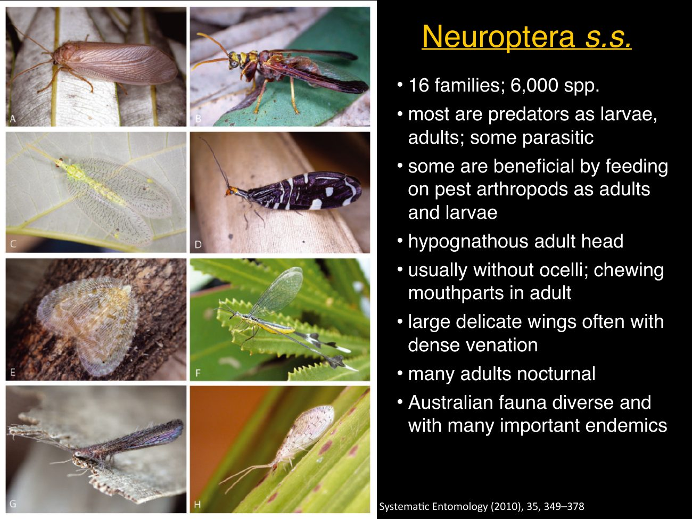](slides/slide-05.jpg)

Now let's get into the Neuroptera, so Neuroptera are almost entirely predatory. There's a few parasites and a few very strange life histories. For instance, there's aquatic Neuroptera that only eat freshwater sponges, which you might not even have known existed.

But there's an insect specialised on it. So, these have predatory larvae in most cases, a few groups. The adults are also predatory, like the that mantisfly in the top, right.

But the adults will eat what they come across. These are often considered, beneficial as they will eat, plant feeding insects like aphids and in large numbers, they have this hypognathous adult head where the mouth parts are pointed down instead of forward. Like in the, Megaloptera.

We just saw they have, very delicate wings with wing patterns. There's extinct ones that kind of look like butterflies. There's some Australian endemic groups that also have, really ornate, wings and wing patterns.

Often these will be encountered at lights that the adults are nocturnal. But the larvae will have, various behaviours, hunting their prey.

[↑ Slides](#slides) · [Course index](../../README.md)

## Slide 6

[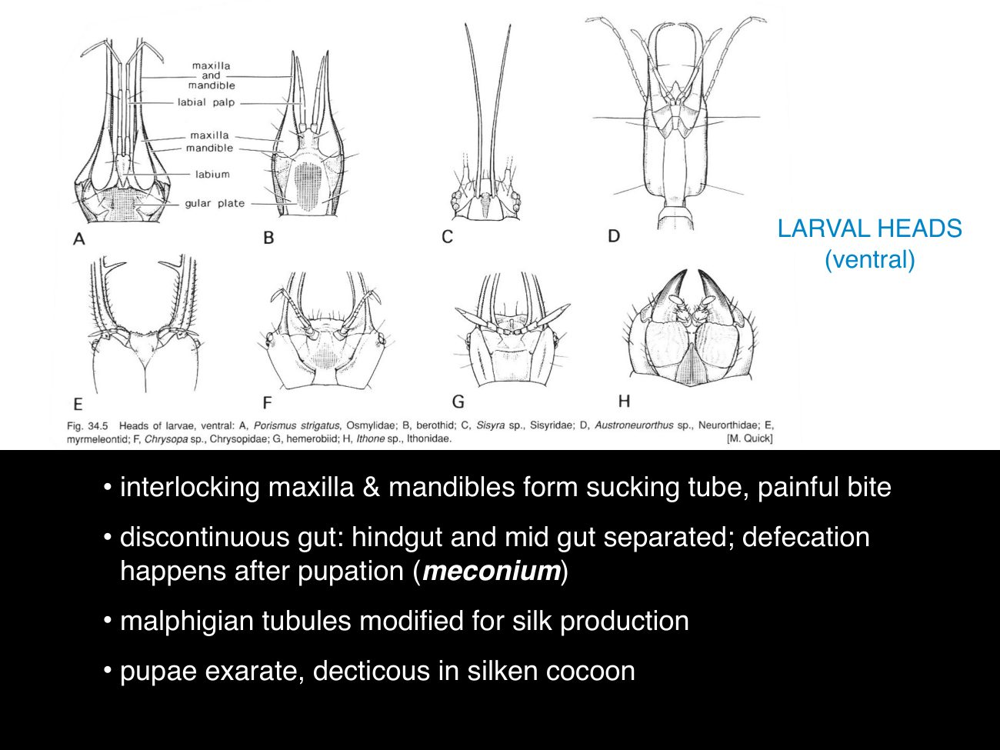](slides/slide-06.jpg)

The larvae of Neuroptera are very specialised because they have essentially two, sucking tubes. What? Looks like the mandibles are actually stylets formed with the maxilla and mandibles.

So, at the end of those, tubes, there's, a canal where they pierce their prey and those mouth parts are variously modified in different neuropterans to pierce their prey and suck the contents. They also are, unusual because they, don't, defecate while they're larvae. Instead, they form meconium and defecate after a pupation.

So that means that some of them can live in quite, narrow, specialised environments and not have to, leave. They don't foul their, little nests. A lot of Neuroptera larvae can also produce silk.

And we use that to protect their cocoon.

[↑ Slides](#slides) · [Course index](../../README.md)

## Slide 7

[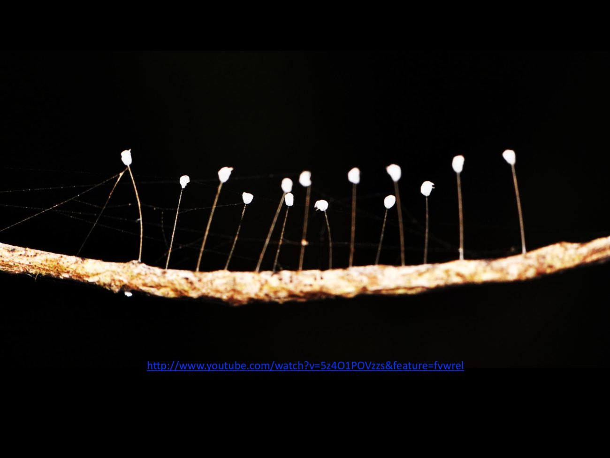](slides/slide-07.jpg)

Neuroptera eggs are quite specialised, too. Some Neuroptera lay their eggs on these long stalks, and the reason they do this is that the larvae are, voracious predators and will be cannibals. So whichever larva, emerges from the egg first will leave the plant that they're they're on instead of waiting to, consume their the eggs or their other brothers and sisters.

[↑ Slides](#slides) · [Course index](../../README.md)

## Slide 8

[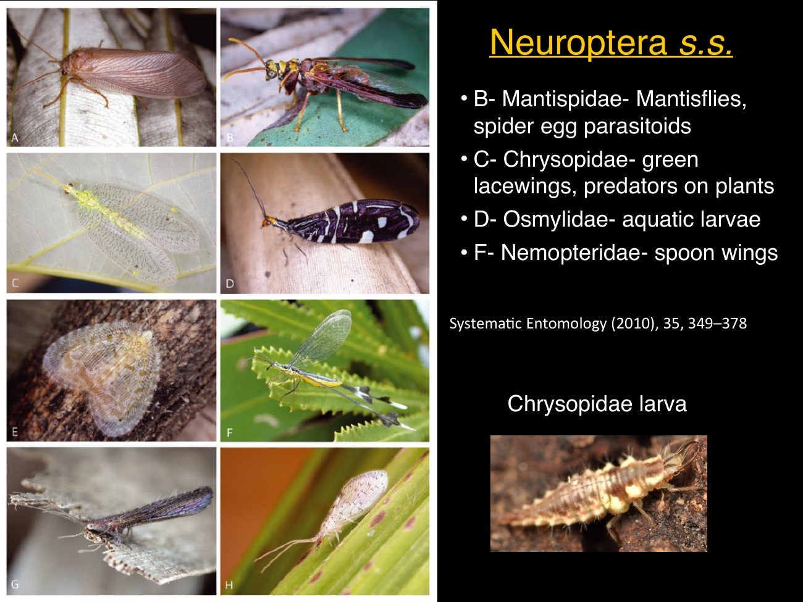](slides/slide-08.jpg)

Just giving some examples of Neuroptera. B there. In the top corner are the Mantispidae.

They look like Mantis. They're predatory as adults, and the larvae are spider egg parasitoids. You can see them at lights.

Really distinctive. Interesting group. C are a really common, family.

The green lacewings. Well, I'm sure we'll we'll encounter some of them as a semester goes on. D with the beautiful pattern wings.

There's a lot that's a quite diverse group in Australia compared to other places. Those are Osmylidae they have aquatic larvae. There's two different lineages of Neuroptera with aquatic predatory larvae.

F are the spoon wings. The hind wings are, modified and reduced, and quite ornate those you can see more often in Western Australia. But Western Australia and Africa are the diversity areas for, Nemopteridae.

[↑ Slides](#slides) · [Course index](../../README.md)

## Slide 9

[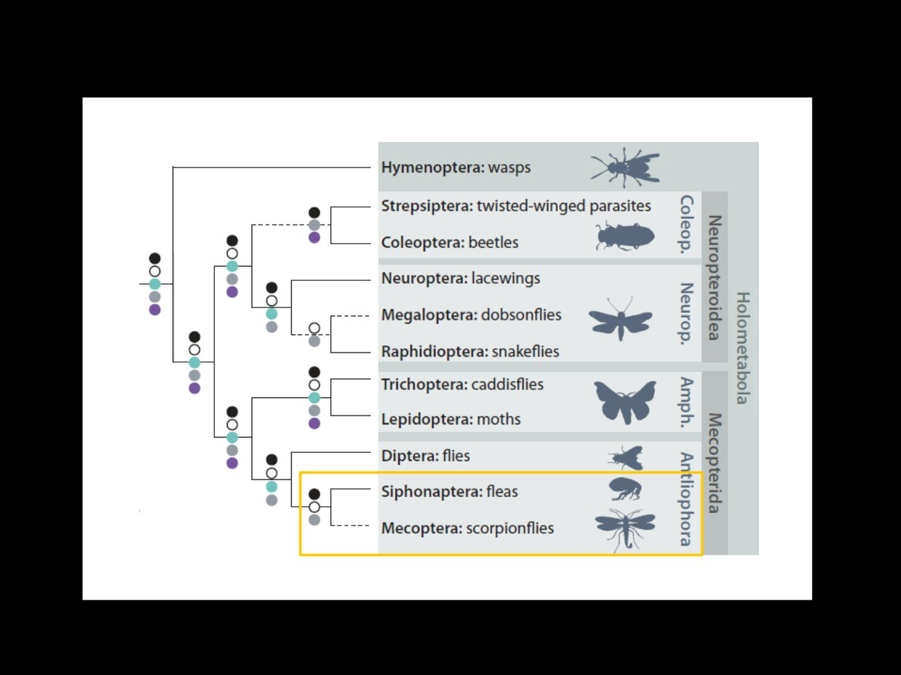](slides/slide-09.jpg)

So let's move on to the next group of these smaller orders that are more closer to flies. So the Neuroptera that we just covered neuropterans Megaloptera are part of the Neuroptera closer to beetles. But the scorpion flies and fleas are in the Antliophora close to flies.

[↑ Slides](#slides) · [Course index](../../README.md)

## Slide 10

[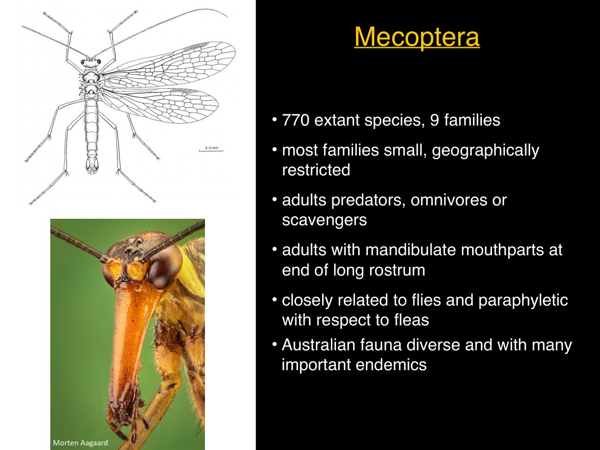](slides/slide-10.jpg)

Mecoptera. Another relatively small, order, but still, quite diverse morphologically and with some very curious characters, most families of Mecoptera are geographically restricted and kind of difficult to find to have strange behaviours. Morphology.

The adults and the larvae are predators, but some of them instead will be scavenging on things they find that are already dead. They have mandibulate chewing mouth parts, but at the end of this long rostrum, so the face eventually is produced. But then at the bottom of that, they have, well developed mandibles maxillae.

It looks like a normal set of it's like mouth parts, but it's on this long rostrum. So that's to compare with the flies. We'll learn about soon, which have a long rostrum, but at the end, it's heavily modified for, lapping up liquids.

And the Mecoptera are, paraphyletic with respect to fleas, which we'll get into with a little bit more detail. But it's it's a area of active research and uncertainty. So it's clear that the fleas and Mecoptera form a group.

But exactly what the branching pattern is unclear. And, Mecoptera, there's there's a lot of important Mecoptera in Australia.

[↑ Slides](#slides) · [Course index](../../README.md)

## Slide 11

[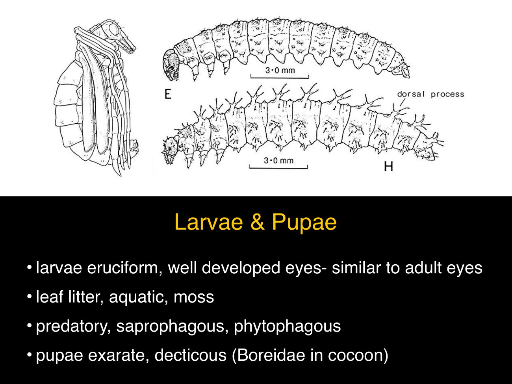](slides/slide-11.jpg)

The larvae are eruciform. So what that means is that they look like little caterpillars. You can see they have three true thoracic legs that are segmented, and then a number of, pseudo legs, prolegs on the abdomen.

So that's similar to caterpillars. Except these are down in the leaf litter and moss, and are mostly, predatory. There's some aquatic, groups as well.

There's a few groups that will attack plants, but most of them are predatory or saprophagous. And usually the pupae you can see on the right there are exarate and decticous. But some can form cocoons.

[↑ Slides](#slides) · [Course index](../../README.md)

## Slide 12

[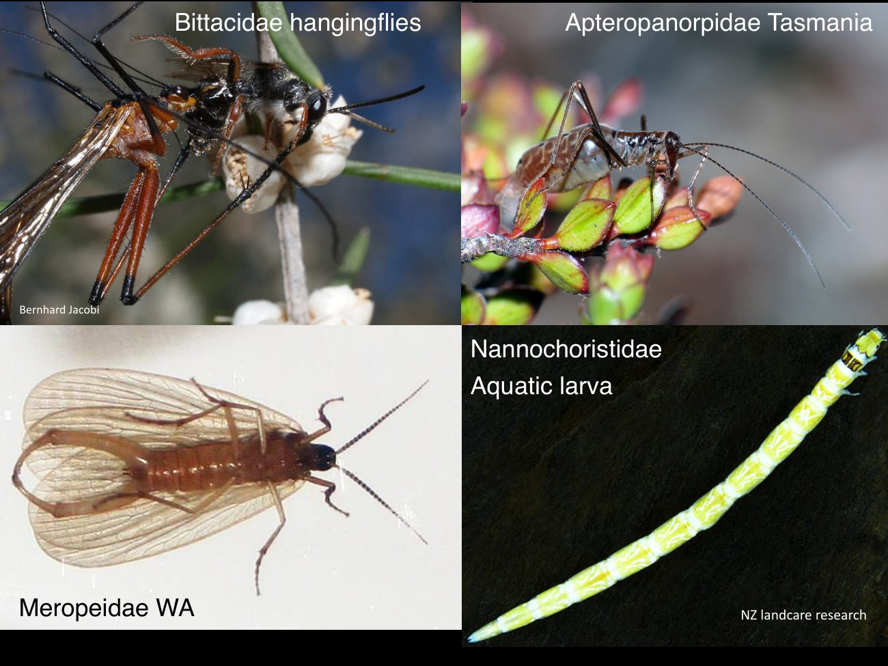](slides/slide-12.jpg)

Just to give some examples of, Mecoptera that you might encounter or that are important in Australia. So the Bittacidae, are probably the one you'd be most likely to find. They're large, predatory insects, and they catch their prey and then use two long legs to hang from a branch while they consume the prey.

Apteropanorpidae are a strange wingless, group of Mecoptera that are only found in Tasmania. Those Meropeidae with those huge modified forceps-like appendages, sometimes called earwig flies because, it's a similar morphology ear to ear wigs, although they're not related. And these are segmented.

They're only found in Western Australia, Brazil and Eastern United States. And the last one a really important, Mecoptera, is Nannochoristidae? So, nannochoristids have aquatic larvae.

They're found in [unclear locality], Australia, New Zealand, chile. And they're quite distinct because they have some adult characteristics that develop in the larvae, unlike almost all other holometabolous insects. So they have true compound eyes, for instance, and these nannochoristids these aquatic ones, along with some of the wingless Mecoptera might be more closely related to fleas than to other.

Mecoptera.

[↑ Slides](#slides) · [Course index](../../README.md)

## Slide 13

[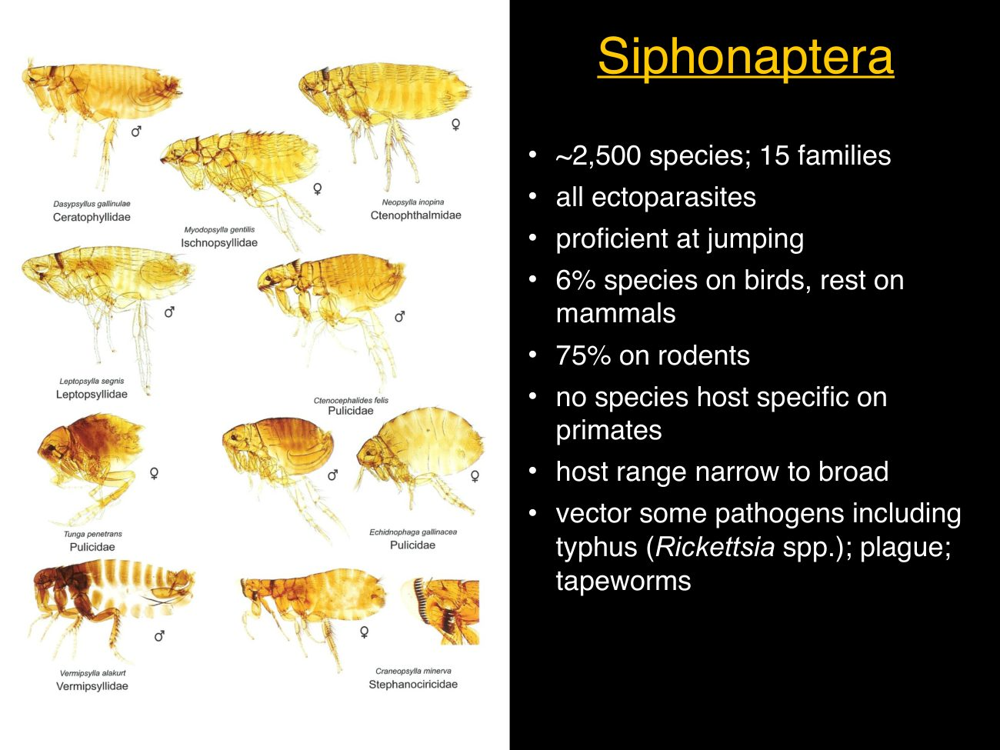](slides/slide-13.jpg)

So let's get into the fleas. A major difference between fleas and lice is that fleas are flattened laterally and lice are flattened. Dorsoventrally, so it's a kind of an easy way to tell them apart.

Fleas are holometabolous. Their larvae are C-shaped and, live in the usually in the nest. Whereas lice, their nymphs develop more gradually into adulthood.

So Siphonaptera the fleas, they're very good at jumping. They will stay on their host, but they can avoid grooming and jump between hosts. And sometimes you'll find them off of the host.

In pitfall traps, moving around, trying to find a new host. So they're usually quite, species specific. A lot of fleas, for instance.

The adults can bite multiple mammals, but the larvae can only develop on a certain host. So they can still be pests, but are relatively specific for their life cycle requirements. A few are on birds, but mostly on rodents on mammals.

There's none that, are species specific on primates. But a lot will bite us if we're if we're, in the wrong place. Some fleas can vector, nasty pathogens, include including typhus and bubonic plague and tapeworms.

And the morphology, even though they're kind of they're reduced wings reduced eyes and antennae and flattened still are different shapes. And, have these, specialised setae to stay on the hosts.

> **Editorial note:** “Develop on a host” should be read with the later explanation: flea larvae generally develop in the host’s nest or environment, not on its body.

[↑ Slides](#slides) · [Course index](../../README.md)

## Slide 14

[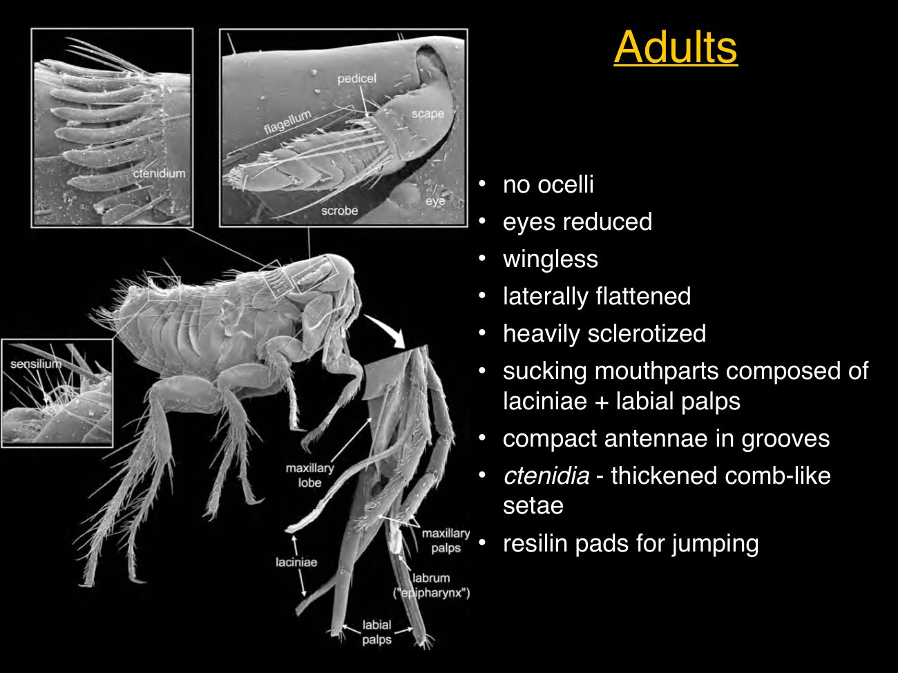](slides/slide-14.jpg)

So adults don't have a ocelli their eyes are reduced. They're quite sclerotised. So they're hard to crush.

They have a sucking mouth part somewhat similar to flies. But the palps are present, and the sucking mouth parts are composed of [laciniae and labial palps, from slide], so still a different structure of the rostrum than in flies or bugs or other. You'll see in insects many different independent times.

These sucking mouth parts have evolved using different components of the ground plan mouth parts. They have the specialised, setae called ctenidia. The arrangement and shape of those is important for identification.

And they have a special structure in the cuticle called resilin, cuticle and protein fused together. That's also present in some scorpion flies that are probably close relatives of fleas.

[↑ Slides](#slides) · [Course index](../../README.md)

## Slide 15

[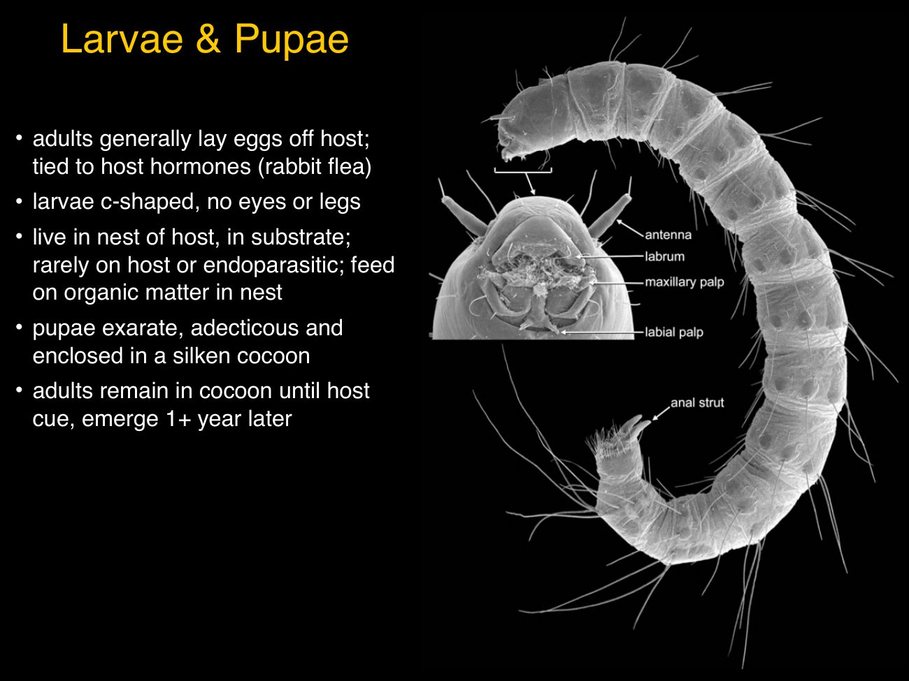](slides/slide-15.jpg)

The, adults, will bite the host and then jump off and usually lay their eggs in the host's nest, or nearby And, the eggs can survive a long time before they hatch, and the pupal stage can also stick around a long time before it hatches. The larvae are C shaped, is and they usually don't suck the blood of the host, but they'll be feeding on other, exudates and leavings in the host's nest. The pupae have a silken cocoon, and, our exarate and all these stages can survive a long time between, feeding, which makes them very effective pests.

[↑ Slides](#slides) · [Course index](../../README.md)

## Slide 16

[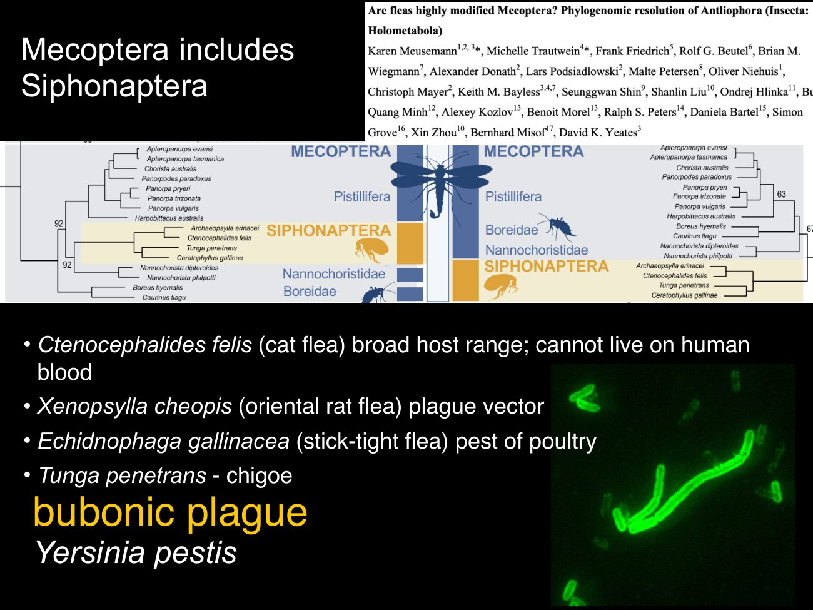](slides/slide-16.jpg)

So, as I mentioned before, Siphonaptera is probably, inside Mecoptera. But exactly where is quite unclear? So there's been various proposals to break up or join the orders, but we need a little bit more research.

So it's likely that they're closely related to those aquatic, nannochoristids or wingless, jumping. Scorpion flies and fleas have a very, major economic impact on human society. The most common one we will probably, encounter is the cat flea.

So cat fleas, can develop on cats and dogs, but, the larvae can't develop on humans, although they will bite. Humans just for sustenance. They can't complete their life cycle.

The Oriental Rat flea, was the vector of bubonic plague of, black death, which, killed a lot of people in Europe and Asia. In the middle of the last millennium, that bubonic plague also kills the flea. There's some major pests of poultry.

So some that attack birds can be pests. And there's other ones. Tunga penetrans, the chigoe flea, which actually burrows into the skin of the host.

So just showing that Yersinia pestis bubonic plague that is vectored by fleas. Still, that's a couple of species out of the thousands and thousands, that have quite, unusual. And, well-studied relationships with their vertebrate hosts.

[↑ Slides](#slides) · [Course index](../../README.md)

## Source notice

this material has been reproduced and communicated to you by or on behalf of the Australian National University In accordance with section 113 P of the Copyright Act 1968. The material in this communication may be subject to copyright under the act. Any further reproduction or communication of this material by you must be consistent with the provisions of the act. Do not reproduce this material. Do not remove this notice.

[← Previous lecture](../12-invertebrate-intro-part-12-insect-overview-6-hemiptera-2-true-bugs/README.md) · [Course index](../../README.md) · [Next lecture →](../14-onychophora/README.md)
