# Onychophora

[← Previous lecture](../13-invertebrate-intro-part-13-insect-overview-7-smaller-holometabolous-orders/README.md) · [Course index](../../README.md) · [Next lecture →](../15-tardigrades-and-nematodes/README.md)

**Slides + cleaned transcript** · 61 slides

English transcript with fillers and repeated false starts removed. Technical terms are corrected using the slides and context. Bracketed wording marks reconstruction or uncertainty. Slide boundaries are inferred from content; the transcripts have no slide timestamps.

[Original transcript](original-transcript.txt) · [Text-only version](cleaned-transcript.md) · [Editing notes](../../EDITING-NOTES.md) · [Correction record](corrections.md)

[Searchable slide text](slide-text.md). Click a slide image to open it at full size.

## Slides

[1](#slide-1) · [2](#slide-2) · [3](#slide-3) · [4](#slide-4) · [5](#slide-5) · [6](#slide-6) · [7](#slide-7) · [8](#slide-8) · [9](#slide-9) · [10](#slide-10) · [11](#slide-11) · [12](#slide-12) · [13](#slide-13) · [14](#slide-14) · [15](#slide-15) · [16](#slide-16) · [17](#slide-17) · [18](#slide-18) · [19](#slide-19) · [20](#slide-20) · [21](#slide-21) · [22](#slide-22) · [23](#slide-23) · [24](#slide-24) · [25](#slide-25) · [26](#slide-26) · [27](#slide-27) · [28](#slide-28) · [29](#slide-29) · [30](#slide-30) · [31](#slide-31) · [32](#slide-32) · [33](#slide-33) · [34](#slide-34) · [35](#slide-35) · [36](#slide-36) · [37](#slide-37) · [38](#slide-38) · [39](#slide-39) · [40](#slide-40) · [41](#slide-41) · [42](#slide-42) · [43](#slide-43) · [44](#slide-44) · [45](#slide-45) · [46](#slide-46) · [47](#slide-47) · [48](#slide-48) · [49](#slide-49) · [50](#slide-50) · [51](#slide-51) · [52](#slide-52) · [53](#slide-53) · [54](#slide-54) · [55](#slide-55) · [56](#slide-56) · [57](#slide-57) · [58](#slide-58) · [59](#slide-59) · [60](#slide-60) · [61](#slide-61)

## Slide 1

[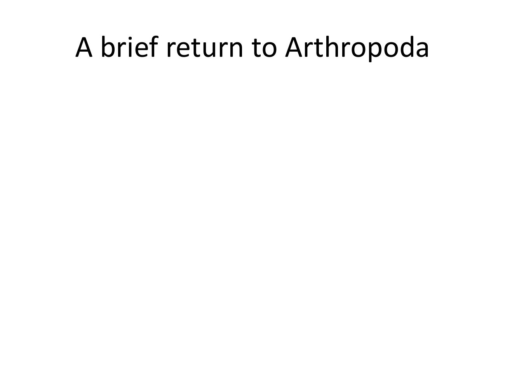](slides/slide-01.jpg)

Hi, folks. Today I want to have a look at the groups that are outside the arthropod. So up to now we've talked about the insects and the cheliceriforms and things that belong inside the arthropod.

But there are a lot of groups, within the Ecdysozoa that are outside the arthropod and in particular today we're going to look at one group in some detail.

[↑ Slides](#slides) · [Course index](../../README.md)

## Slide 2

[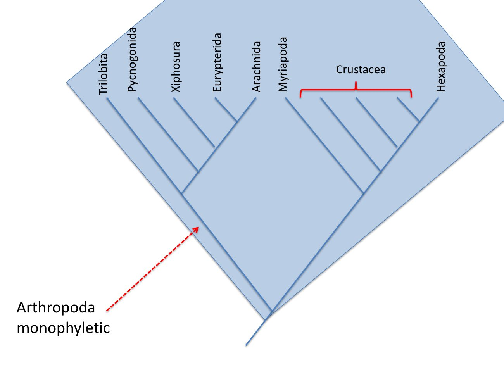](slides/slide-02.jpg)

Just to return to, what we do know about the arthropod. Here's a tree of the arthropods. Sorry.

I shall just get a pen up. OK, and we've We've looked at the various groups in here. I just realised I didn't talk about the trilobites, but the trilobites and the pycnogonids are two groups which sit in the same wider group as the, Merostomata that is the xiphosurans and the eurypterids.

OK, so looking at this tree, the arthropod is monophyletic. We know that they all have a single common ancestor.

[↑ Slides](#slides) · [Course index](../../README.md)

## Slide 3

[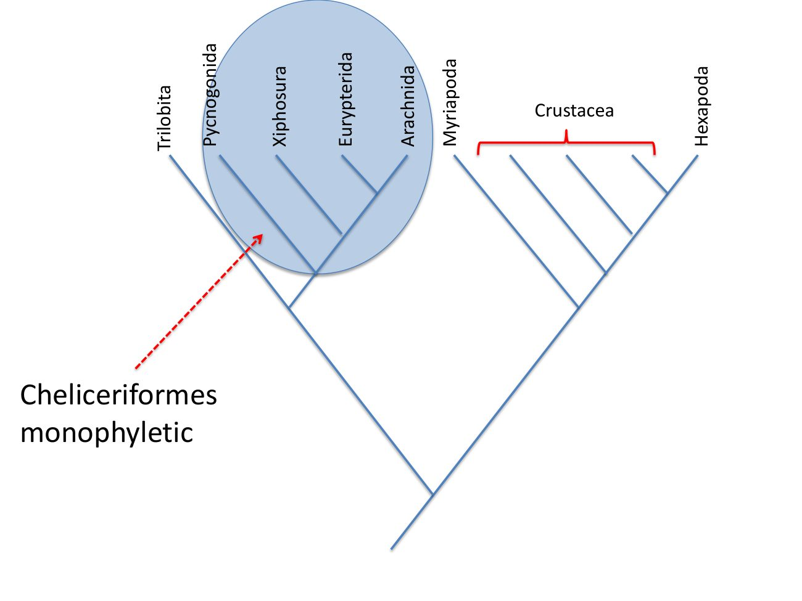](slides/slide-03.jpg)

We know that the Cheliceriformes is monophyletic that is, they have a single common ancestor.

[↑ Slides](#slides) · [Course index](../../README.md)

## Slide 4

[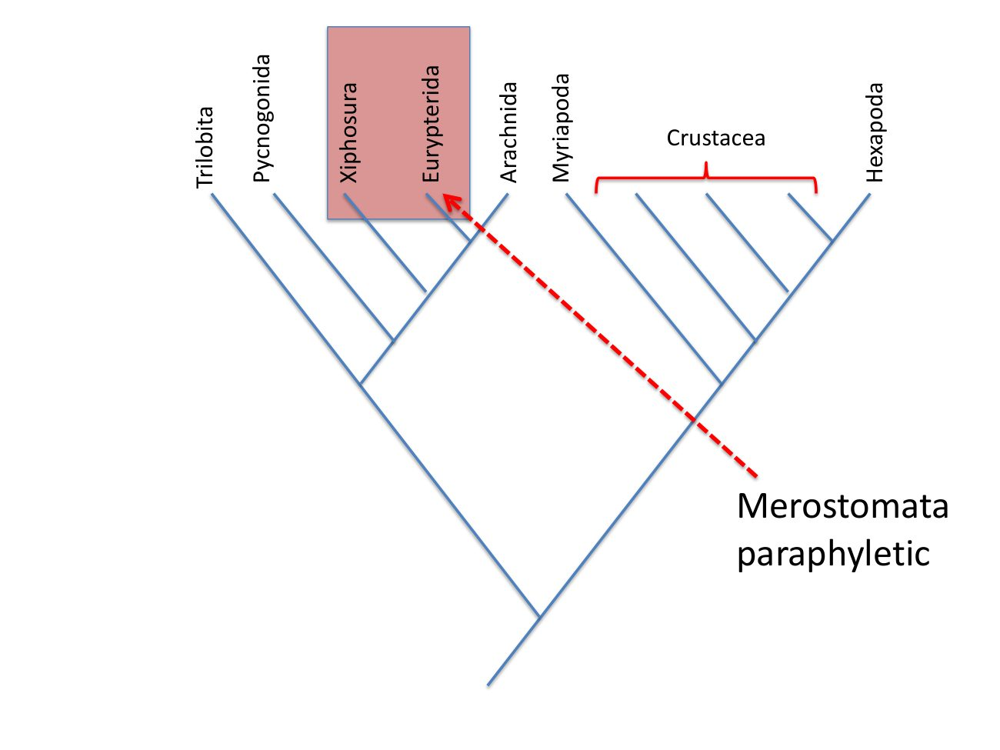](slides/slide-04.jpg)

We looked at the Merostomata and the Merostomata is paraphyletic. What this means is that the eurypterids and the xiphosurans don't share a single common ancestor that is not the ancestor of anybody else.

[↑ Slides](#slides) · [Course index](../../README.md)

## Slide 5

[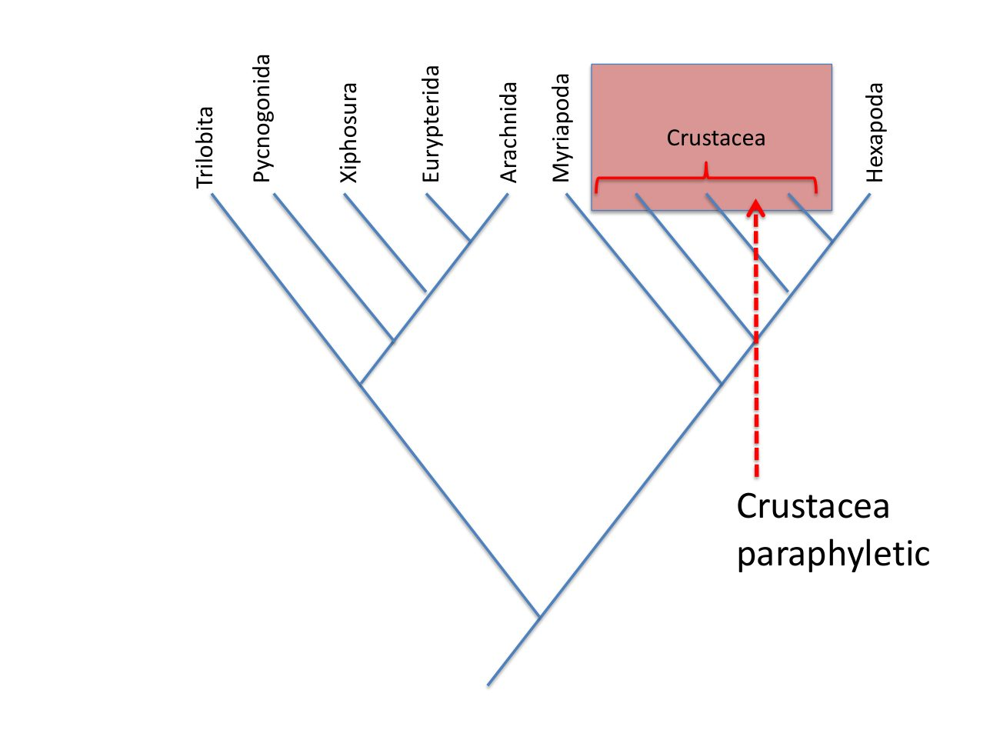](slides/slide-05.jpg)

The Crustacea are also paraphyletic because in order to create a monophyletic group with the crustacean, you need to include the hexapod in there.

[↑ Slides](#slides) · [Course index](../../README.md)

## Slide 6

[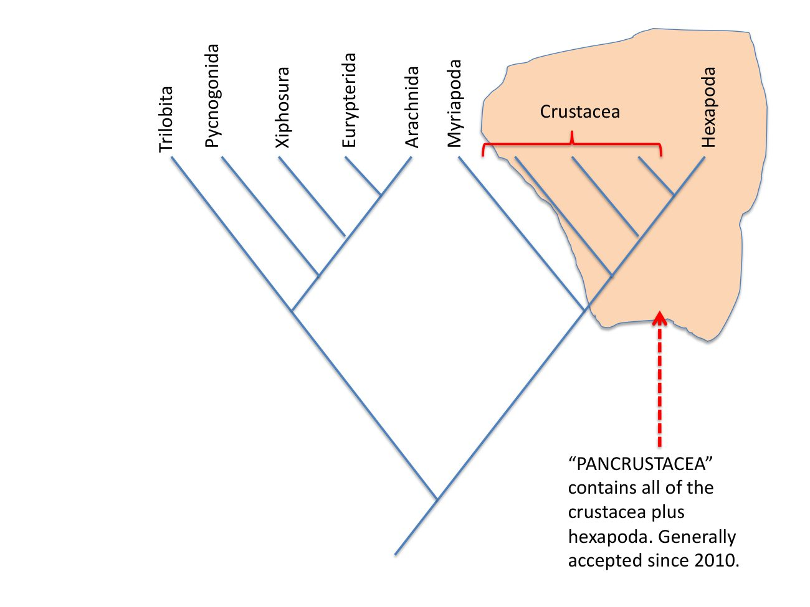](slides/slide-06.jpg)

And this is why we now talk about the Pancrustacea which contains the crustaceans that we're familiar with, plus the hexapod, which of course, includes the insects.

[↑ Slides](#slides) · [Course index](../../README.md)

## Slide 7

[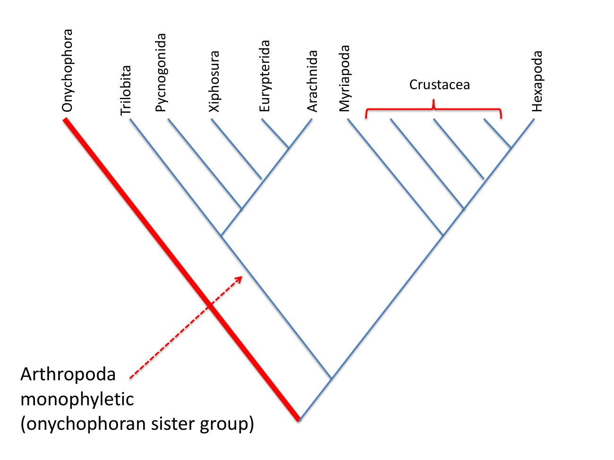](slides/slide-07.jpg)

OK, now what we've discovered much more recently is that just outside the arthropod is this small and fascinating phylum called the Onychophora. So the Onychophora plus the arthropod forms a single monophyletic grouping. But the onychophorans have a number of characteristics which make it clear that they're not arthropods.

I'm going to talk in some detail about this group because it's a group that I've worked on. And I hope that you get a good feel for, what an interesting group they are.

[↑ Slides](#slides) · [Course index](../../README.md)

## Slide 8

[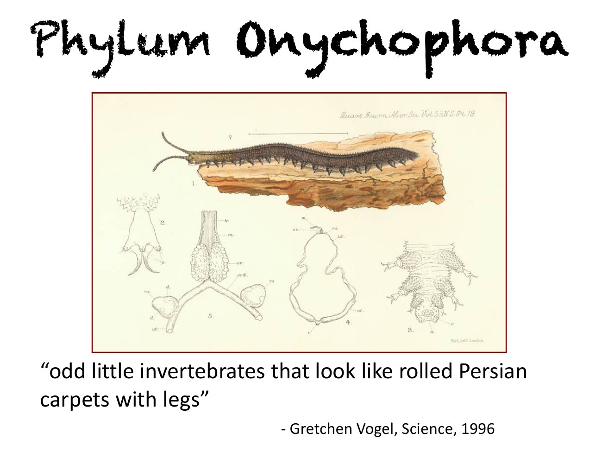](slides/slide-08.jpg)

Someone described onychophorans as odd little invertebrates that look like rolled up Persian carpets with legs. As you can see from these pictures, they do.

[↑ Slides](#slides) · [Course index](../../README.md)

## Slide 9

[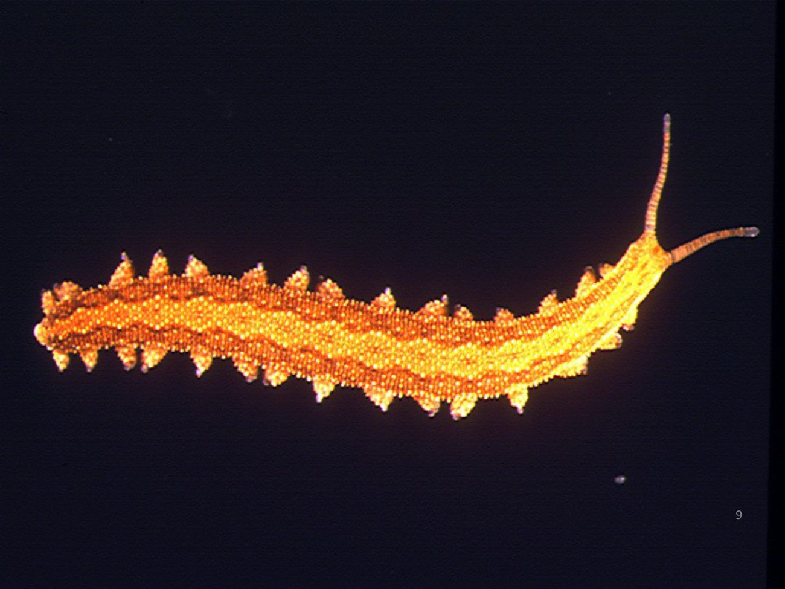](slides/slide-09.jpg)

*No separate passage can be confidently assigned to this slide. [Nearby discussion: slide 8](#slide-8).*

[↑ Slides](#slides) · [Course index](../../README.md)

## Slide 10

[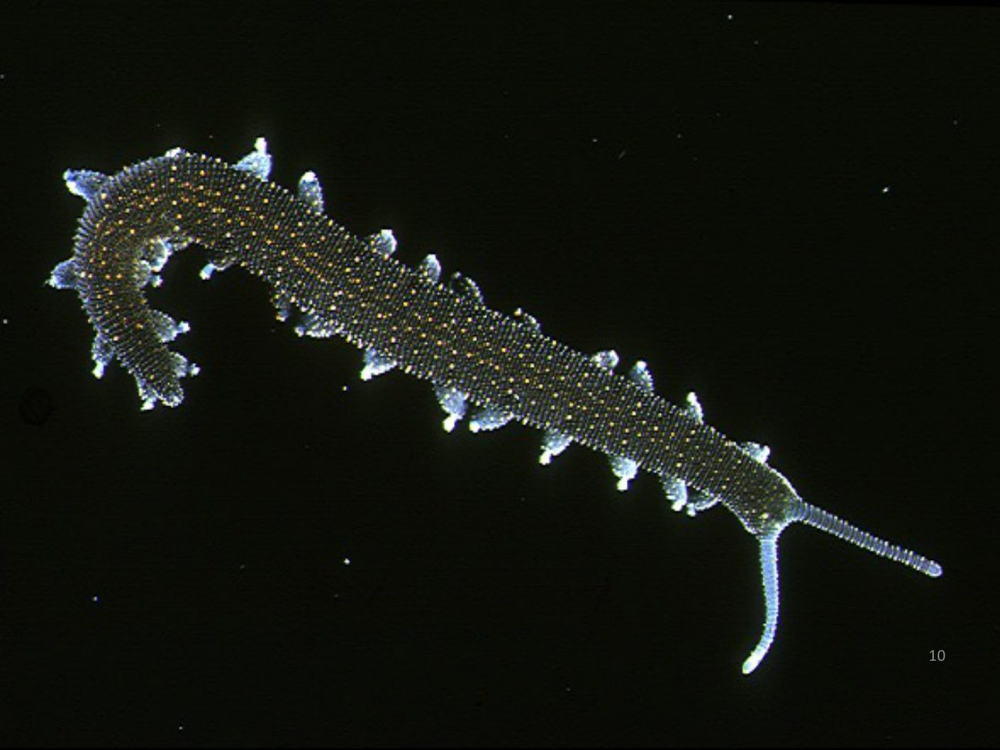](slides/slide-10.jpg)

*No separate passage can be confidently assigned to this slide. [Nearby discussion: slide 8](#slide-8).*

[↑ Slides](#slides) · [Course index](../../README.md)

## Slide 11

[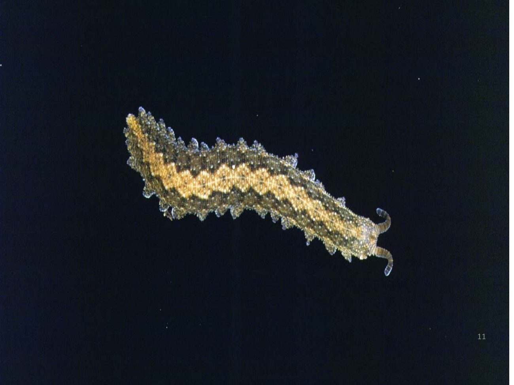](slides/slide-11.jpg)

*No separate passage can be confidently assigned to this slide. [Nearby discussion: slide 12](#slide-12).*

[↑ Slides](#slides) · [Course index](../../README.md)

## Slide 12

[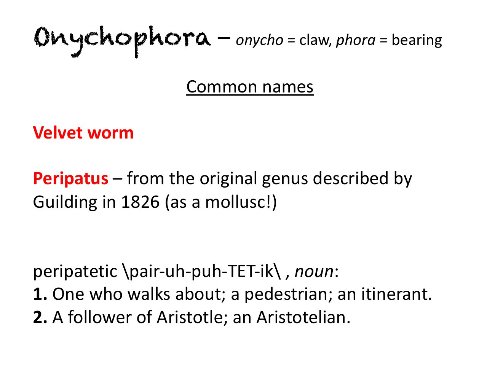](slides/slide-12.jpg)

Common names are velvet worm because they had that sort of velvety appearance. And also Peripatus was the name of the first genus that was described in 18 26. And it comes from the word peripatetic, which means one who walks about a pedestrian, an itinerant, and also a follower of Aristotle.

I assume that Guilding was thinking of the first definition when he named this genus, and although that was the first genus name, the whole group is often referred to as Peripatus.

[↑ Slides](#slides) · [Course index](../../README.md)

## Slide 13

[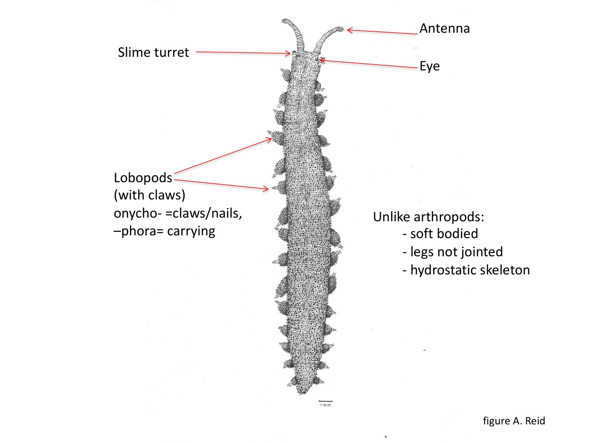](slides/slide-13.jpg)

Here's a picture of a peripatus you can see it's, it has a segmented ancestry, even though it hasn't got clearly marked segments like Centipedes. The legs are called lobo pods. They have claws on them, but they're not jointed.

And that's important because One of the characteristics of the arthropods is that they have jointed legs. That's a diagnostic characteristic of arthropods and the fact that these guys don't excludes them from belonging to the arthropods. They have a very soft body, and so they're very flexible.

And they have an antenna which we don't see in the Cheliceriformes. But we do see in the insects and the crustaceans, they've got two eyes, and they also have these fascinating structures called slime turrets, which we'll look at in a little bit more detail in a bit.

[↑ Slides](#slides) · [Course index](../../README.md)

## Slide 14

[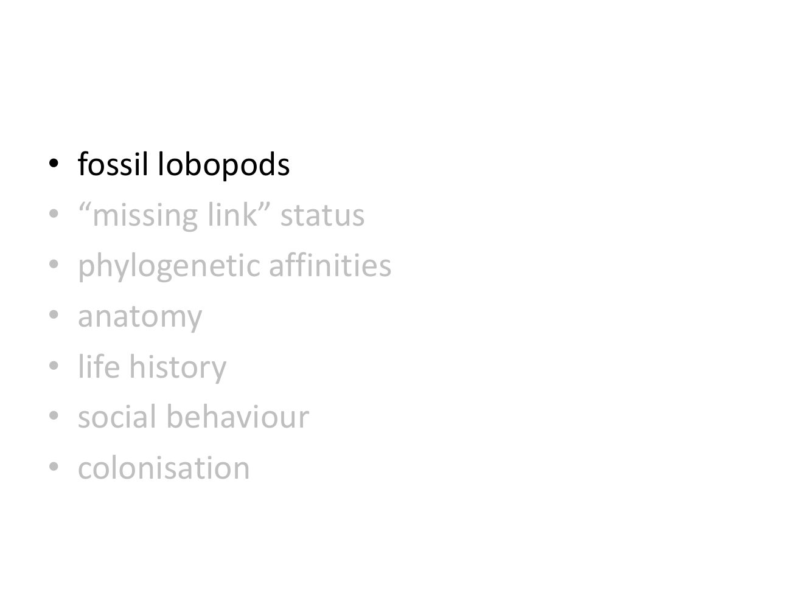](slides/slide-14.jpg)

This is what I'm going to tell you about this group. I'm going to go through these various, topics in relation to Onychophora.

[↑ Slides](#slides) · [Course index](../../README.md)

## Slide 15

[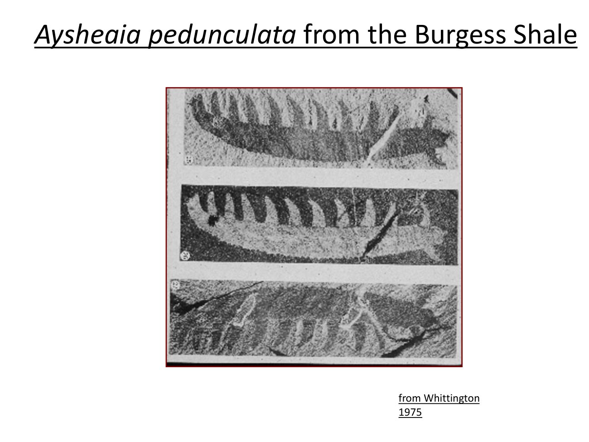](slides/slide-15.jpg)

So, firstly, looking at the fossil Lobo pods, there's a fossil that was discovered, that is 520 years old, 520 million years old from the Burgess shale. And, it's called Aysheaia pedunculata. And it has a very strong resemblance to mo modern day velvet worms per modern day peripatus.

And this is actually, considered by many to actually be, and onychophoran. But if it's not, it's something very close.

[↑ Slides](#slides) · [Course index](../../README.md)

## Slide 16

[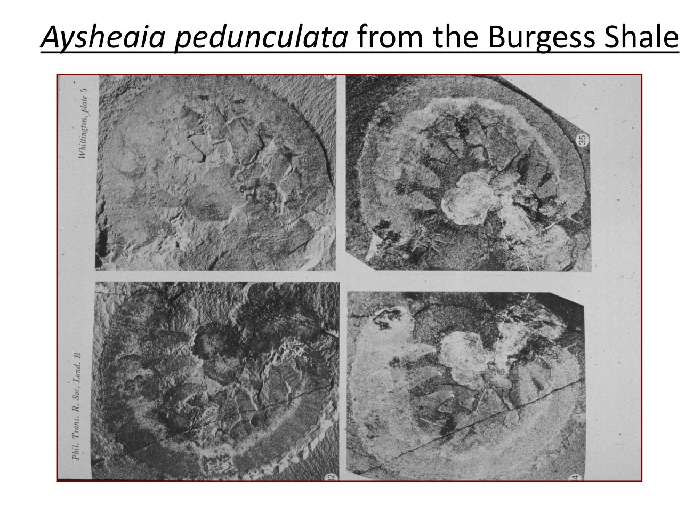](slides/slide-16.jpg)

That's a picture of a, Aysheaia pedunculata of fossil and you can see look at the way it's curled up with its legs in the centre.

[↑ Slides](#slides) · [Course index](../../README.md)

## Slide 17

[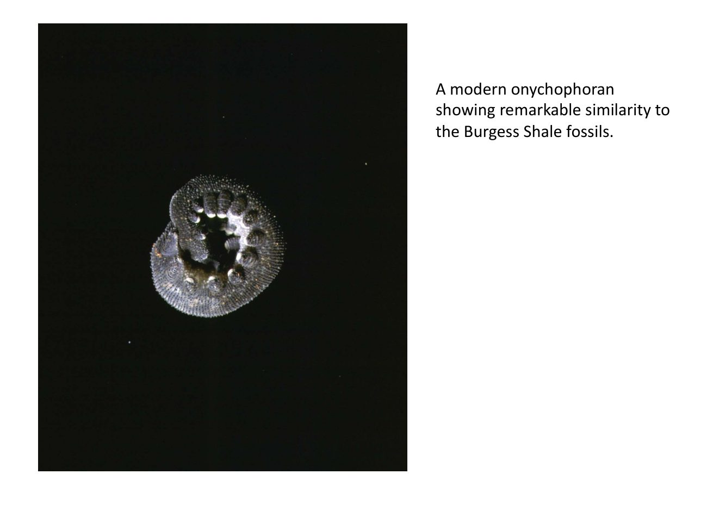](slides/slide-17.jpg)

And then here's a picture of a modern onychophoran that was collected not long ago, just down at Tallaganda State Forest, and you can see that it's remarkably similar to the Burgess shale fossil.

[↑ Slides](#slides) · [Course index](../../README.md)

## Slide 18

[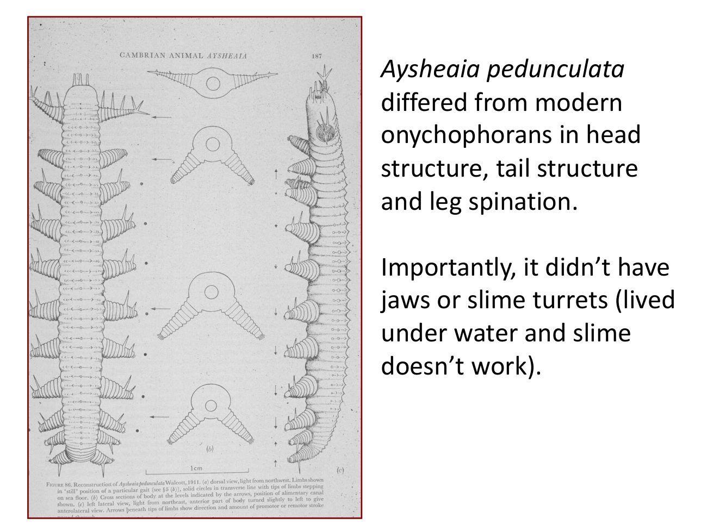](slides/slide-18.jpg)

This is the Burgess shale fossil. It's a little bit different from the, modern velvet worms in that it doesn't have slime glands and it doesn't have jaws and also it was Marine, but nonetheless, you can see that the body structure is very similar.

[↑ Slides](#slides) · [Course index](../../README.md)

## Slide 19

[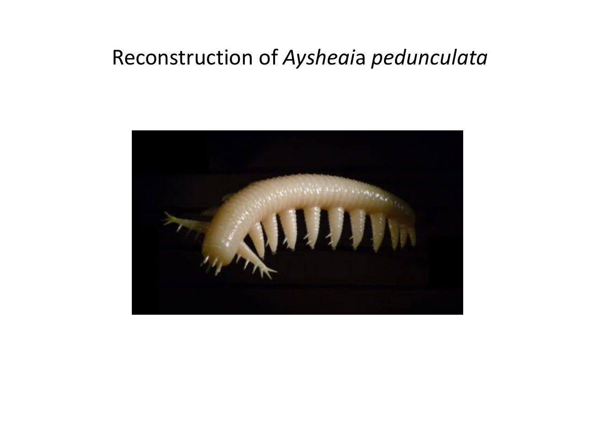](slides/slide-19.jpg)

That's a reconstruction of Aysheaia pedunculata.

[↑ Slides](#slides) · [Course index](../../README.md)

## Slide 20

[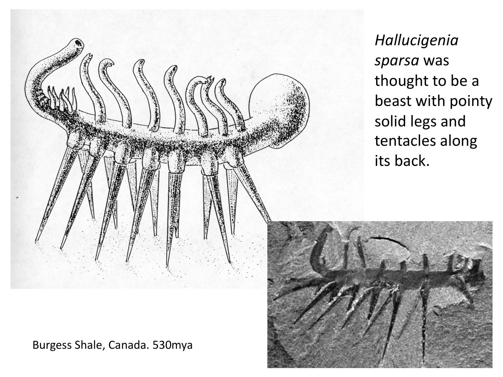](slides/slide-20.jpg)

This was another fascinating animal. It was a fossil again from the Burgess Shale 530 million years ago, called, Hallucigenia sparsa, and it was thought to be an animal with funny, pointy, solid legs and then tentacles along its back.

[↑ Slides](#slides) · [Course index](../../README.md)

## Slide 21

[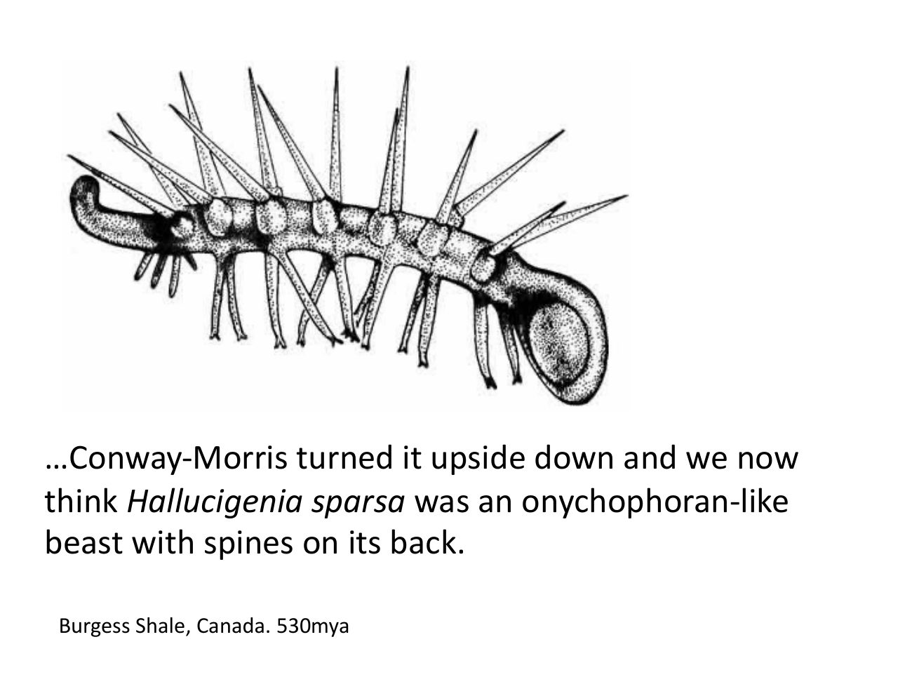](slides/slide-21.jpg)

But more recently it was found that this fossil was actually being looked at upside down, and in fact, this is what Hallucigenia sparsa looks like and, or looks like, and it looks like it is also an onychophoran like animal, but with spines on its back and many more fossils have since been found that look very like modern onychophorans but have quite amazing defensive structures like these spines or armour on their backs.

[↑ Slides](#slides) · [Course index](../../README.md)

## Slide 22

[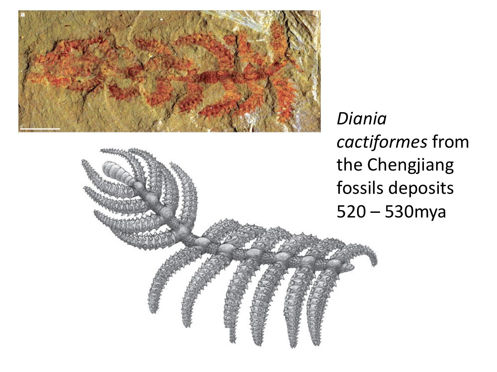](slides/slide-22.jpg)

Here's a couple of other examples. This is Diania cactiformis, meaning it looks like a cactus, and it's thought also to belong to the same group as our velvet worms. Again very ancient 520 to 530 million years old.

[↑ Slides](#slides) · [Course index](../../README.md)

## Slide 23

[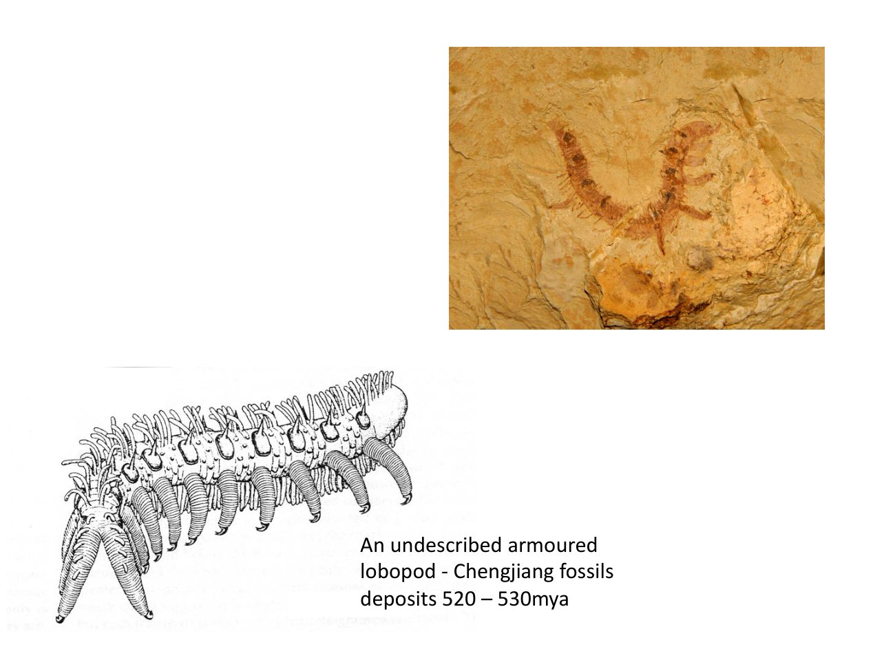](slides/slide-23.jpg)

Here's another undescribed species from, Chengjiang fossil deposits in China again very ancient, and you can see very close, similarity with modern day Onychophora. People refer to these old ones generally as Lobo Pods or lobopodians, rather than putting them directly into the Onychophora.

[↑ Slides](#slides) · [Course index](../../README.md)

## Slide 24

[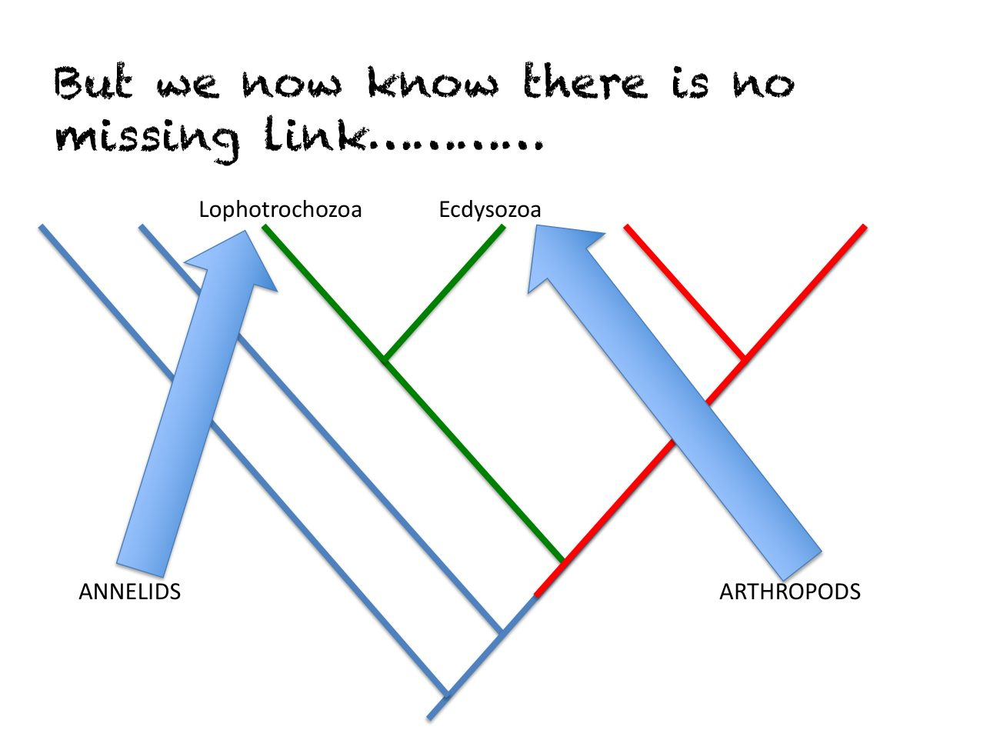](slides/slide-24.jpg)

OK, part of the reason why such a small, obscure group received so much attention over the last 100 years or so has been because it was thought that it could be the missing link between two major groups, and this is how people thought that arthropod evolution worked. They thought that the arthropods and a number of other groups tardigrades, and [unclear group] formed a monophyletic group that showed a natural progression from the annelids. That is from the segmented worms.

The segmented worms have segments, as do all of these other groups. Sometimes the segments aren't as easy to see. And so it was thought that there was sort of a natural evolutionary grade, and the onychophorans were a missing link between the annelids and the arthropods.

And these were the reasons why, a onychophorans have got arthropod characters like a haemocoel tubular heart tracheal system, uric acid, excretion, et cetera. But they also have annelid characters. They've got segmental nephridia.

That's the excretory system, circular muscles around the body and ciliated reproductive tract. So people thought that they'd actually found the missing link between the annelids and the arthropods. But now that we know there is no missing link because, in fact, the annelids are not closely related to the arthropods.

This model was wrong looking at the tree we looked at the other day, here's what we now know is the case that we have this group called the Ecdysozoa amongst the protostomes and a group called the Lophotrochozoa and the annelids belong way away from the arthropods. And, in the Lophotrochozoa and the Ecdysozoa contains the arthropods. We're going to have a look at that relationship a bit more closely soon.

> **Editorial note:** The historical “missing link” account is being described and then rejected by the lecturer. It has not been rewritten as a current phylogenetic conclusion.

[↑ Slides](#slides) · [Course index](../../README.md)

## Slide 25

[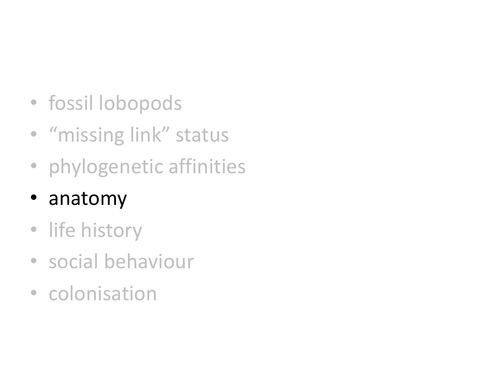](slides/slide-25.jpg)

OK, looking at the anatomy of onychophorans.

[↑ Slides](#slides) · [Course index](../../README.md)

## Slide 26

[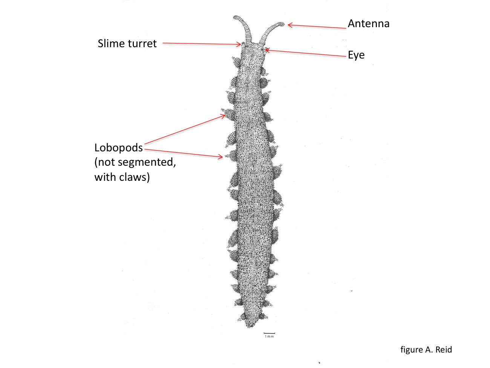](slides/slide-26.jpg)

I've gone through the structures. They're also covered in this these little papilla little lumps all over them, which gives them a velvety appearance. Hence the name Velvet Worm.

[↑ Slides](#slides) · [Course index](../../README.md)

## Slide 27

[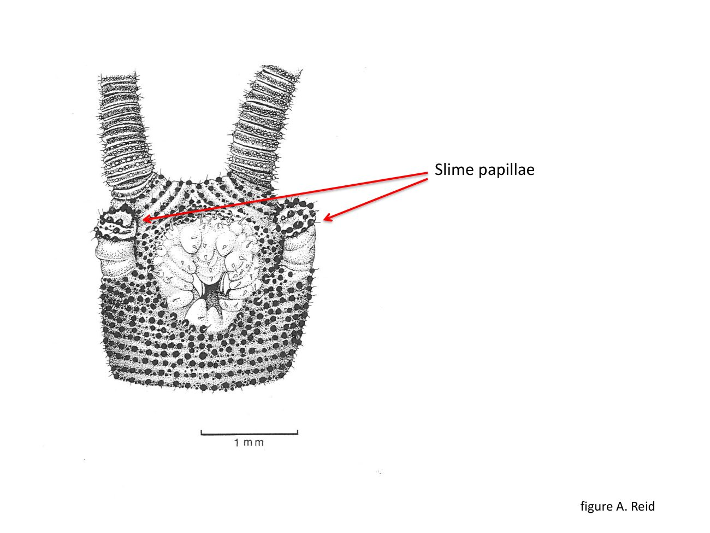](slides/slide-27.jpg)

Here are the slime papilla. And.

[↑ Slides](#slides) · [Course index](../../README.md)

## Slide 28

[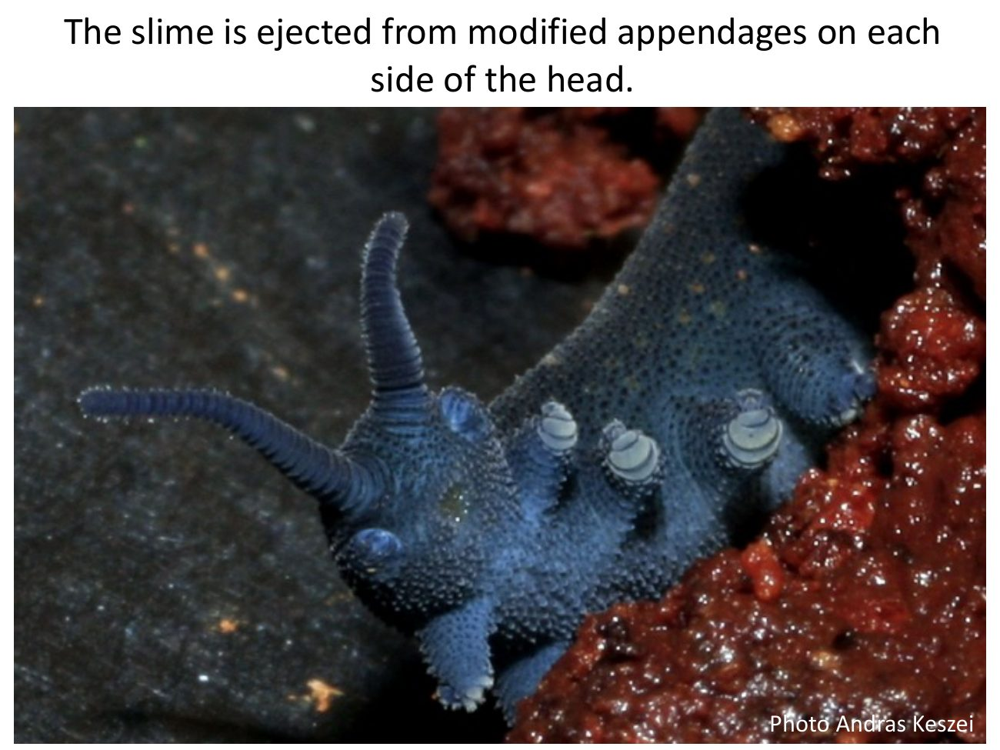](slides/slide-28.jpg)

Here's a photograph and you can see the slime papillae here. Now, these animals have glands and storage. Structures inside their body that can take up to a third of their weight.

And it's full of this very sticky slime which they can actually spray out through their, slime turrets. And that slime very quickly solidifies on contact with air.

[↑ Slides](#slides) · [Course index](../../README.md)

## Slide 29

[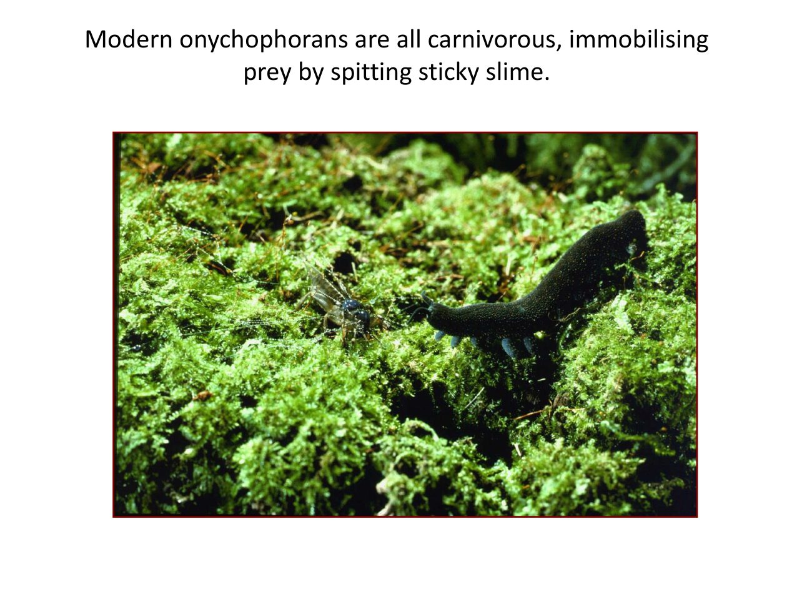](slides/slide-29.jpg)

And here's a picture of an onychophoran hunting and you can see what we've got is just to the left of the centre, a cricket, and you can see it sprayed this sticky slime all over the cricket and what it does. Is it actually, immobilises the animal and it attaches it to the substrate so that it can't move, and then the velvet worm can come up and eat it. So although they look very cute and cuddly, they're actually quite vicious carnivores.

[↑ Slides](#slides) · [Course index](../../README.md)

## Slide 30

[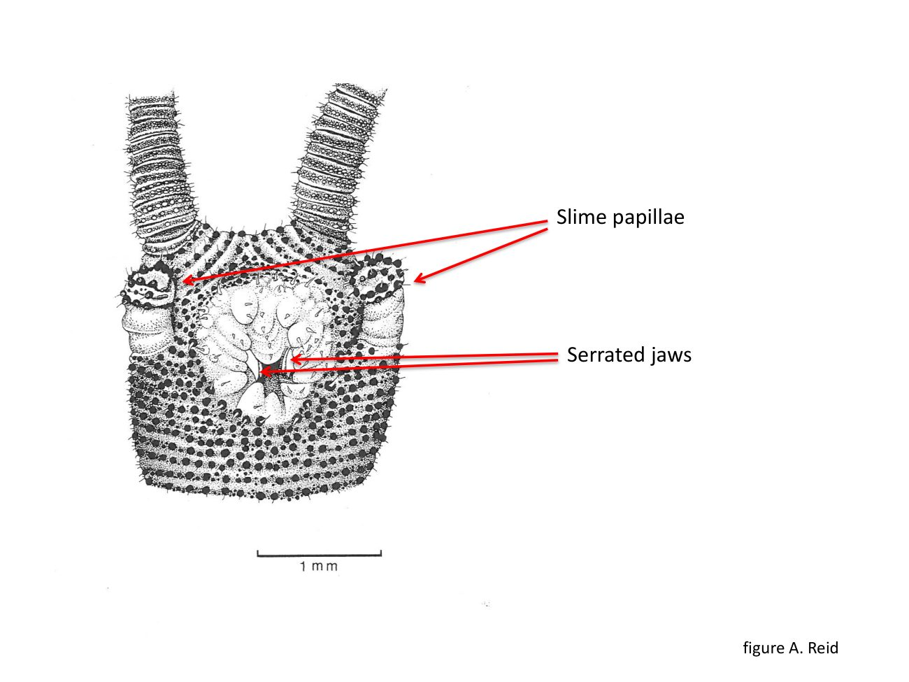](slides/slide-30.jpg)

And they have these huge serrated jaws, which they use to eat their food.

[↑ Slides](#slides) · [Course index](../../README.md)

## Slide 31

[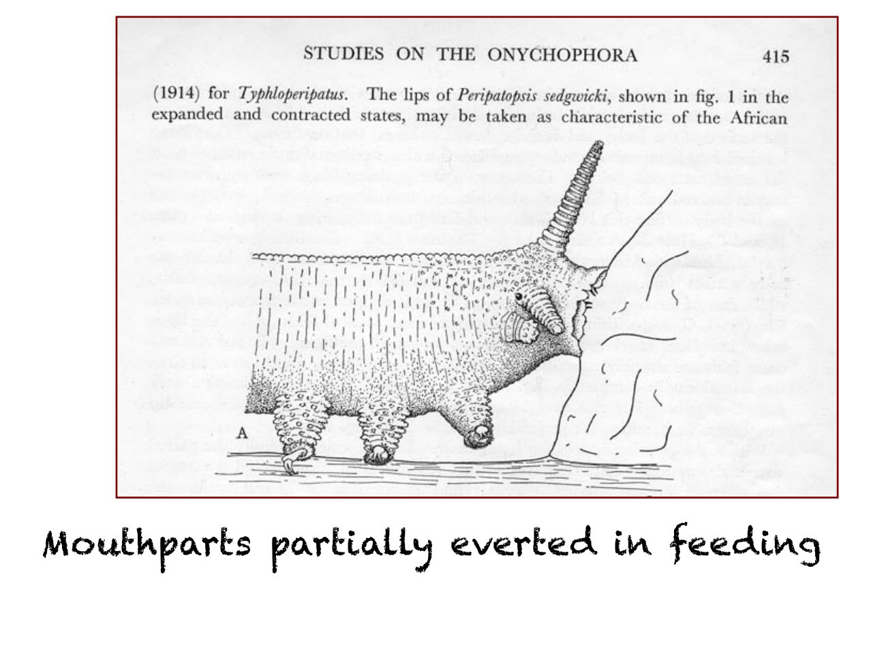](slides/slide-31.jpg)

They can actually partially evert those jaws and, bite into the animal that they're eating. They can eat some solid particles. They also can suck liquid from the animal.

This is a video that my friend Tanya Latty took. Sorry. I'll just have to OK, there we go.

These are velvet worms in a glass container, and they're they're eating the goo that they spat to collect, to catch prey. And you can see the way those jaws, or, moving in unison.

[↑ Slides](#slides) · [Course index](../../README.md)

## Slide 32

[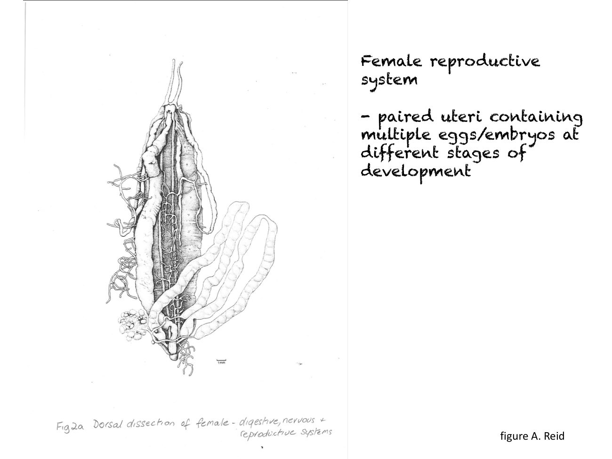](slides/slide-32.jpg)

OK, as far as the reproductive system is concerned, they've got two uteruses, and those uteruses contain multiple eggs and embryos at different stages of development. In fact, when you dissect an animal, you'll find the most recent, Oh, sorry. The oldest, the most developed embryos can actually be removed and they walk off.

[↑ Slides](#slides) · [Course index](../../README.md)

## Slide 33

[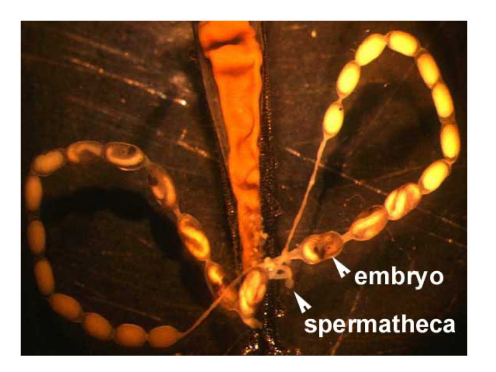](slides/slide-33.jpg)

Here's a picture of those paired, uteruses. And you can see, at the base. We have just basic egg yolk.

And then towards the end, we have whole animals which are crammed into that uterus.

[↑ Slides](#slides) · [Course index](../../README.md)

## Slide 34

[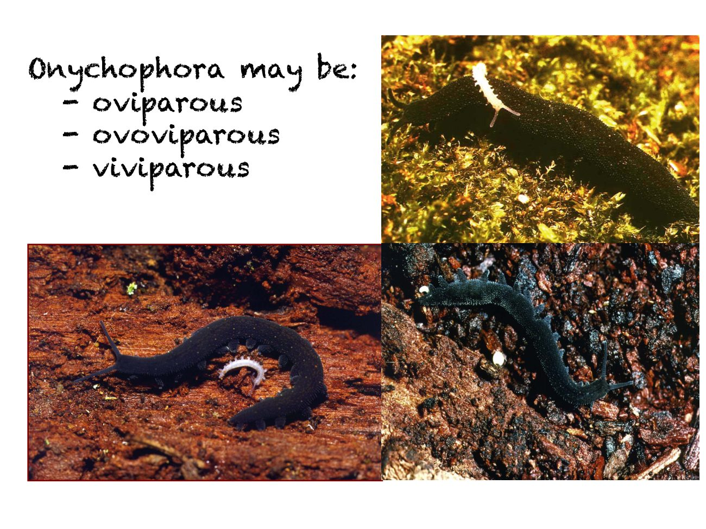](slides/slide-34.jpg)

Another fascinating thing about onychophorans is that some egg layers, that is their oviparous. And there's an egg. There they have these.

Those species have an ovipositor there that you can see. Some are ovoviviparous. What that means is that they contain eggs, which they hold in their body until they hatch and they give live birth, they give birth to live offspring, and some of them are viviparous, which means that they actually provide nutrient to the, embryo.

As it's developing, they move nutrient from the mother through to the embryo as it develops.

[↑ Slides](#slides) · [Course index](../../README.md)

## Slide 35

[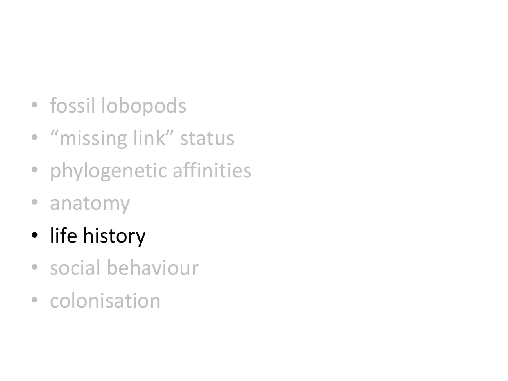](slides/slide-35.jpg)

Now, you'll remember when I talked about the mygalomorph spiders. I talked about the fact that they have four book lungs and the book lungs are not very efficient at, exchanging gases, and also that they result in AAA, tendency to desiccation. And something similar happens to the velvet worms have got multiple spiracles like insects scattered over the whole body.

Those spiracles lead to trachea. That's tubes through the body that, spread the oxygen. But they can't close their spiracles the way insects can, and they have.

So they have these multiple ho holes that are open to the environment, and so they're very prone to evaporation and desiccation. What this means is that velvet worms are limited, like the mygalomorph spiders to very moist environments or to moist climates like the tropics.

[↑ Slides](#slides) · [Course index](../../README.md)

## Slide 36

[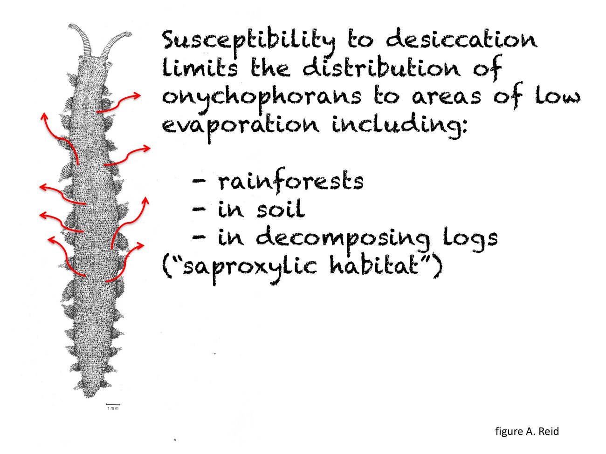](slides/slide-36.jpg)

So that leads into the life history of the group. The susceptibility to desiccation means that you only find them in either wet forests or occasionally in soil. And in Australia, most commonly in decomposing logs.

[↑ Slides](#slides) · [Course index](../../README.md)

## Slide 37

[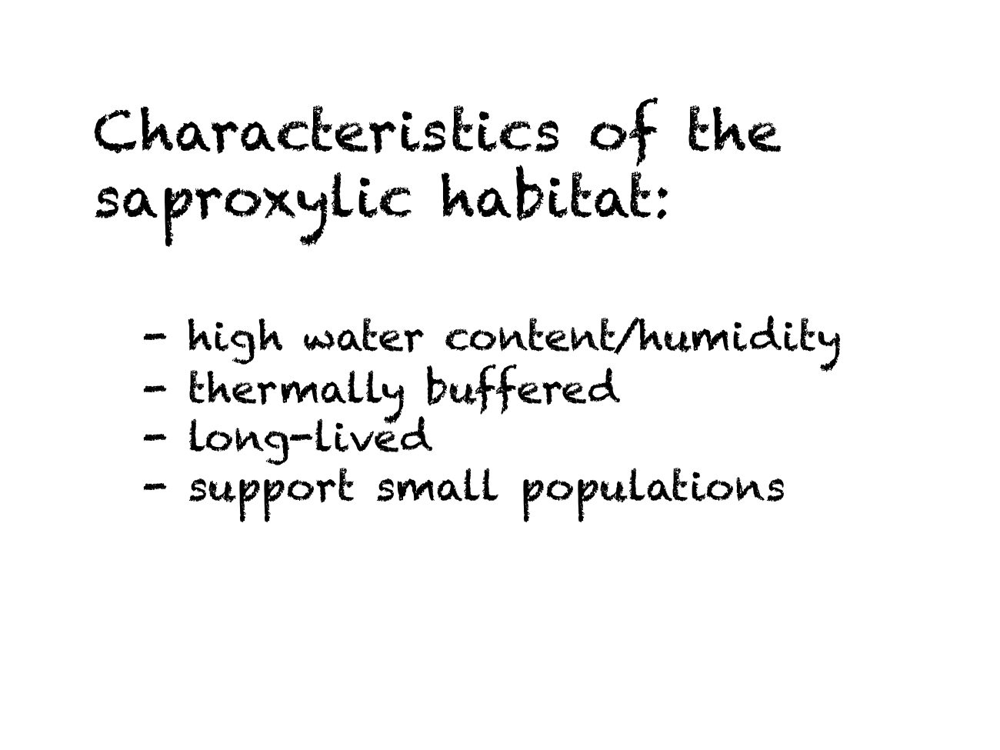](slides/slide-37.jpg)

The decomposing log, environment is called the saproxylic habitat, and the saproxylic habi habitat that is inside re, rotting logs has, is good because it has a very high water content. Even in dry forests, it's thermally buffered. That is, there's so much water in large, decomposing logs that the temperature doesn't change quickly.

Inside the log, even if the temperature is quite variable outside, decomposing logs are long lived. We've dated some logs from local forests, and we know that they've been lying there rotting, for well over 200 years. And, these logs then can support whole populations of animals.

[↑ Slides](#slides) · [Course index](../../README.md)

## Slide 38

[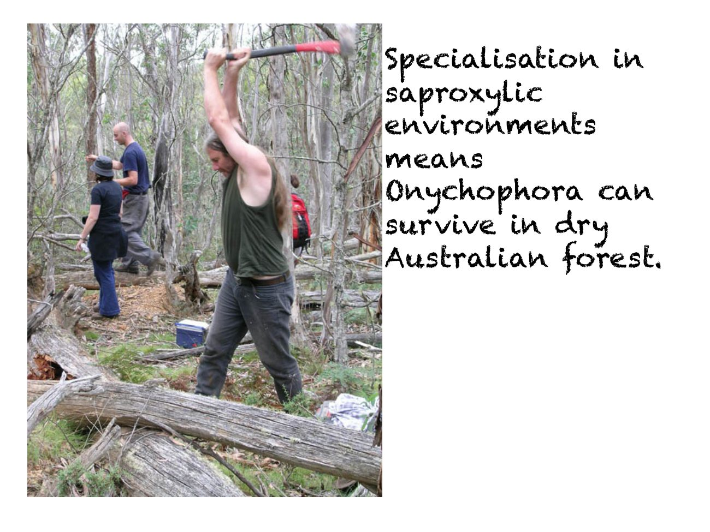](slides/slide-38.jpg)

So here we are, collecting velvet worms. You can see it can be a quite a destructive, practise. What we tend to do is, rather than breaking up a number of logs, we go to one log, and we, sample it to total destruction, leaving all of the other logs around untouched.

You can see from the bottom left of this photo that inside those decomposing logs, they're wet. They're full of that very red rotting wood. Here's a picture of us, me and a number of my students collecting velvet worms at Tallaganda State Forest.

Someone put a sign under it when I put it on my door saying gorillas in the mist. But, field work for velvet worms is quite fun because you get to go out to quite unusual places collecting now.

[↑ Slides](#slides) · [Course index](../../README.md)

## Slide 39

[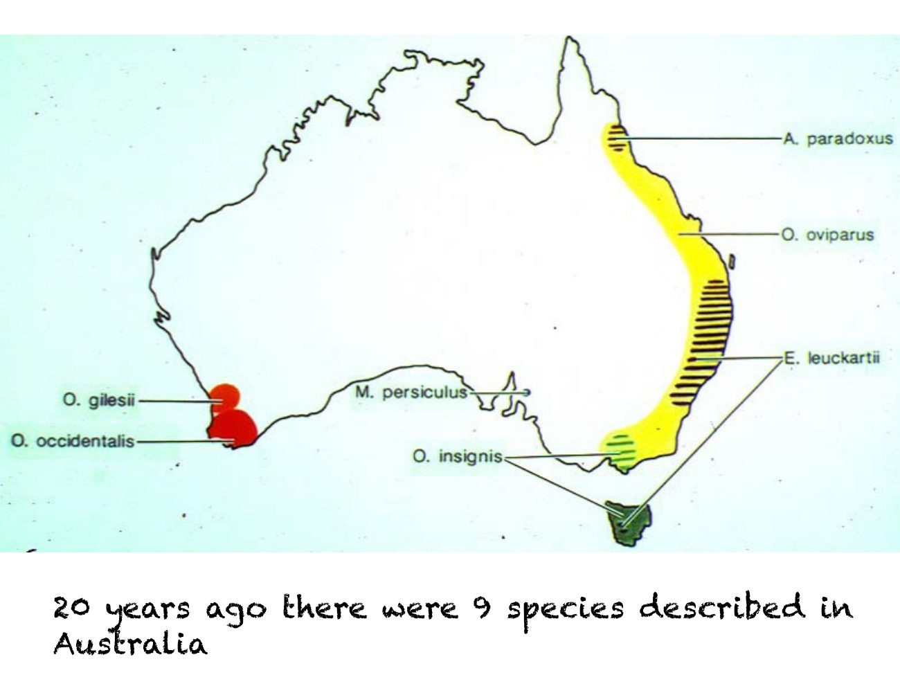](slides/slide-39.jpg)

Before we started working on them, there were nine species described in Australia.

[↑ Slides](#slides) · [Course index](../../README.md)

## Slide 40

[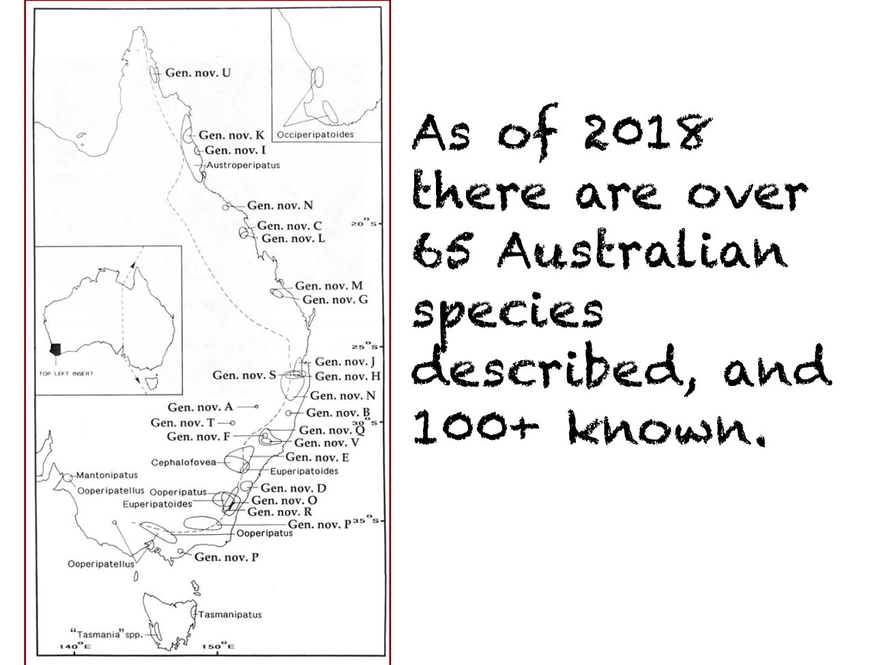](slides/slide-40.jpg)

Since then, my group and others have described many more species as of 2018, there were 65 Australian species described, although we know of at least 100. But in fact, a paper is now in press describing a new species just in the last few weeks.

[↑ Slides](#slides) · [Course index](../../README.md)

## Slide 41

[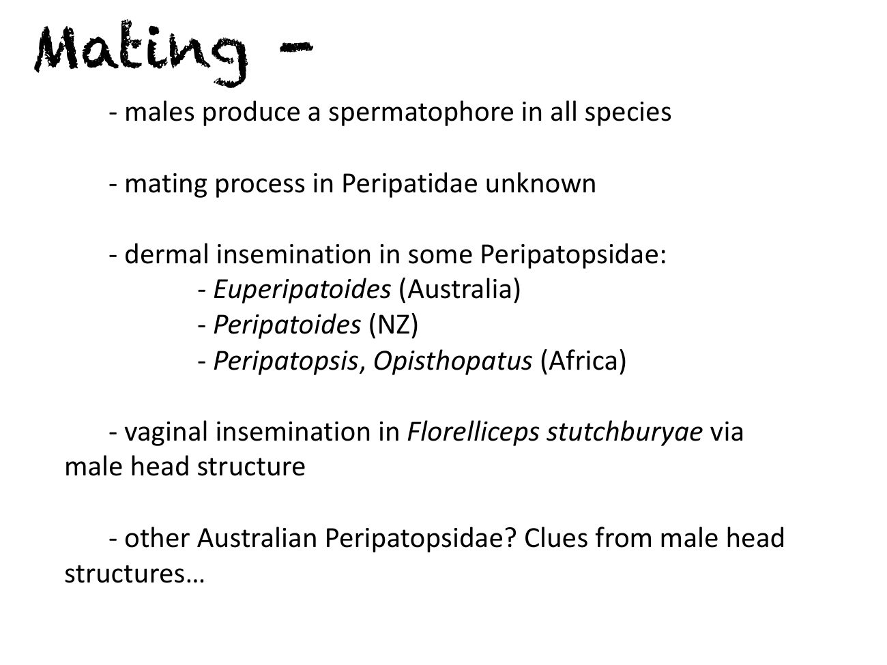](slides/slide-41.jpg)

This group does some really weird stuff, and, the more you look at them, the stranger things you discover mating can be very interesting. In some groups, all in all velvet worms, the males produce a spermatophore, which is sort of like a gooey blob that contains the sperm. We see that in scorpions and a number of other groups as well.

We don't know how that spermatophore is transferred in the family Peripatidae. There are two families the Peripatidae and the Peripatopsidae, the Australian group of the Peripatopsidae. So we don't know how the mating process occurs in the Peripatidae.

But in the peripatopsids, which are found in Australia, New Zealand and Africa, they have what's called dermal insemination. What this means is that the male places the spermatophore anywhere on the female's body, and then the female has special cells that travel up and actually break down her body wall, where the spermatophore is, and then the sperm swim into the female's body cavity and swim to a spermatheca where the a spermatheca where they collect. We know in some species there's vaginal insemination via the male head structure, which I'll show you a picture of in a moment.

And that is the spermatophore is actually pushed into the female's vagina. Here's a picture of one of these, species, for Florelliceps stutchburyae. And the male is the one behind.

He has a spermatophore on his head and he's inserting that into the female. Before we knew about this mating system, we were intrigued by the fact that we discovered many species with very unusual structures on their heads. And we didn't know what they were for until we saw this one mating.

> **Editorial note:** Statements about which mating mechanisms were known reflect the lecture’s date.

[↑ Slides](#slides) · [Course index](../../README.md)

## Slide 42

[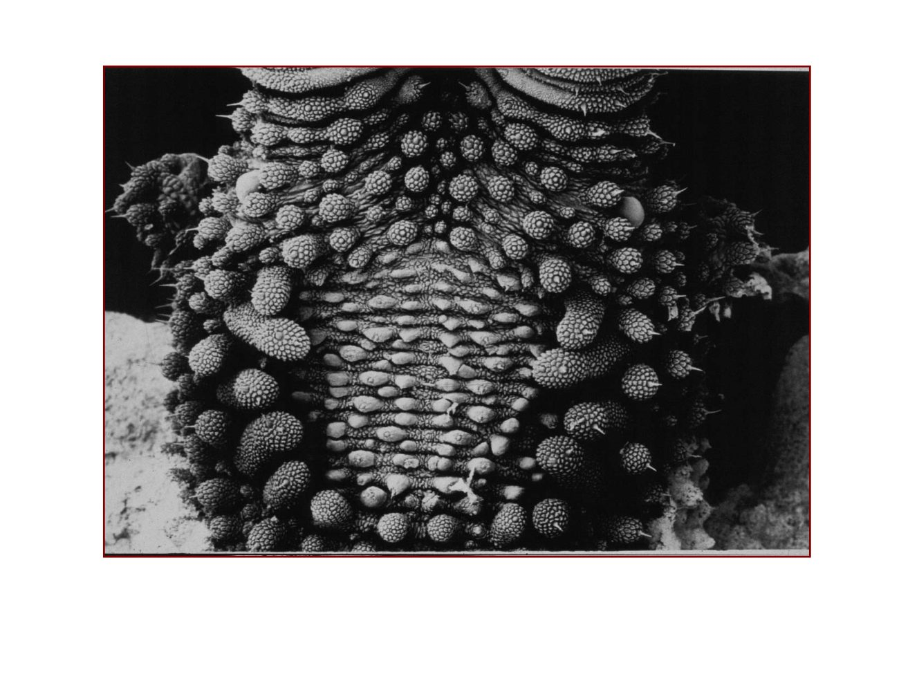](slides/slide-42.jpg)

Here's a velvet worm, The antenna at the top. You can see the eyes here. And oh, sorry.

And this one has this strange area in the middle of the head where the papilla are reduced or virtually not, there.

[↑ Slides](#slides) · [Course index](../../README.md)

## Slide 43

[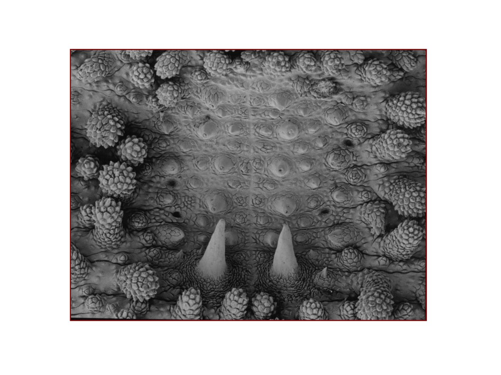](slides/slide-43.jpg)

Here's another species we found, which has a similar system, but it's got these two spines.

[↑ Slides](#slides) · [Course index](../../README.md)

## Slide 44

[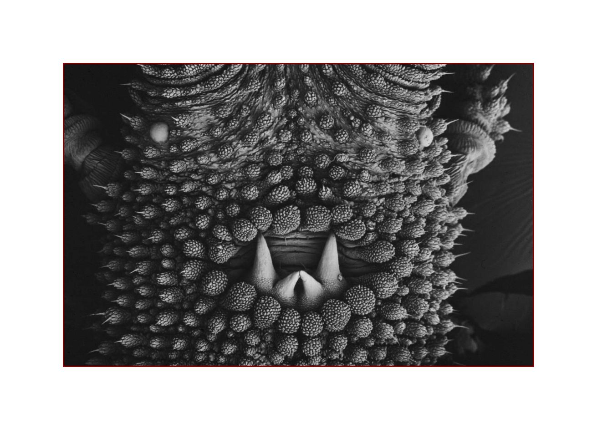](slides/slide-44.jpg)

This one has four spines again, there's the eyes, an antenna and there's a slime gland there, slime. Turret. And there's the antenna at the top.

And again this very funny structure.

[↑ Slides](#slides) · [Course index](../../README.md)

## Slide 45

[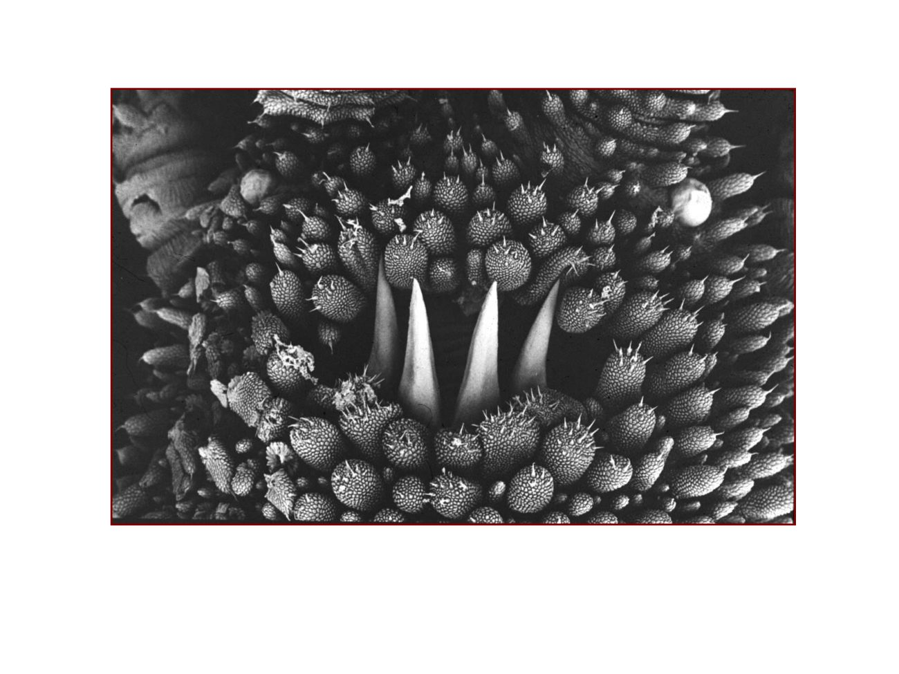](slides/slide-45.jpg)

And this one has another species with four spines. These are really useful characteristics for distinguishing between species. But for a long while, we had no idea what they were for.

[↑ Slides](#slides) · [Course index](../../README.md)

## Slide 46

[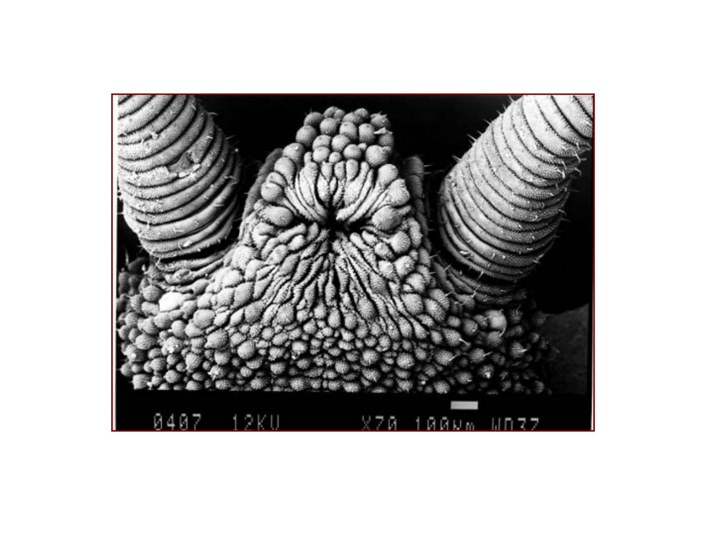](slides/slide-46.jpg)

Here's another one with a large hole in its head and when it's stimulated in the right way.

[↑ Slides](#slides) · [Course index](../../README.md)

## Slide 47

[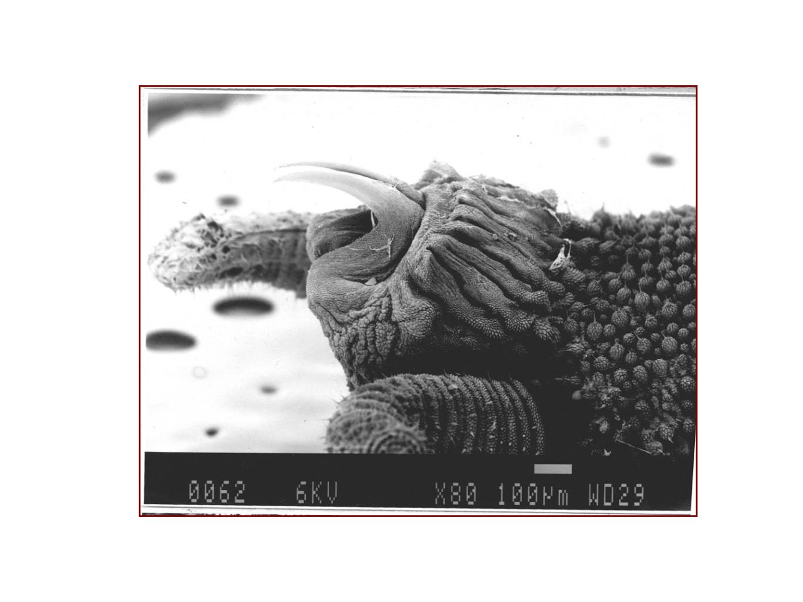](slides/slide-47.jpg)

That structure everts to give you this thing that looks like a volcano with two big spines on it. And it was from this species we discovered.

[↑ Slides](#slides) · [Course index](../../README.md)

## Slide 48

[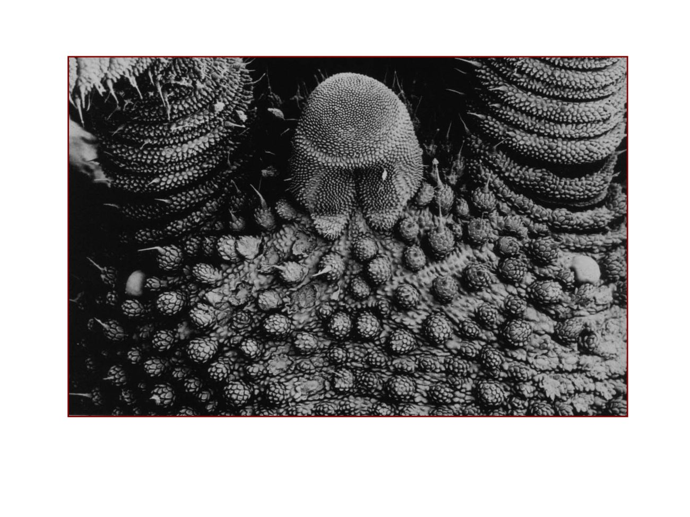](slides/slide-48.jpg)

Oh, and this one, has this strange structure. We refer to that species as the dickhead or phallocyphalus [name uncertain]. OK, And with that one with the eversible head structure, what we discovered is that they actually can put the spermatophore on their head, and they can pull it inside their head inside that structure.

[↑ Slides](#slides) · [Course index](../../README.md)

## Slide 49

[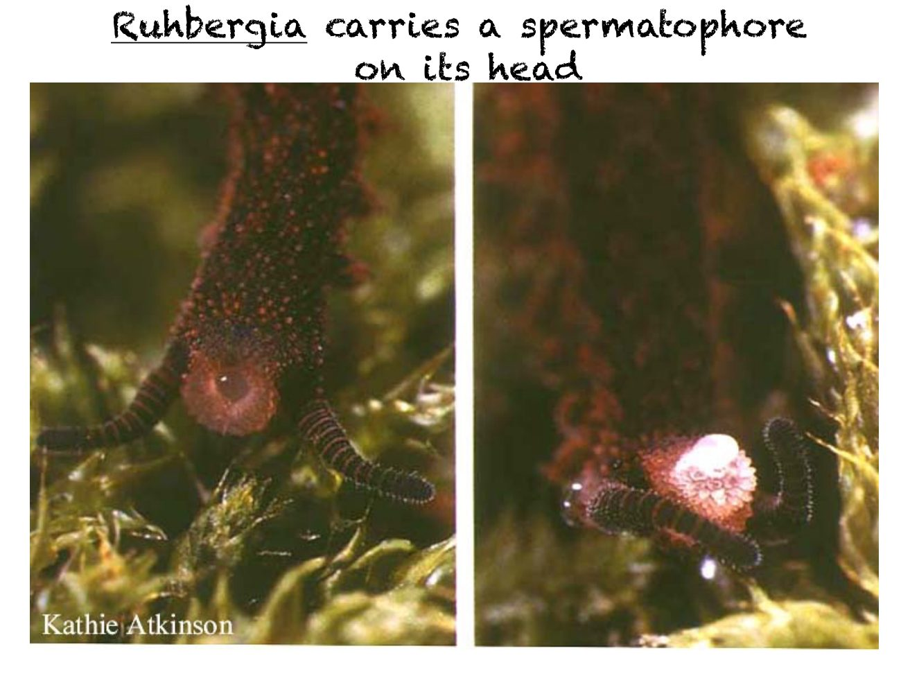](slides/slide-49.jpg)

And we've since seen other species that carry the spermatophore round on their head. And those head structures somehow help secure the spermatophore until they can insert it into the female.

[↑ Slides](#slides) · [Course index](../../README.md)

## Slide 50

[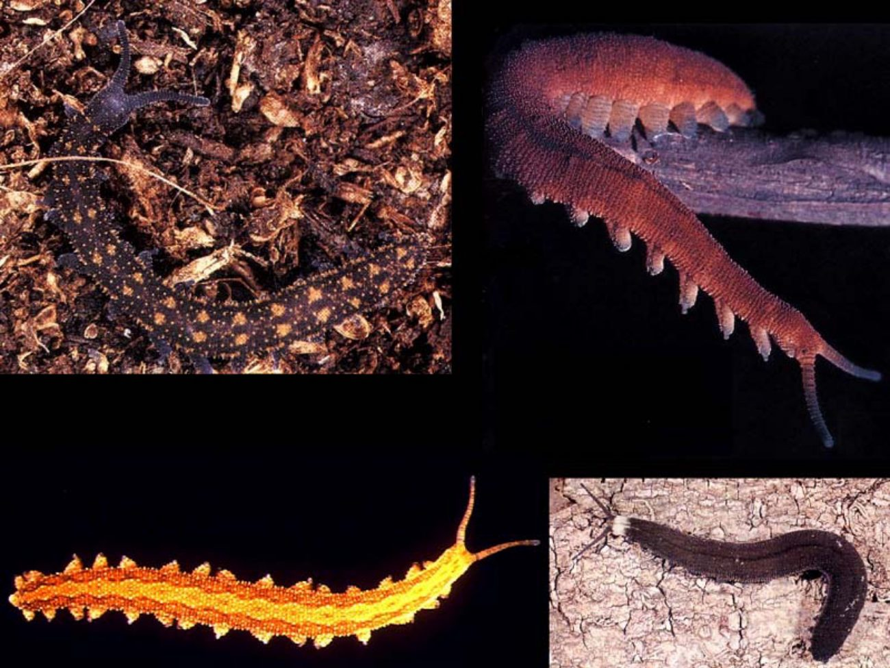](slides/slide-50.jpg)

Here's some gratuitous pictures of velvet worms just to show the incredible variety of colour. However, they're a very difficult group to work on taxonomically because although they're very colourful, and although there's a lot of variation in colour, the variation in colour occurs within species as well as between species. And so we're limited to looking at morphological characters on an animal that doesn't have a lot of morphological, useful morphological characters for the taxonomy.

[↑ Slides](#slides) · [Course index](../../README.md)

## Slide 51

Another thing we discovered is that they show social behaviour.

[↑ Slides](#slides) · [Course index](../../README.md)

## Slide 52

This particular species, which is named after me, which is very kind of Mandy Reid. It's the most abundant velvet worm we know of. It's viviparous.

It gives live birth. It's got a skewed sex ratio. Its males are smaller than females.

We get them in enormous densities up to 1000 per hectare in southeastern Australia. They never found in pit traps. We don't know why.

We do know they, produce a pheromone which attracts them to other individuals of the same species. And through studying that we found very complex social behaviour.

[↑ Slides](#slides) · [Course index](../../README.md)

## Slide 53

And what we found is when you in, is that in the wild you find them in large groups. And so we studied them in the lab and started introducing individuals to other individuals and watching what happened? That's the paper that was written.

That's a long while ago now, 2005.

[↑ Slides](#slides) · [Course index](../../README.md)

## Slide 54

So one of the things we see in these groups is clumping, and there's a bunch of them sitting all in a clump. And this is unusual for aggressive predators to actually be friendly to one another. Rather than eating each other, they show aggression towards newcomers, that is, individuals brought in from a different log.

This is an example where the one on the right has just bitten the one on the left and you can see the one on the left is sort of cringing away and then reconciliation. That is, if you put two together. They do a lot of this biting and stuff, and then one of them, the subordinate one, it seems, crawls gently over the other animal, which is sort of saying, Alright, I accept that you are, dominant over me.

They have a, they If you put food in, they will all eat the hunt, The food together But once they've restrained AAA food item, they have a feeding hierarchy where first of all the adult females feed on the, prey, then the juveniles and then the males. OK, so quite interesting behaviour for what otherwise looks like a very simple organism.

[↑ Slides](#slides) · [Course index](../../README.md)

## Slide 55

This is a picture of an interesting species that's found in Tasmania. It's, critically endangered. It's called, Tasmanipatus anophthalmus [probable], which means having no eyes.

You find it in logs, but actually it's distribution centres on a cave system in Tasmania, and so we think it probably evolved in the caves. And like many other cave animals, it lost its eyes.

> **Editorial note:** The species-name reading is probable from the description and spelling; no recording was supplied for confirmation.

[↑ Slides](#slides) · [Course index](../../README.md)

## Slide 56

That's another Persian rug sort of animal.

[↑ Slides](#slides) · [Course index](../../README.md)

## Slide 57

Here again, there are a bunch of us collecting velvet worms from a decomposing log [unclear phrase]

[↑ Slides](#slides) · [Course index](../../README.md)

## Slide 58

And this shows the diversity of patterning and colouring in the group.

[↑ Slides](#slides) · [Course index](../../README.md)

## Slide 59

*No separate passage can be confidently assigned to this slide. [Nearby discussion: slide 58](#slide-58).*

[↑ Slides](#slides) · [Course index](../../README.md)

## Slide 60

So onychophorans are sometimes referred to as lobopodians, and that name includes, embraces not only the living onychophorans, but also those fossil forms like Aysheaia pedunculata, et cetera. But there's also another living group that's included in this, group lobopodians. I should say lobopodian is not a taxonomic name.

It's simply a term used to embrace all of these different forms.

[↑ Slides](#slides) · [Course index](../../README.md)

## Slide 61

And the other group is the group that we're going to talk about tomorrow, which is the Tardigrades phylum Tardigrada. And we'll talk about those in the next lecture. OK, so that's all for now.

And there will be another, lecture coming up.

[↑ Slides](#slides) · [Course index](../../README.md)

## Source notice

this material has been reproduced and communicated to you by or on behalf of the Australian National University in accordance with section 113 P of the Copyright Act 1968 The material in this communication maybe subject to copyright under the act any further reproduction or communication of this material by you must be consistent with the provisions of the act. Do not reproduce this material. Do not remove this notice.

[← Previous lecture](../13-invertebrate-intro-part-13-insect-overview-7-smaller-holometabolous-orders/README.md) · [Course index](../../README.md) · [Next lecture →](../15-tardigrades-and-nematodes/README.md)
