# Tardigrades and Nematodes

[← Previous lecture](../14-onychophora/README.md) · [Course index](../../README.md) · [Next lecture →](../16-chelicerata-part-1-ticks-mites-horseshoe-crabs/README.md)

**Slides + cleaned transcript** · 31 slides

English transcript with fillers and repeated false starts removed. Technical terms are corrected using the slides and context. Bracketed wording marks reconstruction or uncertainty. Slide boundaries are inferred from content; the transcripts have no slide timestamps.

[Original transcript](original-transcript.txt) · [Text-only version](cleaned-transcript.md) · [Editing notes](../../EDITING-NOTES.md) · [Correction record](corrections.md)

[Searchable slide text](slide-text.md). Click a slide image to open it at full size.

## Slides

[1](#slide-1) · [2](#slide-2) · [3](#slide-3) · [4](#slide-4) · [5](#slide-5) · [6](#slide-6) · [7](#slide-7) · [8](#slide-8) · [9](#slide-9) · [10](#slide-10) · [11](#slide-11) · [12](#slide-12) · [13](#slide-13) · [14](#slide-14) · [15](#slide-15) · [16](#slide-16) · [17](#slide-17) · [18](#slide-18) · [19](#slide-19) · [20](#slide-20) · [21](#slide-21) · [22](#slide-22) · [23](#slide-23) · [24](#slide-24) · [25](#slide-25) · [26](#slide-26) · [27](#slide-27) · [28](#slide-28) · [29](#slide-29) · [30](#slide-30) · [31](#slide-31)

## Slide 1

[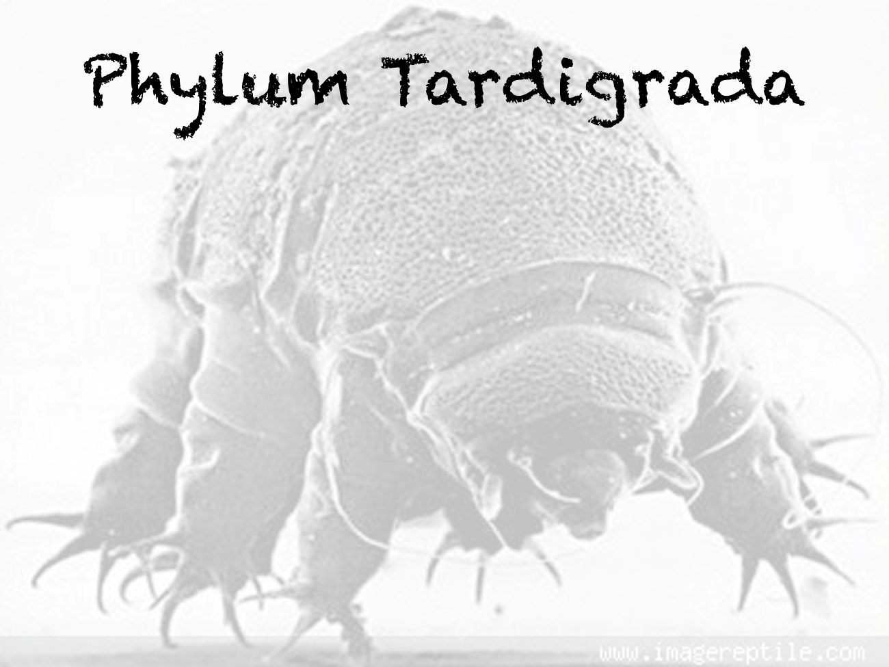](slides/slide-01.jpg)

Hi, folks. This is the last lecture I'll be giving, in the earlier lectures, we had a look at, some arthropods that aren't insects, specifically the Cheliceriformes. And then we went on to look at the Onychophora, which is a phylum that sits just outside the arthropod, but represents what is probably the sister group of the arthropod, looking at the velvet worms.

We saw that they're very like arthropods in that they have a chitin cuticle, and they have legs and a number of other, arthropod like characteristics. But they don't qualify as arthropods because they have a few anomalous sort of characters, probably the most obvious being that unlike arthropods, they don't have jointed legs Instead, they have these sort of flexible legs, which we refer to as Lobo pods. We finished that lecture looking at the fact that onychophorans are referred to as lobopodians sometimes, along with the fossil onychophorans and also with another group.

And that other group is the tardigrades phylum Tardigrada.

[↑ Slides](#slides) · [Course index](../../README.md)

## Slide 2

[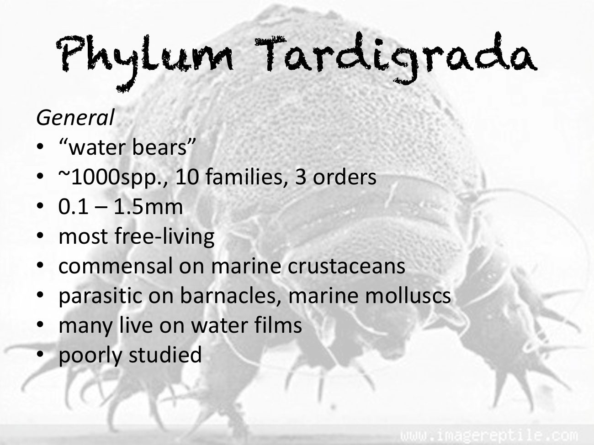](slides/slide-02.jpg)

But tardigrades are often referred to as water bears. There are 1000 known species, but we know that is an incredible underestimate. The reason for that is the animals are very small from 0.1 to 1.5 millimetres, quite cryptic and found in sometimes quite unusual places.

And so there are bound to be many more species. But unfortunately, they're a very poorly studied group. Most tardigrades are free living.

That is, they live, outside and they live, terrestrially. And in marine and aquatic situations, some are parasitic on barnacles and parasitic on mollusks. Many live in the water films that we find in terrestrial environments that coat Mosses and that coat, soil particles.

And so, they're very small to sort of fit into that very fine niche.

[↑ Slides](#slides) · [Course index](../../README.md)

## Slide 3

[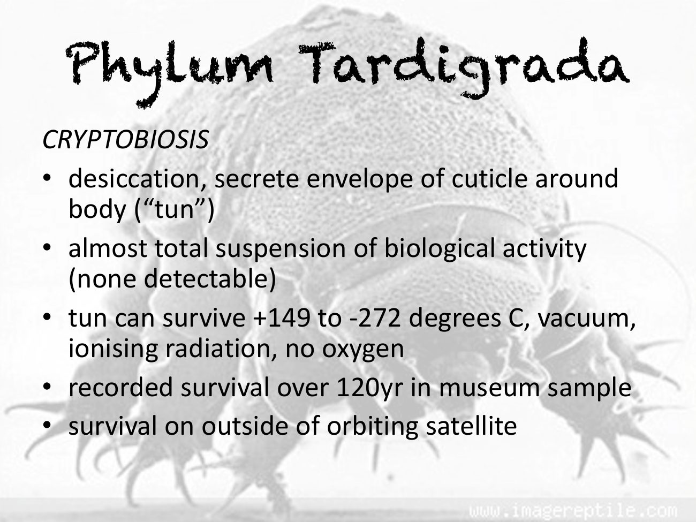](slides/slide-03.jpg)

An interesting characteristic of Tardigrades is what's called cryptobiosis. That is, they can survive desiccation by secreting cuticle around their body. And this forms a structure called a tun and, within the Tun they almost totally suspend their biological activity.

The tun can survive an enormous range of temperatures from 149 down to minus 272 degrees C Celsius. They can live in vacuums. They can survive in vacuums.

They can be exposed to ionising radiation. They don't need oxygen. One specimen of a tun that was rehydrated from a museum sample was 100 and 20 years old and, on rehydration.

The animal was perfectly fine. Also a couple of decades ago, tardigrade tuns were sent up on the outside of an orbiting satellite when the satellite came down after they'd been exposed to ionising radiation, cold temperatures, hot temperatures and vacuum, the animals came back to life. So quite amazing.

Amazingly tenacious organisms.

> **Editorial note:** Extreme-survival values and the historical 120-year revival claim are retained from the lecture, not independently established here; survival depends strongly on species, duration and conditions.

[↑ Slides](#slides) · [Course index](../../README.md)

## Slide 4

[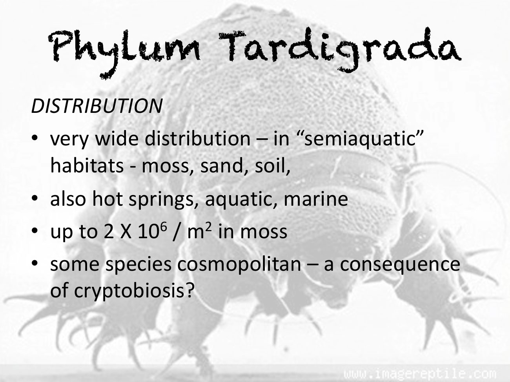](slides/slide-04.jpg)

They've got an incredibly wide distribution in terms of habitat. We call it sort of semi aquatic because they live not just in, fresh water, but also in freshwater films around sand and soil particles. But you also find them in hot springs.

And in the ocean, their densities can get up to really high. We can get up to 2 million in a cubic metre of moss, and some species are found all over the world, some individual species. And this is probably because of that cryptobiosis issue.

Once they form a tun, they can be blown around over very large distances. They can be carried around by water, and so they can probably move between continents.

[↑ Slides](#slides) · [Course index](../../README.md)

## Slide 5

[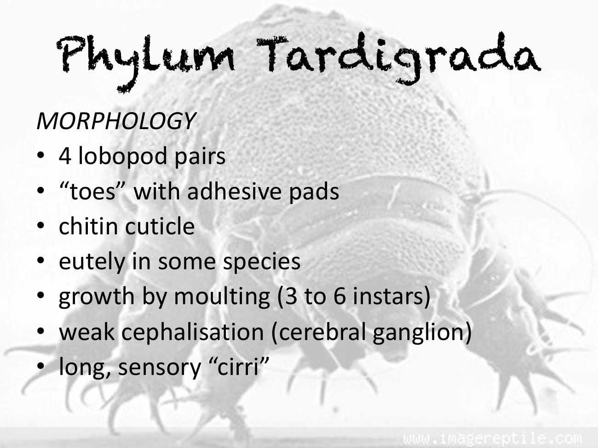](slides/slide-05.jpg)

Tardigrades look superficially like velvet worms in that they don't have jointed limbs. They have lobo pods, flexible lobes with claws. On the end, tardigrades have got ex adhesive pads on the end of those claws, which allows them to stick to very slippery surfaces.

They've got a chitinous cuticle like a velvet worm.

[↑ Slides](#slides) · [Course index](../../README.md)

## Slide 6

[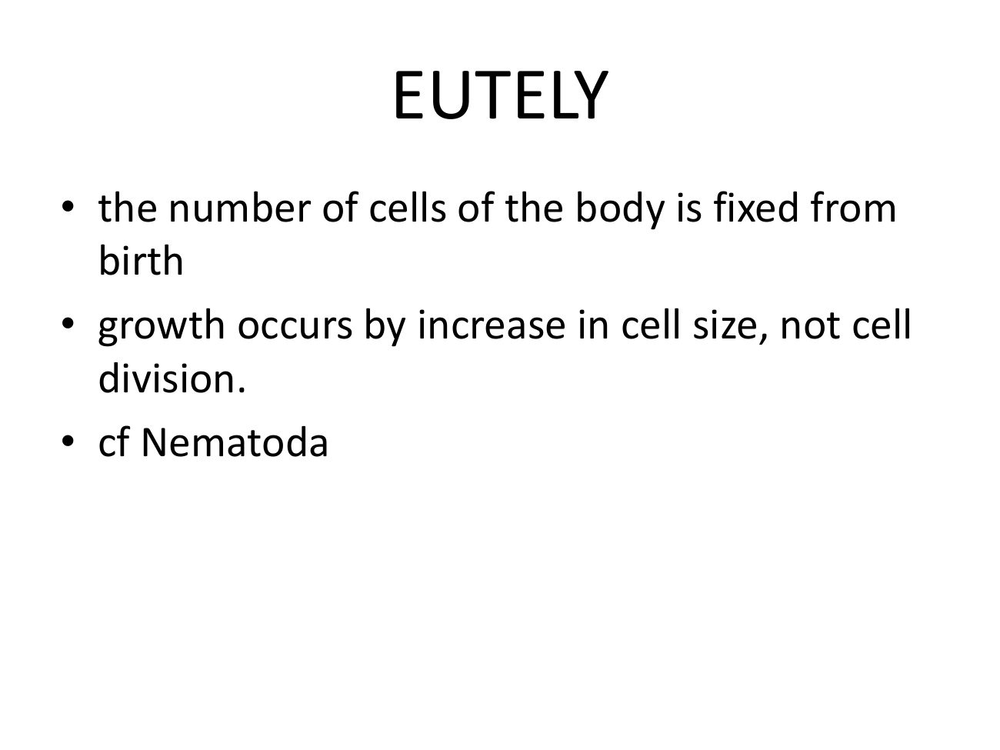](slides/slide-06.jpg)

And in some species, we see this strange characteristic called eutely means that once an animal has, developed from an embryo and hatched, the number of cells in its body is fixed. It cannot undergo cell division. The way they grow then is not by dividing and producing more cells, but by individual cells growing in size.

This is a bit of a problem because their cells can't divide and so they can't survive damage. They can't do what other organisms do, which is simply use stem cells to produce more, differentiated cells. Instead, they just don't survive.

This is interesting. You'll see why later in that it is held in common with the nematodes, and there's an interesting relationship with the nematodes. We'll discuss, the tardigrades grow and moult like velvet worms and also like arthropods.

They do have a head, although, they don't have a lot of nervous material in their head. So they're they're not sort of the Einsteins of the animal world. They talk to the environment through these long, fine hairs, which you can see on the background picture here called cirri and their sensory hairs.

> **Editorial note:** Eutely concerns a fixed cell complement in particular tissues or life stages; the blanket claim that these animals cannot repair any damage is an oversimplification.

[↑ Slides](#slides) · [Course index](../../README.md)

## Slide 7

[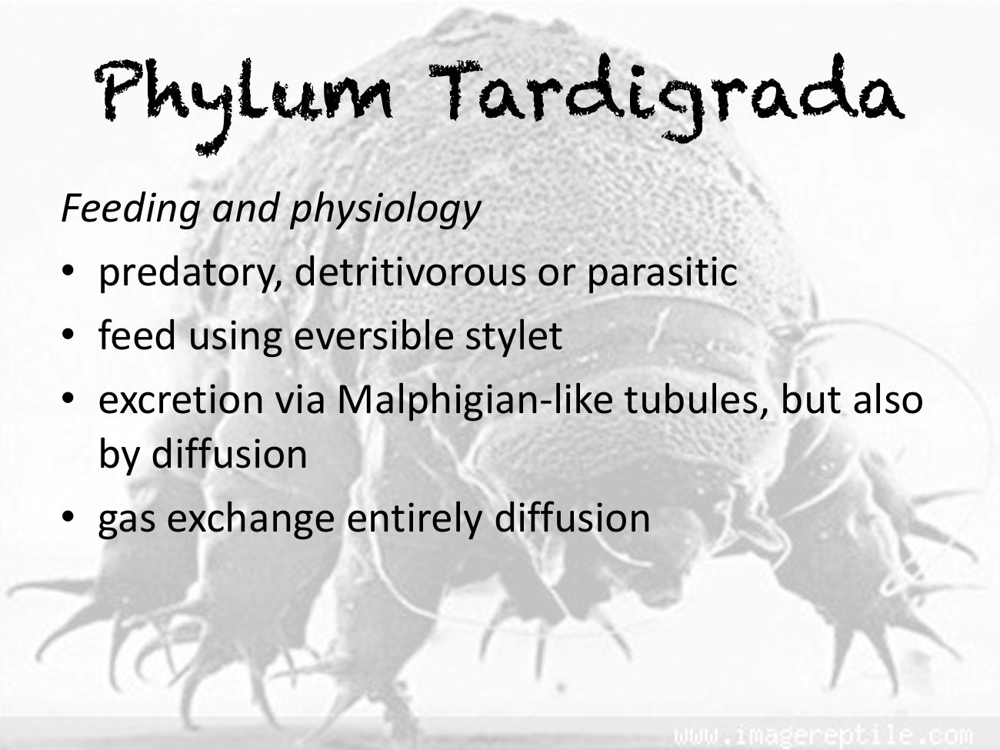](slides/slide-07.jpg)

They can be predators. Some feed on detritus and some are parasitic. They eat using an eversible stylet, which is like a hollow tube that comes out the front of their mouth.

Analogous, but probably not homologous with the stylet we see on the Hemiptera on the bugs. They're so small that they don't need, gills or lungs. They exchange gas directly with the environment through their cuticle.

[↑ Slides](#slides) · [Course index](../../README.md)

## Slide 8

[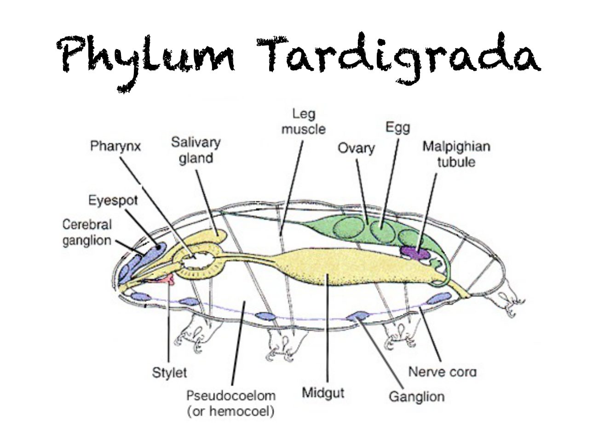](slides/slide-08.jpg)

This is a picture of a tardigrade. As you can see, it's quite simple. It's got a ventral nerve cord, which we also see in the arthropods and velvet worms.

They've got a gut with a mouth at one end and an anus at the other. They don't have a heart because they can do their gas exchange and excretion through their cuticle. Otherwise nothing particularly remarkable about them when we compare them to arthropods.

[↑ Slides](#slides) · [Course index](../../README.md)

## Slide 9

[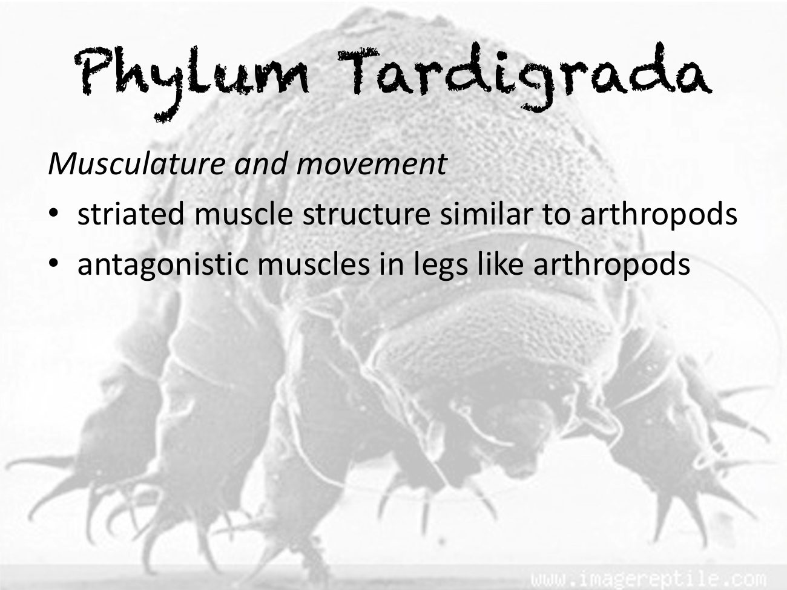](slides/slide-09.jpg)

Their striated muscle structure is similar to arthropods in their legs. They have antagonistic muscles that can pull the legs backwards and forwards.

[↑ Slides](#slides) · [Course index](../../README.md)

## Slide 10

[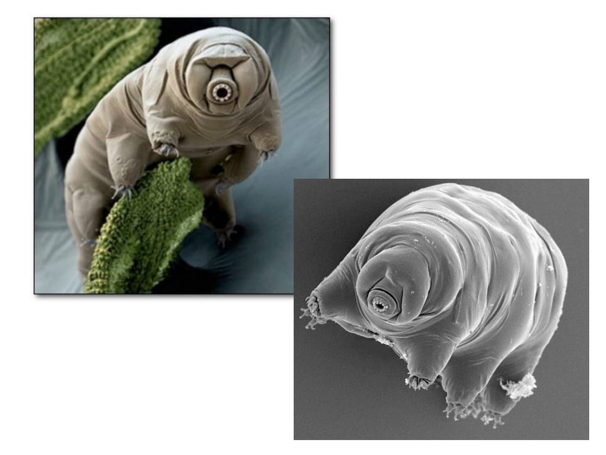](slides/slide-10.jpg)

Here's a couple of, coloured up electron microscope pictures of tardigrades, and you can see the lobopods and that funny stylet on the front. Here's another picture where you can also see the cirri. That's those sensitive sensory hairs as well as the claws on the end of each lobopod.

[↑ Slides](#slides) · [Course index](../../README.md)

## Slide 11

[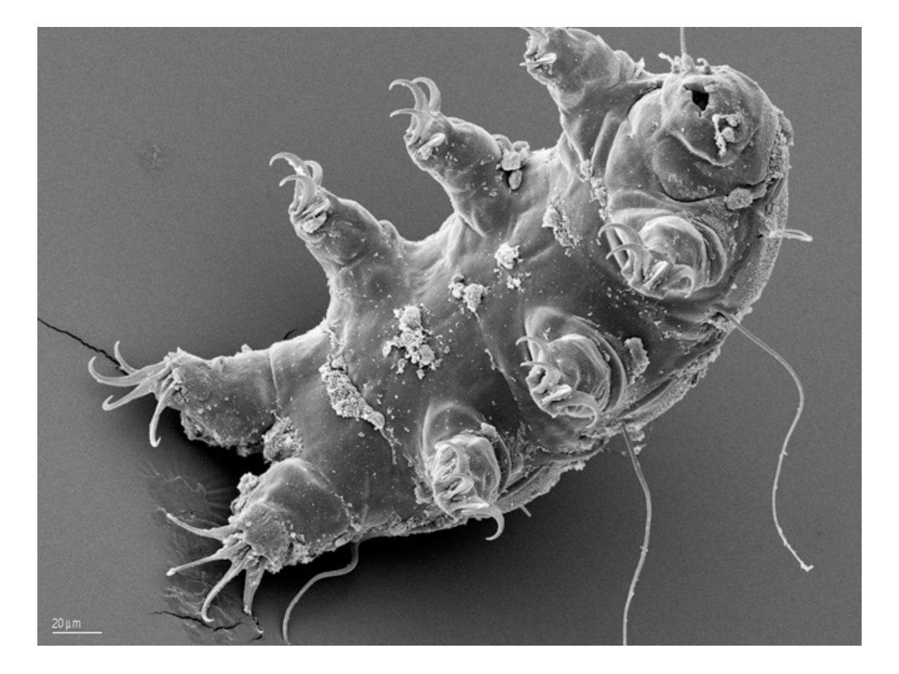](slides/slide-11.jpg)

This is a light microscope picture of a live tardigrade.

[↑ Slides](#slides) · [Course index](../../README.md)

## Slide 12

[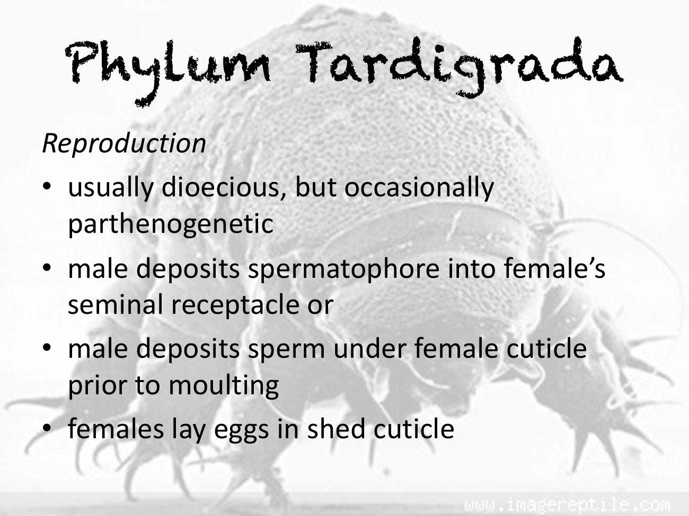](slides/slide-12.jpg)

They normally have separate sexes, males and females, but there are some species which are known to be parthenogenetic. That's a secondary development. The male produces a spermatophore, as with the velvet worms, and he can put that into the female seminal receptacle in some species in other species, he waits till the female's about to moult, and her cuticle is coming loose, and he inserts the sperm under her cuticle.

Then, when the female moults she leaves behind the sperm and her eggs inside the shed, cuticle so that cuticle works as protection from the environment for the eggs.

[↑ Slides](#slides) · [Course index](../../README.md)

## Slide 13

[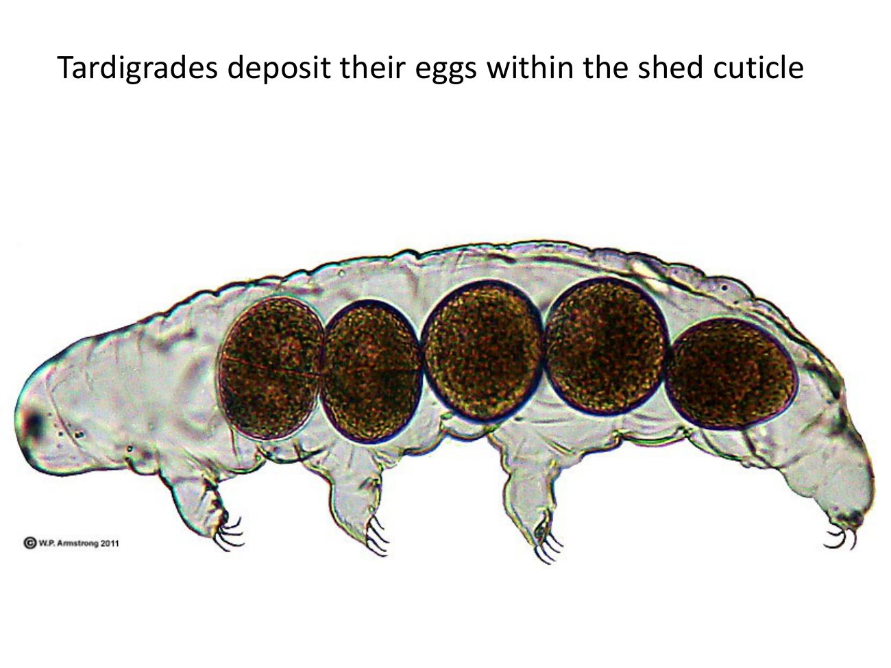](slides/slide-13.jpg)

There's a picture of a shed cuticle with five eggs in it. You can see the eggs are actually very large in comparison to the size of the female's body. There's another picture of the same thing.

[↑ Slides](#slides) · [Course index](../../README.md)

## Slide 14

[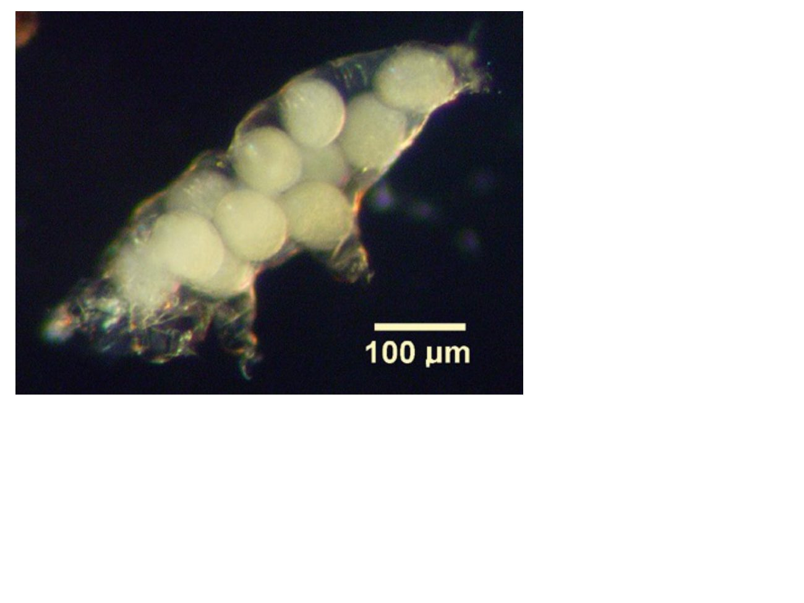](slides/slide-14.jpg)

*No separate passage can be confidently assigned to this slide. [Nearby discussion: slide 13](#slide-13).*

[↑ Slides](#slides) · [Course index](../../README.md)

## Slide 15

[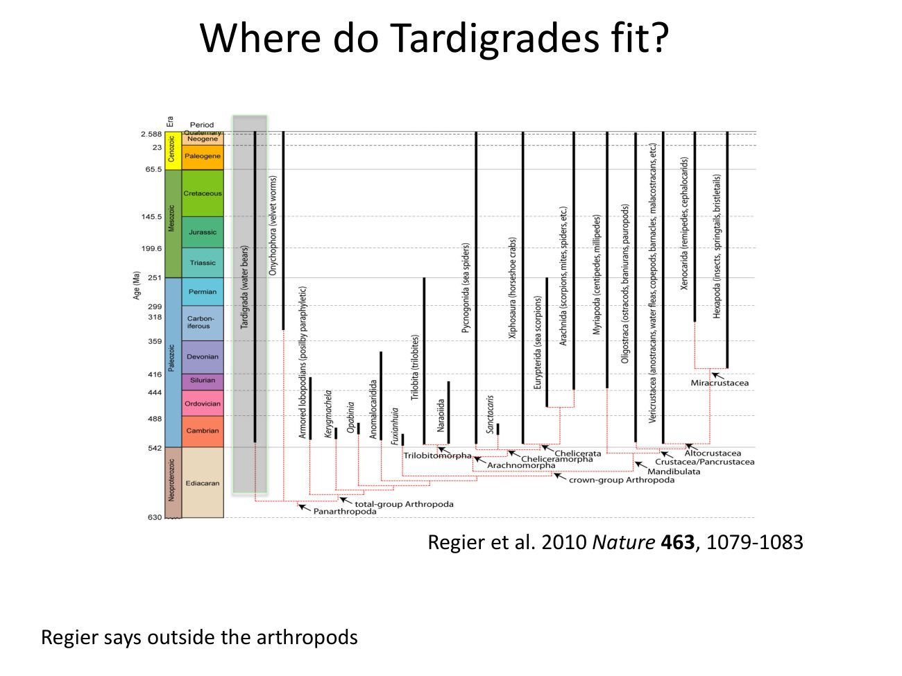](slides/slide-15.jpg)

Where do tardigrades fit? What I mean by that is, where do they fit in the evolutionary tree? We know they're not arthropods.

We know onychophorans are also not arthropods and look quite similar to tardigrades. But we also know that, onychophorans are very close to arthropods in an evolutionary sense, and the tardigrades are, too. But we really don't know exactly how the relationship works.

If you look at this tree the, arthropods, this part of the tree here. Then we have the velvet worms, the Onychophora up here, which are the sister group to the arthropods. And here are the tardigrades.

And if you look down at the route between the velvet worms and the tardigrades, you can see that we don't really know how tardigrade velvet worm arthropods are all related. It's a it's a, polytomy. That is.

They don't Ha we can't tell which is the common ancestor of the tardigrades onychophorans and velvet worms Individually. OK, so we know that they sit close to the arthropods. We know they sit close to the onychophorans, but we don't know exactly what the relationship is.

[↑ Slides](#slides) · [Course index](../../README.md)

## Slide 16

[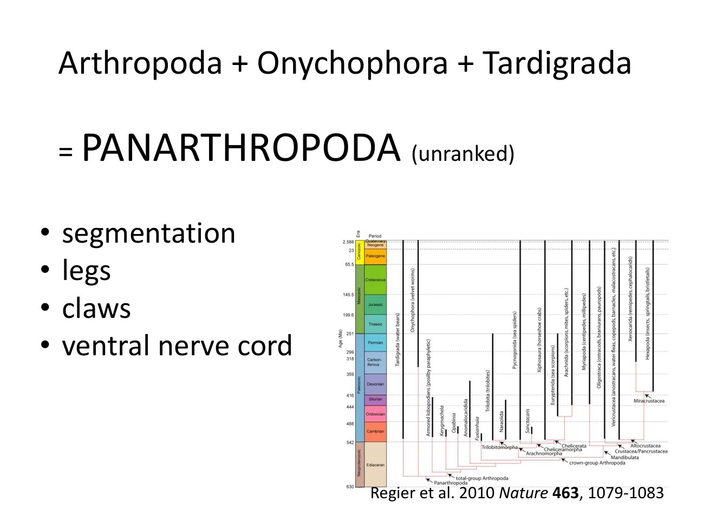](slides/slide-16.jpg)

We do know that the tardigrades and the onychophorans and the arthropods have segmentation. They've got legs, they've got claws, they've got a ventral nerve cord, so they're obviously all very similar. But the exact relationship between the three is not really clear.

[↑ Slides](#slides) · [Course index](../../README.md)

## Slide 17

[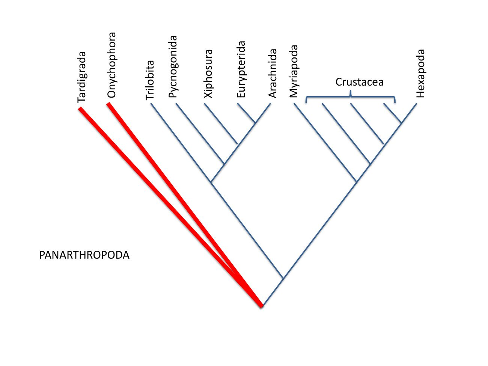](slides/slide-17.jpg)

So what I've done here is drawn a tree that has the arthropod of the pan arthropod that is with the tardigrades onychophorans and arthropods, and you can see. I haven't, separated the three at the base. So it's not clear how the tardigrades just onychophorans and, arthropods relate to one another.

[↑ Slides](#slides) · [Course index](../../README.md)

## Slide 18

[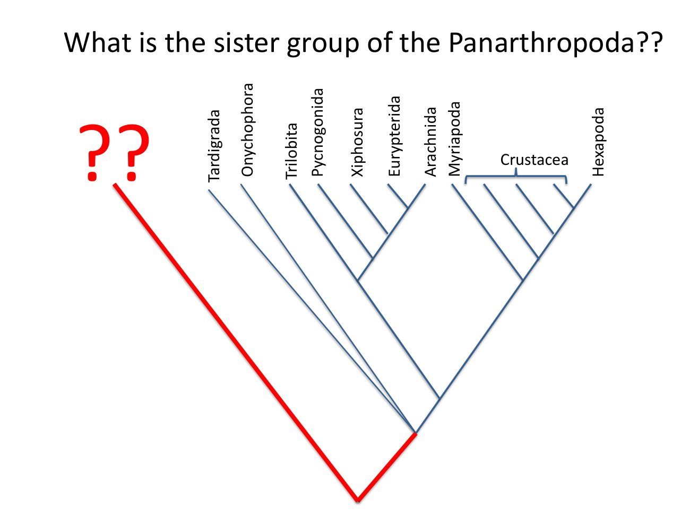](slides/slide-18.jpg)

OK, nonetheless, we know they form the pan arthropod. So the next question is, what else is related? What's the sister group to the pan arthropod?

What's their closest relative? So for many years, it was thought the closest relative was the annelids, the segmented worms, and the reason for that was the segmentation on the annelids. But now we know that's not true.

We discussed that last lecture more recently.

[↑ Slides](#slides) · [Course index](../../README.md)

## Slide 19

[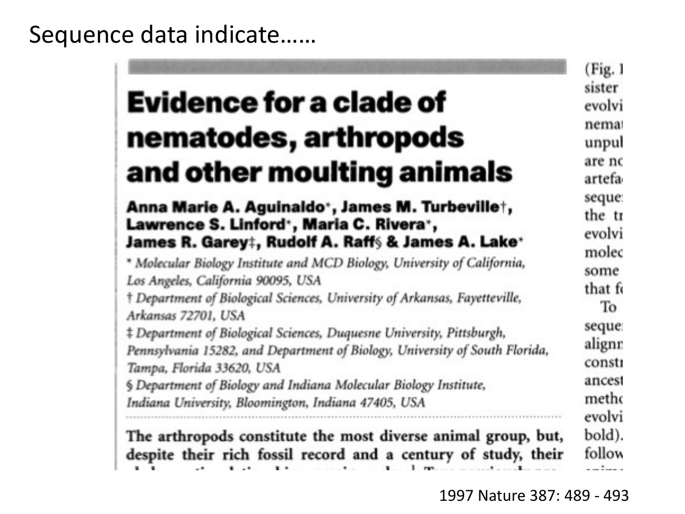](slides/slide-19.jpg)

In the 19 nineties, looking at sequence data, people discovered that nematodes roundworms are actually the sister group to the pan arthropod. And that's really interesting, because nematodes have very few similarities to the pan arthropod, and in fact, they have very few similarities to anything else. And we'll have a look at the nematodes now and have a look at what's unusual about the nematodes and what suggests they do fit in with the pan arthropods.

[↑ Slides](#slides) · [Course index](../../README.md)

## Slide 20

[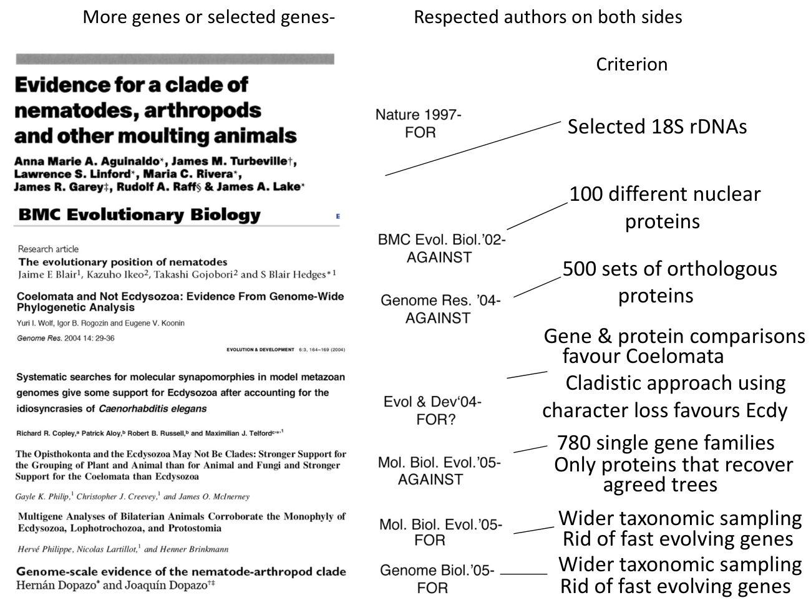](slides/slide-20.jpg)

One of the problems is that the common ancestor of the nematodes and the pan arthropods is so ancient that we've lost genetic signal in the DNA sequences that people have looked at and also morphological sig signal in the sense that so much evolution has gone on since that common ancestor that we can't see a lot of similarities. This is a number of, papers, which were molecular papers up to 2005, some of which said the, nematodes belong with the pan arthropod. Others said that they don't.

[↑ Slides](#slides) · [Course index](../../README.md)

## Slide 21

[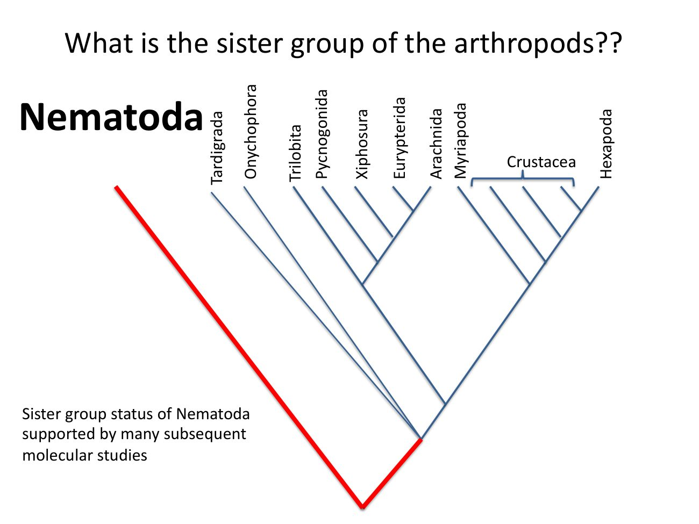](slides/slide-21.jpg)

The general feeling now, though, is that they do belong as the sister to the pan arthropod. There they are there, sitting on that tree as the sister group.

[↑ Slides](#slides) · [Course index](../../README.md)

## Slide 22

[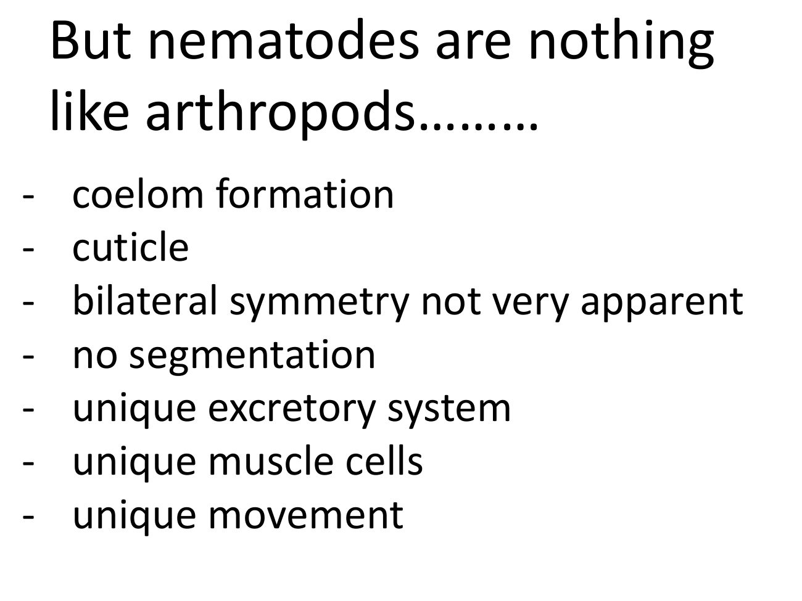](slides/slide-22.jpg)

But nematodes are really different to the arthropods. For example, coelom formation. You'll remember the coelom is the body cavity.

We have a coelom. It's our body cavity that holds our intestines and, other organs. Insects and other arthropods have the same.

And so, nematodes have a coelom, but it's formed in a very different way.

[↑ Slides](#slides) · [Course index](../../README.md)

## Slide 23

[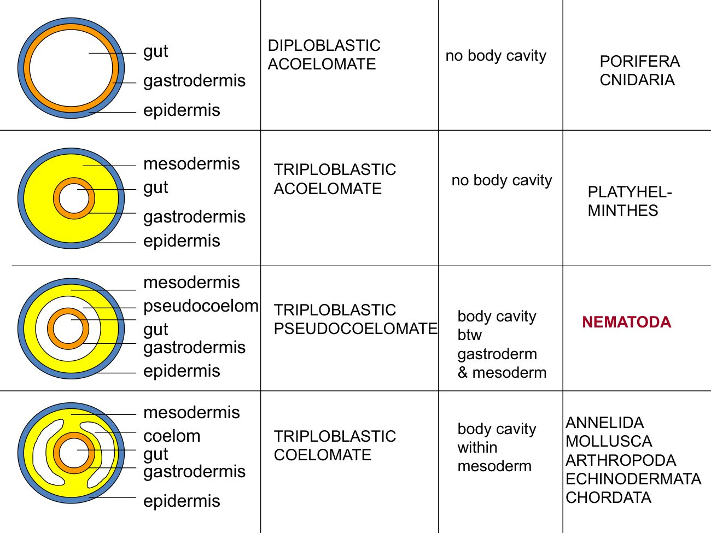](slides/slide-23.jpg)

You may remember this from first year. Looking at this table at the top, we've got things like the sponges and the cnidarians, which have two body cell layers. Next one down is the Platyhelminthes, which developed a third body cell layer called the Mesoderm.

But looking at the bottom two, firstly, there's the nematode. They have this coelom the body cavity. But the coelom is between the endoderm or the gastrodermis, which is the middle body layer, and the mesoderm, whereas in virtually all other animals with a coelom, the coelom has involved splitting with inside the mesoderm.

Now people used to think that the pseudocoelom was somehow more primitive or more simple or inferior to a true coelom. But it works just as well. It's just formed differently.

Nonetheless. It's a pretty major difference right back at the embryological level, and so it doesn't immediately make us think that the nematodes should be related to the pan arthropod.

[↑ Slides](#slides) · [Course index](../../README.md)

## Slide 24

[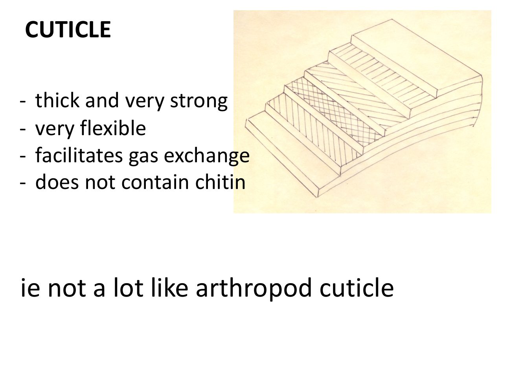](slides/slide-24.jpg)

There's also the cuticle. The cuticle is unique in the nematodes. It's in multiple layers.

It's very flexible. There's gas exchange, but it doesn't contain chitin, which we find in all of the other pan arthropods. So it's very different from arthropod pod cuticle.

[↑ Slides](#slides) · [Course index](../../README.md)

## Slide 25

[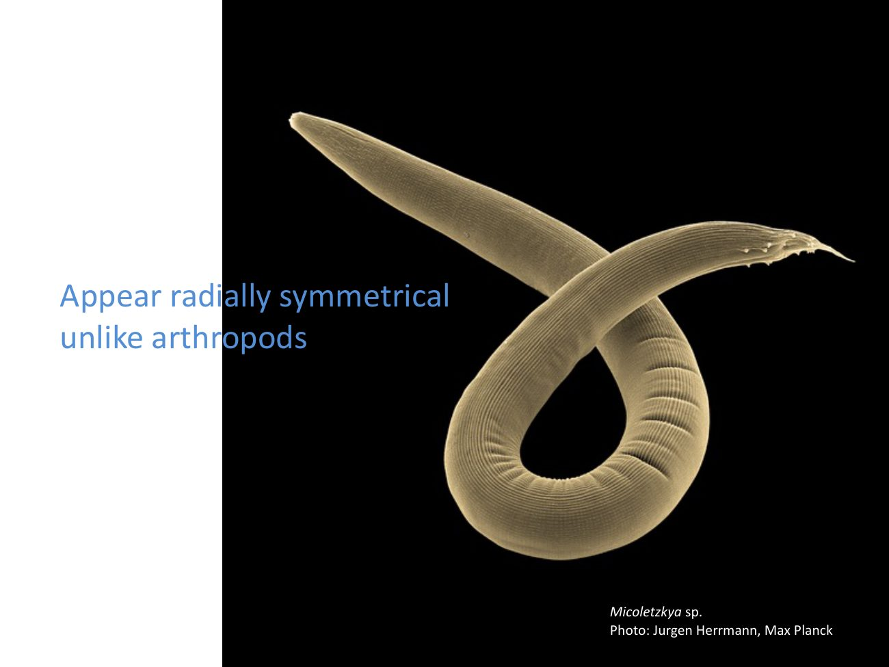](slides/slide-25.jpg)

The pan arthropods clearly have bilateral symmetry with a head at one end, an anus or a tail at the other and they have an up and a down. They've got a ventral nerve cord and usually a dorsal heart. But that's not so immediately apparent in the, nematodes, which are referred to as round worms.

Because you can see if you were to cut those, you can cut them in, any plane because they're effectively a cylinder and you will get identity identical halves. However, it turns out that's not quite right, because if you look at them, their external internal structures, they clearly do have, like an up and a down as well as a head and a tail. But what they don't have is segmentation.

Segmentation occurs in all of the pan arthropods, but not in the nematodes. Nematodes also have an excretory system, which is different from those of the pan arthropods that have an excretory system. Remember, in things like the tardigrades, they don't have an excretory system they simply excrete directly out their cuticle.

[↑ Slides](#slides) · [Course index](../../README.md)

## Slide 26

[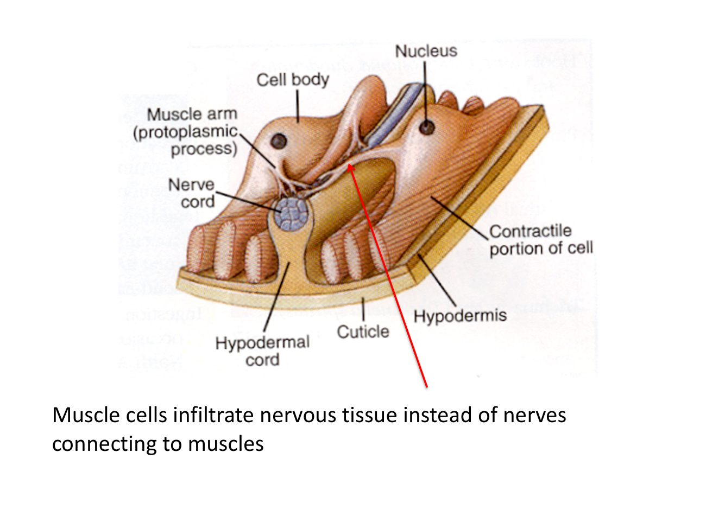](slides/slide-26.jpg)

And also nematodes have this unique muscle system. It's not just unique amongst the pan arthropod and nematode grouping, but it's also just unique within the nematodes in all other animals, nerves lead to the muscles and nerves. Tell the muscles to contract or relax in the nematodes.

Unlike any other animal group, the muscle cells actually have these structures, which branch out from the muscle cells and go to the nerve fibres. So instead of the nerve fibres branching to the muscles, as in us and in the pan arthropods, the muscle fibres go to the nerves again. As with the coelom formation, it's different from anything else, but it works.

And so there's no reason to think this is more primitive or, simple or less advanced. In other groups, it's just different. But it is interesting because it's just so different from any other animals.

[↑ Slides](#slides) · [Course index](../../README.md)

## Slide 27

[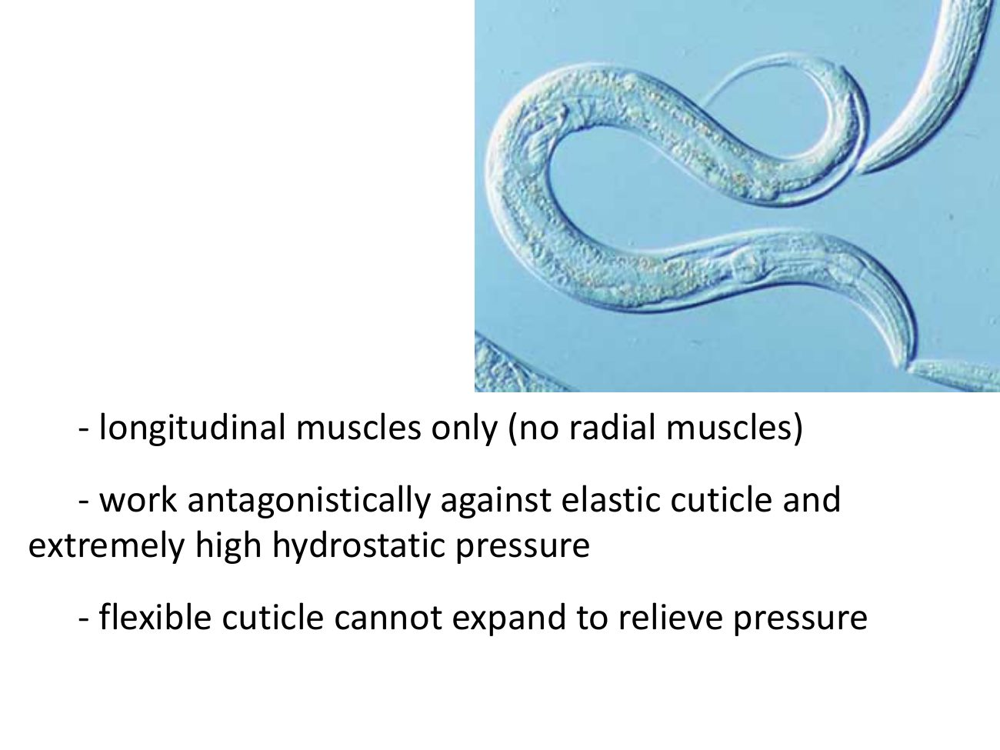](slides/slide-27.jpg)

They also have unique movement. They've got. They use high internal body pressure and then longitudinal muscles.

They can tighten the muscles on one side to bend the animal one way on the other side to bend it the other. And so they move in a with a thrashing motion. It's very inefficient and an inefficient form of movement, but it works, at least as far as it needs to in the nematodes.

[↑ Slides](#slides) · [Course index](../../README.md)

## Slide 28

[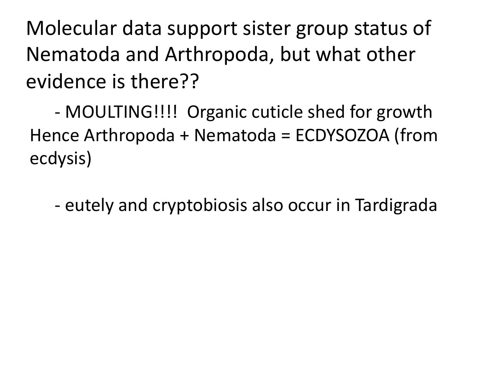](slides/slide-28.jpg)

OK, so molecular data support the nematodes being the sister group to the arthropods. How about other evidence that holds them together? And as I've mentioned, there actually is very little.

But let's look at what there is. The big one is moulting the pan arthropods moult between instars or bet between or as they grow, and so do the nematodes, so their cuticle is very different. But nonetheless, as the animal grows, it needs to moult that cuticle.

The process of moulting is called ecdysis, and that's how we get the name Ecdysozoa to describe the pan arthropods, plus the nematodes.

[↑ Slides](#slides) · [Course index](../../README.md)

## Slide 29

[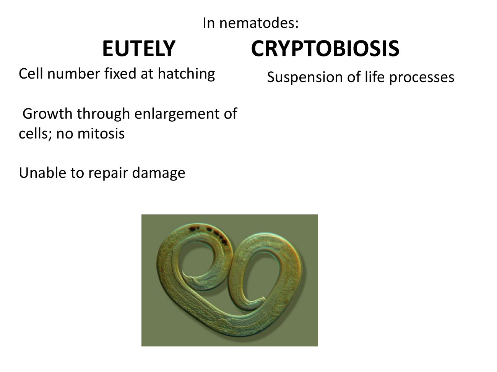](slides/slide-29.jpg)

We talked about eutely and cryptobiosis in the tardigrades. We get those two phenomena in the nematodes as well. There's a description of those processes, but we already covered it in relation to the tardigrades.

[↑ Slides](#slides) · [Course index](../../README.md)

## Slide 30

[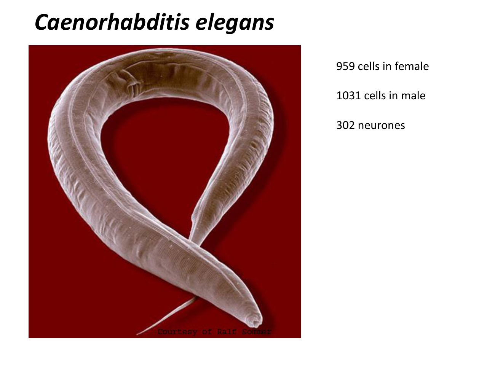](slides/slide-30.jpg)

Looking a little bit more deeply at the eutely, you'll remember, means that after hatching, the animals can't go through cell division, and so they have a set number of cells. All their life. In one species that's been used a lot in evolutionary studies or in morphological studies, has been the developmental studies.

Sorry has been Caenorhabditis elegans, and we know in this species. We know exactly how each cell arises, what cell it arises from During embryogenesis. We know the fate of all those cells and we know the numbers of cells.

Female, Caenorhabditis elegans have 959 cells. Males have 1000 and 31 and, that number is fixed. We know they've got 302 neurons and we know exactly how they arise.

> **Editorial note:** The 959-cell figure refers to adult somatic cells in the C. elegans hermaphrodite, not simply a female. Germline cell divisions are an important exception to the lecture’s generalisation.

[↑ Slides](#slides) · [Course index](../../README.md)

## Slide 31

[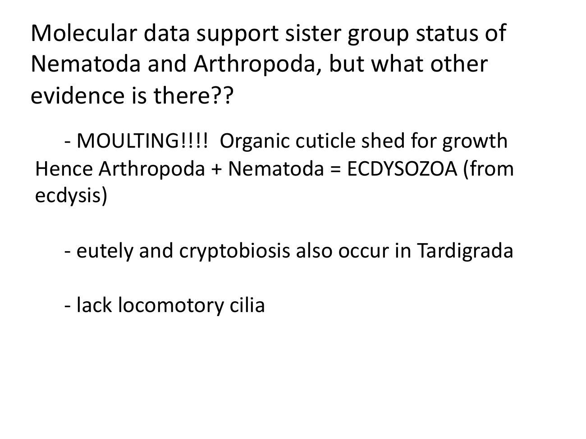](slides/slide-31.jpg)

Another thing we find in the other group that is not the, Ecdysozoa that is the Lophotrochozoa is that they use cilia. A lot of their larvae are ciliated and can swim around. Or they can use locomotory cilia, like in the flat worms to help them move and in the mollusks.

But the nematodes and the pan arthropod don't use locomotory cilia. Also, nematodes have a amoeboid sperm, which we also see sometimes amongst the pan arthropod. OK, so that's the end of the story there.

Basically, we haven't had a chance to look at the Lophotrochozoa. But I hope that you've got some ideas as to how the relationships work within the Ecdysozoa. And although we looked at a lot of, insects.

There are many invertebrate animals that aren't insects. OK, so good luck. I know for many of you, this is the last year of your degree.

So I hope, the year finishes well for you. And whatever you do in future years goes well, thank you.

[↑ Slides](#slides) · [Course index](../../README.md)

## Source notice

this material has been reproduced and communicated to you by or on behalf of the Australian National University in accordance with section 113 P of the Copyright Act 1968 The material in this communication maybe subject to copyright under the act any further reproduction or communication of this material by you must be consistent with the provisions of the act. Do not reproduce this material. Do not remove this notice.

[← Previous lecture](../14-onychophora/README.md) · [Course index](../../README.md) · [Next lecture →](../16-chelicerata-part-1-ticks-mites-horseshoe-crabs/README.md)
