# Chelicerata Part 2 - remaining groups

[← Previous lecture](../16-chelicerata-part-1-ticks-mites-horseshoe-crabs/README.md) · [Course index](../../README.md) · [Next lecture →](../18-hymenoptera-part-1-classification-taxonomy/README.md)

**Slides + cleaned transcript** · 40 slides

English transcript with fillers and repeated false starts removed. Technical terms are corrected using the slides and context. Bracketed wording marks reconstruction or uncertainty. Slide boundaries are inferred from content; the transcripts have no slide timestamps.

[Original transcript](original-transcript.txt) · [Text-only version](cleaned-transcript.md) · [Editing notes](../../EDITING-NOTES.md) · [Correction record](corrections.md)

[Searchable slide text](slide-text.md). Click a slide image to open it at full size.

## Slides

[1](#slide-1) · [2](#slide-2) · [3](#slide-3) · [4](#slide-4) · [5](#slide-5) · [6](#slide-6) · [7](#slide-7) · [8](#slide-8) · [9](#slide-9) · [10](#slide-10) · [11](#slide-11) · [12](#slide-12) · [13](#slide-13) · [14](#slide-14) · [15](#slide-15) · [16](#slide-16) · [17](#slide-17) · [18](#slide-18) · [19](#slide-19) · [20](#slide-20) · [21](#slide-21) · [22](#slide-22) · [23](#slide-23) · [24](#slide-24) · [25](#slide-25) · [26](#slide-26) · [27](#slide-27) · [28](#slide-28) · [29](#slide-29) · [30](#slide-30) · [31](#slide-31) · [32](#slide-32) · [33](#slide-33) · [34](#slide-34) · [35](#slide-35) · [36](#slide-36) · [37](#slide-37) · [38](#slide-38) · [39](#slide-39) · [40](#slide-40)

## Slide 1

[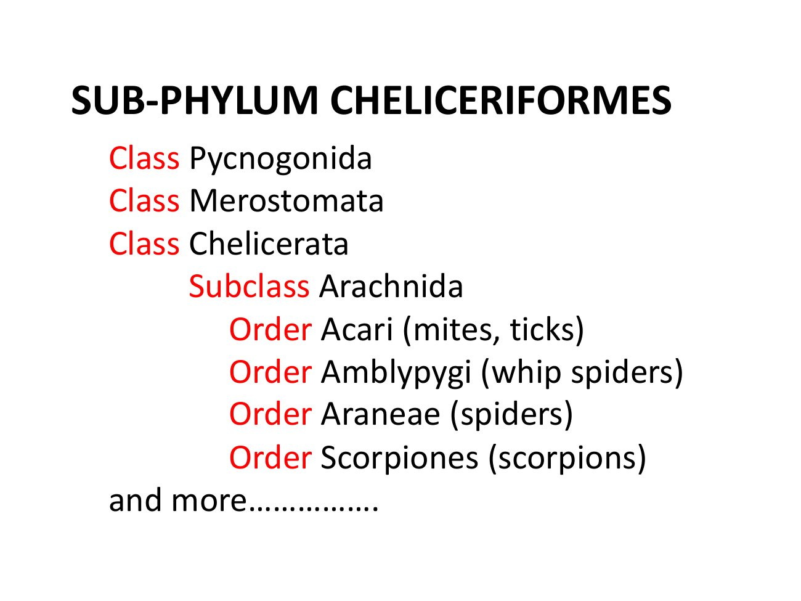](slides/slide-01.jpg)

Hi, folks. Today we're going to continue on, from the, previous lecture. We started yesterday looking at the Cheliceriformes and, at a few selected groups within the cheliceriforms.

Yesterday we looked at the Merostomata, which includes the fossil giant water scorpions, which aren't scorpions, and the horseshoe crabs, which aren't crabs. And then we moved on and looked at the Arachnida. Now, you can see from this picture we've got the class Pycnogonida, which I haven't spoken about the Merostomata and then the class Chelicerata containing the Arachnida.

Now taxonomists are still in disagreement about the relative status of these groups. Sometimes the Arachnida is referred to as a class so we're not going to expect you to, distinguish between what's a class? What's a subclass, that sort of thing.

Because if the taxonomists can't, why should you? OK.

[↑ Slides](#slides) · [Course index](../../README.md)

## Slide 2

[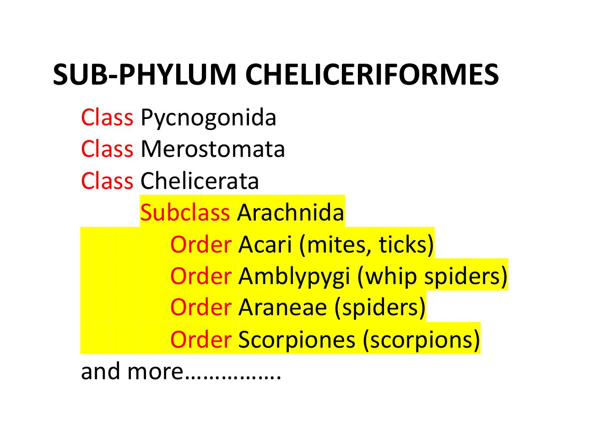](slides/slide-02.jpg)

And then yesterday what we did Was we all right, we, started looking at the arachnids. We looked specifically at the Acari, which is the mites and ticks. And today we're going to have a look at a few other arachnids.

Today's will be a slightly shorter lecture. I should also point out that some universities run whole courses on arachnids and we're going to spend one lecture. So of necessity, it will be a flying visit, and we'll just be looking at some of the major groups.

[↑ Slides](#slides) · [Course index](../../README.md)

## Slide 3

[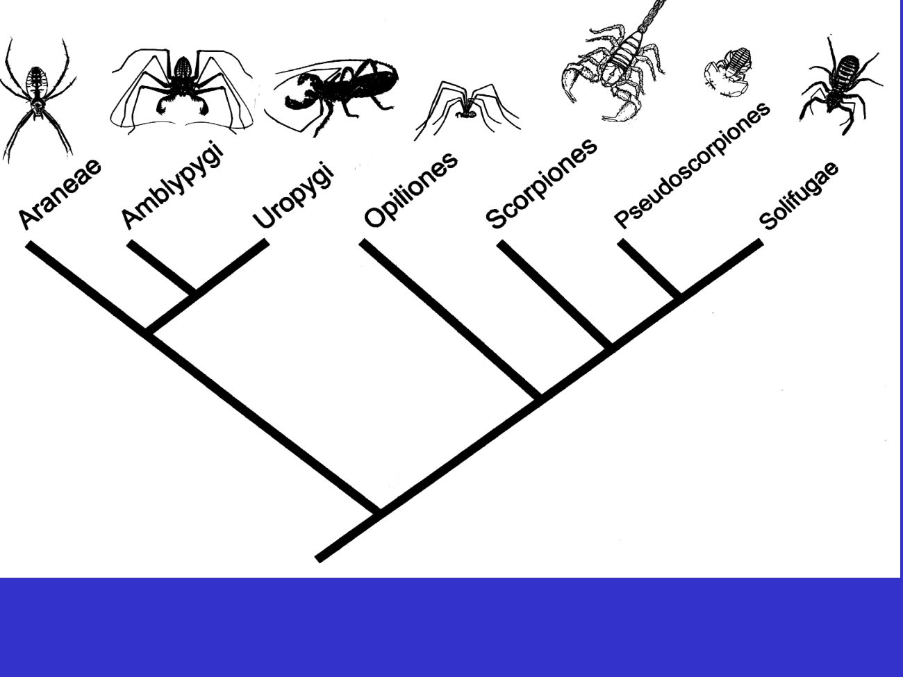](slides/slide-03.jpg)

This is a tree of, the, arachnids. And as you can see, they're all rather leggy beasts. Mostly, fairly large.

Although some, as we'll see aren't, and they fall into two distinct groups. There's this one here, and this one here. So two monophyletic lineages, I.

I won't go into it in detail, But the re the way they're separated is basically to do with the way the chelicerae are articulated not important to you, but just to point out that there is a good morphological character that distinguishes these two different branches.

[↑ Slides](#slides) · [Course index](../../README.md)

## Slide 4

[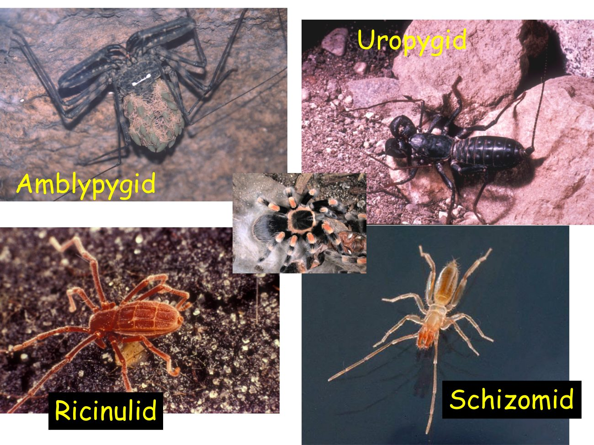](slides/slide-04.jpg)

Here's a picture of a few arachnids. Some of which we'll look at the amblypygid on the top, right? A uropygid.

There's a mygalomorph spider in the centre. The bottom left is this very strange group called the ricinuleids. These you're almost certain to never see in your life.

And we won't go into a lot of detail about those. There's schizomids bottom, right.

[↑ Slides](#slides) · [Course index](../../README.md)

## Slide 5

[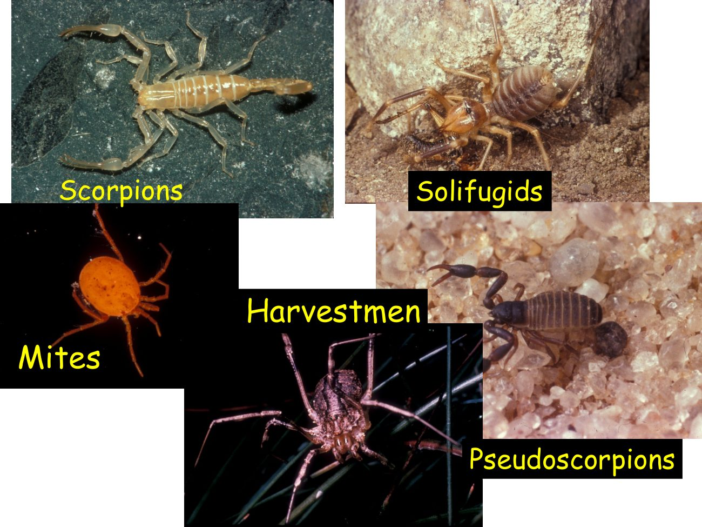](slides/slide-05.jpg)

Scorpion, solifugids mites, which we've already looked at etcetera. So we'll have a look at a few of these groups today.

[↑ Slides](#slides) · [Course index](../../README.md)

## Slide 6

[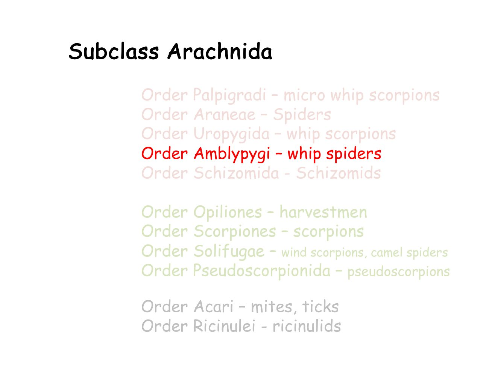](slides/slide-06.jpg)

First off, we'll look at the Amblypygi, which are the whip spiders.

[↑ Slides](#slides) · [Course index](../../README.md)

## Slide 7

[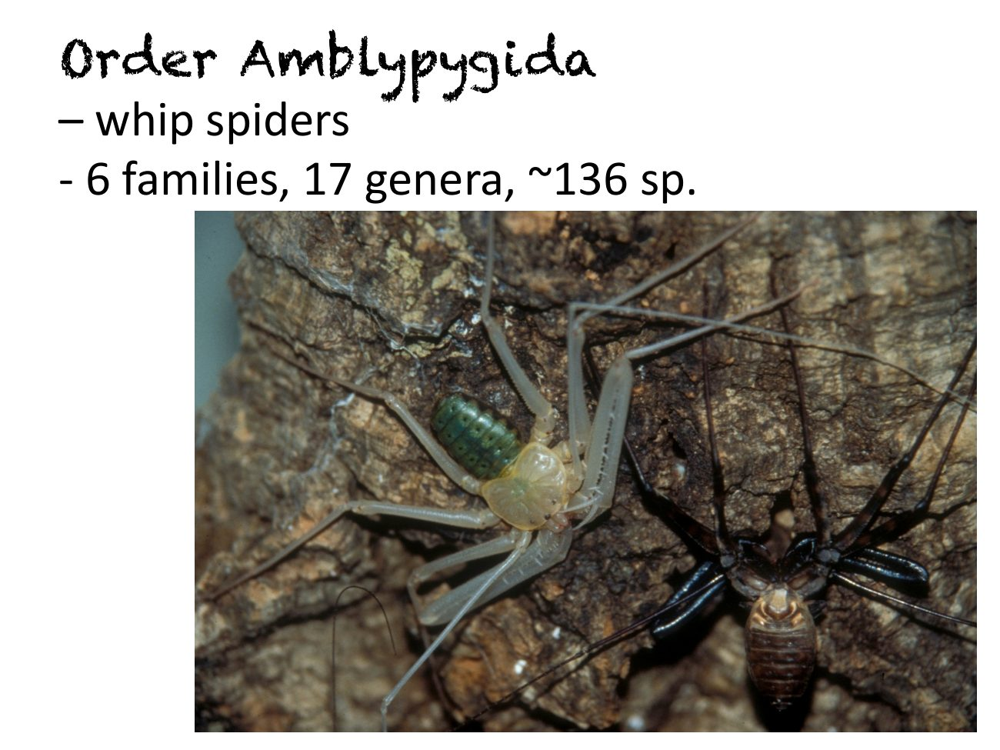](slides/slide-07.jpg)

These are a very interesting group. You can see superficially, they look like a spider. In fact, they look like a Huntsman spider because their legs, their knees are turned backwards so they can sit very flat.

And this is because they live underneath rocks and sometimes underneath bark. Amblypygids aren't numerous. There are six families. 17 genera 100 and 36 species, so they're not incredibly common.

[↑ Slides](#slides) · [Course index](../../README.md)

## Slide 8

[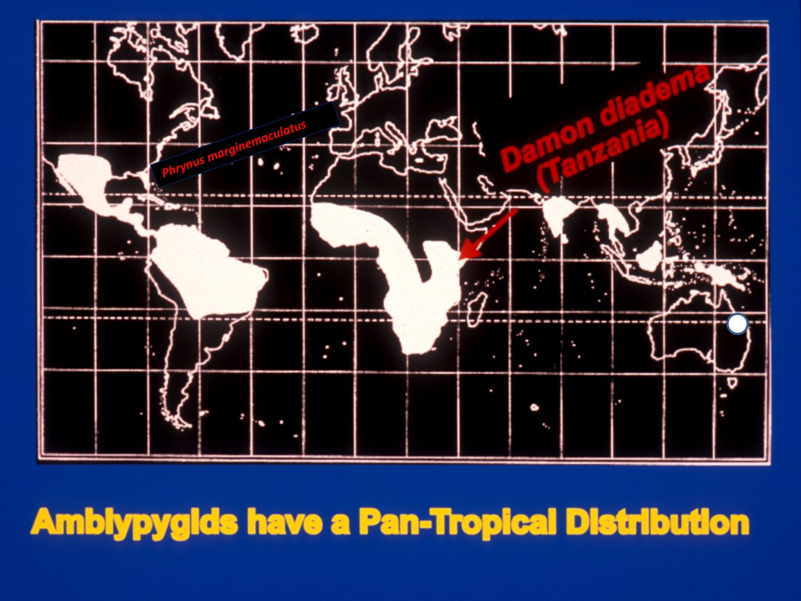](slides/slide-08.jpg)

And this is a an old map, which I've modified a bit. This was the distribution of the amblypygids. So they're sort of pan tropical found throughout the tropics.

And it's only in the last 20 odd years that this particular population in northern Australia was discovered. Sadly, the Australian ones are very small. They're about 1 to 2 centimetres across, unlike some of the, other species which can get to 15, possibly even 20 centimetres across.

[↑ Slides](#slides) · [Course index](../../README.md)

## Slide 9

[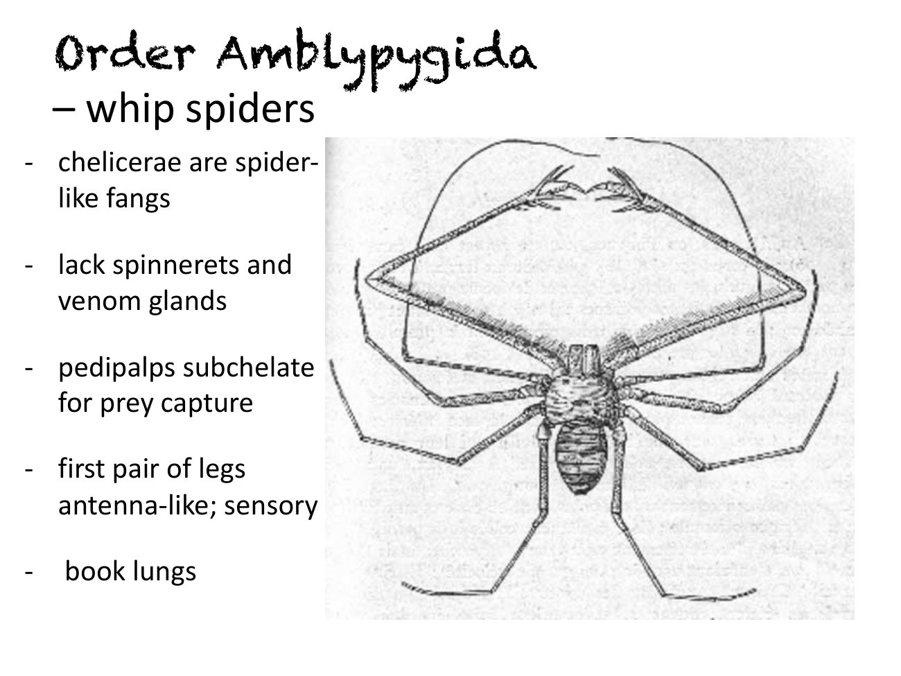](slides/slide-09.jpg)

So they're quite, evil looking beasts. I think, if you have a look at the, first at the chelicerae, which we can't really see from here. But the chelicerae are very much like the spiders.

They've got a fang, then the palps, which on the spiders, we call pedipalps. And they look like little legs are actually these very large grasping appendages. And they have, like, nippers on the end, which means they can grab and manipulate food and use it to capture food.

The first pair of legs and we'll see this again and again. And again. Actually, I'll point it out when we see it.

The F, the first pair of legs are actually modified to look very like antennae. That we see in insects, of course. Cheliceriforms don't have antennae, but these modified legs have the same function.

And they also have book lungs, which again, we'll talk about in a little bit.

[↑ Slides](#slides) · [Course index](../../README.md)

## Slide 10

[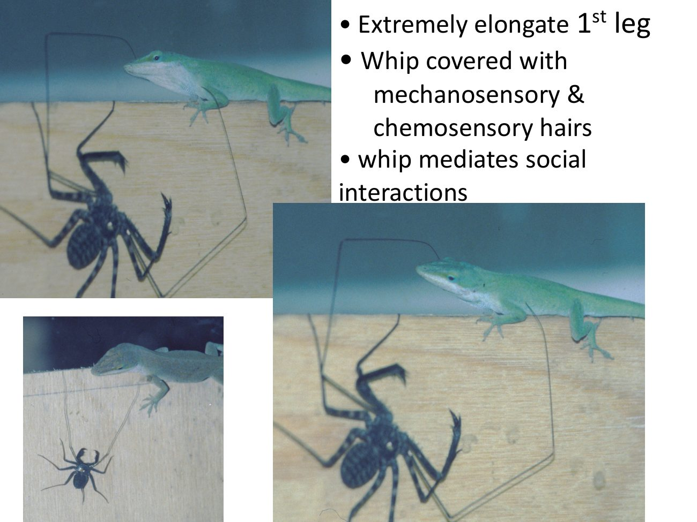](slides/slide-10.jpg)

So there's that extremely long first leg. You can see it's using it to actually touch a lizard and feel it up. That's why they called Whip Spiders, because it's called a whip.

And it's not just mechanosensory, that is. It just doesn't feel just It's not just, detecting things by touch, but it can also detect chemicals. The other thing about this group is that many of them are social, that is, they form family groups, and one of the ways that they sort of keep together and work out who it is that's nearby is by using that whip, which they move very gently and touch the body of the other animals in their group.

[↑ Slides](#slides) · [Course index](../../README.md)

## Slide 11

[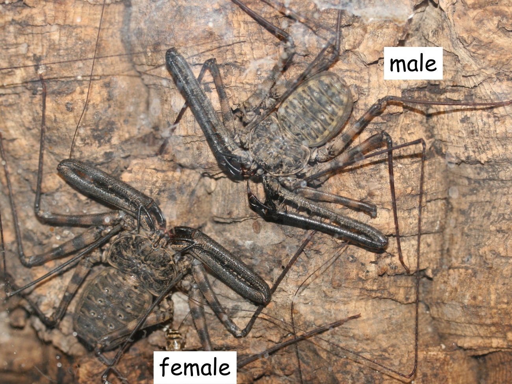](slides/slide-11.jpg)

Here's some photographs of two a male and a female, and you often find the two sexes together.

[↑ Slides](#slides) · [Course index](../../README.md)

## Slide 12

[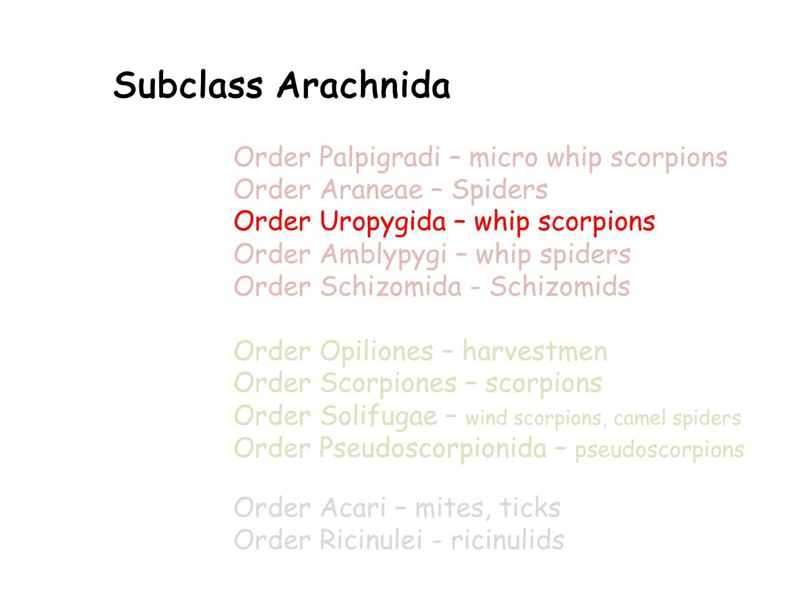](slides/slide-12.jpg)

OK, so that's the amblypygids.

[↑ Slides](#slides) · [Course index](../../README.md)

## Slide 13

[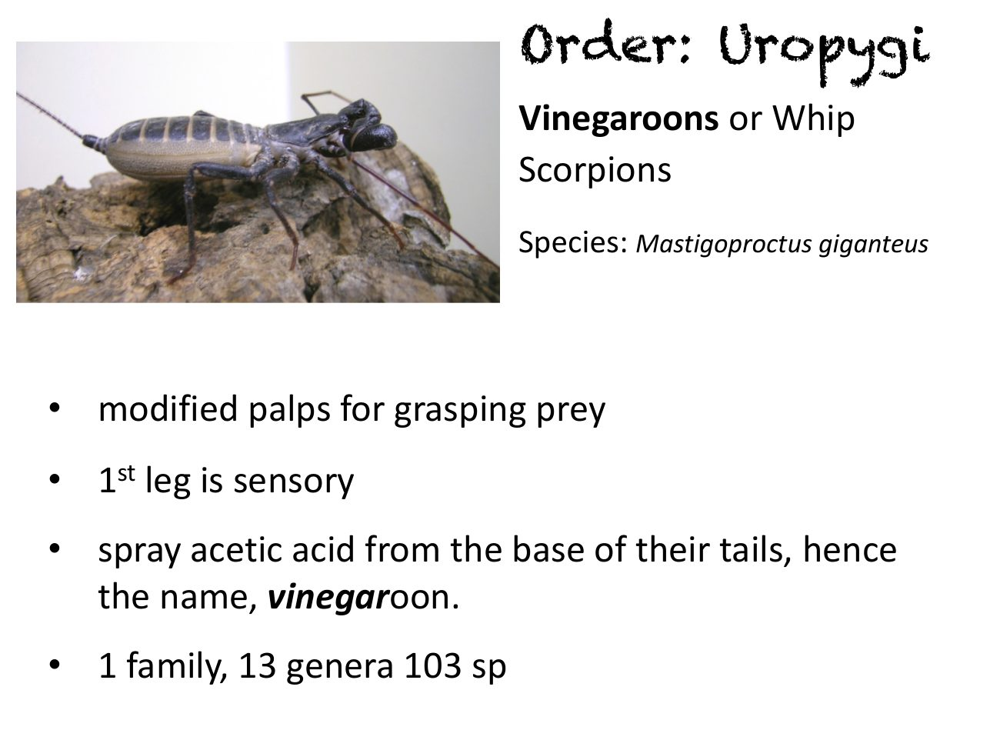](slides/slide-13.jpg)

Another group again, which is probably something you won't see much is Uropygi, which are the whip? Scorpions. Unlike the whipped spiders, they're the whip Scorpions.

Although they're, called the whip part is because they have that same modified first leg which looks very much like an antenna. So they just like the amblypygids have the palps modified for grasping. They've got that first leg.

That's sensory. And, like the, amblypygids, they're not venomous, but they do, have the ability to spray acid, from the base of their tails. Acetic acid.

And that's why they're sometimes called vinegaroons because of ace. Acetic acid is the active acid in vinegar, and it smells like vinegar. And so these animals, when you annoy them, release a very strong vinegar smell.

Again, as with the amblypygids, it's not a big group. There's one family, 13 genera, 103 species. But we don't see them here.

[↑ Slides](#slides) · [Course index](../../README.md)

## Slide 14

[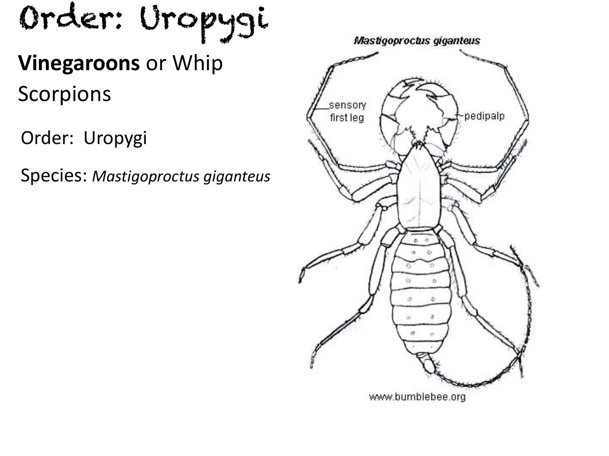](slides/slide-14.jpg)

There's a picture of uropygid, just to show you the various structures so you can see the modified pedipalps here, they're not as long as on the, amblypygids. However, they've got these nippers on the end. Unlike spiders where the palps actually just look like walking legs.

[↑ Slides](#slides) · [Course index](../../README.md)

## Slide 15

[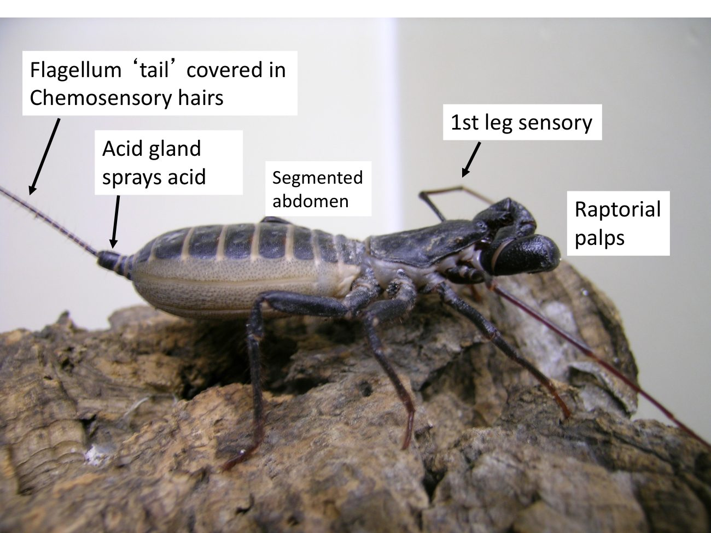](slides/slide-15.jpg)

OK, so there's a picture of one, and you can see all of those structures on the whole animal.

[↑ Slides](#slides) · [Course index](../../README.md)

## Slide 16

[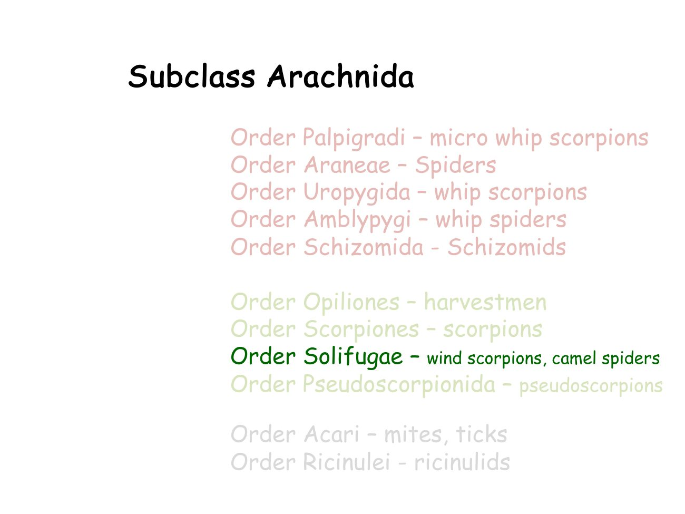](slides/slide-16.jpg)

OK, moving right along.

[↑ Slides](#slides) · [Course index](../../README.md)

## Slide 17

[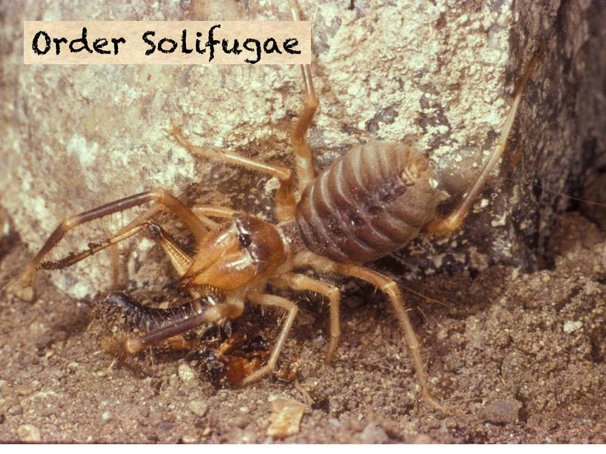](slides/slide-17.jpg)

Another group is the camel spiders or the Solifugae again. We don't see them here. I've actually seen them when I lived in Arizona or in the United States, and they're actually quite impressive animals.

Here you can see it's got a general spider. Look to it. However, the nippers, the chelicerae are actually two large nippers that work independently up and down, and they're extremely powerful.

While they don't have venom, you certainly don't want to be bitten by a camel spider. They're also incredibly fast.

[↑ Slides](#slides) · [Course index](../../README.md)

## Slide 18

[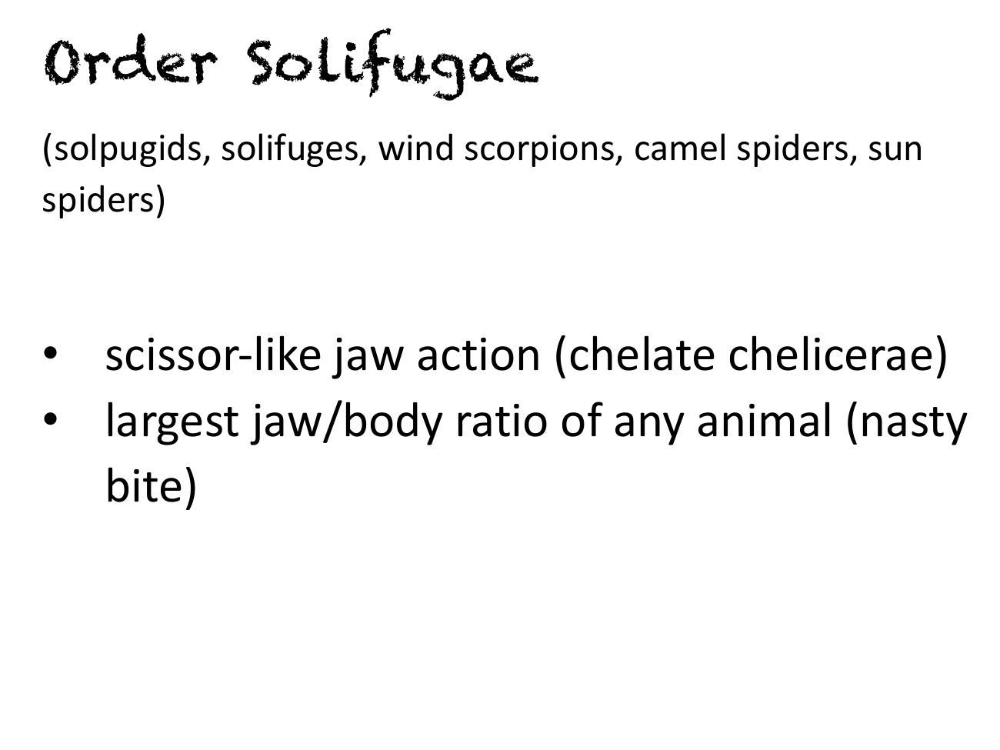](slides/slide-18.jpg)

So there is. They've got a scissor like jaw action. They've got the largest jaw to body ratio of any animal.

And as I've said, they can give you a very nasty bite. It's not venomous, but, they're very powerful.

[↑ Slides](#slides) · [Course index](../../README.md)

## Slide 19

[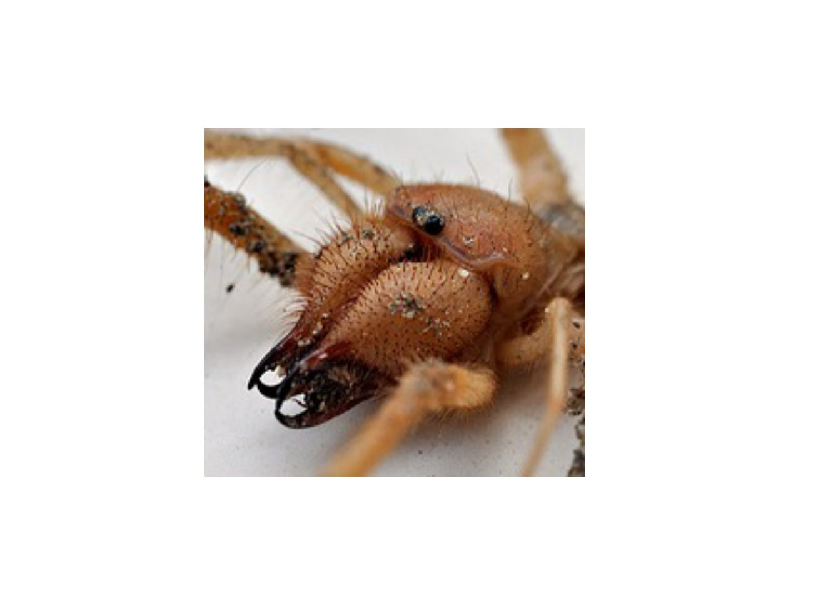](slides/slide-19.jpg)

There's a picture of them close up. Quite impressive looking animals.

[↑ Slides](#slides) · [Course index](../../README.md)

## Slide 20

[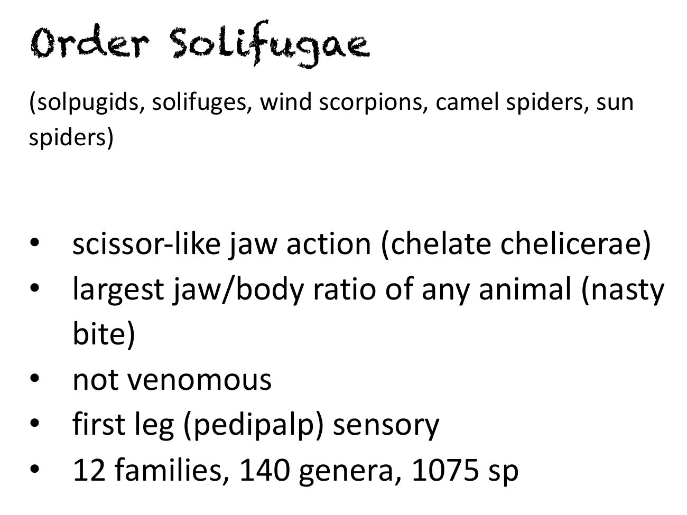](slides/slide-20.jpg)

Again, their first leg, is sensory I'm sorry, I don't know why it says petty palp there. Their first leg is sensory. 12 families. 100 and 40 genera 1000 species.

[↑ Slides](#slides) · [Course index](../../README.md)

## Slide 21

[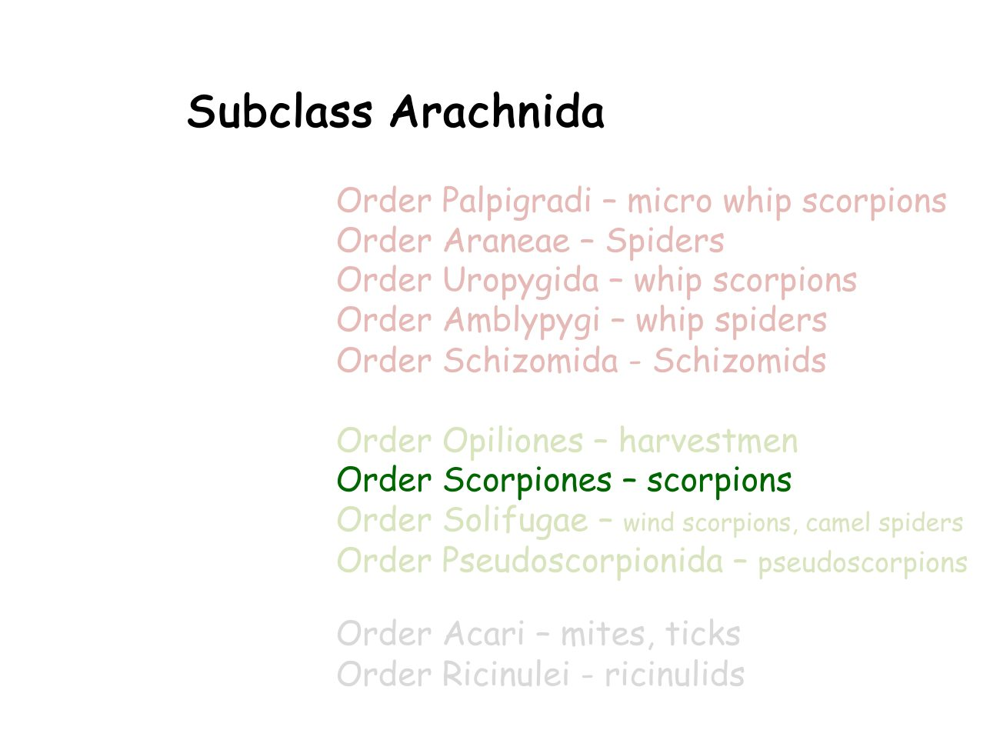](slides/slide-21.jpg)

One group that you probably are familiar with because they're very common in Australia and particularly around the AC T are the scorpions Mhm.

[↑ Slides](#slides) · [Course index](../../README.md)

## Slide 22

[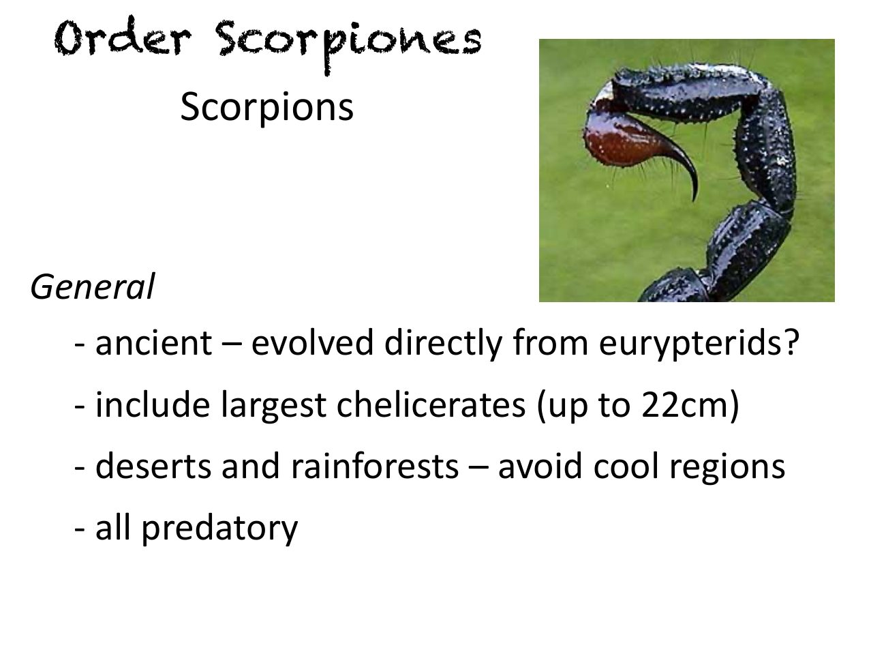](slides/slide-22.jpg)

The scorpions are interesting. They're a very ancient group. People suggested that perhaps they evolved directly from the eurypterids from those, giant fossil water scorpions.

Although that was really based just on the superficial resemblance between the two. And we're fairly sure now that, the two have no close relationship. The biggest of the chelicerates are scorpions up to 22 centimetres long, and you find them in deserts and rainforests.

They tend to avoid cooler regions, although we do get them very commonly around Canberra. All scorpions are predatory.

[↑ Slides](#slides) · [Course index](../../README.md)

## Slide 23

[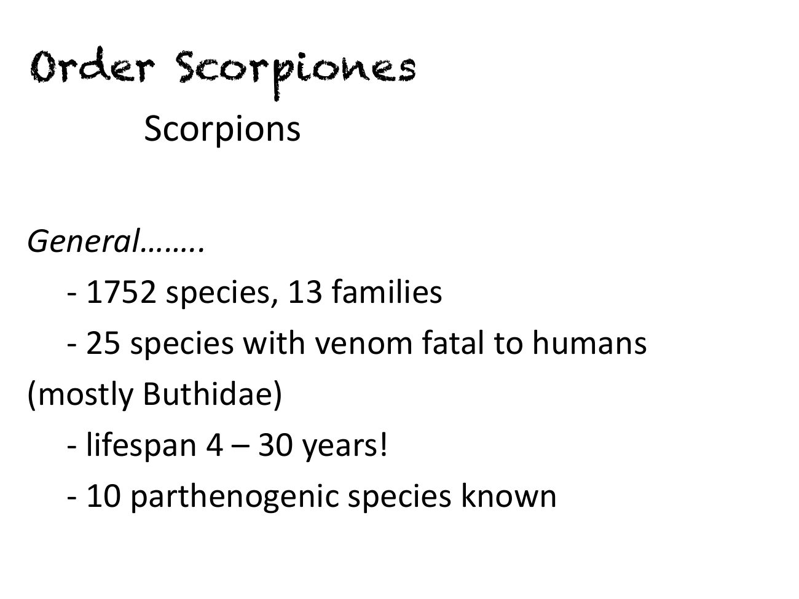](slides/slide-23.jpg)

1700 species, 13 families and 25 of these species have venom that can be fatal to humans. They mostly come from the family. Buthidae.

We don't have any dangerous scorpions in Australia. Although their bites are extremely painful. They have a very long lifespan from 4 to 30 years.

And there are 10 parthenogenetic species known that is, they are have only have females.

[↑ Slides](#slides) · [Course index](../../README.md)

## Slide 24

[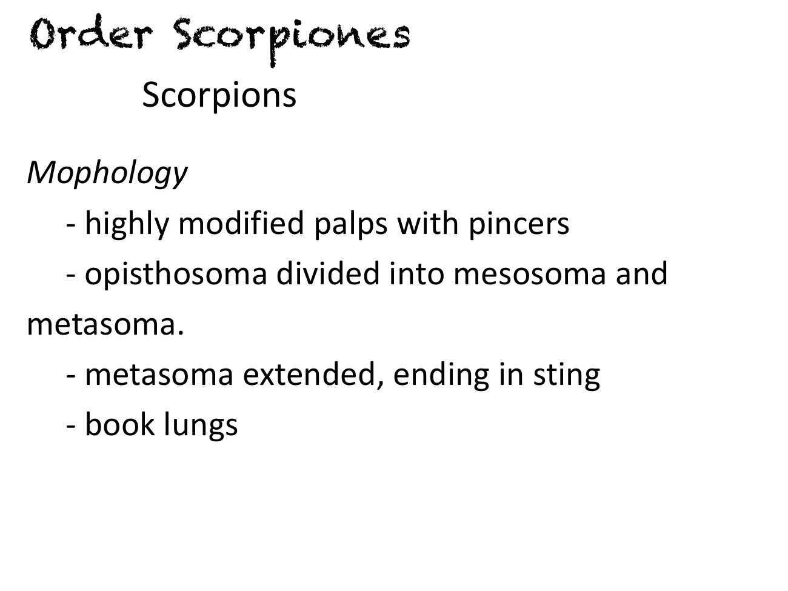](slides/slide-24.jpg)

The morphology involves those very highly modified palps which look like nippers on the front. So again, we're seeing this repeated thing where the palps are modified to work, as prey catcher or defence structures. The opisthosoma.

That's the back half the abdomen. And it's actually divided into two parts the mesosoma and the metasoma, which you'll see in a picture. The metasoma is extended, and what's really interesting is at the end of it has a venom gland and a sting.

Now something I don't think anybody's actually addressed. And I'd like to know what the reason is that the venom between spiders and scorpions is very similar, and yet spiders to deliver the venom from their fangs at the front and scorpions from behind. So clearly there's been some sort of clever segmental genetics trick to actually shift the structures that, produce venom and deliver them from one end of the animal to the other.

They also have book lungs, which again we'll we'll look at in a bit.

> **Editorial note:** The proposed genetic relocation of venom apparatus is speculative commentary in the lecture, not an established correction.

[↑ Slides](#slides) · [Course index](../../README.md)

## Slide 25

[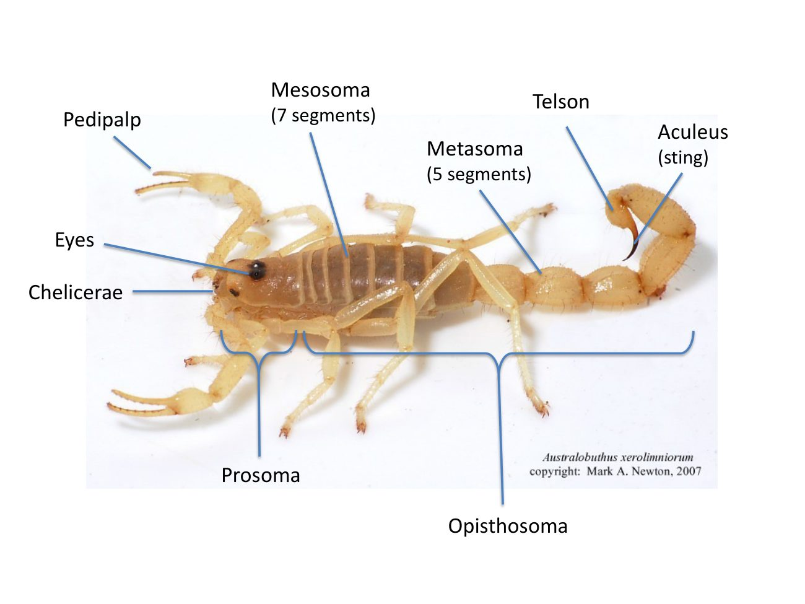](slides/slide-25.jpg)

There's a picture. So what you can see here is, the mesosoma and metasoma. So there's the, and we got to telson at the end of Sting, there's the what would be the abdomen in the spider.

Then we've got the prosoma here. Eyes. You can see that Modified palp.

The chelicerae are very small and hard to see. They basically use them for feeding. And the whole Sorry.

So the whole, opisthosoma is this. This is what is corresponds to the abdomen in the spider, and it's broken up into the mesosoma and the metasoma.

[↑ Slides](#slides) · [Course index](../../README.md)

## Slide 26

[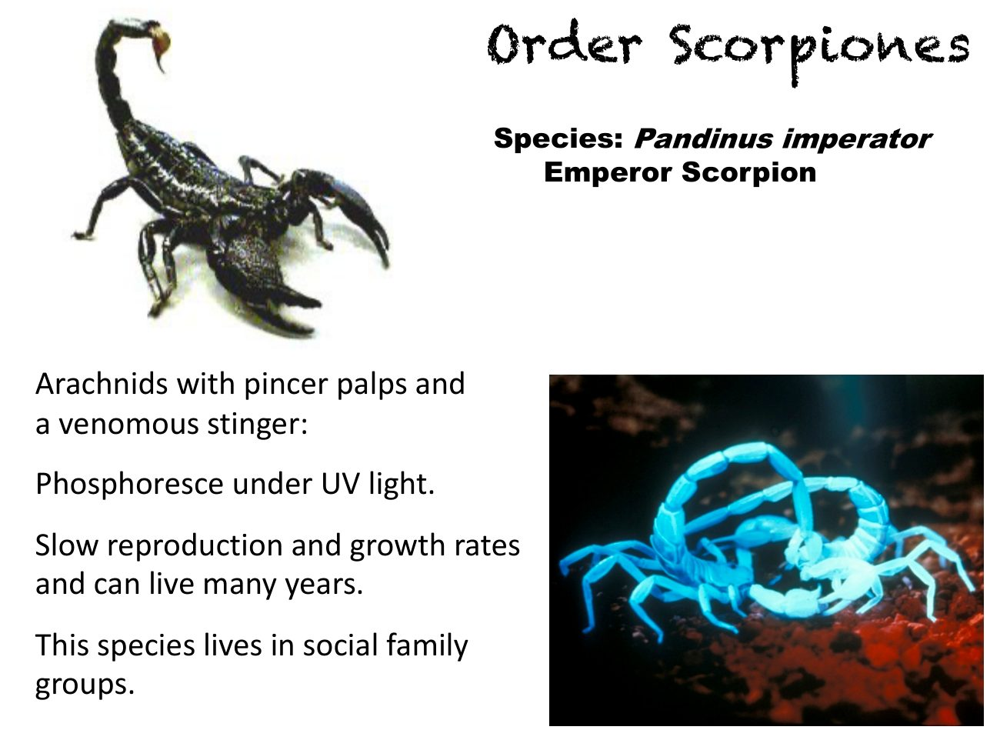](slides/slide-26.jpg)

A very interesting thing about scorpions is that they glow under ultraviolet light, even animals that I've had pickled in ethanol for 30 or 40 years. I still bring out to classes sometimes and stick under a UV light source because they have this incredible, property of glowing under ultraviolet light. It makes them very easy to find at night during the day.

They're easy to find because they live under rocks or bark at night time. If you go walking around with a UV torch, you can actually see them glowing. It's very unclear why they do this.

They don't seem to be able to see into the UV range, so they're not seeing each other at night. And so nobody knows exactly why they do this. But, all scorpions do glow.

As I've said, very slow reproduction, very slow growth rates. They can live for up to 30 years. This particular species also lives in family groups, so some of them are social.

And we see this over and over again in the Cheliceriformes that we keep seeing social species popping up sort of randomly across the family tree.

[↑ Slides](#slides) · [Course index](../../README.md)

## Slide 27

[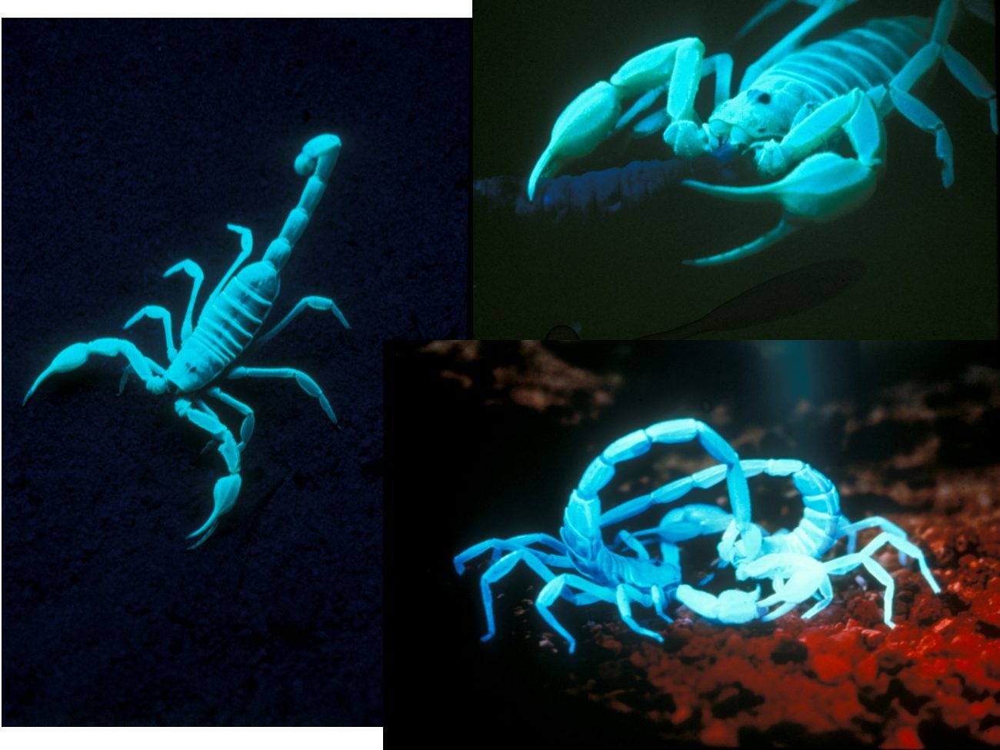](slides/slide-27.jpg)

There's some more glowing scorpions. Another thing I should say is that, they live for a long while. They need extremely little food.

Turns out that a scorpion, when resting, has the same metabolic rate as a radish. And what this means is they can go for incredibly long periods without eating. So people say that cockroaches are going to inherit the earth after the, next after a nuclear war.

But in fact, the scorpions will be there to eat the cockroaches. You can also freeze them solid in a block of ice and thaw the block of ice and out they come again.

[↑ Slides](#slides) · [Course index](../../README.md)

## Slide 28

[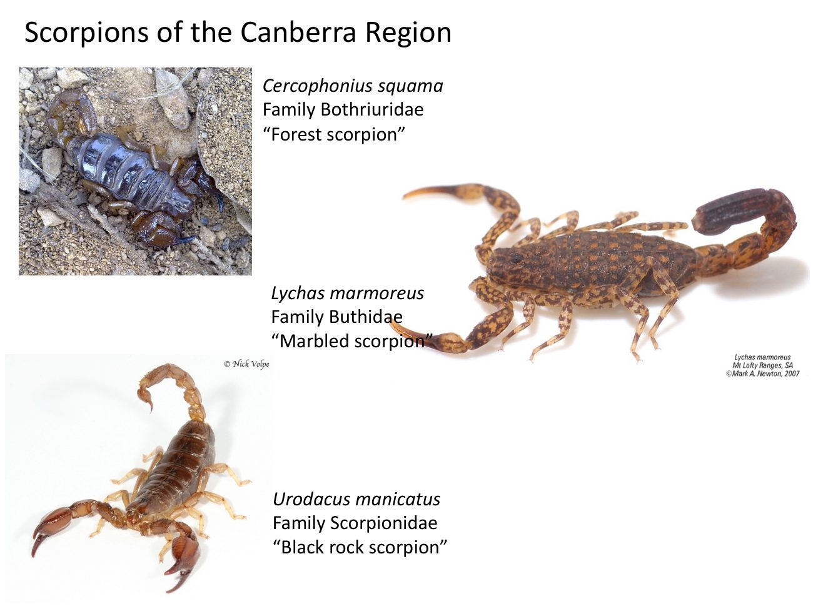](slides/slide-28.jpg)

As I said, there's a number of species in the Canberra region. This one's not so common. Cercophonius squama.

It's the Forest Scorpion. You find this under rocks, you find it in fairly low densities on Black Mountain under rocks, they're quite distinctive. They've got that dark colouring and that very bulgy abdomen.

This is Lychas marmoreus. This belongs to the family Buthidae. It's called the marbled scorpion.

They live under bark usually. What's interesting is that most of the highly venomous scorpions belong to the family Buthidae. And if you look at them, they don't actually look as scary as the other ones.

And this is probably because the other families have those very large nippers which they can use to for defence and prey capture the buthids don't and so they're probably compensating by having very powerful venom. As I say, there are no life threatening scorpions in Australia, but certainly the ones that give the nastiest bites around Australia are from the Buthidae. And then this is the very common one, which is found all over Black Mountain, Mount Ainsley and the surrounding hills and the Brindabella.

It's Urodacus manicatus or the Black Rock Scorpion. They live under rocks in burrows. The burrows normally have a half moon shaped entrance, and the burrows are only usually about 15 20 centimetres long.

[↑ Slides](#slides) · [Course index](../../README.md)

## Slide 29

[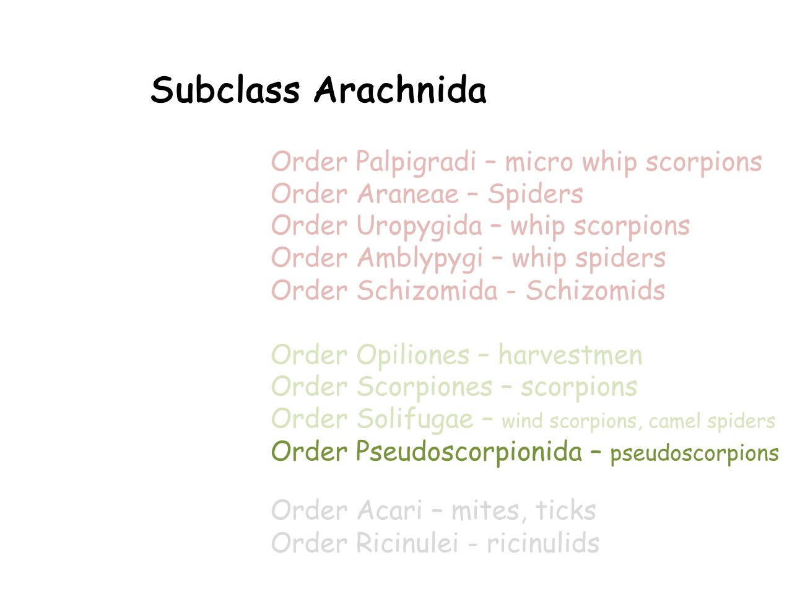](slides/slide-29.jpg)

OK, then there's the pseudo scorpions.

[↑ Slides](#slides) · [Course index](../../README.md)

## Slide 30

[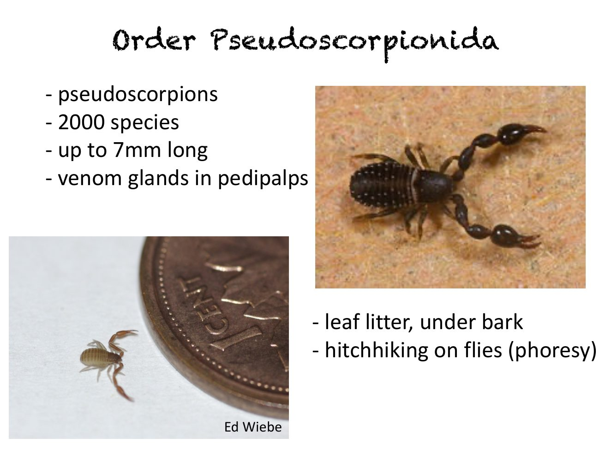](slides/slide-30.jpg)

This is again, a group that are actually probably more common than we think, but they're very hard to find one of the reasons being that they're so incredibly small. You can see bottom left. There's a picture of a pseudo scorpion next to an American one cent piece.

You can see that it's tiny. There are about 2000 species described, although that is almost certainly an incredible underestimate. Because, as I say, people don't see them a lot.

They don't. They don't get it into huge densities. Usually, and so they're just found here and there.

Their maximum length is about seven millimetres, but many of them are much shorter. Interestingly, although they have pedipalps, modified like in a scorpion. They deliver their poison from the pedipalps, not from the back end the way a scorpion does.

So they actually can bite with their pedipalps and deliver poison at the same time. So and they're of course, carnivorous. They're not closely related to scorpions.

The main similarity is those modified pedipalps. You find them in leaf litter, you find them under bark. You sometimes find them in books.

Because they're very flat, and they can fit between pages. An interesting thing that's been seen repeatedly with them, and I've seen it around Canberra. Is this hitchhiking on flies?

It's called phoresy, and they can actually latch onto flies or other flying insects. And that's the way they disperse. There was a year in Canberra where these guys were very common, and you could actually tell if a fly was carrying them because they made a slightly different noise as they buzzed and so you could actually catch flies out of the air and, pull pseudoscorpions off.

> **Editorial note:** Pseudoscorpion relationships and the stated species totals reflect the lecture’s account; no updated phylogeny is substituted.

[↑ Slides](#slides) · [Course index](../../README.md)

## Slide 31

[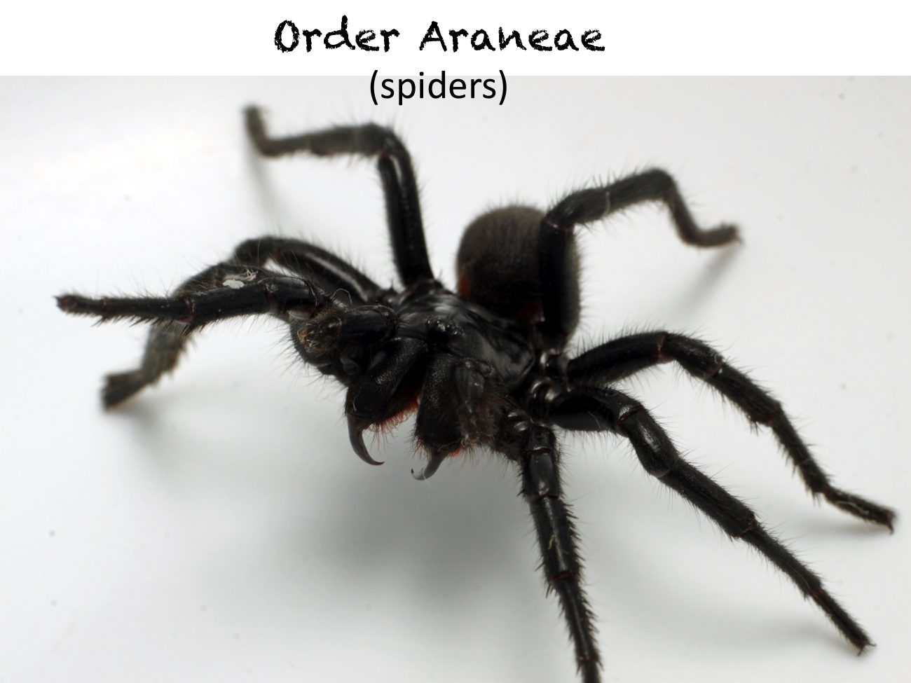](slides/slide-31.jpg)

OK, that's the pseudo scorpions. That's the minor groups. Now we've got the Araneae.

This is the spiders and of course, a group that you're very familiar with You can see from this animal. Eight legs, two fangs up the front, pedipalps, which look like small walking legs. And a bunch of eyes.

The number of eyes can vary from eight down to none, depending on the species.

[↑ Slides](#slides) · [Course index](../../README.md)

## Slide 32

[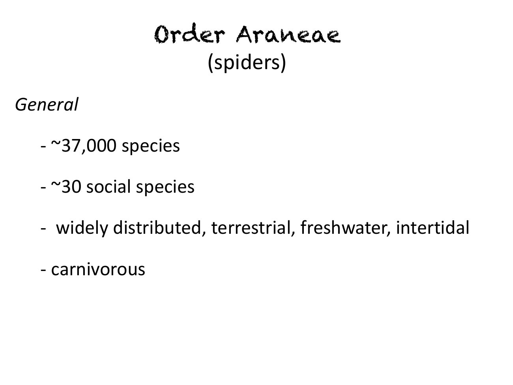](slides/slide-32.jpg)

Very big group, At least cheliceriforms. 37,000 species currently described is probably at least twice that, I mentioned that we see in the Cheliceriformes this social behaviour popping up like in some of the amblypygids And some of the scorpions and about 30 species of spider are known to be social. That is, they form large groups. And although they're opportunist carnivores, they don't eat each other in these groups or not usually, as you no doubt know, spiders are widely distributed.

They're found all around the world. There's terrestrial ones. There's freshwater ones.

You get ones are, on the beach, into in into tidal areas, even around rock pools. But there are no marine species, and all spiders are carnivorous.

[↑ Slides](#slides) · [Course index](../../README.md)

## Slide 33

[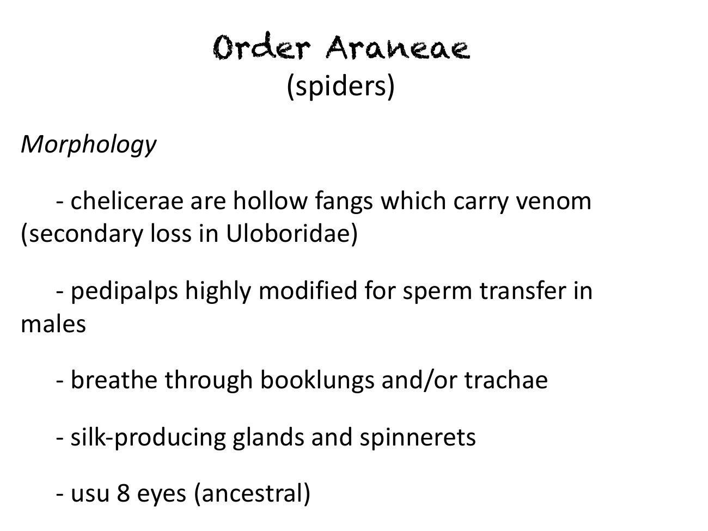](slides/slide-33.jpg)

So the chelicerae, modified to be hollow fangs and they carry venom and they just they, deliver it through those fangs by injection. There's one family of spiders, the Uloboridae, where there has been a secondary loss of fangs and venom. The pedipalps which look like normal walking legs but smaller, change after the last moult in the adult males and they actually, are highly modified for sperm transfer.

Basically, those pedipalps, are modified such that they carry a structure that's like AAA basting bulb or maybe even a syringe. The male deposits semen on a special Web and then sucks it up in these syringes and then inserts them into the female's. Gonopore and compresses the ends of the syringes to, inject the sperm they breathe through book lungs or tracheae.

And I'm going to show you a picture of these in a bit. The special thing about spiders amongst the Cheliceriformes is that they have silk producing glands and spinnerets that deliver the silk, and they can produce many different sorts of silk. You're no doubt familiar with, orb weaving spiders, which form large, sticky orb webs, which work as nets to catch prey.

They also use that web for covering their egg sac. The burrowing species use it for burrowing, lining their burrow. There are net casting spiders which make nets out of their web and throw them over their prey.

So th this, web building facility is quite amazing, and they've used it in many different ways. As I said, they usually have eight eyes. That's the ancestral form.

But we have some cave spiders with no eyes, some with two, some with four, some with six.

> **Editorial note:** Uloborids lack venom glands but still have chelicerae and fangs; the lecture’s “loss of fangs” is retained as a factual issue.

[↑ Slides](#slides) · [Course index](../../README.md)

## Slide 34

[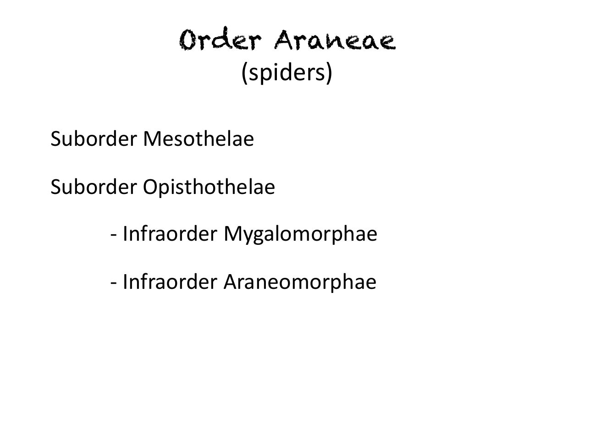](slides/slide-34.jpg)

Here are the spider groups. And again, there's this taxonomic issue. The way I've got it here is I've got the suborder Mesothelae and the suborder Opisthothelae, which contains the infra order Mygalomorphae and Araneomorphae.

However, that moves around. Sometimes the araneomorphs and am mygalomorphs are considered to be suborders, not infra orders. So don't worry about that.

The names themselves are useful, particularly Mygalomorphae and Araneomorphae. But how they actually sit in the taxonomic hierarchy, is not something that's, worth worrying about too much, because it'll probably change.

[↑ Slides](#slides) · [Course index](../../README.md)

## Slide 35

[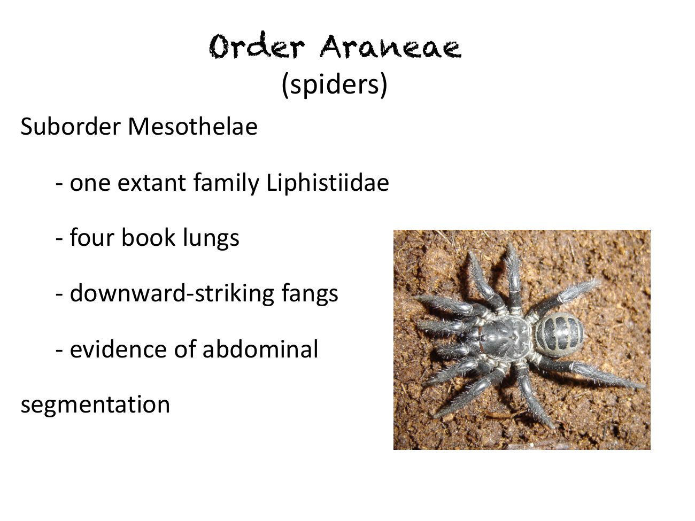](slides/slide-35.jpg)

The Mesothelae. The I think are particularly interesting these carry a lot of plesiomorphic characters. That is a lot of characters that probably affect the structures of the ancestors.

Most particularly, if you look at that abdomen, it's segmented. In other spiders, we don't see that sort of, segmental structure. Sometimes it's apparent through little dimples and muscle attachment sites, but certainly not with those, sclerotised, dorsal plates that we see in the Mesothelae.

There's one family, the Liphistiidae There used to be more, very sadly, their distribution is relatively limited, and large areas where they lived were actually destroyed by the American bombing of Cambodia back in the 19 seventies. Or at least people haven't been able to go back and look properly at a lot of these areas. Partly because they've been just, turned into a wasteland.

But also, because there's also landmines, which make it, fairly difficult to go spider hunting. And they have four book lungs again. I keep talking about book, lungs and lungs, and I promise I'll show you some in a moment.

They have downward striking fangs, so they have two fangs, which point downwards. This means the animal has to raise its body to strike it as prey. And as I've said there's evidence of abdominal segment segmentation.

[↑ Slides](#slides) · [Course index](../../README.md)

## Slide 36

[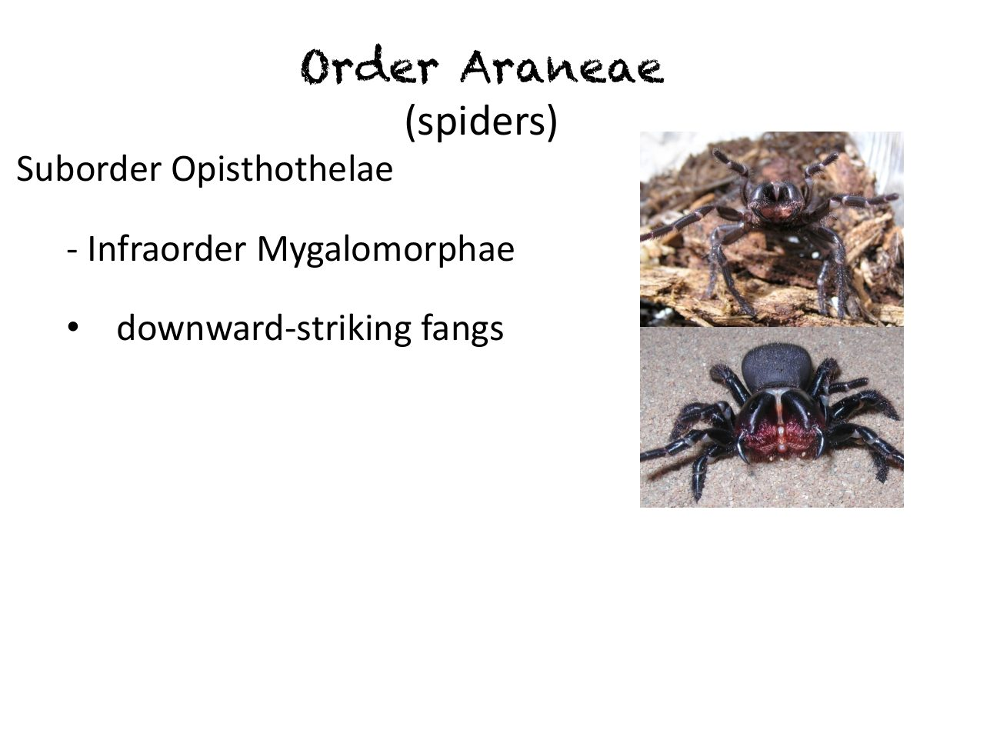](slides/slide-36.jpg)

And then we get to the spiders. The infraorder Mygalomorphae, have downward striking fan fangs just like the Mesothelae. You can see this is a funnel web here and you can see it's actually had to raise the front of its body so it can strike downwards with its fangs like an axe.

And this animal here, I think I've already shown you some photos of this. This is a mouse spider which has these huge chelicerae. So the bit at the base is called the paturon.

That's full of muscle and full of, venom gland. And then the fangs at the end in the mouse spider are very stout, and mouse spiders can handle very hard bodied animals. Like large beetles and that sort of thing.

[↑ Slides](#slides) · [Course index](../../README.md)

## Slide 37

[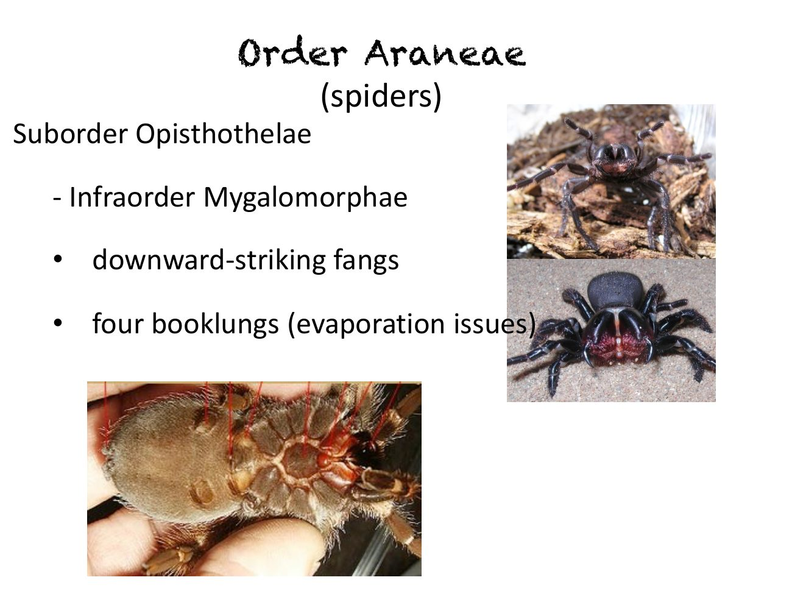](slides/slide-37.jpg)

Finally, we get to a picture of book lungs. OK, if you turn over a mygalomorph, you will see they have these four spots which I'm circling now with my pen. 12, three Oh, these spots are actually cavities Where the inside of the cavity ha cavity has, convoluted membranes, to maximise surface area, and then that cavity has a small opening to the outside. Now, this is a method of, gas exchange.

Basically, the book structure maximises the surface area for which gas can be exchanged over One of the problems with gas exchange systems is they need to be moist to work. And in the mygalomorph spiders, you have this large surface area of moist membrane, and the animals suffer very badly from desiccation. They lose water very badly.

They can't close the, openings to the book lungs and, so and they're also not incredibly efficient. So mygalomorph spiders tend to be slow or if they can be faster, very fast for very short periods before they run out of oxygen. And what it also means is that they're very limited in where they can live.

So in tropical areas, in rainforests and places, they can actually walk around free. But in most of Australia, for example, they're limited to living in burrows. They build their burrows under rocks, under logs, or sometimes straight in the ground.

And the reason for this is that once you get down to a certain depth, the humidity in a burrow is pretty much 100% wherever you are in the world. And so they can sit down in these burrows, avoid desiccation and then come out either just sitting at the entrance and snatching stuff that goes past or in wetter times. They can actually come out, hunting and things and in a lot of species.

Also, the males have to go out to find females, and so they usually wait for a night of high humidity or rain before they come out.

[↑ Slides](#slides) · [Course index](../../README.md)

## Slide 38

[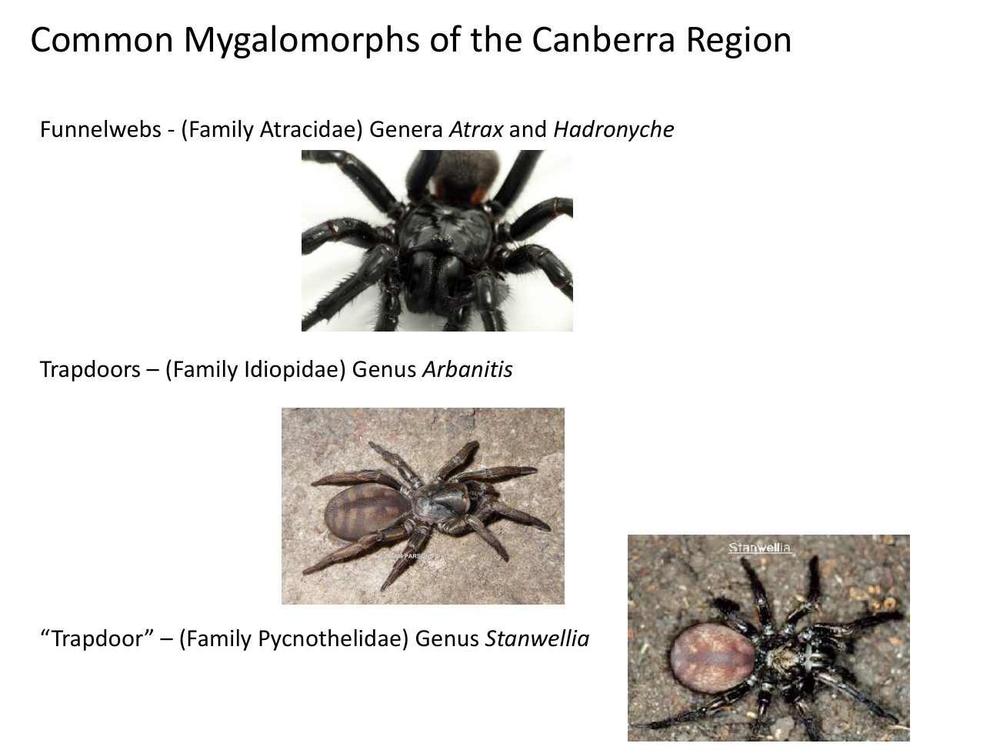](slides/slide-38.jpg)

There's a few mygalomorph spiders around Canberra, and here are the commonest ones. These are the funnel Web spiders. I'm sure you're familiar with funnel Web spiders.

There's a number of species of funnel webs, which are known to give lethal bites to humans. 14 people have died historically from being bitten by funnel Web spiders. There are two genera in the AC, T and four species. The Canberra Valley, because it's so disturbed, is pretty much funnel web free.

But we do get them in the surrounding hills. There's a population I've been monitoring for about 40 years on Black Mountain. And, I sometimes get them brought in for identification from Murrumbateman.

So they're definitely about, But people are so rarely bitten. If you want to worry about something, you should be a lot more worried about being run over by a truck or something like that than being bitten by a funnel web. There's also trapdoor species around Canberra.

There are three species that I know of. They're family Idiopidae again. Very large spiders, very chunky.

They live in burrows. Interestingly, most trapdoor spiders don't build trap doors, and can confuse things. A lot of wolf spiders do build trap doors.

So a trapdoor on the burrow is not necessarily diagnostic of a trapdoor spider. Another common one, which is also sometimes referred to a trap door as a to as a trap door and doesn't build a trap door is the genus Stanwellia. They're sometimes called metallic tube spiders.

And again, there's a number of, a couple of these species found in the AC T. These guys build burrows either straight in open ground, like the other trapdoor spiders or under rocks and logs. And then we have the Opisthothelae.

Sorry.

[↑ Slides](#slides) · [Course index](../../README.md)

## Slide 39

[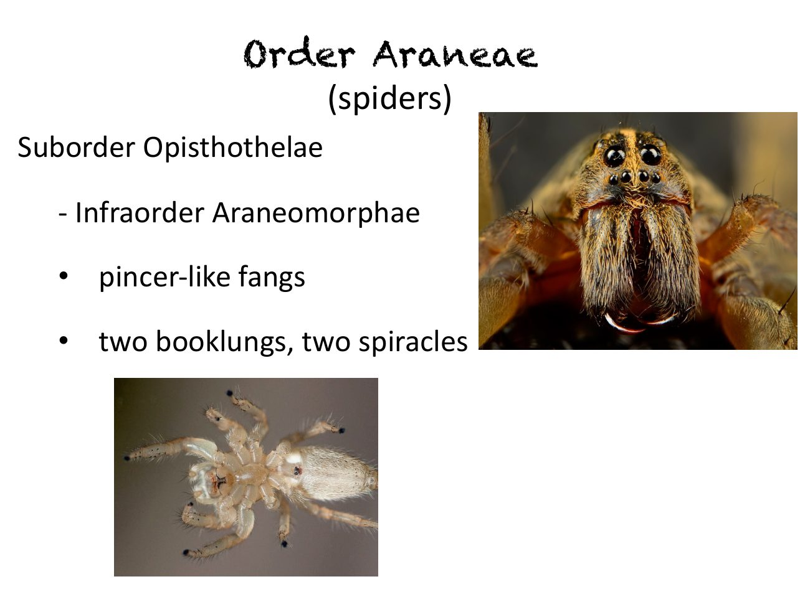](slides/slide-39.jpg)

Then we have the Araneomorphae and the Araneomorphae are the spiders that most of us are familiar with. They've got a number of differences from the mygalomorph. So if you look at the top right picture, I'm just going to trace the fangs.

You can see there's two fangs and they're pointing inwards. And so the way the animal bites is the paturons the bits above the fangs spread out, and then they use their fangs like pincers. It looks like a more efficient means of, biting.

And people have argued that it is, although there isn't a lot of evidence to show that, it used to be thought it allowed them to catch larger prey. But that doesn't seem to be the case. What it does mean is the animal doesn't have to rear up to catch its prey.

So with the mygalomorphs, if they're going to bite something with their fangs, they have to lift their body up so high they can't actually see the animal that they're biting. But their vision is so poor that probably doesn't matter much. Amongst the araneomorphs, we have, enormous variation.

And many of them have very good eyesight. This is a wolf spider in the top, right? And they have two eyes pointing forwards, which are really, give them very good vision.

Bottom left. We have, jumping. Spider jumping spiders have the best vision of all invertebrates, perhaps, with the exception of squids and octopuses.

And they have very large eyes again, which you can't see from this picture. The reason I've shown the jumping spider from below is it's only got two book lungs, which I'm tracing out now with my pen. And the reason for this is because they've also, and all araneomorphs also have another way of breathing, which is through spiracles, just like the insects.

So they have little two little openings under the abdomen, which are too small to see here, and they lead into tubes trachea, which spread through the body, and, they can be opened and closed, and they, transport oxygen through the body. And it's because they've reduced their book lungs and started to use spiracles that they can do things like hang up in their web all day in the hot sun where the mygalomorphs can't. So the araneomorphs, the Araneae, also by far the commonest of spiders and also the most visible because they don't have to spend their life hiding in Burrows.

> **Editorial note:** Respiratory anatomy varies among araneomorphs; the source generalises across the group.

[↑ Slides](#slides) · [Course index](../../README.md)

## Slide 40

[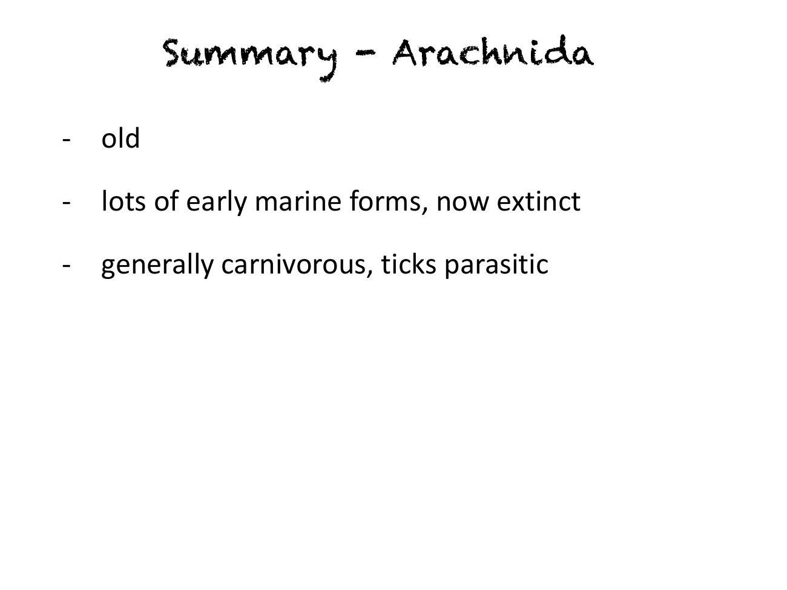](slides/slide-40.jpg)

So just in summary, the Arachnida it's an old group. There were early marine forms, but now those forms are extinct. They're, generally carnivorous.

But remember, the ticks and mites we talked about earlier are also arachnids. The ticks are parasitic And, mites, can eat, detritus as well as, it can eat detritus. OK, so that's it.

We'll leave it there. And, next lecture, we'll talk about a number of completely different groups.

[↑ Slides](#slides) · [Course index](../../README.md)

## Source notice

this material has been reproduced and communicated to you by or on behalf of the Australian National University in accordance with section 113 P of the Copyright Act 1968. The material in this communication maybe subject to copyright under the act any further reproduction or communication of this material by you must be consistent with the provisions of the act. Do not reproduce this material. Do not remove this notice.

[← Previous lecture](../16-chelicerata-part-1-ticks-mites-horseshoe-crabs/README.md) · [Course index](../../README.md) · [Next lecture →](../18-hymenoptera-part-1-classification-taxonomy/README.md)
