# Hymenoptera Part 1 - Classification  Taxonomy

[← Previous lecture](../17-chelicerata-part-2-remaining-groups/README.md) · [Course index](../../README.md) · [Next lecture →](../19-hymenoptera-part-2-morphology/README.md)

**Slides + cleaned transcript** · 18 slides

English transcript with fillers and repeated false starts removed. Technical terms are corrected using the slides and context. Bracketed wording marks reconstruction or uncertainty. Slide boundaries are inferred from content; the transcripts have no slide timestamps.

[Original transcript](original-transcript.txt) · [Text-only version](cleaned-transcript.md) · [Editing notes](../../EDITING-NOTES.md) · [Correction record](corrections.md)

[Searchable slide text](slide-text.md). Click a slide image to open it at full size.

## Slides

[1](#slide-1) · [2](#slide-2) · [3](#slide-3) · [4](#slide-4) · [5](#slide-5) · [6](#slide-6) · [7](#slide-7) · [8](#slide-8) · [9](#slide-9) · [10](#slide-10) · [11](#slide-11) · [12](#slide-12) · [13](#slide-13) · [14](#slide-14) · [15](#slide-15) · [16](#slide-16) · [17](#slide-17) · [18](#slide-18)

## Slide 1

[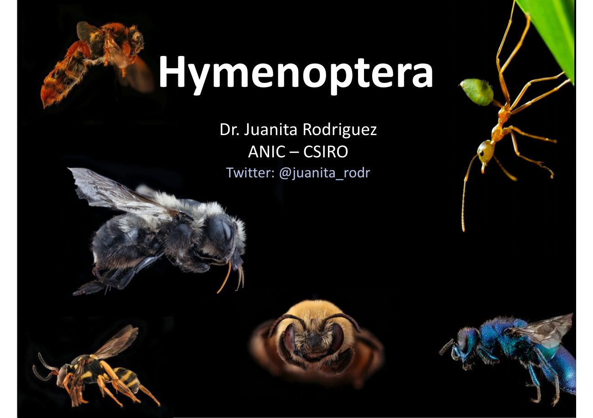](slides/slide-01.jpg)

Hello, everyone. In the next few videos we're going to talk about Hymenoptera which are the ants, bees and wasps. And today we're going to start with the phylogenetics and taxonomy.

[↑ Slides](#slides) · [Course index](../../README.md)

## Slide 2

[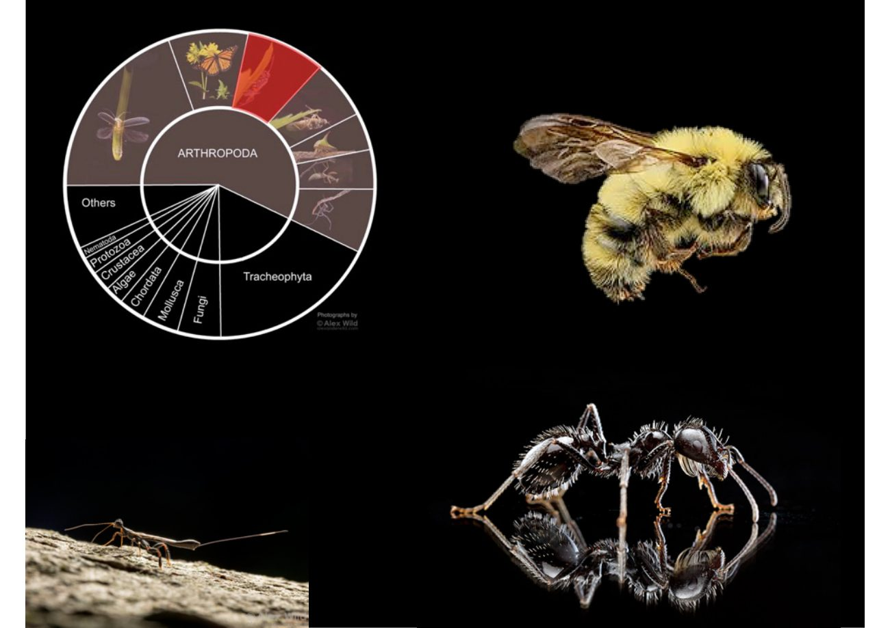](slides/slide-02.jpg)

So first of all, as Hymenoptera are arthropods and arthropods account for more than 60% of described species and then within the arthropods. This red section is what the diversity of Hymenoptera and it accounts for about 8% of all described species, so they're very diverse, but also they're very important as pollinators. They often are used as bio indicators and they're also used as biocontrol agents to name a few examples.

[↑ Slides](#slides) · [Course index](../../README.md)

## Slide 3

[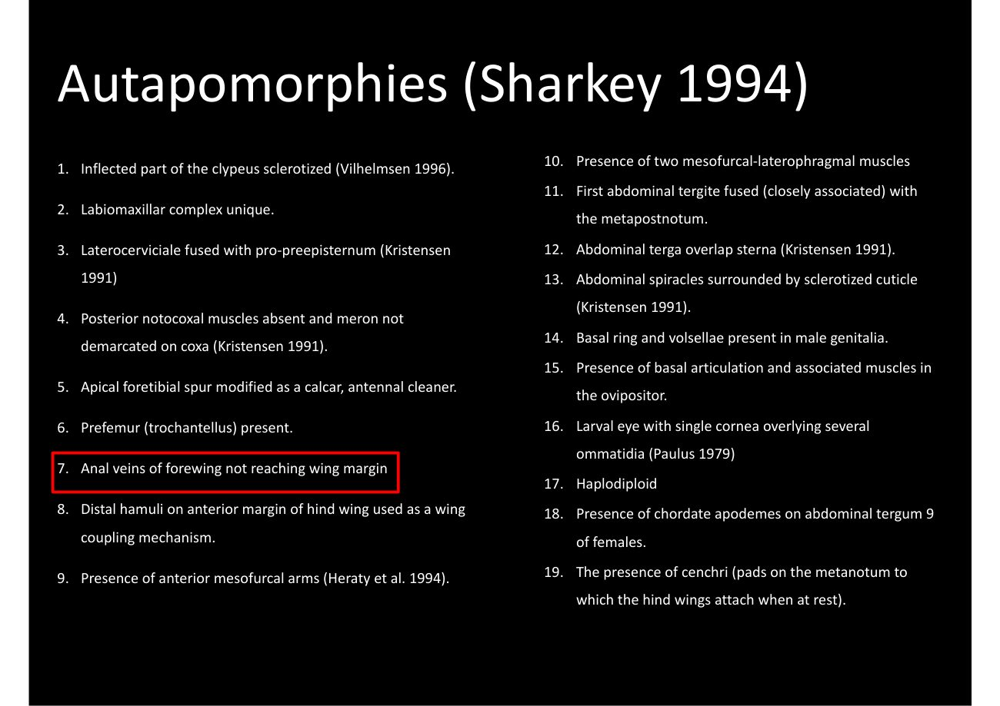](slides/slide-03.jpg)

So let's look at the autapomorphies for Hymenoptera. Remember that autapomorphies are derived characters and can be used to diagnose one of our groups here. We have a number of them and you don't need to remember them all.

I will highlight a few of the most important ones. So first, the anal veins of the forewings do not reach the wing margin.

[↑ Slides](#slides) · [Course index](../../README.md)

## Slide 4

[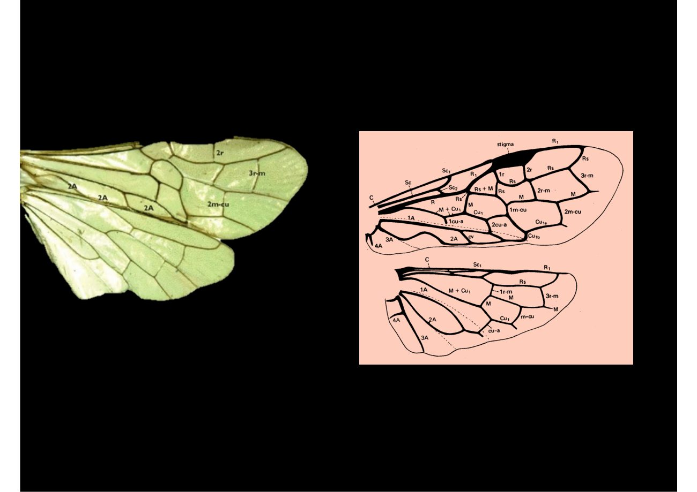](slides/slide-04.jpg)

And here you can see what that looks like. So have a look at veins. One a to four A on the forewing.

This is easier to see in the illustration. Basically, they're not reaching the wing margin at all.

[↑ Slides](#slides) · [Course index](../../README.md)

## Slide 5

[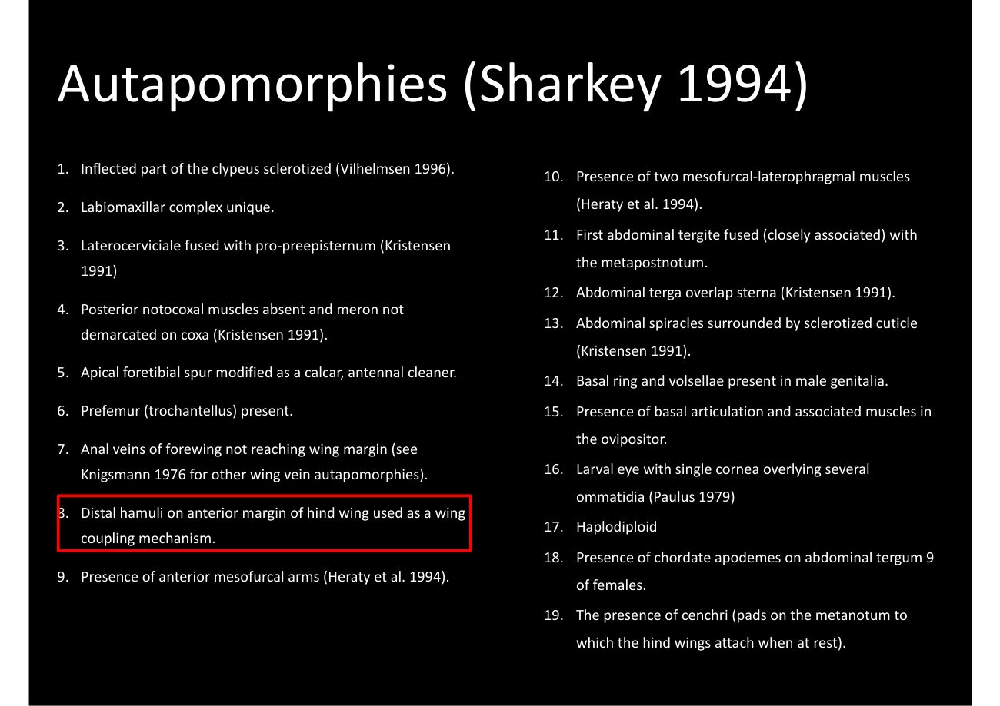](slides/slide-05.jpg)

Now then, we have a very unique wing coupling mechanism where the fore- and hind wings are joined together with these structures called hamuli. And this is probably one of the most important characteristics of hymenopterans because these little hooks make sure that the fore- and the hind wing stay together to make flight more efficient.

[↑ Slides](#slides) · [Course index](../../README.md)

## Slide 6

[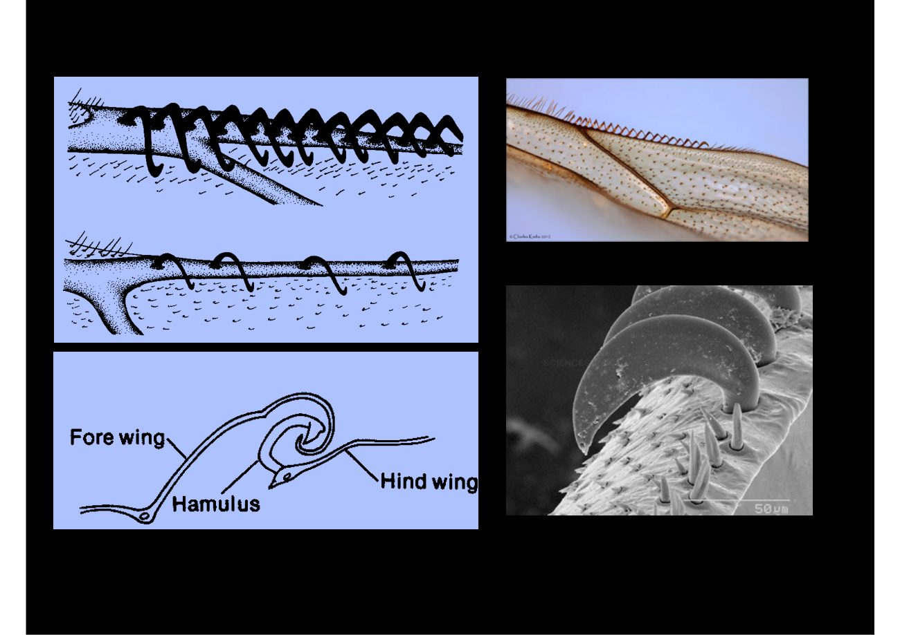](slides/slide-06.jpg)

Here in this figure, you can see what they look like under the microscope under the electron microscope scanning electron microscope, and also how they couple together.

[↑ Slides](#slides) · [Course index](../../README.md)

## Slide 7

[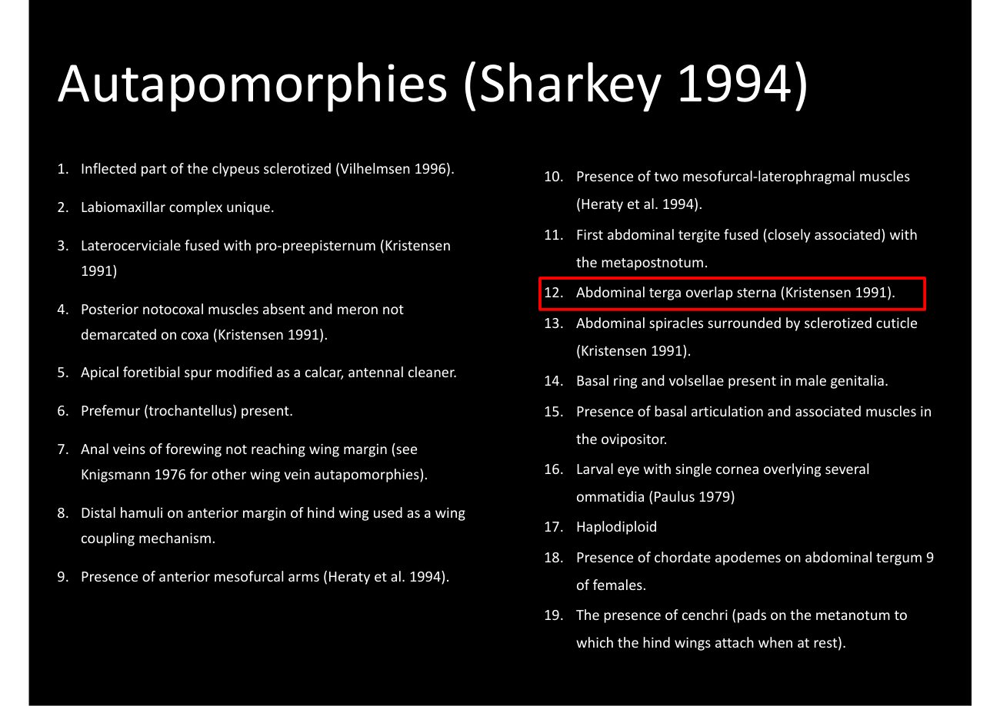](slides/slide-07.jpg)

And then hymenopterans also have abdominal tergites that overlap the sternites.

[↑ Slides](#slides) · [Course index](../../README.md)

## Slide 8

[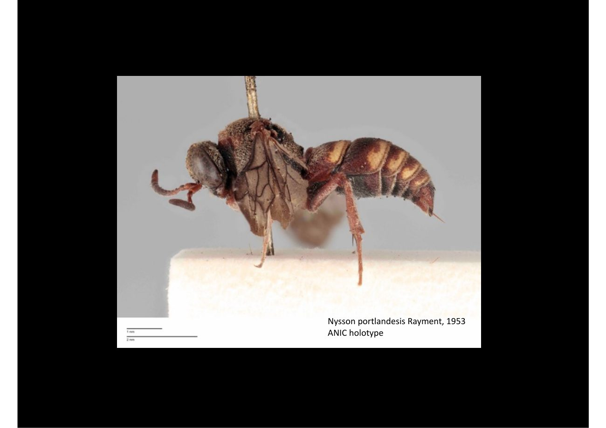](slides/slide-08.jpg)

And so basically, you can see here, tergites are the dorsal plates of the metasoma and they are covering their sternites, which are the ventral plates of the metasoma. They're actually overlapping them.

[↑ Slides](#slides) · [Course index](../../README.md)

## Slide 9

[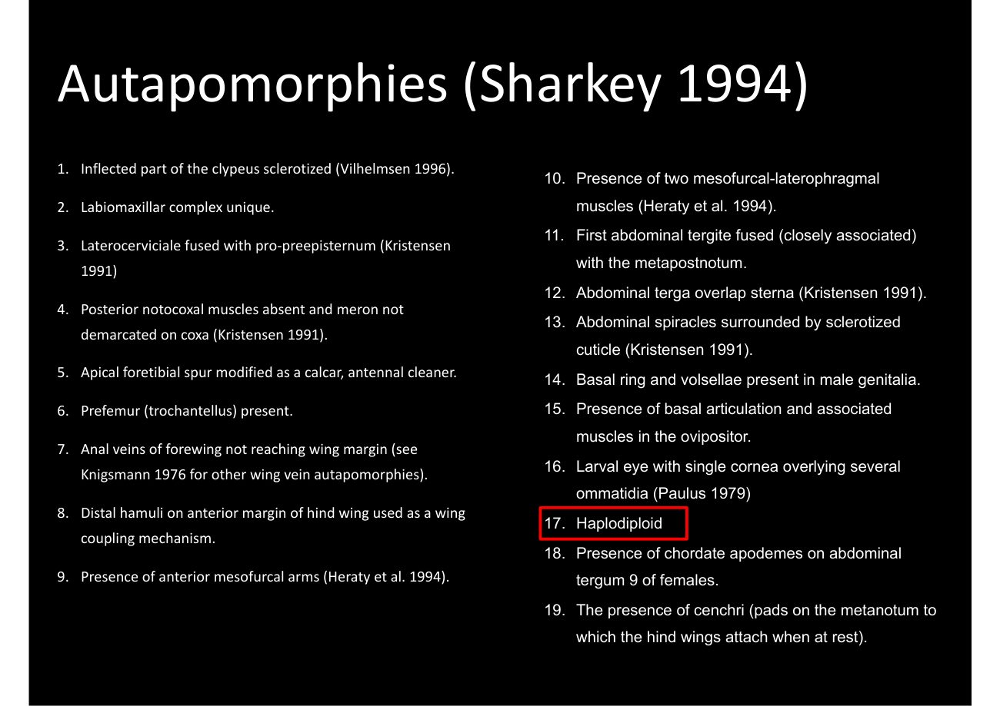](slides/slide-09.jpg)

And another important feature is the haplodiploid sex determination system. This is very unique to Hymenoptera and basically females are diploid and males are haploid.

> **Editorial note:** Haplodiploidy is not unique to Hymenoptera; it also occurs in other groups, including thrips.

[↑ Slides](#slides) · [Course index](../../README.md)

## Slide 10

[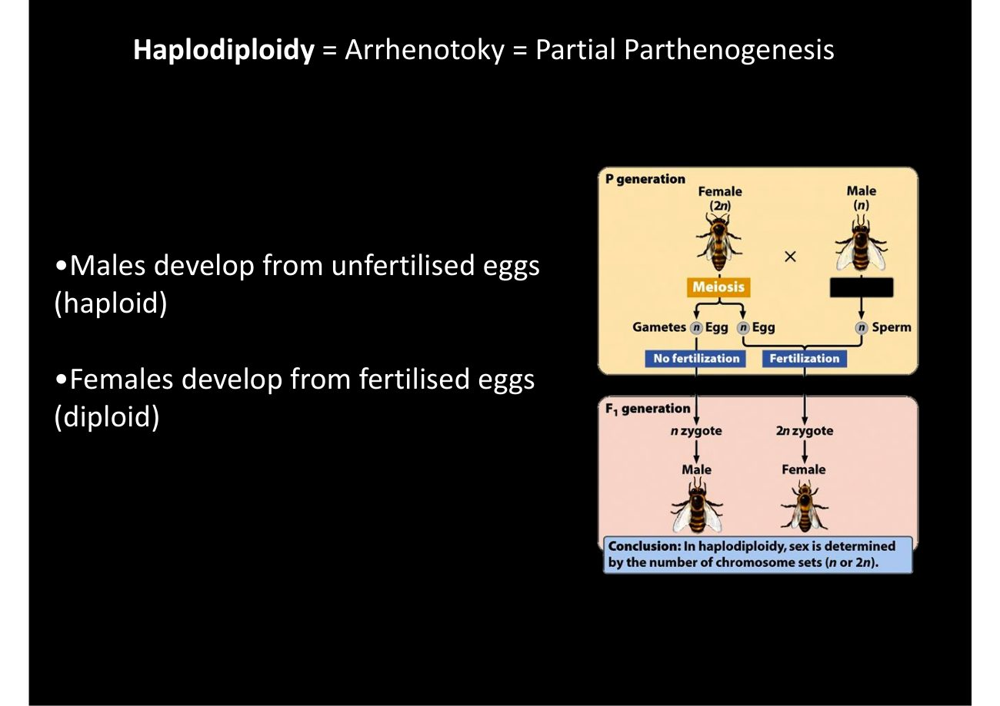](slides/slide-10.jpg)

So this means that males develop from unfertilized eggs and females develop from fertilised eggs so that the males can develop directly from a zygote, whereas the females are produced through fertilisation.

> **Editorial note:** The source says males develop from a zygote, but an unfertilised egg is not a zygote. The preceding explanation on the slide correctly distinguishes unfertilised and fertilised eggs.

[↑ Slides](#slides) · [Course index](../../README.md)

## Slide 11

[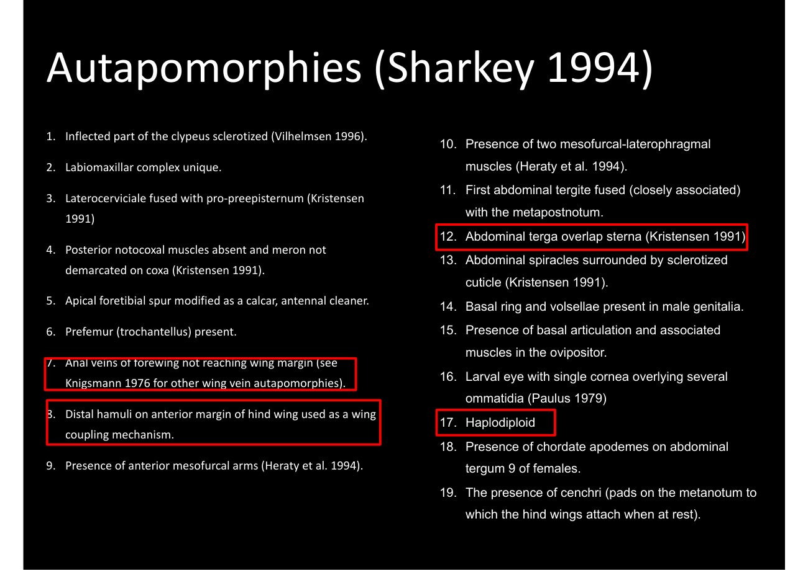](slides/slide-11.jpg)

So those are the most important and easily observed diagnostic characters of Hymenoptera. OK, anal veins not reaching the wing margin. Fore- and hind wings coupled through hamuli abdominal tergites overlapping sternites and a haploid sex determination system.

[↑ Slides](#slides) · [Course index](../../README.md)

## Slide 12

[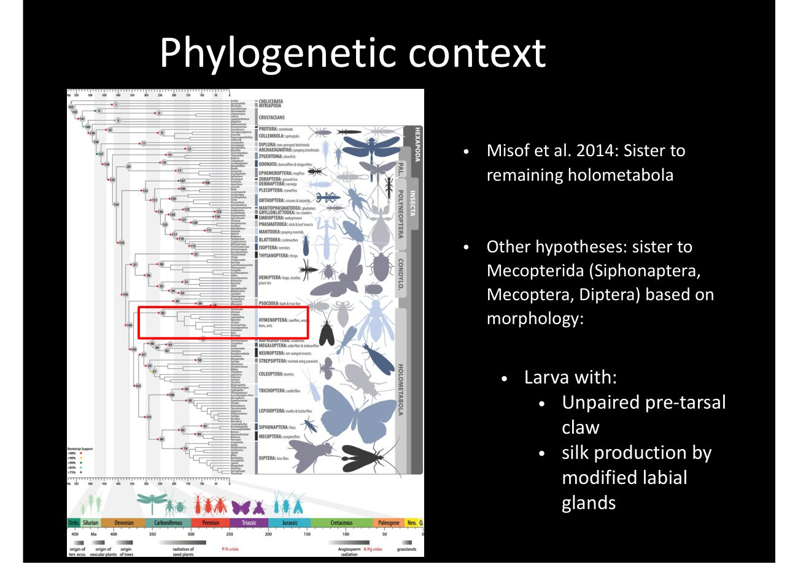](slides/slide-12.jpg)

So now let's see the phylogeny of Hymenoptera and where it is located within the large insect phylogeny. So this is one of the most recent molecular phylogeny of all insects, and you may already have seen it throughout the course. As you can see, Hymenoptera are showing up as the earliest branch of Holometabola.

This means that they are sister to all the orders that have complete metamorphosis. There have been other hypothesis on what the relatives of Hymenoptera are. One where they are sister to this group called Mecopterida, which is a clade composed of Siphonaptera, Mecoptera and Diptera.

This was based on larva morphology because all these orders have in common a larva with pretarsal claws that are not paired and produce silk through modified labial glands. So this, hypothesis, though, has been rejected by recent phylogenetics studies.

[↑ Slides](#slides) · [Course index](../../README.md)

## Slide 13

[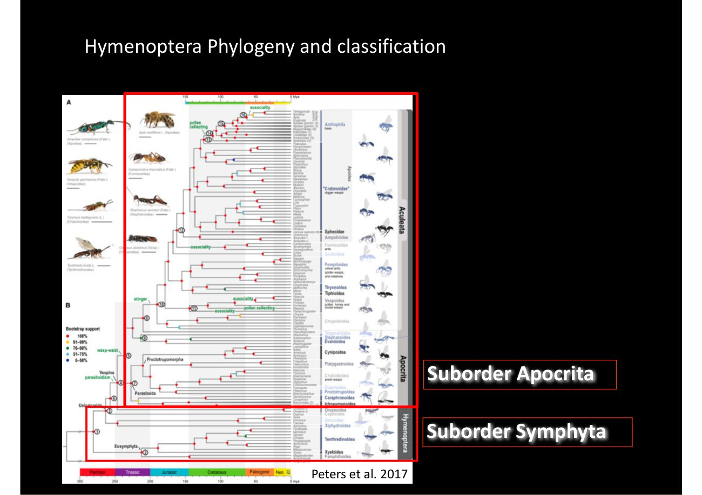](slides/slide-13.jpg)

OK, now let's zoom in to Hymenoptera and look at just their phylogeny. And this is a hypothesis from Peters and collaborators. We can see that there are two sub orders here, one that is the earliest branching and these are commonly known as sawflies.

This is the suborder Symphyta, wasps without a waist and then one that shows up later in the history of the border which is the Suborder Apocrita. They are actually wasps that have a waist and I'll show you the morphological implications in a little bit. This group also coincides with the origin of parasitism.

So have a look at the phylogeny [question about Symphyta unclear]. And what about Apocrita? Actually Symphyta is not Monophyletic and Apocrita is.

[↑ Slides](#slides) · [Course index](../../README.md)

## Slide 14

[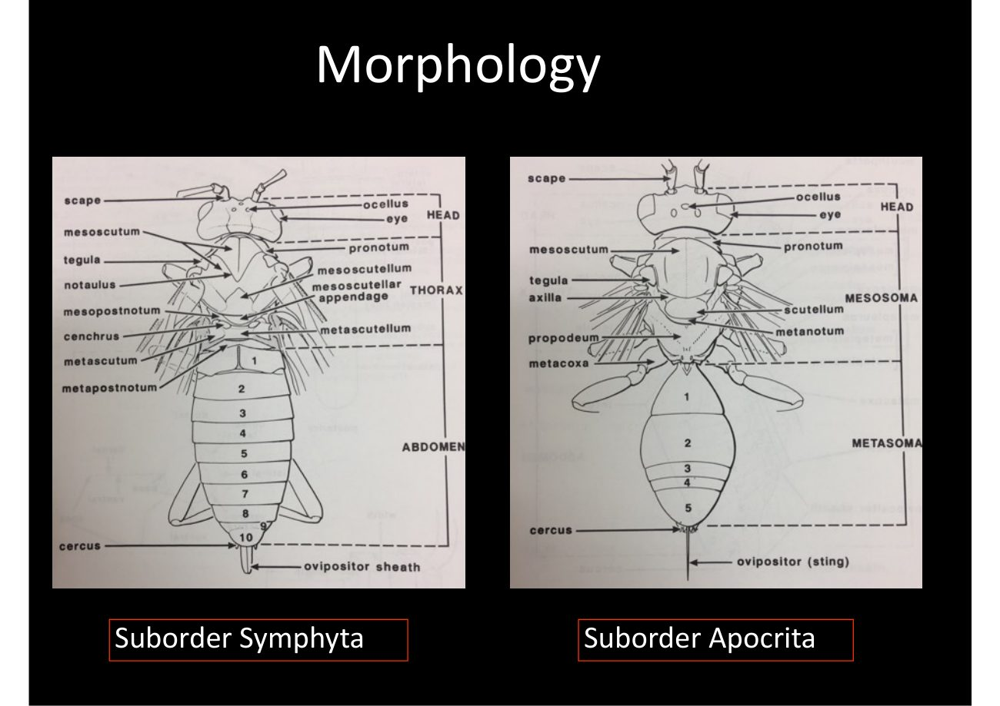](slides/slide-14.jpg)

Now here. We can see on the left Symphyta and on the right [Apocrita]. Take some time to look at the differences in their morphology.

Like I was saying before, for all insects, we have the head, the thorax and the [abdomen], and in [Symphyta] we still have these three body divisions. But if you look on the right in Apocrita, the first segment of the abdomen is actually fused to the thorax. And when this segment is fused to the thorax is now called the propodeum.

This segment alone is called the propodeum that is fused to the thorax. But now the thorax plus the first abdominal segment is now going to be called the mesosoma. Then the abdomen minus the first segment is going to be called metasoma.

So basically, in summary segment, one of the metasoma is actually segment two of the abdomen.

[↑ Slides](#slides) · [Course index](../../README.md)

## Slide 15

[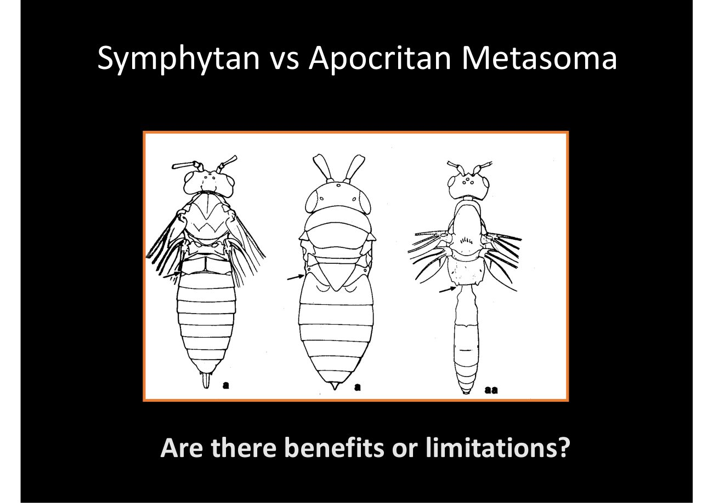](slides/slide-15.jpg)

And this may have had some advantages for apocritans. So think about what? What could those be So remember that the origin of Apocrita is also the origin of parasitism.

OK, so what advantage would this be for? Well, if you think about it, a WASP waist may allow metasomal movement in different planes to make a oviposition more efficient.

[↑ Slides](#slides) · [Course index](../../README.md)

## Slide 16

[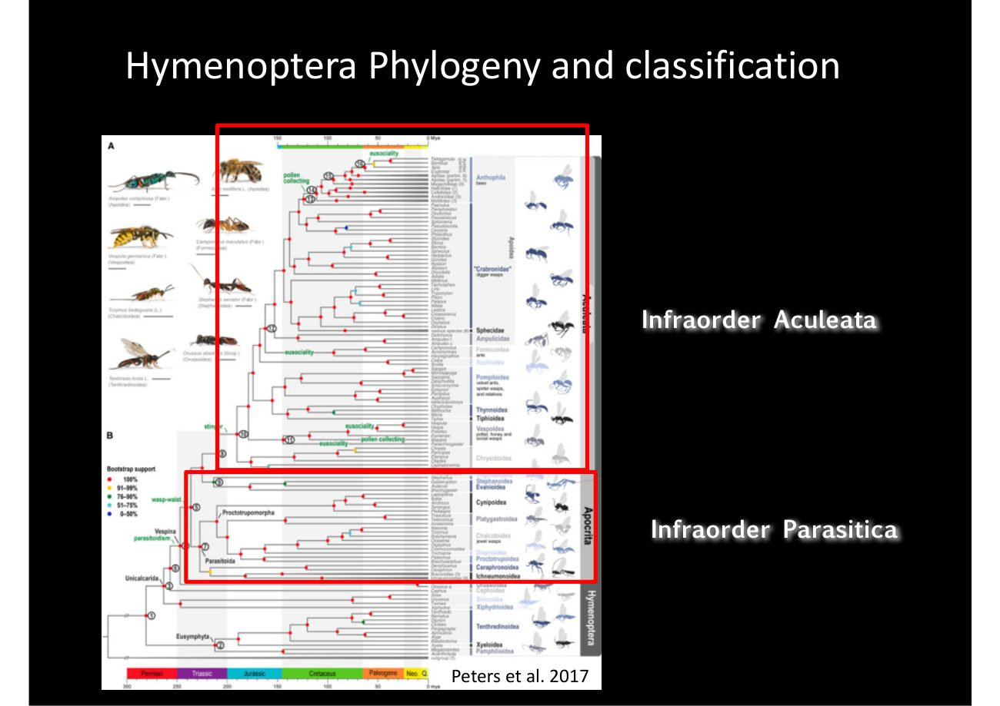](slides/slide-16.jpg)

So let's look at this group with a wasp waist. Let's zoom in into the classification within Apocrita.. Here we have two clades infraorder Parasitica which are mostly wasps that don't have a stinger but just an ovipositor.

And then we have infraorder Aculeata which are stinging wasps. Now an important fact is that the stinger is actually a modification of the ovipositor. So basically males cannot sting because they never had an ovipositor.

> **Editorial note:** “Parasitica” is a traditional grouping, not a monophyletic clade. The lecturer’s classification is retained.

[↑ Slides](#slides) · [Course index](../../README.md)

## Slide 17

[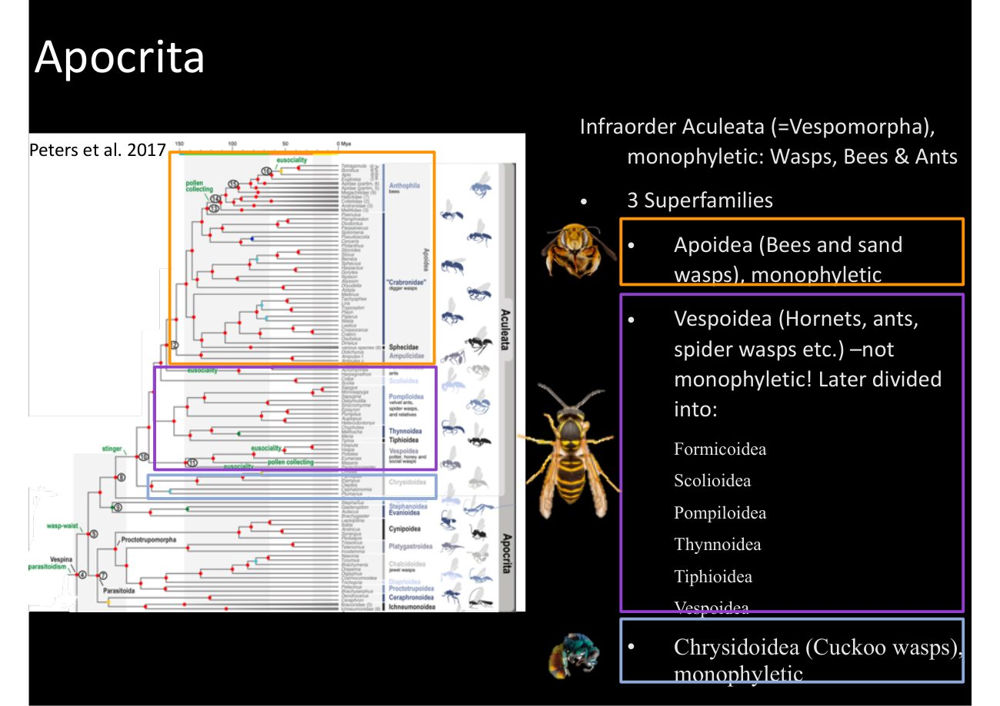](slides/slide-17.jpg)

Now let's zoom in to Aculeata, which are the stinging wasps. And here we have the social wasps, the bees and their ants. This group is monophyletic and we have three super families.

Within this the blue one are [Chrysidoidea], which are the cuckoo wasps. Then in orange we have [Apoidea], which are bees and sand wasps. And in purple we have [Vespoidea], which are the hornets and spider wasps.

This last group is actually not monophyletic and was later divided into a bunch of other smaller superfamilies that are monophyletic. So here is the list Formicoidea, Scolioidea, Pompiloidea, Thynnoidea, Tiphioidea and Vespoidea.

[↑ Slides](#slides) · [Course index](../../README.md)

## Slide 18

[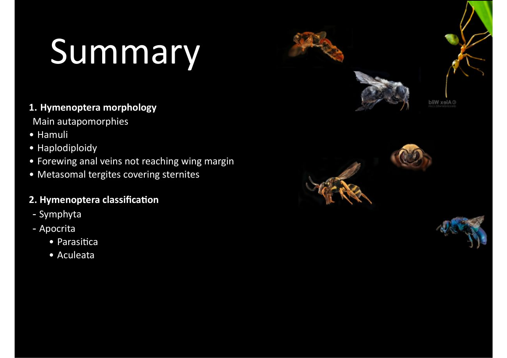](slides/slide-18.jpg)

So, in summary, the main autapomorphies of Hymenoptera are haplodiploidy and the forewing anal veins not reaching the wing margin. And the metasomal tergites covering the sternites Second, Hymenoptera is classified into Symphyta and [Apocrita]; Apocrita is divided into Parasitica and Aculeata.

[↑ Slides](#slides) · [Course index](../../README.md)

## Source notice

this material has been reproduced and communicated to you by or on behalf of the Australian National University In accordance with section 113 P of the Copyright Act 1968. The material in this communication may be subject to copyright under the act, any further reproduction or communication of this material by you must be consistent with the provisions of the act. Do not reproduce this material. Do not remove this notice.

[← Previous lecture](../17-chelicerata-part-2-remaining-groups/README.md) · [Course index](../../README.md) · [Next lecture →](../19-hymenoptera-part-2-morphology/README.md)
