# Hymenoptera Part 2 - Morphology

[← Previous lecture](../18-hymenoptera-part-1-classification-taxonomy/README.md) · [Course index](../../README.md) · [Next lecture →](../20-hymenoptera-part-3-evolution-behaviour/README.md)

**Slides + cleaned transcript** · 20 slides

English transcript with fillers and repeated false starts removed. Technical terms are corrected using the slides and context. Bracketed wording marks reconstruction or uncertainty. Slide boundaries are inferred from content; the transcripts have no slide timestamps.

[Original transcript](original-transcript.txt) · [Text-only version](cleaned-transcript.md) · [Editing notes](../../EDITING-NOTES.md) · [Correction record](corrections.md)

[Searchable slide text](slide-text.md). Click a slide image to open it at full size.

## Slides

[1](#slide-1) · [2](#slide-2) · [3](#slide-3) · [4](#slide-4) · [5](#slide-5) · [6](#slide-6) · [7](#slide-7) · [8](#slide-8) · [9](#slide-9) · [10](#slide-10) · [11](#slide-11) · [12](#slide-12) · [13](#slide-13) · [14](#slide-14) · [15](#slide-15) · [16](#slide-16) · [17](#slide-17) · [18](#slide-18) · [19](#slide-19) · [20](#slide-20)

## Slide 1

[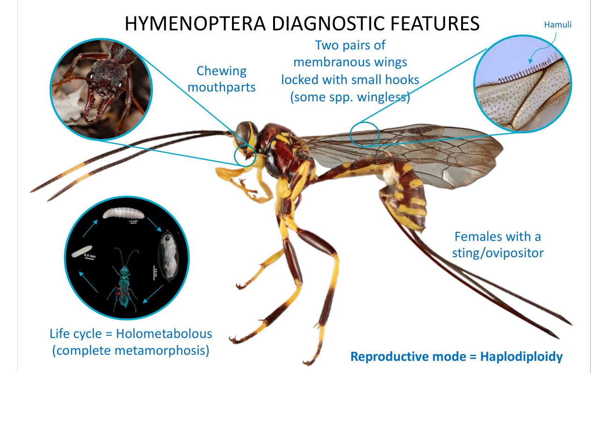](slides/slide-01.jpg)

This video is about morphological features that you have to watch out for when identifying Hymenoptera. But first, let's do a little bit of a review. What are the diagnostic features?

Not all the ones that we talked about are here, but let's remember they have two pairs of wings, they are membranous and they are locked with small hooks, fore- and hind wings. Females have a sting or ovipositor, depending on what group they are from, and also they have haplodiploid reproductive mode or sex determination system and they are holometabolous: they have complete metamorphosis.

[↑ Slides](#slides) · [Course index](../../README.md)

## Slide 2

[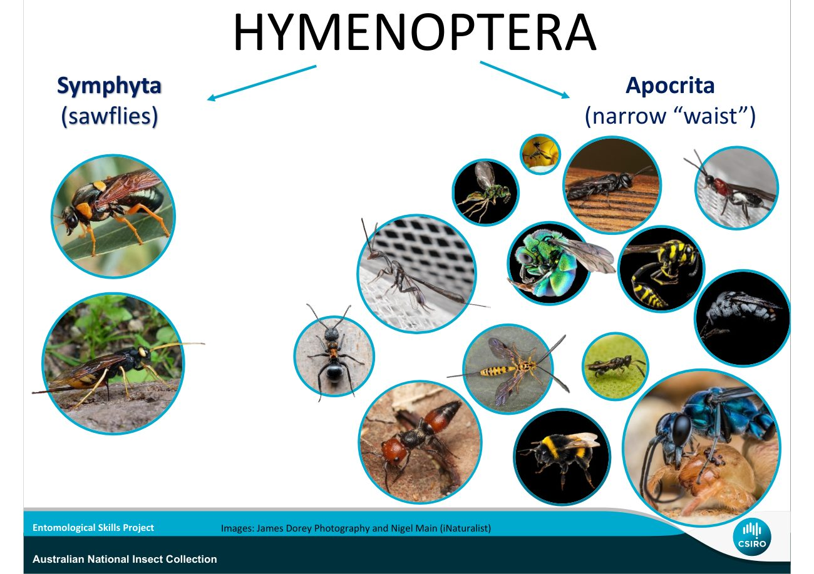](slides/slide-02.jpg)

Now [Hymenoptera] is divided into two large groupings or suborders: Symphyta and Apocrita. Symphyta are known as sawflies and are wasps without a waist and Apocrita are wasps with a narrow waist.

[↑ Slides](#slides) · [Course index](../../README.md)

## Slide 3

[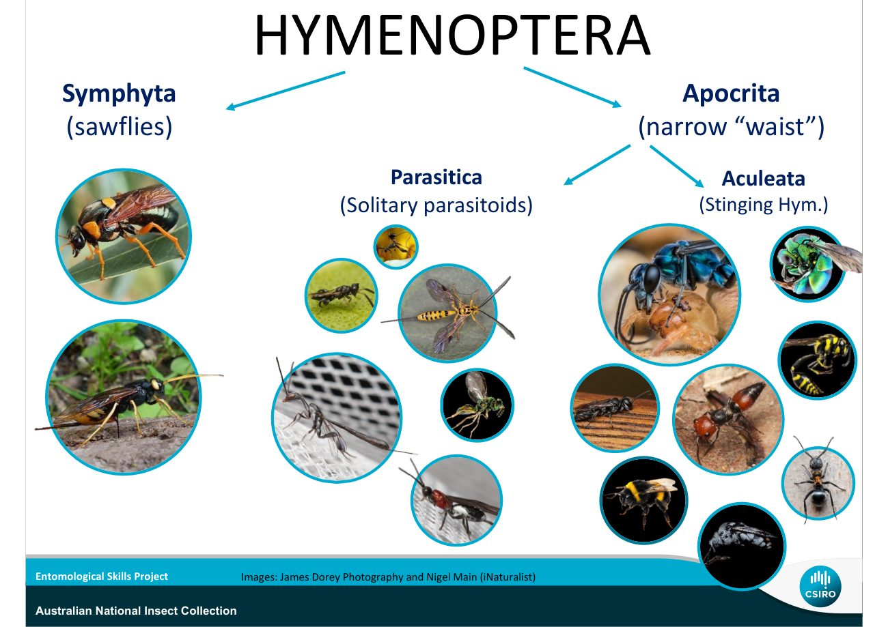](slides/slide-03.jpg)

Then Apocrita are divided into two the Parasitica which are solitary parasitoids mostly without a stinger usually and then Aculeata, which are the stinging Hymenoptera. Remember that the stinger is a modification of the ovipositor.

[↑ Slides](#slides) · [Course index](../../README.md)

## Slide 4

[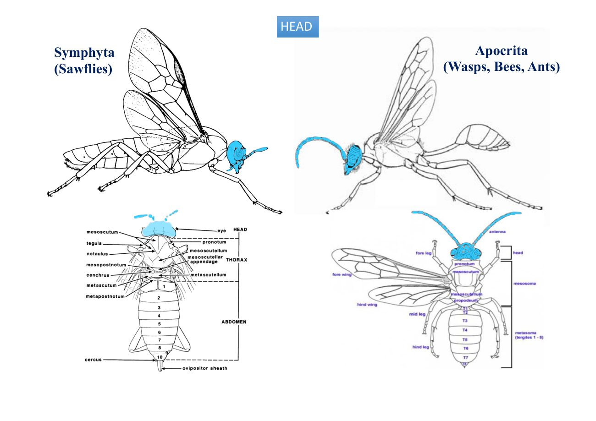](slides/slide-04.jpg)

All right, so first we're going to start with the head and run through the body. On the left you see Symphyta; on the right, Apocrita. So let's remember that Apocrita have head, mesosoma and [metasoma]; [Symphyta] have [head, thorax] and abdomen.

In Apocrita, The first segment of the abdomen is fused to the thorax, and that first segment is now called the propodeum, and the thorax plus propodeum is now called mesosoma, whereas the abdomen without the first segment is called the [metasoma]. In [Symphyta] we have [head, thorax] and abdomen like other insects. And so we have the head here.

[↑ Slides](#slides) · [Course index](../../README.md)

## Slide 5

[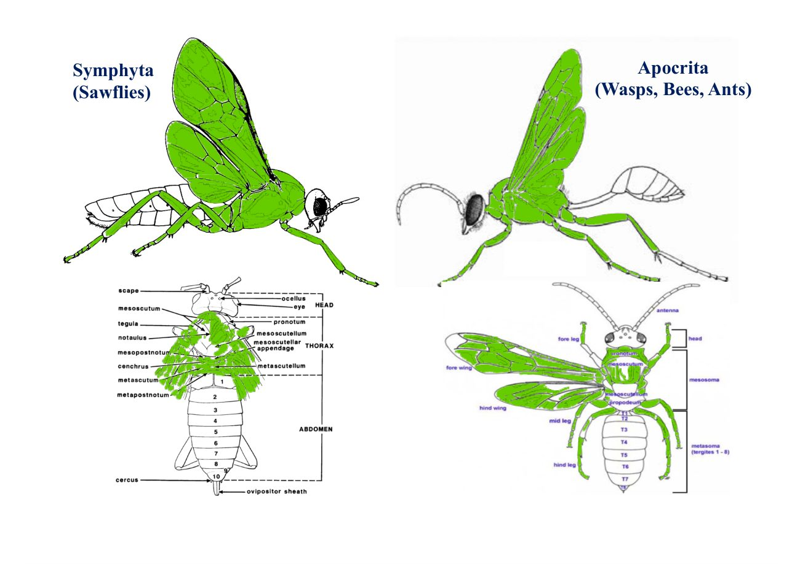](slides/slide-05.jpg)

We're highlighting the thorax and you see that with the head. We had the antennae with the thorax. We have the wings and the legs.

[↑ Slides](#slides) · [Course index](../../README.md)

## Slide 6

And then we have the abdomen where we also have the male genitalia in males, and the ovipositor or stinger in females.

[↑ Slides](#slides) · [Course index](../../README.md)

## Slide 7

[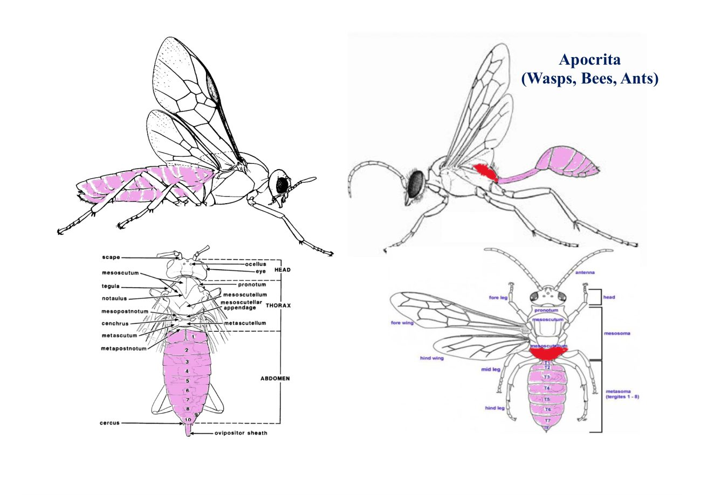](slides/slide-07.jpg)

And this red portion, as I was saying, is called propodeum, which used to be the first segment of the abdomen. But it is now fused to the thorax to create the mesosoma.

[↑ Slides](#slides) · [Course index](../../README.md)

## Slide 8

[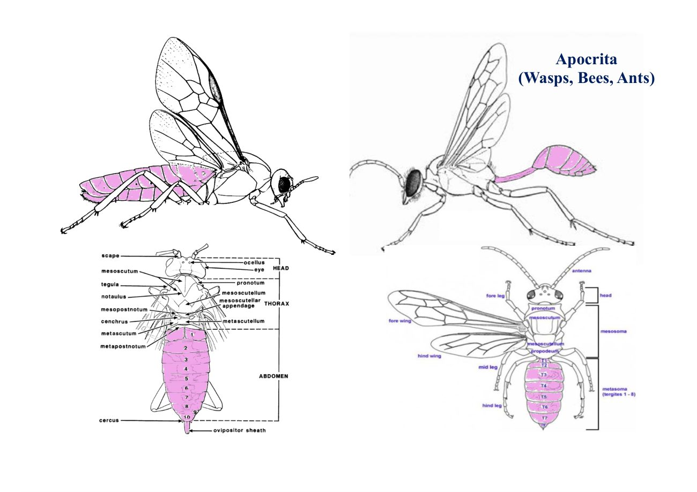](slides/slide-08.jpg)

*No separate passage can be confidently assigned to this slide. [Nearby discussion: slide 7](#slide-7).*

> **Editorial note:** This slide continues the body-region comparison; the transcript contains no distinct new passage here.

[↑ Slides](#slides) · [Course index](../../README.md)

## Slide 9

[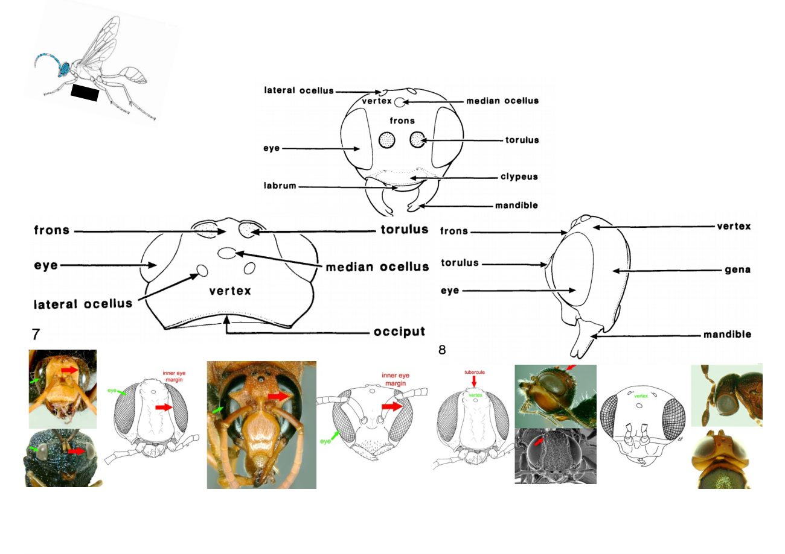](slides/slide-09.jpg)

All right, so if we start with the head, we are going to have certain features that are important. First of all, the [ocelli]—how close they are to each other, the shape of the eyes and the relationship to the antenna insertion or a single torulus the shape of the clypeus, the labrum and the mandible. So at the bottom, we have some examples.

For example, on the very left, you have, eye margin. That is not emarginate. So it's quote unquote, a normal eye margin, and sometimes the eyes can be really far apart from the toruli or really close by.

In other cases, the toruli can be placed right at the bottom of the margin of the eyes really close to clypeus or in the middle in between the eyes. Also, you can have emarginate eyes, as in the picture. The second picture from left to right.

And that is an interesting feature that you're going to see to ID certain families. You can also find, tubercles on the Vertex or different shapes of the Vertex, which is the very tip of the head looking from above. So that's going to be also used to identify different families.

[↑ Slides](#slides) · [Course index](../../README.md)

## Slide 10

[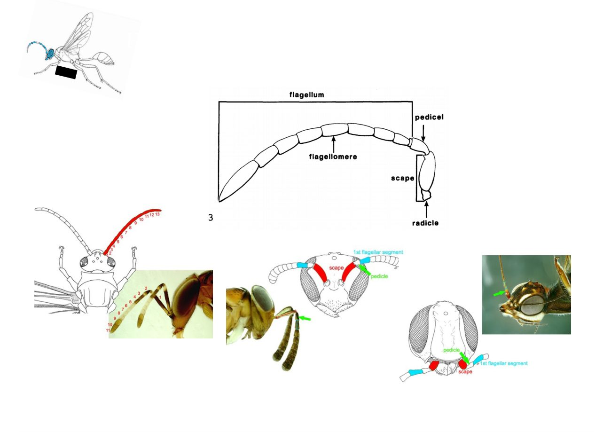](slides/slide-10.jpg)

The antenna is very important, and it's important to be able to tell apart the main parts the main regions of the antenna. So the first really tiny [basal part] is called the radicle. And then after that, there's a segment that is usually longer, not always longer, a thick, a different shape.

And it's called scape. The segment right after the scape is called the pedicel, and then what? Everything else after the [pedicel] is the flagellum, each of the segments forming the flagellum are called flagellomeres.

So sometimes you will see, in your keys for identifying families that the for example, the scape longer than or third flagellomere as long as the scape things like that. So the relationship between the segments and also the number of segments is going to tell you about the family or the genus that you're looking at.

[↑ Slides](#slides) · [Course index](../../README.md)

## Slide 11

[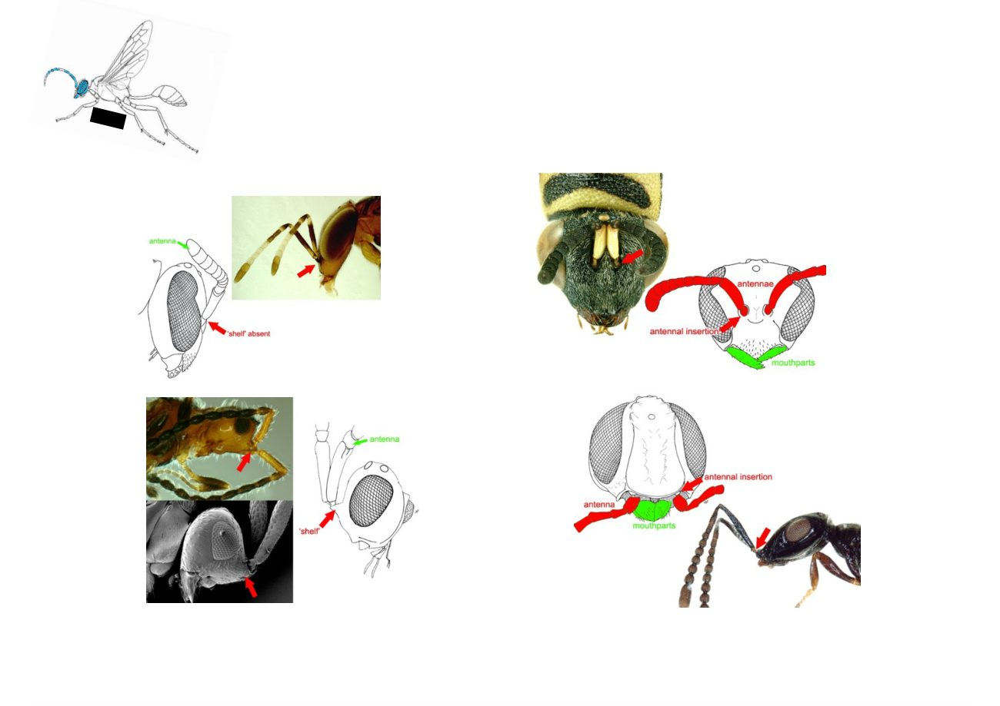](slides/slide-11.jpg)

Now. Also in the head. What kind of antenna insertion is the antenna inserted in just at the same plane of the frons?

Or is it inserted in sort of a shelf, as you see at the bottom left? Some families are very characteristic for having this shelf, and that's going to rule out a lot of other families. Also are the antenna insertions, as I said before, So as you see on the right, are they inserted far away from the mouth parts or really close to the mouth parts?

That's also going to help you rule out a bunch of families.

[↑ Slides](#slides) · [Course index](../../README.md)

## Slide 12

[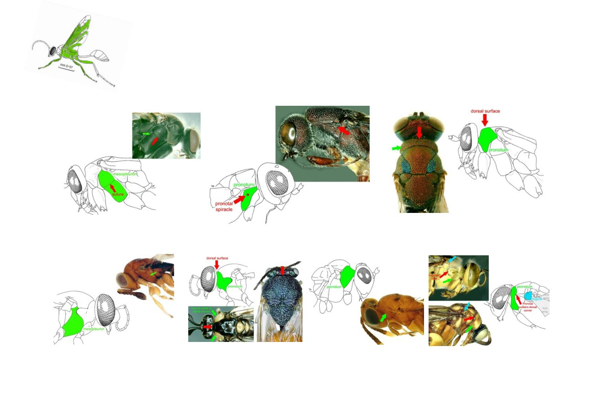](slides/slide-12.jpg)

Now let's go to the [mesosoma]. This can be a little bit more complex because it has a lot of building blocks or segments or plates that are going to be important. One of them is the mesopleuron, and this first picture that you see on the top left is the [mesopleuron] of the family Pompilidae.

This is completely unique to this family. If you have a specimen with a mesopleuron that has a suture that is completely crossing it horizontally, then it's a pompilid, and the mesopleuron needs to be that shape, kind of like an oval shaped OK. Now, another thing is to be able to recognise the pronotum, and that can be really tricky.

The pronotum is the first segment of the mesosoma after the head, and many times, as in the second picture of from the top, in the middle picture at the top, the pronotum is a little bit hidden under another segment. So you need to be able to look at the head and go backwards counting to see where the first segment is, and then you find the pronotum and then it's going to ask, the keys are going to ask. [Incomplete question omitted.] Is the dorsal surface long, or is it U shaped?

So, for example, for the family [Vespidae], or social wasps, the dorsal surface or the posterior surface of the pronotum is going to form a U shape. So I'm going to show you that later and you go here, you can see other examples of what the pronotum can look like. So pronotum very important.

It has to, it is the first segment after the head, and sometimes it's very hidden. So be careful. When this can happen.

> **Editorial note:** Strictly, the pronotum is the dorsal plate of the prothorax, not the entire first segment.

[↑ Slides](#slides) · [Course index](../../README.md)

## Slide 13

[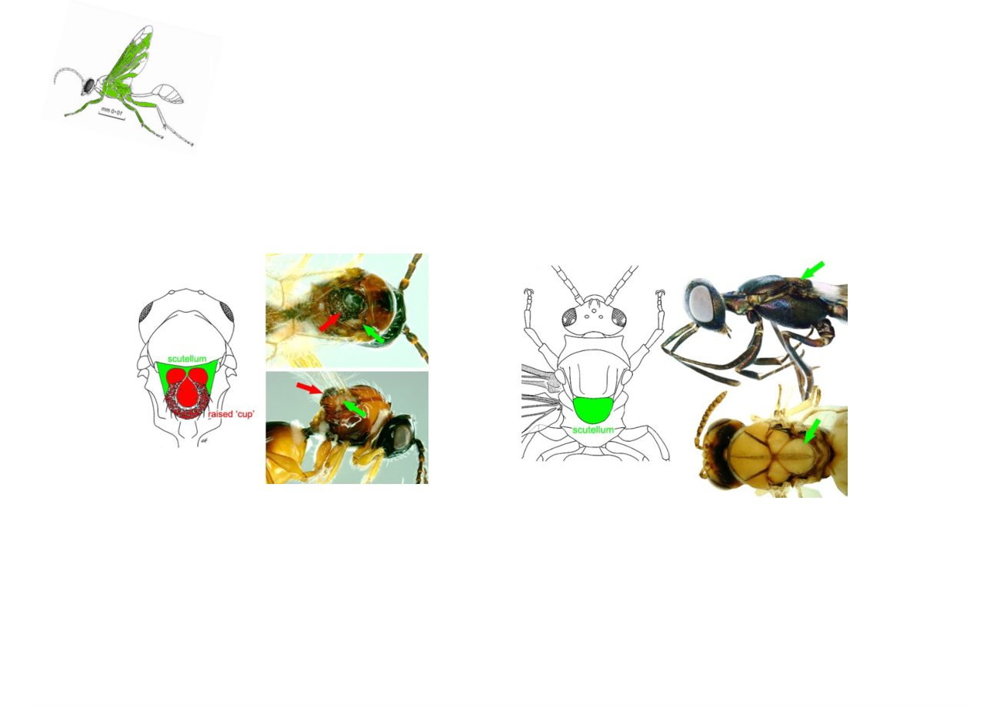](slides/slide-13.jpg)

Now, in the dorsal part there is this region called [the scutellum]. It's right after the pronotum. And sometimes there is a raised region here, OK?

And also you're going to look at different shapes. Different, sculpture found in this. OK, so, be careful also to be able to locate this.

So it's the pronotum. Then there's another segment, and after that, is this usually triangle shape kind of.

> **Editorial note:** The scutellum lies behind the mesoscutum; the source’s “right after the pronotum” is imprecise.

[↑ Slides](#slides) · [Course index](../../README.md)

## Slide 14

[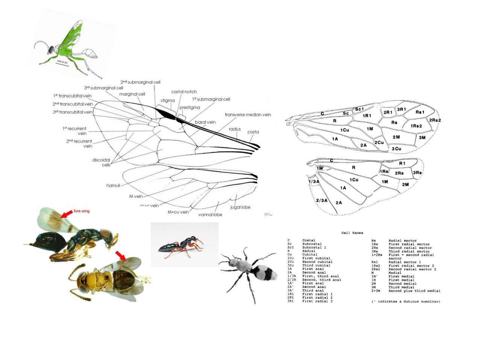](slides/slide-14.jpg)

Now the wings wing venation is very useful, but can be very tricky and confusing because there are very, many ways to call veins and cells. There are different ways to name them different nomenclature. The important part is to, be able to kind of compare your specimen to your key because usually you're going to have figures showing what you're looking for.

So in the wings, they're going to ask you, how many cells does the specimen have? This is a good character. If it has more than seven close cells, it's one thing like in the middle top picture.

But for example, look at the bottom right. It has only one cell. Actually, there's no cells in that one because the coastal cell is absent.

There's no vein in the margin of the cell. So actually, there's no cells that are closed and closed by, veins. So closed cells are cells that are completely enclosed by veins.

They're going to ask you about the coastal cell. If this is present or absent, and you need to look and see if the margin has a vein and then another one at the bottom left, they're going to ask you about the shape of the marginal cell. And the marginal cell is the one that goes right next to the stigma.

So this darkened, large, darkened region that we see at the top left it's going to be the marginal cell is going to be right next to it. So number six, for example, in the middle in the top middle is going to be a marginal cell. You don't need to learn this by heart or memorise it.

You just need to be able to compare your specimen to the figures and kind of guide yourself about the shape.

[↑ Slides](#slides) · [Course index](../../README.md)

## Slide 15

[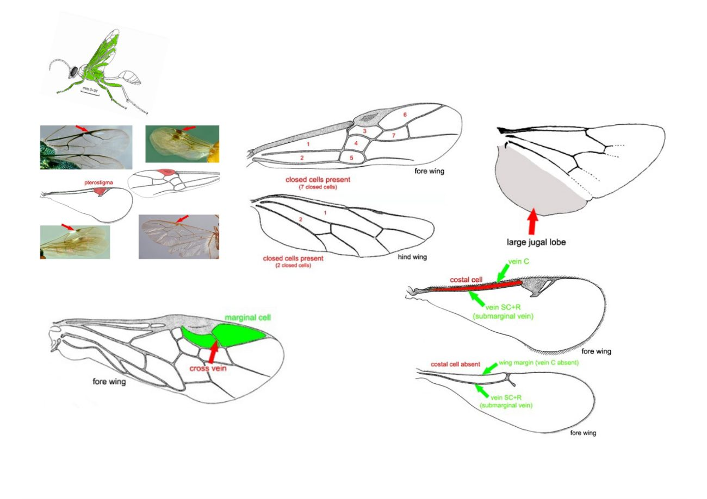](slides/slide-15.jpg)

And then the jugal lobe is one character that is important for some on the right top, right. If there is this lobe at the very end of the hind wing, then there's a jugal lobe. Some families do not have this lobe at all.

[↑ Slides](#slides) · [Course index](../../README.md)

## Slide 16

[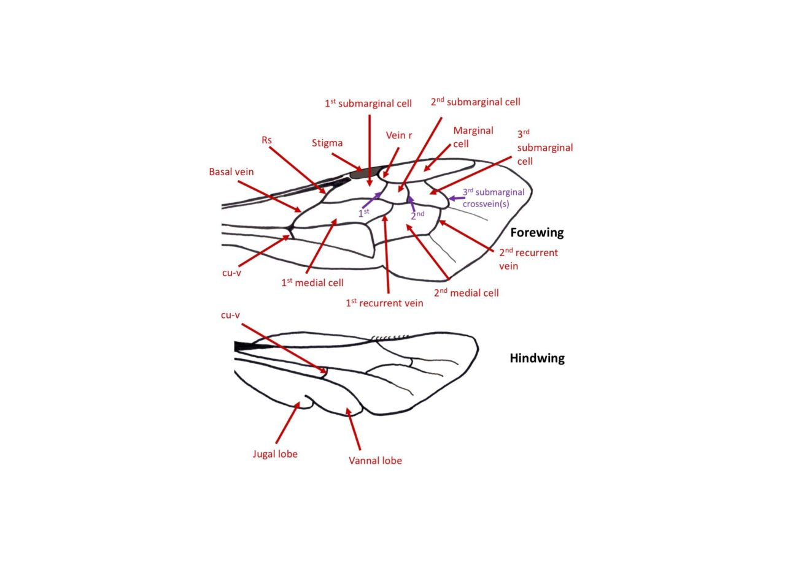](slides/slide-16.jpg)

So here is the nomenclature just for you to guide yourself and be able to, compare with your specimen. Like I said, you don't need to remember these names. I don't know them by heart.

I've memorised some of them that are used very commonly, but many times I just have to go back and check.

[↑ Slides](#slides) · [Course index](../../README.md)

## Slide 17

[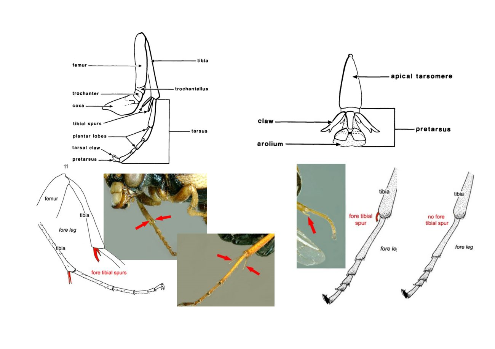](slides/slide-17.jpg)

Now the legs, the important part in the legs is to be able to tell where you have each of the segments. So [coxa, trochanter], femur, tibia. And sometimes between the trochanter and the femur, there's going to be a small segment called the trochantellus, and only some families have.

This is at the top left of the slide. Then on the right, we have the final [apical tarsomere]. Sometimes they say, the number of the tarsomere, but usually the [apical tarsomere].

And this one sometimes has spines or has a different shape. And the claw. In the pretarsus, the claw and the arolium also have different shapes.

One other thing at the bottom left that you're going to look for are the tibial spurs And so at the end of the tibia, how many spines or spurs are there and are they shaped like a comb? If they are shaped like a comb, usually it's an ant, but it can be other families. But, this can help tell apart lots of the families and then on the right, you see some examples where there are actually no tibial spurs.

OK, so this is usually looked at in the forelegs. But sometimes they ask you what is the, spur number on the fore-, middle and hind legs?

[↑ Slides](#slides) · [Course index](../../README.md)

## Slide 18

[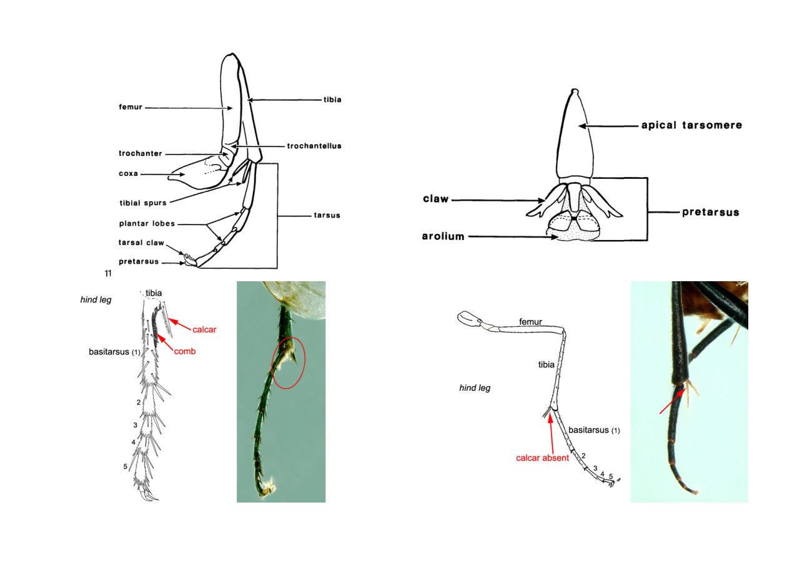](slides/slide-18.jpg)

And here is the example that I was telling you about. Sometimes this spur looks like a comb and the base, where it attaches to or, the it's equivalent on the tarsus looks like a comb. So the [calcar] and the comb this is very particular of ants.

They use it for grooming and on the right, you can see an example where there's no calcar and there's no comb.

[↑ Slides](#slides) · [Course index](../../README.md)

## Slide 19

[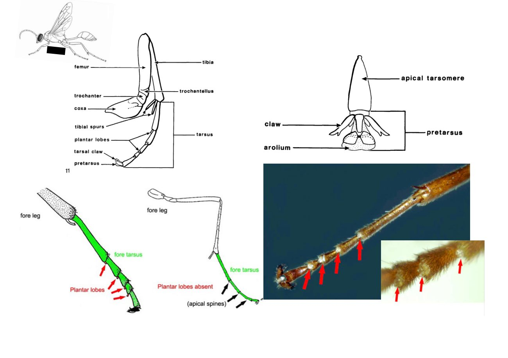](slides/slide-19.jpg)

Now, sometimes in the [tarsus—several words unclear], the [tarsomeres] are the parts that make up the tarsus, and sometimes they have lobes or not, and sometimes they have different lengths. So they're going to tell you first longer than second. These are things that you're going to look for.

Another one is the femur. The femur can have different shapes at the bottom left, you can see this hind femur with teeth. This is characteristic of a single family.

If you have a specimen with this that is really tiny, it is a [Chalcididae, as illustrated], but there can be other families. So look. Watch out for other characters.

[↑ Slides](#slides) · [Course index](../../README.md)

## Slide 20

[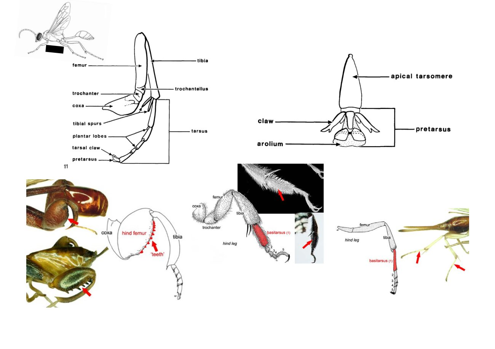](slides/slide-20.jpg)

And then, on the right. Like I said, the first [tarsomere, or basitarsus], which is the basal tarsomere after the [tibia], it's going to have different shapes or hairs or lengths compared to other tarsal segments. So this is it for hymenopteran morphology?

Always remember to compare your specimen with different diagrams from different families and use these characters for identification.

[↑ Slides](#slides) · [Course index](../../README.md)

## Source notice

this material has been reproduced and communicated to you by or on behalf of the Australian National University in accordance with Section 113 P of the Copyright Act 1968. The material in this communication may be subject to copyright under the act. Any further reproduction or communication of this material by you must be consistent with the provisions of the act. Do not reproduce this material. Do not remove this notice.

[← Previous lecture](../18-hymenoptera-part-1-classification-taxonomy/README.md) · [Course index](../../README.md) · [Next lecture →](../20-hymenoptera-part-3-evolution-behaviour/README.md)
