# Hymenoptera Part 4 - Biosecurity

[← Previous lecture](../20-hymenoptera-part-3-evolution-behaviour/README.md) · [Course index](../../README.md) · [Next lecture →](../22-coleoptera-part-1-diversity/README.md)

**Slides + cleaned transcript** · 12 slides

English transcript with fillers and repeated false starts removed. Technical terms are corrected using the slides and context. Bracketed wording marks reconstruction or uncertainty. Slide boundaries are inferred from content; the transcripts have no slide timestamps.

[Original transcript](original-transcript.txt) · [Text-only version](cleaned-transcript.md) · [Editing notes](../../EDITING-NOTES.md) · [Correction record](corrections.md)

[Searchable slide text](slide-text.md). Click a slide image to open it at full size.

## Slides

[1](#slide-1) · [2](#slide-2) · [3](#slide-3) · [4](#slide-4) · [5](#slide-5) · [6](#slide-6) · [7](#slide-7) · [8](#slide-8) · [9](#slide-9) · [10](#slide-10) · [11](#slide-11) · [12](#slide-12)

## Slide 1

[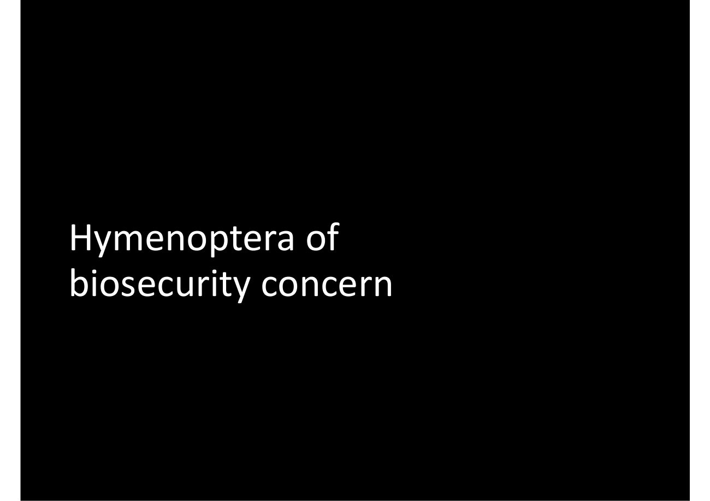](slides/slide-01.jpg)

In this video, we're going to talk about [Hymenoptera] of biosecurity concern.

[↑ Slides](#slides) · [Course index](../../README.md)

## Slide 2

[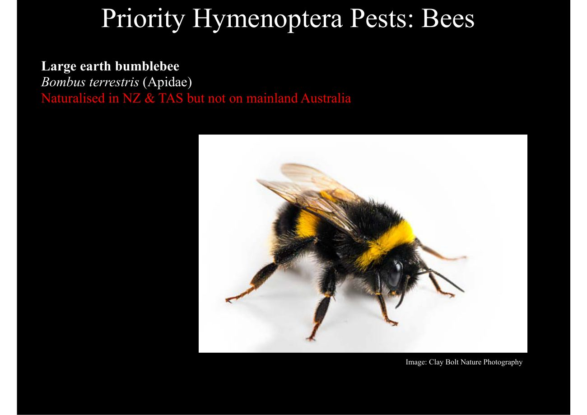](slides/slide-02.jpg)

So let's start with the introduced bees. Bumble bees are not native to Australia and the species Bombus terrestris has been naturalised in New Zealand and Tasmania but is not found in mainland Australia. If these bumblebees were to establish in Australia, they could increase the spread of many weed species and compete with other buzz pollinators for floral resources.

Bumble bees are buzz pollinator. That means that they get pollen from flowers by buzzing, and we have some native pollinators that do that, such as blue banded bees so they could compete with them. And they could also impact the natural environment by competing with other species like nectar gathering birds.

[↑ Slides](#slides) · [Course index](../../README.md)

## Slide 3

[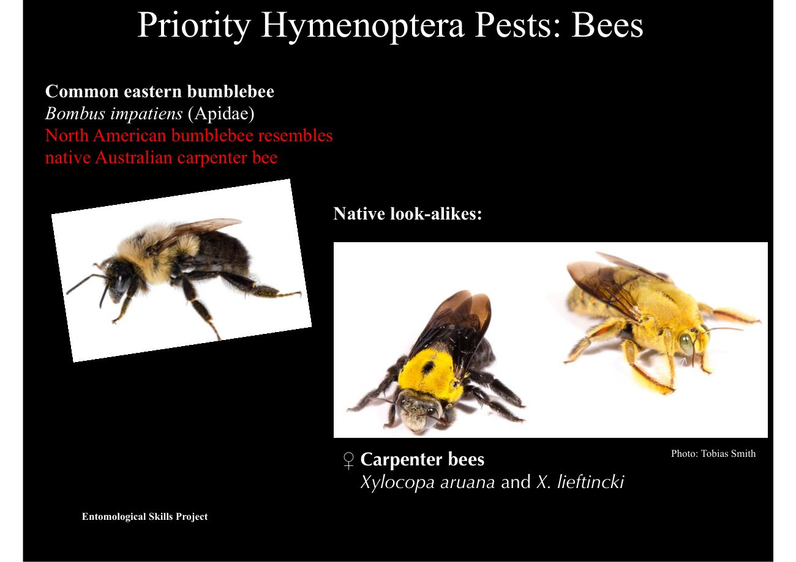](slides/slide-03.jpg)

Bumble bees can look like some native species. So, for example, the North American bumble Bee, the Bombus impatiens looks really similar to Xylocopa [carpenter bees]. Although B.

Impatiens is not in Australia yet.

[↑ Slides](#slides) · [Course index](../../README.md)

## Slide 4

[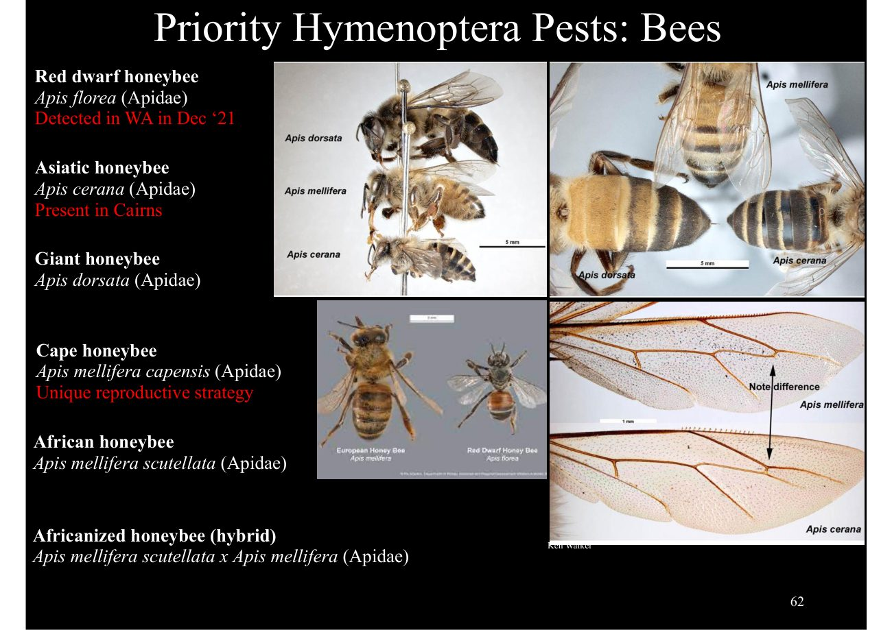](slides/slide-04.jpg)

There are a number of other bee species of concern. And these are especially in the genus Apis, which is the same genus as the European honeybee. If these exotic bees were to come into Australia, they could bring mites or other pests and diseases, and they could damage our healthy colony colonies.

They are also very poor producing honey, and some are aggressive, and they rob honey from European honey bee nests and take over their hives. So here you can see some images showing the main differences between the species, their sizes, coloration and some of the wing venation within this genus apis the species Apis florea. The first that we're going to talk about was detected in W A at the end of 2021.

They are smaller than European honeybees. They have a red, brown, white and black coloration, and their nests are a single comb, usually less than 25 centimetres across. And they can carry exotic mites or diseases and rob honey now Apis cerana has been present in North Australia for a while, and they originated in Indonesia.

They're now established in northern Queensland around Cairns, and they look similar to honeybees, but they're smaller to European honeybees, but they're smaller, and they have more pronounced black and yellow stripes. These species can also be infested with Varroa mites or other bee diseases that could harm Australia's existing honeybee colonies or even native bees. Next up, we have the giant honeybees Apis dorsata.

They are much larger than European honeybees, and they originated in Southeast Asia, and thankfully, they prefer tropical climates. The next few are also subspecies of Apis mellifera, so the species of the European honey bee. So first cape honey bees are found only in South Africa.

They look very similar as European honeybees, but they're not good at producing honey and also can take over the hives of other bees. African honeybees, originated in sub Saharan Africa, looks similar as well and are highly aggressive. They can attack animals or humans if nests are disturbed.

And finally, the famous Africanized honeybee, which are actually a hybrid between the European honey bee and the African honey bee can look very similar as well, and the same. They can be very aggressive. And they could, if they breed with native honey bees, they can make our bees more aggressive.

> **Editorial note:** Biosecurity occurrence and detection statements describe the lecture’s time frame, not a current pest-status check. Australia’s European honeybees are introduced; “native honey bees” here appears to mean established managed honeybees.

[↑ Slides](#slides) · [Course index](../../README.md)

## Slide 5

[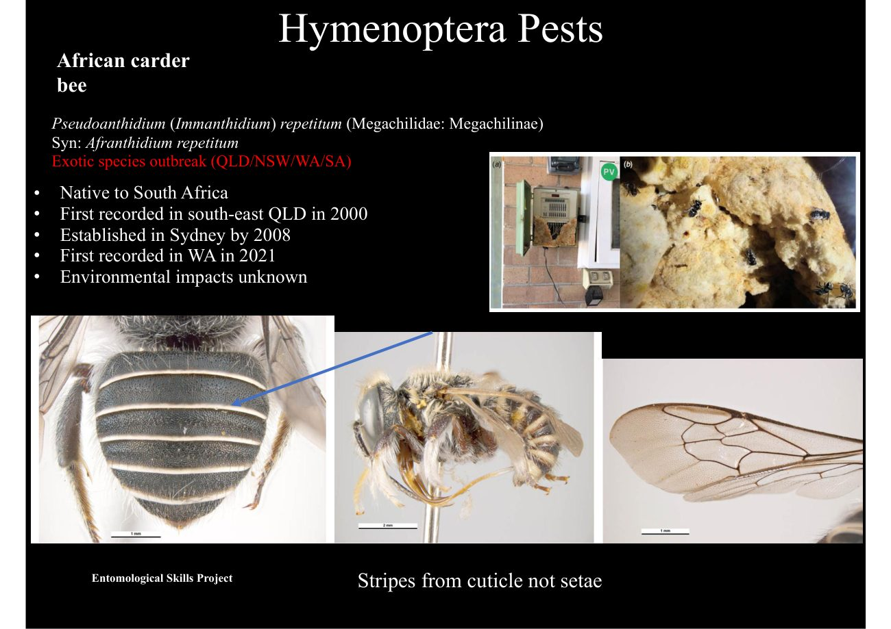](slides/slide-05.jpg)

But there are some other bee families, like Megachilidae, that are included in the category of non native bees. The African carder bee has not yet known to cause any environmental impacts, but obviously it could compete for resources from native bees. So here you can see on the right top, right the nest they make.

We can also damage, structures. And there are some morphological characteristics to tell them. Apart from natives.

[↑ Slides](#slides) · [Course index](../../README.md)

## Slide 6

[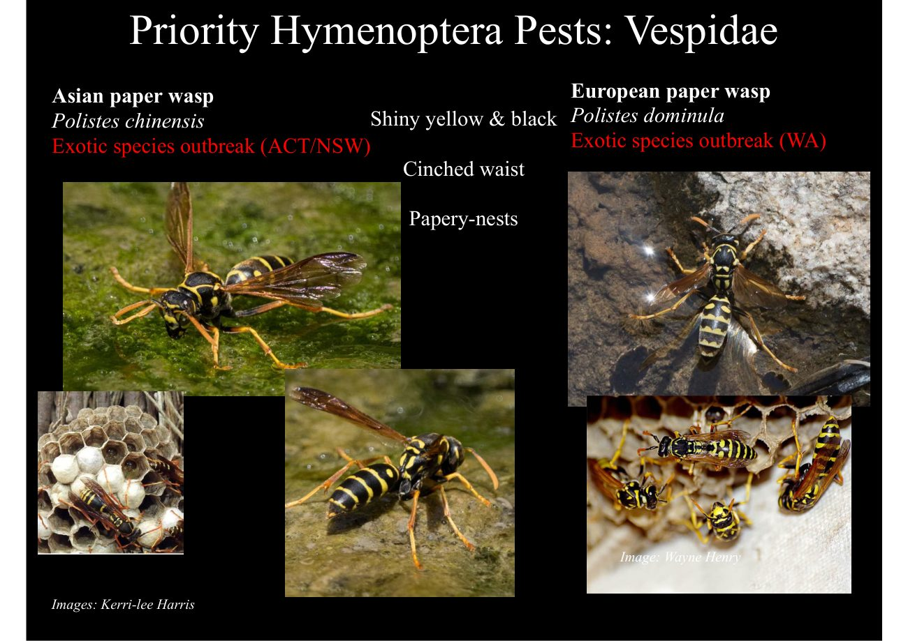](slides/slide-06.jpg)

Now moving on to the family [Vespidae], the social wasp family. In this family, we have the Asian paper WASP and European paper WASP. First, they actually look pretty similar to each other and are in the same genus Polistes.

The Asian paper WASP is native to Eastern Asia, including parts of Japan and China, and it's been introduced to New Zealand, where it's widespread on the North Island in Australia is known from New South Wales and the AC T. The concern is that it can be, public nuisance and have potential environmental impacts. Now, the European paper WASP on the right, sometimes called yellow paper, WASP is an introduced species as well, and it was first discovered in 1986.

Now found everywhere in Australia, the nest is umbrella shaped and has open cells that can be seen from below. And they are constructed in protected locations. So the same, this can be a nuisance to humans.

These species can compete with natives and cause harm with the stings, and they can be more aggressive than native paper wasps.

> **Editorial note:** The transcript’s “everywhere in Australia” is broader than the slide’s WA outbreak label. Distribution claims are retained as lecture content, not verified current guidance.

[↑ Slides](#slides) · [Course index](../../README.md)

## Slide 7

[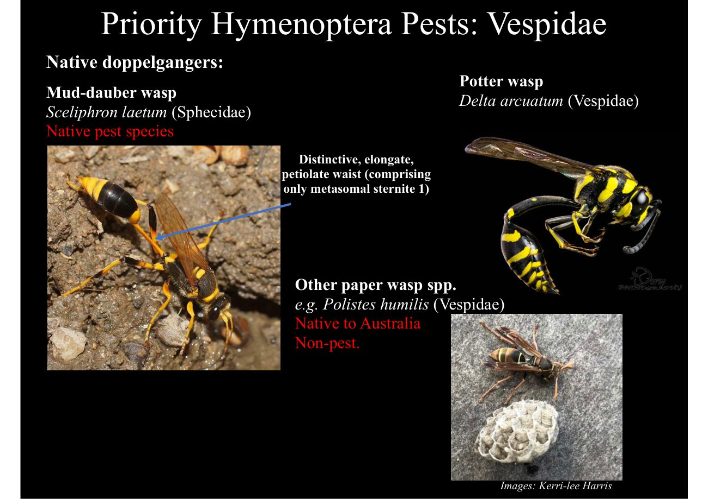](slides/slide-07.jpg)

But we have some native species that actually looks similar to these introduced species, mainly in terms of coloration. So, for example, on the top left, we see mud-dauber wasp, and they can be told apart by the kind of nest they nest in mud. And they have an elongate and petiolate first sternite of the metasoma, which is actually made up only of the sternite, in the first segment of the metasoma and these species belong to [Sphecidae], which is actually part of [Apoidea] and so there are many more other characters to tell it.

Apart from [Vespidae] for example, the posterior margin of the pronotum is not U shaped as in on the top, right? The Potter wasp Delta arcuatum is actually a [vespid] and can look alike, but it has the long waist. So the first elongate metasomal segment and at the bottom right.

You can see the native paper wasp, and you can tell this one apart by mainly by colour coloration. So they have different coloration that these wasps are much less aggressive.

[↑ Slides](#slides) · [Course index](../../README.md)

## Slide 8

[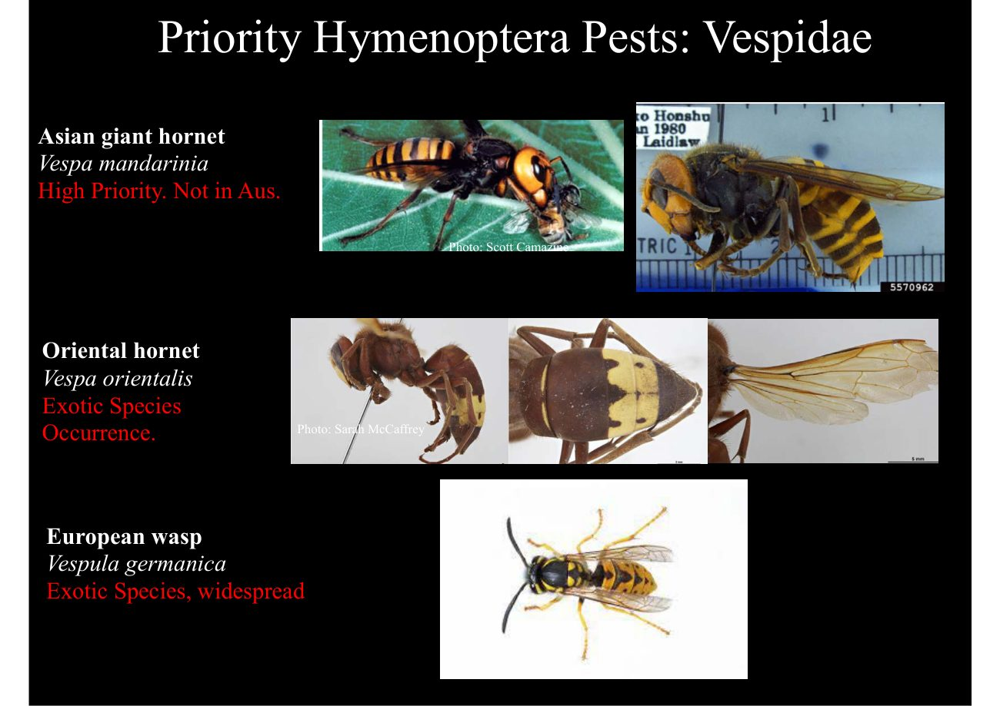](slides/slide-08.jpg)

Some other vespids of concern are in the genus Vespa, So first Asian giant hornets, which were famous in the news recently, and the subspecies Japanese giant Hornet Vespa mandarinia japonica are the world's largest hornet. There are about 38 millimetres in length and a wingspan of 76 millimetres, and they can have a direct impact on honeybee colonies because they kill honeybees and their brood to feed themselves and their brood. The Oriental Hornet Vespa orientalis is another Vespa species of concern, but it's not yet in Australia, so, and none of these two are actually yet in Australia and in general the same.

They're all predators of honeybees. They can attack honey bee guards Robb, the hive of the brood in order to feed themselves. And another concern is that the stings, are used to kill prey but also defend their nest so they could attack humans as well.

And the venom contains a large amount of, components that could cause allergies. Also, hornets, unlike honeybees, can, they don't die after stinging and so they can sting multiple times. Now, in the genus Vespula, the European wasp is widespread, and you've probably seen it around, and they are attracted to food and drink and can interfere with human, outdoor life.

Unlike honeybees again, they can sting repeatedly. The nests are pretty large, and they can be a problem to fruit growers, beekeepers and food processors in the field.

[↑ Slides](#slides) · [Course index](../../README.md)

## Slide 9

[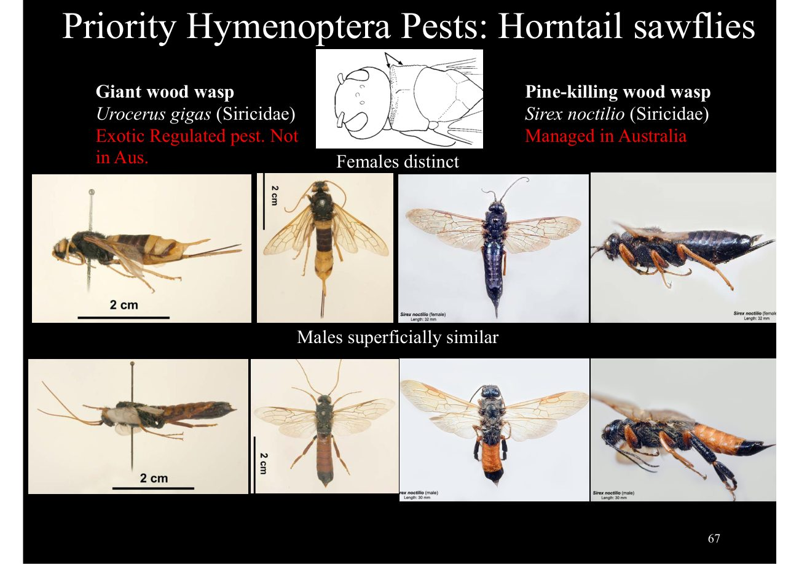](slides/slide-09.jpg)

But not only [apocritans are] pests. There are some symphytans that have been known to cause damage due to their xylophagous feeding mode. So, for example, here we have the giant wood wasp, which is exotic.

It's such a exotic pest not found in Australia, but there is actually a species of wood wasp managed in Australia on the right, that is the pine killing wood wasp. It is native to Eurasia and Morocco, and they were accidentally introduced to the southern Hemisphere, including Australia, New Zealand, South Africa and South America, and they've also recently arrived in North America. It's the most damaging invasive pine plantation pest in the Southern Hemisphere.

It kills millions of trees, and so it's been present here in Tasmania since 1952 and mainland Australia since the sixties. You can tell them apart from other so because they have this kind of shoulder pads, pointed shoulder pads showing in the top picture.

[↑ Slides](#slides) · [Course index](../../README.md)

## Slide 10

[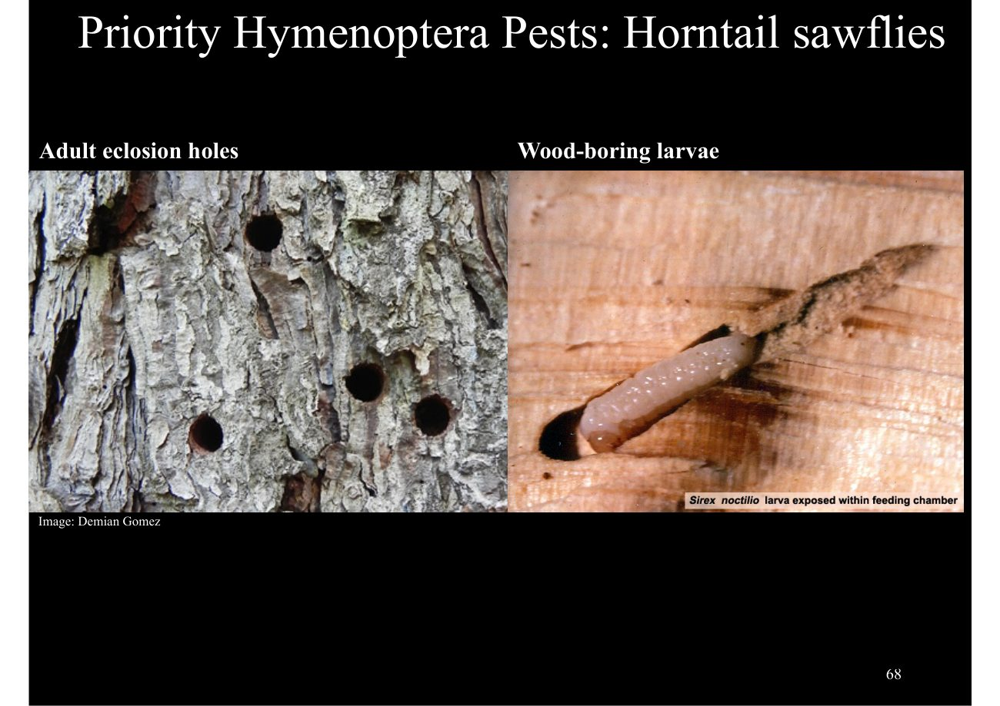](slides/slide-10.jpg)

And here's what the damage and the larvae look like, so they produce a lot of damage to the tree trunks.

[↑ Slides](#slides) · [Course index](../../README.md)

## Slide 11

[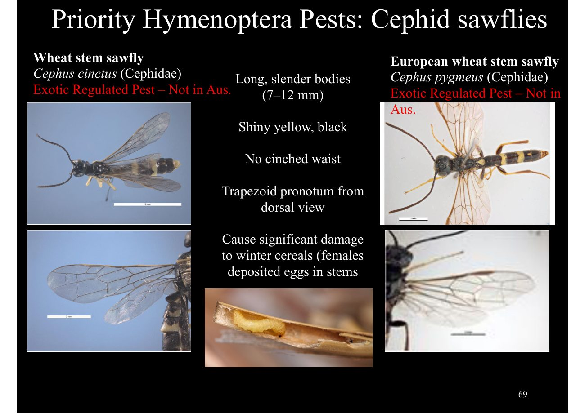](slides/slide-11.jpg)

Another group of sawflies are the family [Cephidae], and they're also of concern. But thankfully, they're not yet in Australia, and they can cause damage to winter cereals because their larvae feed on the plant tissue. Here, you can see in the middle how these damage looks like.

[↑ Slides](#slides) · [Course index](../../README.md)

## Slide 12

[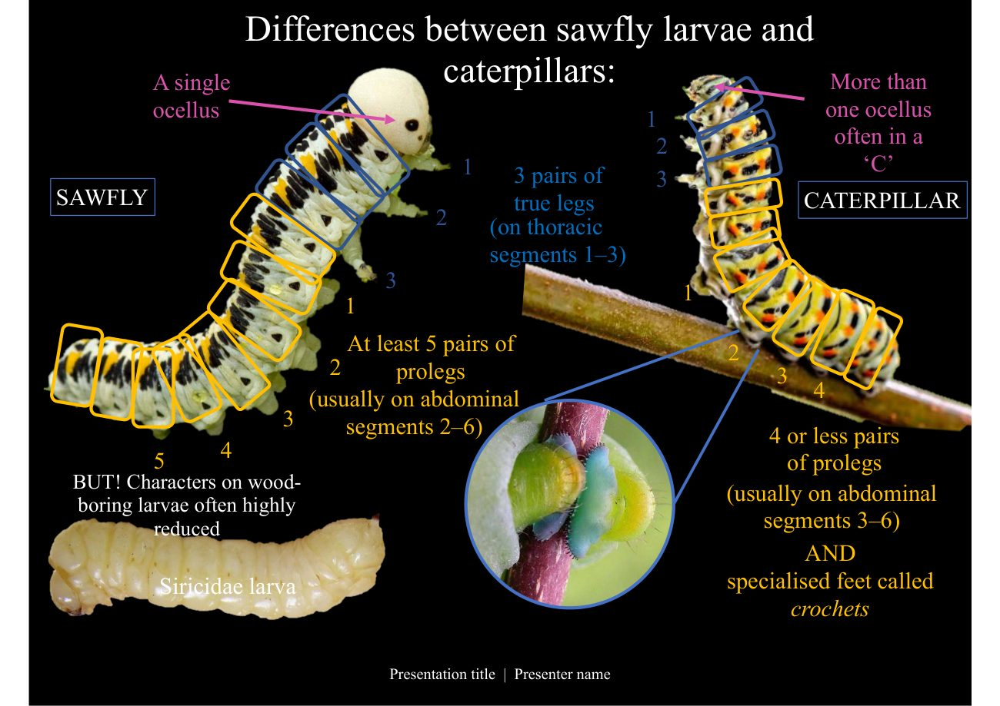](slides/slide-12.jpg)

And finally speaking of sawflies, their larvae can be tricky to tell, apart from lepidoptera larvae, so here are some characters to tell them apart. First of all, we have three pairs of true legs, but the sawflies also do and they are on thoracic segments. 1–3 and sawflies have at least five pairs of prolegs, usually on abdominal segments 2 to 6. And caterpillars have four or less pairs of prolegs, So if there's five, it's usually a sawfly but also, caterpillars have specialised feet called crochets, which you can see here now.

Sawflies have a single ocellus. That's another way to tell them apart. And caterpillars have more than one ocellus, and they're often arranged in a C shape, so this is easy to see in most larvae.

But wood-boring larvae are often have a very reduced morphology that you can see here, and this can be more difficult to tell apart. So this ends our presentation on Hymenoptera of biosecurity concern.

> **Editorial note:** The slide counts abdominal prolegs separately from the terminal anal pair. Many caterpillars have four abdominal pairs plus an anal pair, so “five means sawfly” is not a reliable standalone rule.

[↑ Slides](#slides) · [Course index](../../README.md)

## Source notice

this material has been reproduced and communicated to you by or on behalf of the Australian National University in accordance with Section 113 P of the Copyright Act 1968. The material in this communication may be subject to copyright under the act. Any further reproduction or communication of this material by you must be consistent with the provisions of the act. Do not reproduce this material. Do not remove this notice

[← Previous lecture](../20-hymenoptera-part-3-evolution-behaviour/README.md) · [Course index](../../README.md) · [Next lecture →](../22-coleoptera-part-1-diversity/README.md)
