# Coleoptera Part 1 - Diversity

[← Previous lecture](../21-hymenoptera-part-4-biosecurity/README.md) · [Course index](../../README.md) · [Next lecture →](../23-coleoptera-part-2-ecology-natural-history/README.md)

**Slides + cleaned transcript** · 42 slides

English transcript with fillers and repeated false starts removed. Technical terms are corrected using the slides and context. Bracketed wording marks reconstruction or uncertainty. Slide boundaries are inferred from content; the transcripts have no slide timestamps.

[Original transcript](original-transcript.txt) · [Text-only version](cleaned-transcript.md) · [Editing notes](../../EDITING-NOTES.md) · [Correction record](corrections.md)

[Searchable slide text](slide-text.md). Click a slide image to open it at full size.

## Slides

[1](#slide-1) · [2](#slide-2) · [3](#slide-3) · [4](#slide-4) · [5](#slide-5) · [6](#slide-6) · [7](#slide-7) · [8](#slide-8) · [9](#slide-9) · [10](#slide-10) · [11](#slide-11) · [12](#slide-12) · [13](#slide-13) · [14](#slide-14) · [15](#slide-15) · [16](#slide-16) · [17](#slide-17) · [18](#slide-18) · [19](#slide-19) · [20](#slide-20) · [21](#slide-21) · [22](#slide-22) · [23](#slide-23) · [24](#slide-24) · [25](#slide-25) · [26](#slide-26) · [27](#slide-27) · [28](#slide-28) · [29](#slide-29) · [30](#slide-30) · [31](#slide-31) · [32](#slide-32) · [33](#slide-33) · [34](#slide-34) · [35](#slide-35) · [36](#slide-36) · [37](#slide-37) · [38](#slide-38) · [39](#slide-39) · [40](#slide-40) · [41](#slide-41) · [42](#slide-42)

## Slide 1

[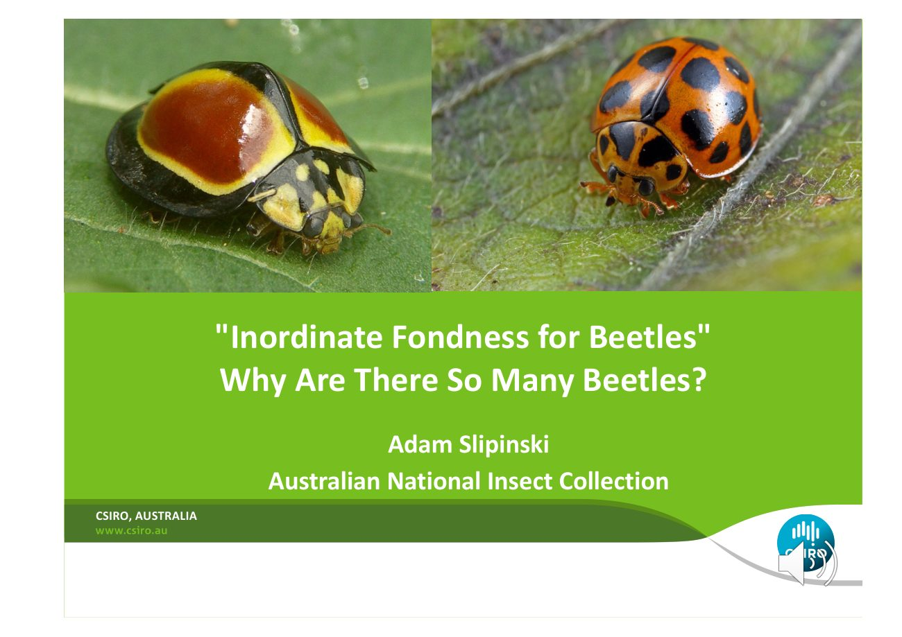](slides/slide-01.jpg)

Welcome to the beetle lectures. Welcome to diversity of beetles and we are trying to explain how and why there are so many beetles out there. My name is Adam Slipinski and I work as a curator and research scientist of the entomology in Australian National Insect Collection.

Across the road.

[↑ Slides](#slides) · [Course index](../../README.md)

## Slide 2

[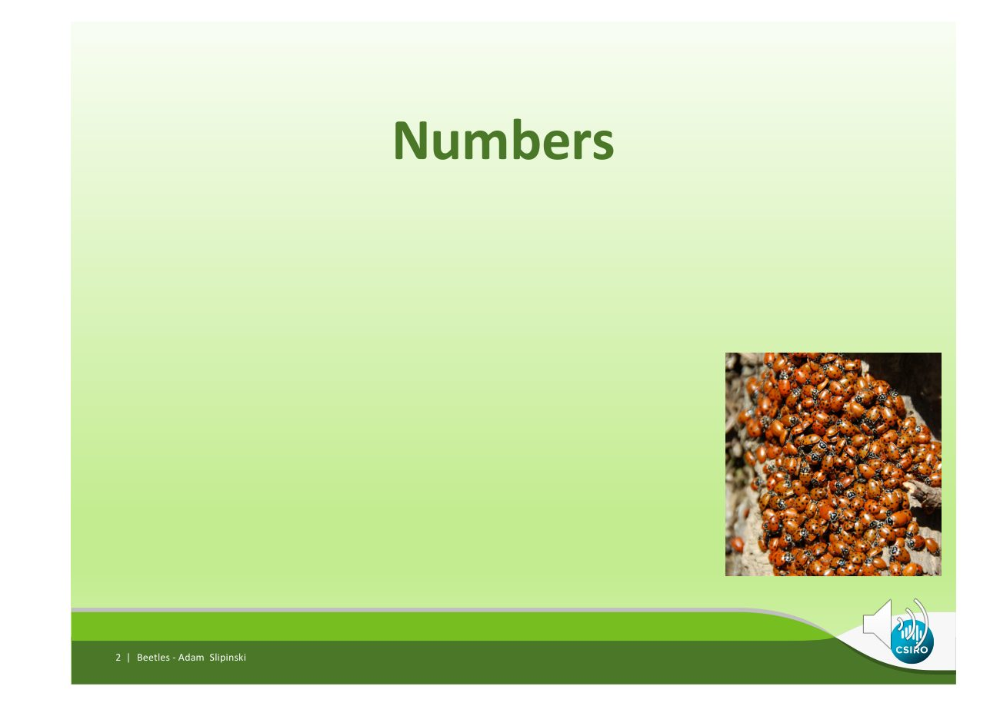](slides/slide-02.jpg)

When we talk about the beetles, we wonder, how to measure the diversity of beetles. Should we measure them by numbers? Should we measure them by, how diverse they are and what do they perform in the environment?

[↑ Slides](#slides) · [Course index](../../README.md)

## Slide 3

[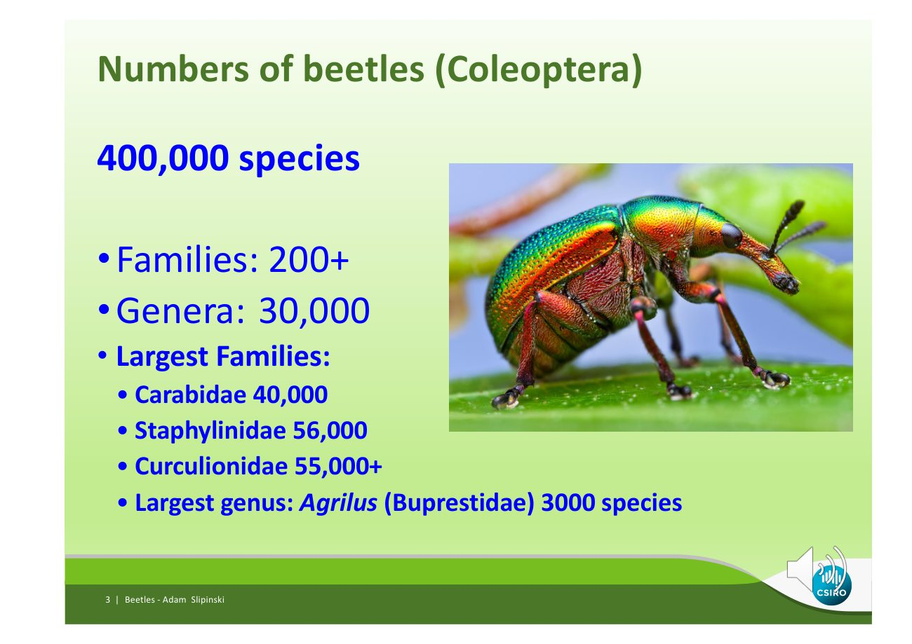](slides/slide-03.jpg)

If we're talking about the numbers of beetles, definitely. This is the largest group of, multi cell organisms. Definitely the largest group of insects.

We are talking about 400,000 described species, with the numbers of undescribed species being estimated from 1 million to 10, even more millions. Obviously, all those estimations are, based on some assumptions that we cannot really verify. But there is many beetles out there.

Definitely. We are talking about 200 plus different families, 30,000 genera And some of those, numbers of the described species within the families are staggering. We have about 40,000 carabid beetles.

We have, maybe about 60,000 of [Staphylinidae] and about the same number of weevils. And that's the biggest group that is really understudied. We don't know how many species are really out there.

[↑ Slides](#slides) · [Course index](../../README.md)

## Slide 4

[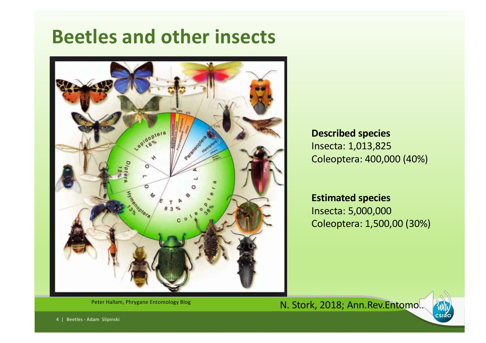](slides/slide-04.jpg)

When we compare the beetles to other insect orders with those 400,000, maybe half a million of the described species. That's about 40 50% of all the insects. I think the conservative estimates by Nigel Stork saying that there may be 5 million of the species of insects.

Then the number of beetles will go down to maybe about 30% of the all insects. That's probably due to the number of really small wasps that we don't know and what they say if every insect has got at least one wasp parasite and that's probably true, So there is probably understudied number of wasps out there.

[↑ Slides](#slides) · [Course index](../../README.md)

## Slide 5

[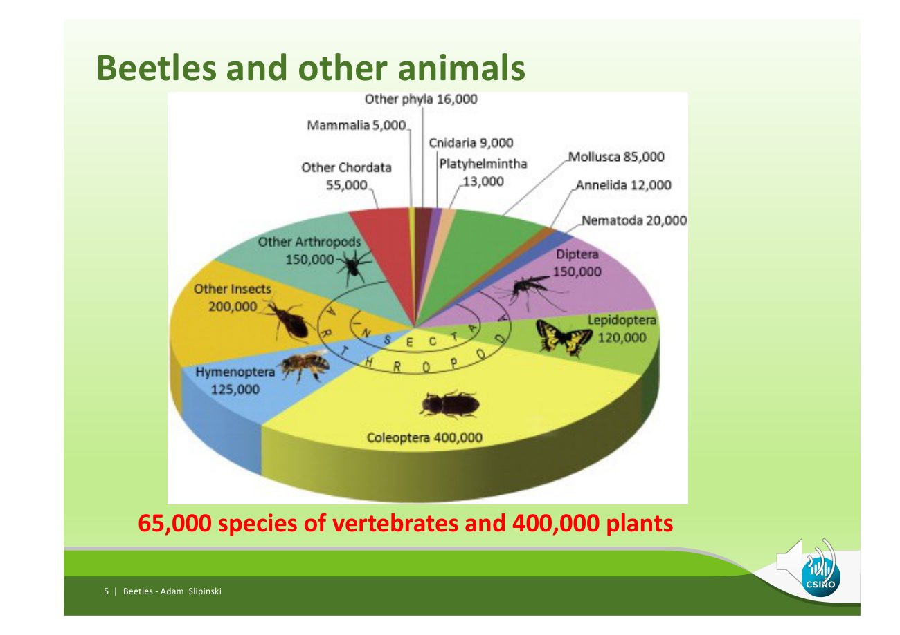](slides/slide-05.jpg)

When you look at the beetles comparing to other animals, this is how we look like we look about 400,000, half a million, and there is very little of the other vertebrates. Even the whole Chordata is about 55,000 species, all the vertebrates and mammals. 5000. And there's only less than half a million, plant species.

So that's the that is the diversity of beetles we are talking about.

[↑ Slides](#slides) · [Course index](../../README.md)

## Slide 6

[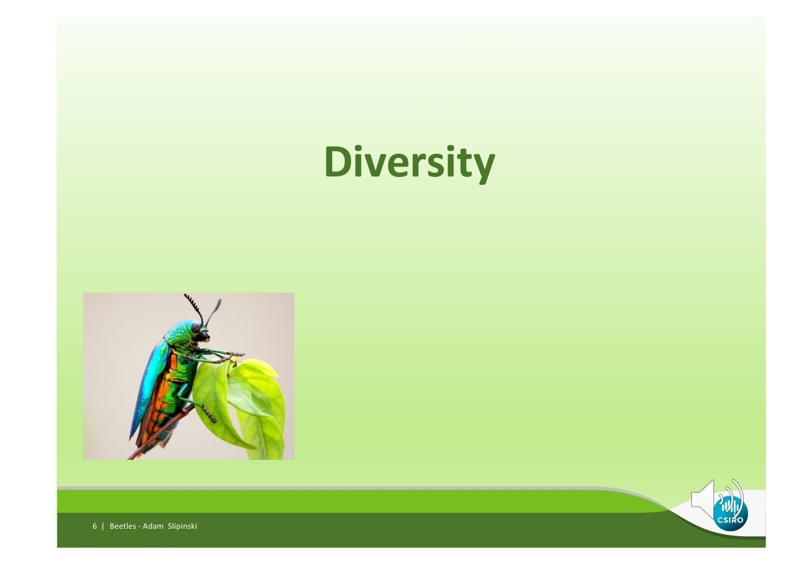](slides/slide-06.jpg)

When you look at the diversity of morphology of beetles, we have to start from this that the beetles are holometabolous insects.

[↑ Slides](#slides) · [Course index](../../README.md)

## Slide 7

[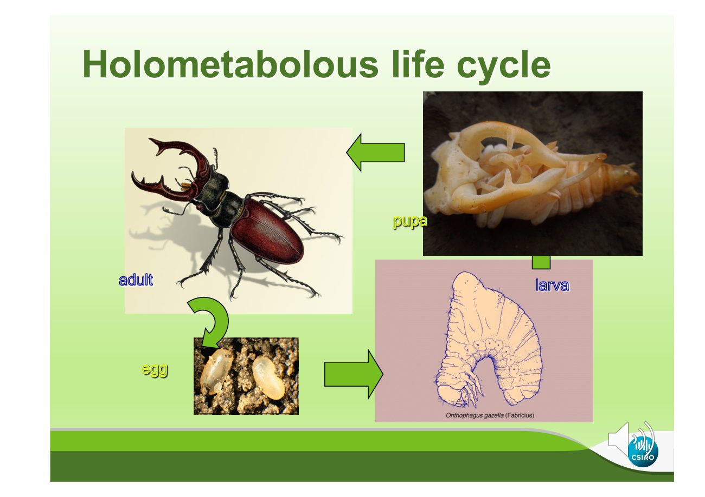](slides/slide-07.jpg)

Holometabolous, as are the insects that they have. They lay eggs, then they have a larva and then they have a pupa. And that pupa basically is the stage, which makes this wonder when the larva were very different.

Morphologically thing is turning into the beetle, and that's important, to say why they are so, diverse. If we take the beetles, we have the larvae and adults, which are very different. They have very different, evolutionary pressures.

They do different things. The adult can be herbivorous or can be carnivorous. The larva may be living in water doing completely different things, so the larvae and adults are not feeding together.

They are spatially and temporarily very far apart, which gives them enormous opportunity. Because the larvae can explore completely different niches than adults and adults very often are just the vehicles of the genetics. They very often just emerge.

They fly into, an environment, finding the host, finding the mate and they actually mate. And they lay [eggs] and the life cycles begins. And that larval life cycle can last for years.

There are known cases that it lasts for eight, nine or ten years. One adult can live maybe hours or weeks or days. So that is, this.

This holometabolism is an important element in all the holometabolous, insects and beetles in particular.

[↑ Slides](#slides) · [Course index](../../README.md)

## Slide 8

[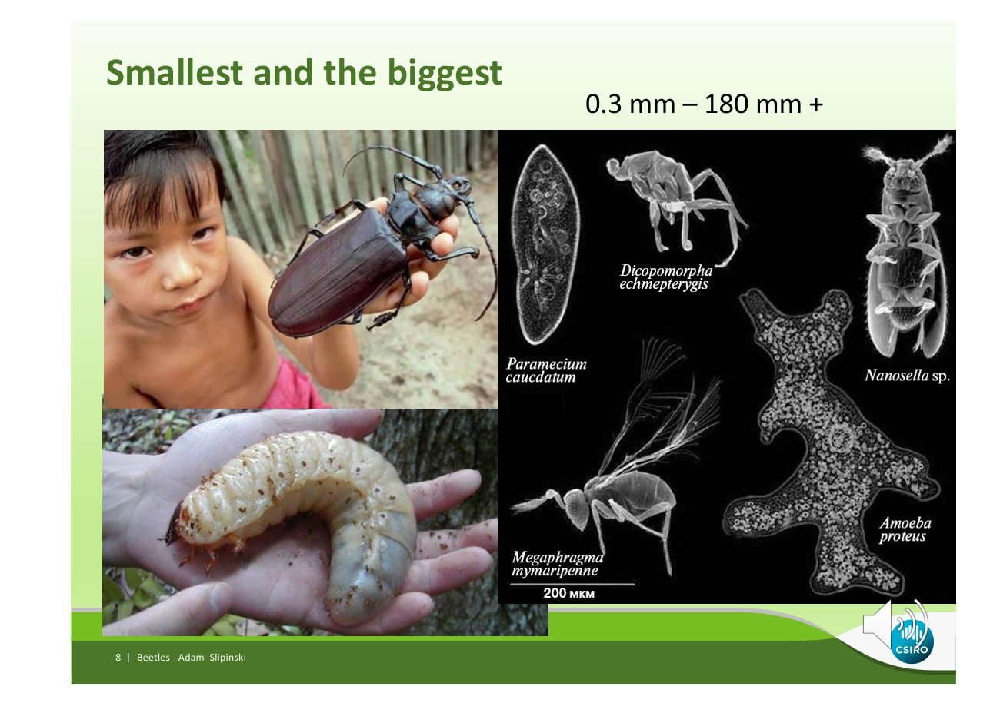](slides/slide-08.jpg)

When we look at the diversity of beetles, we look at the beetles, which are incredibly, large and incredibly small. The largest beetle that we can see here is the Titanus giganteus, which is over 18 centimetres long on the palm of that boy. And at the same time, we know that the larvae of beetles are about one third longer and larger than adults.

Can you imagine the larva of that beetle? It's a lot of it's a lot of, meat in there, definitely a lot of protein. And they are being, definitely eaten by a lot of Aboriginal, including in Australia.

They are regarded as delicacy as a witchetty grubs. So when we compare the smallest beetles, which is, ptiliids which are living in a spores of a fungus, they are about as long as the unicellular organism, paramecium or a they are only about the same size as the smallest wasp again, which are matching the beetles in that. In that respect.

> **Editorial note:** Larval size relative to adult size varies among beetles; the statement is retained as the lecturer’s generalisation.

[↑ Slides](#slides) · [Course index](../../README.md)

## Slide 9

[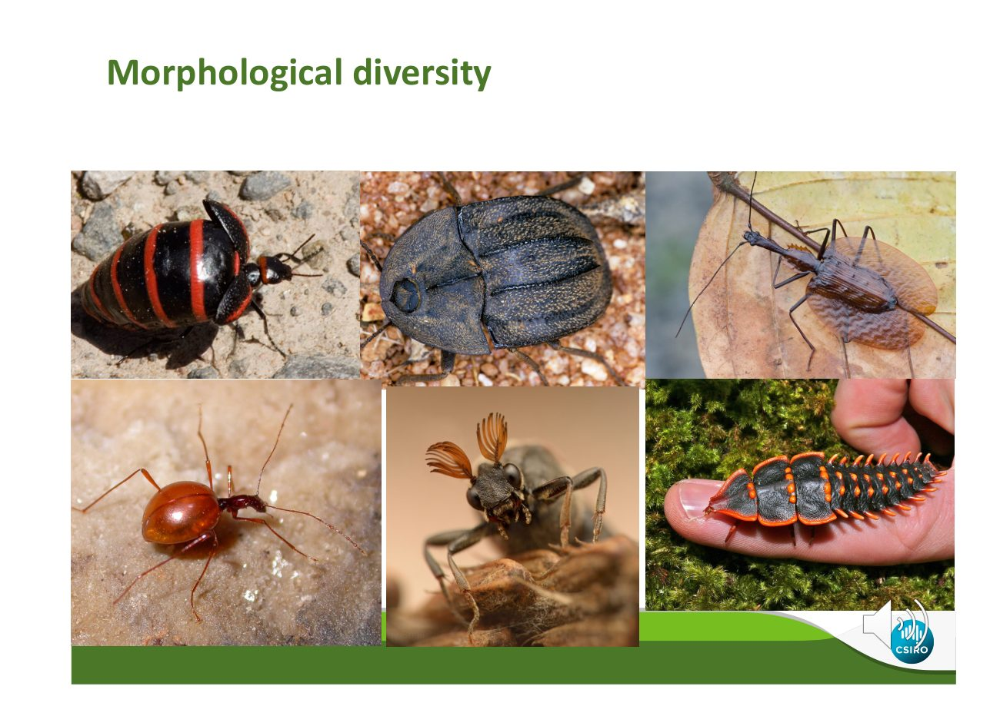](slides/slide-09.jpg)

When you look at the kind of overall diversity of beetles, we have something which are larviform. The females are neotenic. They don't ever turn into the beetles.

They are things which are living in water. There are things which are living in a desert and there are things which are parasites. So we can see all those differences and why they can do all those things.

[↑ Slides](#slides) · [Course index](../../README.md)

## Slide 10

[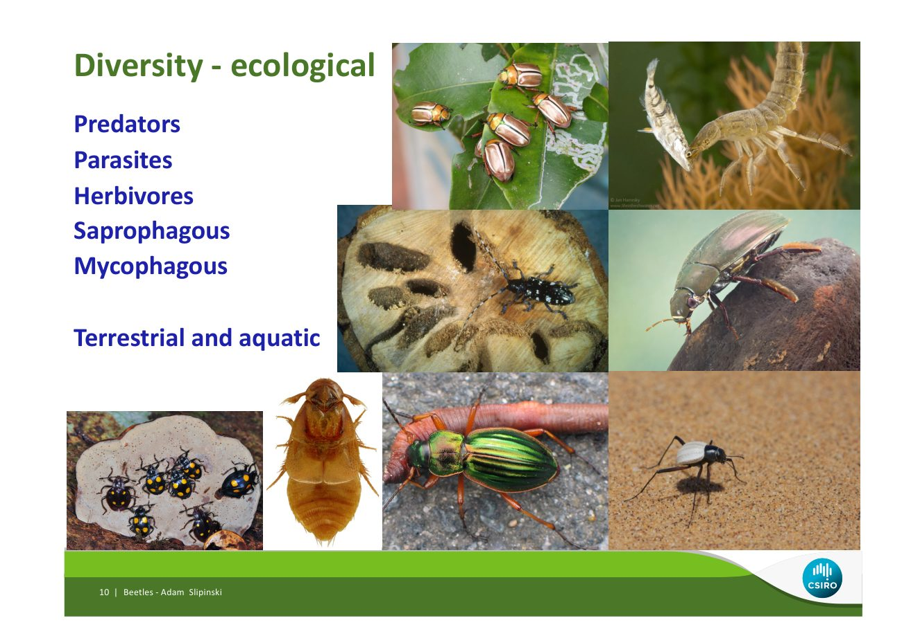](slides/slide-10.jpg)

*No separate passage can be confidently assigned to this slide. [Nearby discussion: slide 9](#slide-9).*

> **Editorial note:** Ecological examples overlap the preceding morphology discussion; no distinct passage is identifiable for this slide.

[↑ Slides](#slides) · [Course index](../../README.md)

## Slide 11

[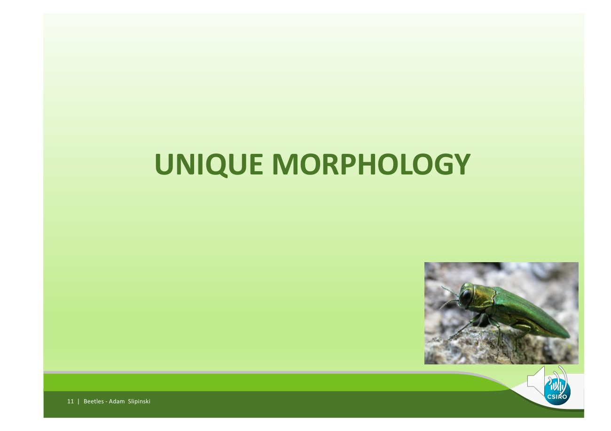](slides/slide-11.jpg)

I think part of this is because they have very unique morphology.

[↑ Slides](#slides) · [Course index](../../README.md)

## Slide 12

[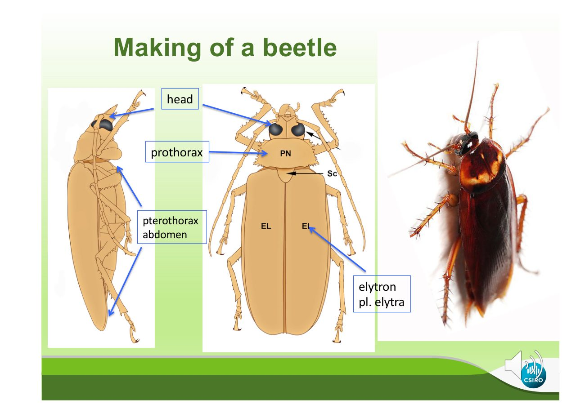](slides/slide-12.jpg)

When we look at the beetle, we see that there are two major parts of it. There is the frontal part, which is basically what we it is basically had and the prothorax which is articulated and then everything else is covered by [elytra]. So we have two elements, and this articulation between the head and prothorax forming one beat and the rest is a very important because it gives a lot of mobility to this.

To these beetles is very similar to the cockroaches as well. They also have a very similar situation. They have a head and have a mobile prothorax, and everything else is covered by this [forewing covers; term unclear].

They are not elytra. This is the difference because they are using those elytra. Basically, this elytra still for flying what the beat done.

[↑ Slides](#slides) · [Course index](../../README.md)

## Slide 13

[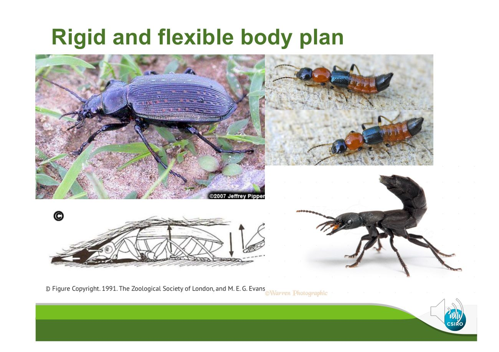](slides/slide-13.jpg)

So when we look at the beetles, they have this flexibility, this rigid body plan where they can wedge in the into the litre. They can go under the bark. They can do a lot of things because of those.

[↑ Slides](#slides) · [Course index](../../README.md)

## Slide 14

[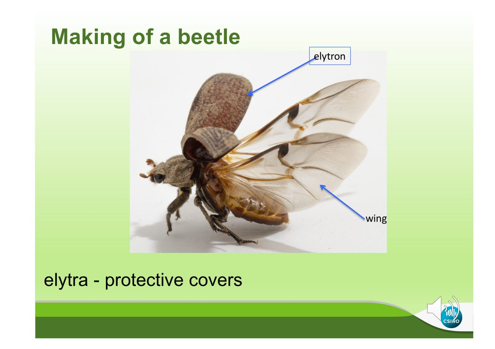](slides/slide-14.jpg)

Elytra: elytron is the singular. And plural is elytra are the forewings the wings, which are fitting sitting on the mesothorax. And they are leathery.

They are heavily sclerotised, and they form kind of covers for the only, wings, which are using for actually flying, which are the posterior wings, which are on the metathorax. And those wings are actually folded under the elytra.

[↑ Slides](#slides) · [Course index](../../README.md)

## Slide 15

[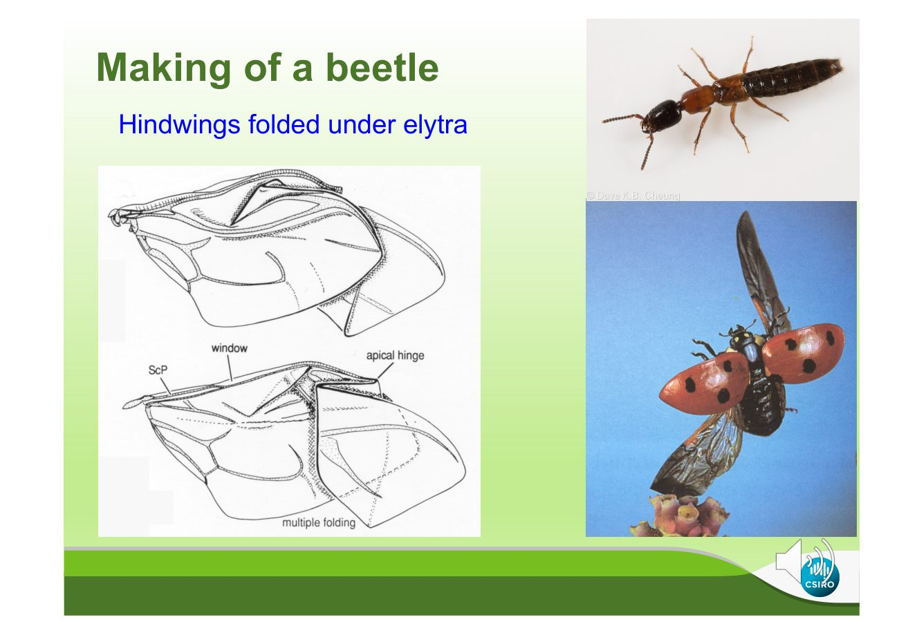](slides/slide-15.jpg)

So when we look at the wings, the Beetle wings have this ability that they can actually be stored under very tight spaces. When we look at that [staphylinid] in here, the elytra are very short. They have to be folded two or three times, actually to fit under those elytra.

The wings are way longer than the [elytra], and when the Beetle starts, take off, he has to lift the elytra pump, the wings stretch the wings, and then they basically fly. That is a very unique feature.

[↑ Slides](#slides) · [Course index](../../README.md)

## Slide 16

[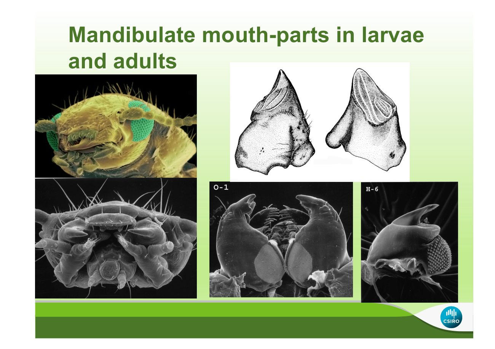](slides/slide-16.jpg)

*No separate passage can be confidently assigned to this slide. [Nearby discussion: slide 15](#slide-15).*

> **Editorial note:** The supplied transcript does not contain a clear separate discussion of this mouthparts slide.

[↑ Slides](#slides) · [Course index](../../README.md)

## Slide 17

[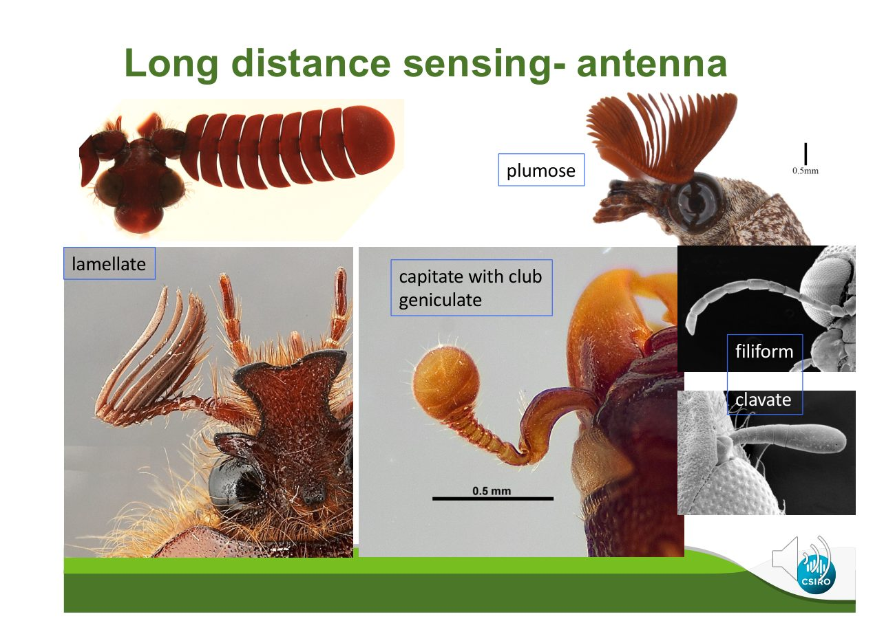](slides/slide-17.jpg)

Another feature is that, the beetles can actually find all those different environments are incredibly developed, sensory sensilla. And those are the senses on their head, mostly because that's where their vision and where is the kind of, radar is when they are all this antenna and normal beetles are 11 segmented, but they could be like 40 50 segmented in some males forming those enormous, structures. And they can do a lot of things.

And sometimes when they go into water or something, the antenna are probably not that very useful, that they are becoming very short, like a forming a short thing.

[↑ Slides](#slides) · [Course index](../../README.md)

## Slide 18

[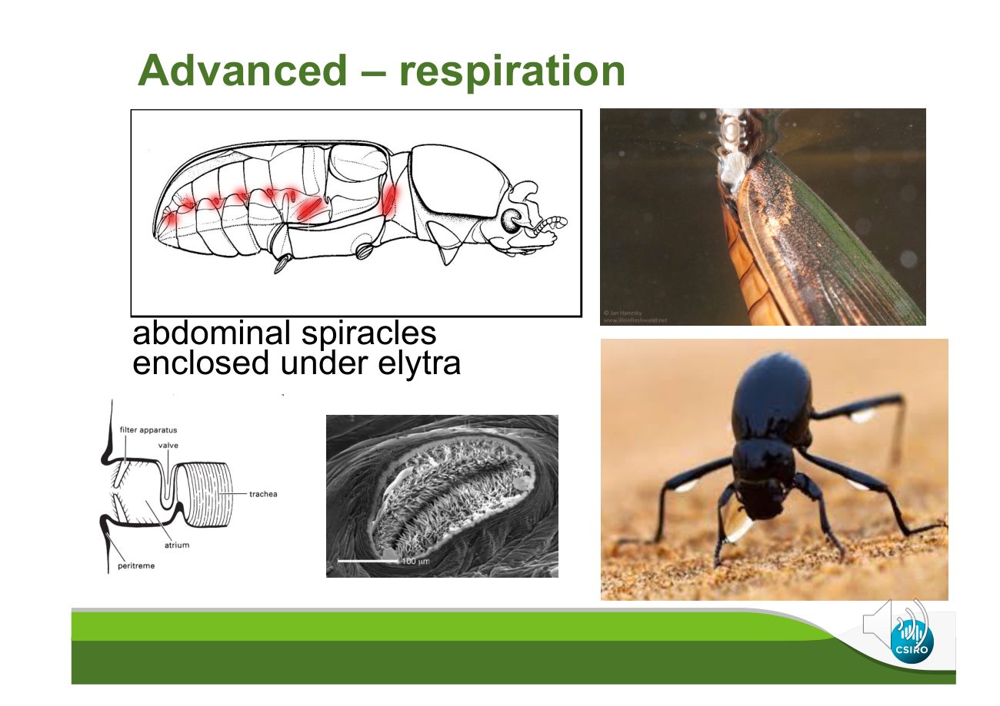](slides/slide-18.jpg)

So when you look at the Beetle also, the very important thing is that those elytra which are covering you, see the covering the mesothorax and metathorax and the whole elytra is covering all the spiracles. The spiracles are the basically opening of their, system. So this is basically the opening.

They are just basically, holes and then the tracheae going all in there into the body. And if we think you have something which is open to the outside world, there could be a lot of kind of things getting into that, including fungi, including different bacteria and including some other parasites can get here. So the beetles are very being very smart.

They have all the openings covered by elytra, and then this is covered very tightly. So that actually limits the accession to those spiracles. Absolutely.

And that means also that the very important thing in the life I mean the water, which is the critical element during the respiration. They are losing the water desiccation and there is a death, including the things which are living on the very, desert. They can still seal the spiracles and form this chamber under the elytra, which kind of conserve the moisture, conserve the water, and in water beetles.

Actually, they can actually store the bubble air under the elytra. That is important.

[↑ Slides](#slides) · [Course index](../../README.md)

## Slide 19

[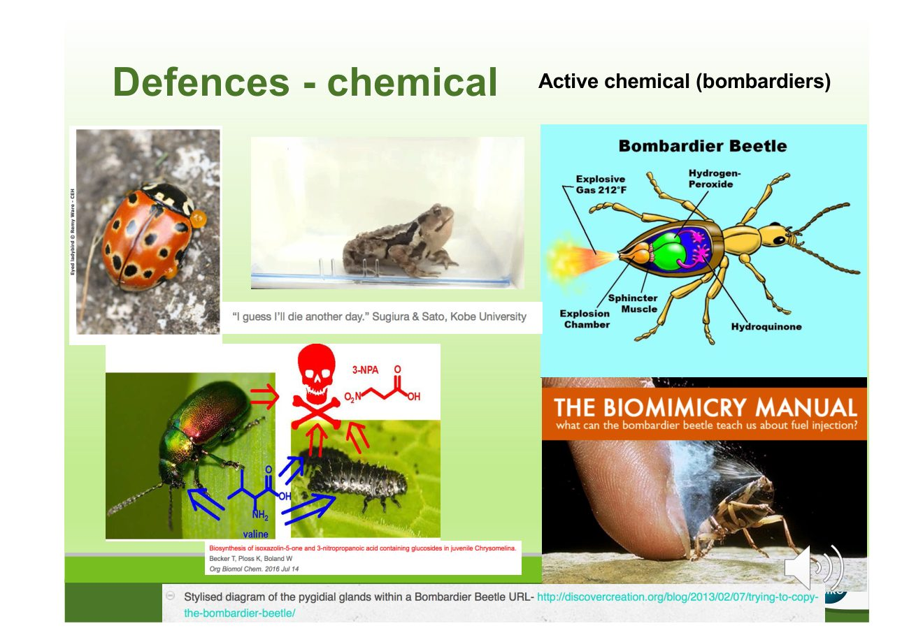](slides/slide-19.jpg)

And also, the beetles are very, robust. In terms of their defences, they could be defences in their body, their structures. There could be a lot of chemical defences in their blood.

What they call that there is a lot of, very nasty chemicals there. They could also absorb the chemicals from the plants. If they are herbivorous, they can.

They can absorb a lot of alkaloids from the plants and build them into their hemolymph. Or also, they can, generate enormous potent, explosive chemicals in the bombardier beetles that we have covered here, which, actually, when those two chambers, they are two separate chambers. When they get together, they are forming exploder, which is actually very loud and very visual.

And it is also very painful and that we see that from the toad who is trying to catch that bombardier beetle.

[↑ Slides](#slides) · [Course index](../../README.md)

## Slide 20

[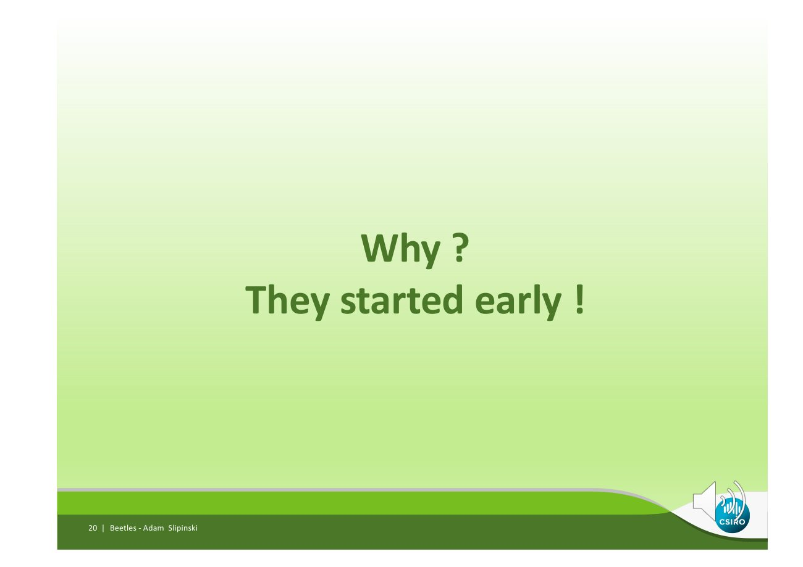](slides/slide-20.jpg)

I think one of the very important elements in why there are so many beetles is that they started quite early.

[↑ Slides](#slides) · [Course index](../../README.md)

## Slide 21

[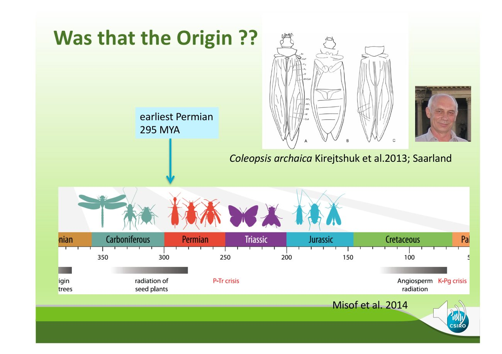](slides/slide-21.jpg)

When we look at the earliest beetle, we have almost at the beginning of Permian. So 295 million years ago, there is a There is the oldest fossil, Coleopsis archaica, described in 2013 from the in Germany. And that little fossil is important because it basically shows more or less all the, beetle features that we know, in the beetles.

[↑ Slides](#slides) · [Course index](../../README.md)

## Slide 22

[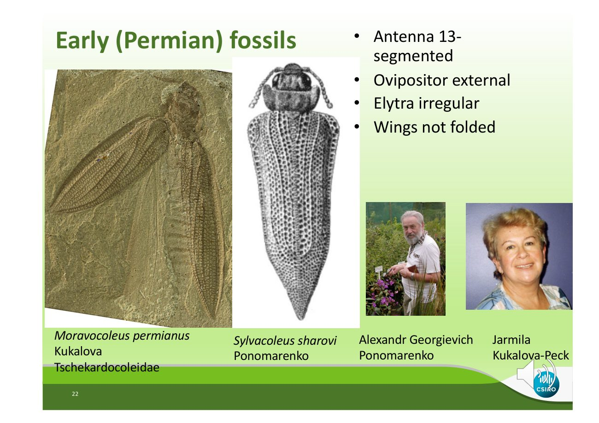](slides/slide-22.jpg)

Except when we look at those, things. They have two differences. The antenna is 13 segmented when the normal standard beetle antenna is 11 Segmented the numbers the higher numbers in the recent beetles are in the secondary division of the segments.

Here we have 13 segments also. What is important here is when we look at the beetle, Whatever is in the abdomen, the genitalia, the female and male genitalia are all invaginated. They are inside of the abdomen.

Here in this, Permian fossils, the part of the abdomen is not completely invaginated. So we can see part of the female special genitalia sticking out. So that very often is referred to Protocoleoptera as a kind of a sister group.

To the true beetles, the two people what we have here, Alexandr Ponomarenko the Russian, famous, still being alive. Palaeontologist and [Jarmila Kukalova-Peck] Czech, Canadian entomologist. They have done a lot of work in this Permian fossil.

Beetles.

[↑ Slides](#slides) · [Course index](../../README.md)

## Slide 23

[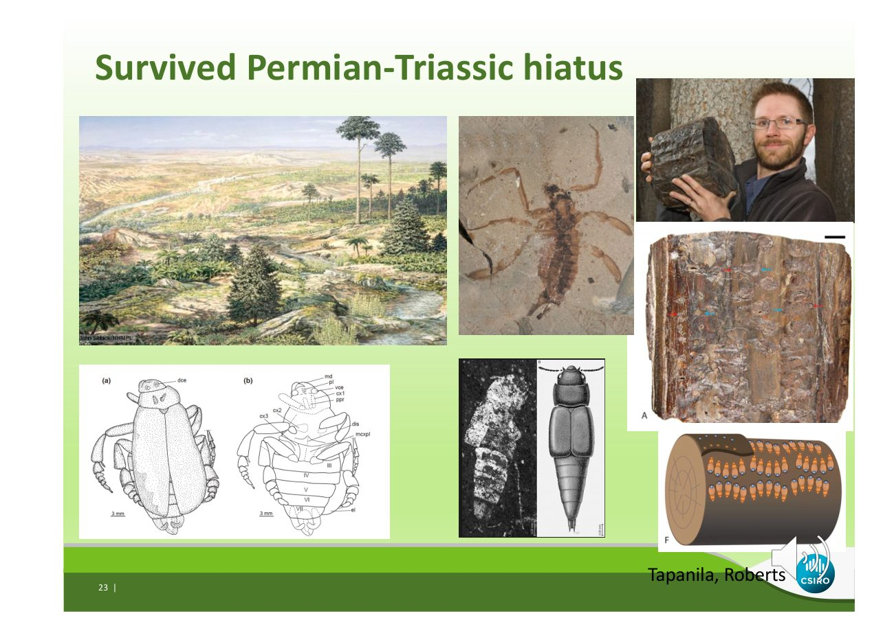](slides/slide-23.jpg)

The beetles have diversified enormously in past Permian, and there is there was this major hiatus in the life between the Permian and Triassic when about 70% of the their life has been completely lost. We don't know exactly why that has happened, but beetles have survived and there is not a very good fossil record from that period. But we have just after the this Permian–Triassic hiatus.

We have early Triassic fossils and they see the beetles have survived and they are doing very well, actually.

[↑ Slides](#slides) · [Course index](../../README.md)

## Slide 24

[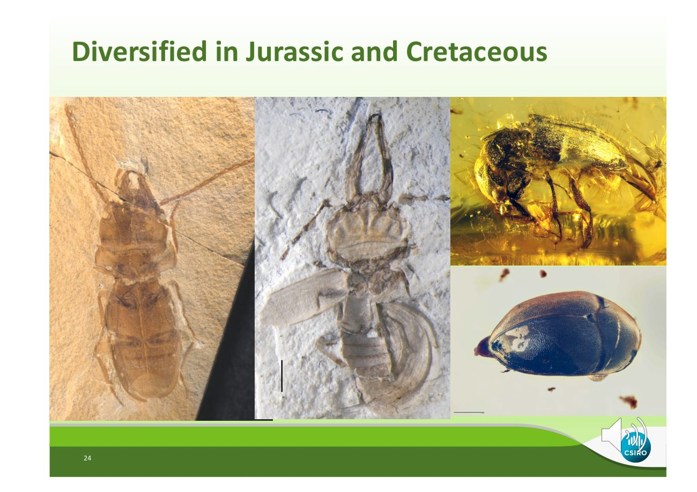](slides/slide-24.jpg)

And when we go to the Cretaceous and Jurassic, we have, enormous number of fossil beetles and the bats are in Russia. The China Brazil Europe. A lot fossil, resins, the Baltic amber, the Cretaceous amber from Myanmar, enormous numbers.

And they from Jurassic, almost Cretaceous. They just start forming exactly the same forms as we have now. We can very often distinguish them, so we will say that maybe 120 million years the diversity of current beetles have been steady.

They only diversified some of their lineages.

[↑ Slides](#slides) · [Course index](../../README.md)

## Slide 25

[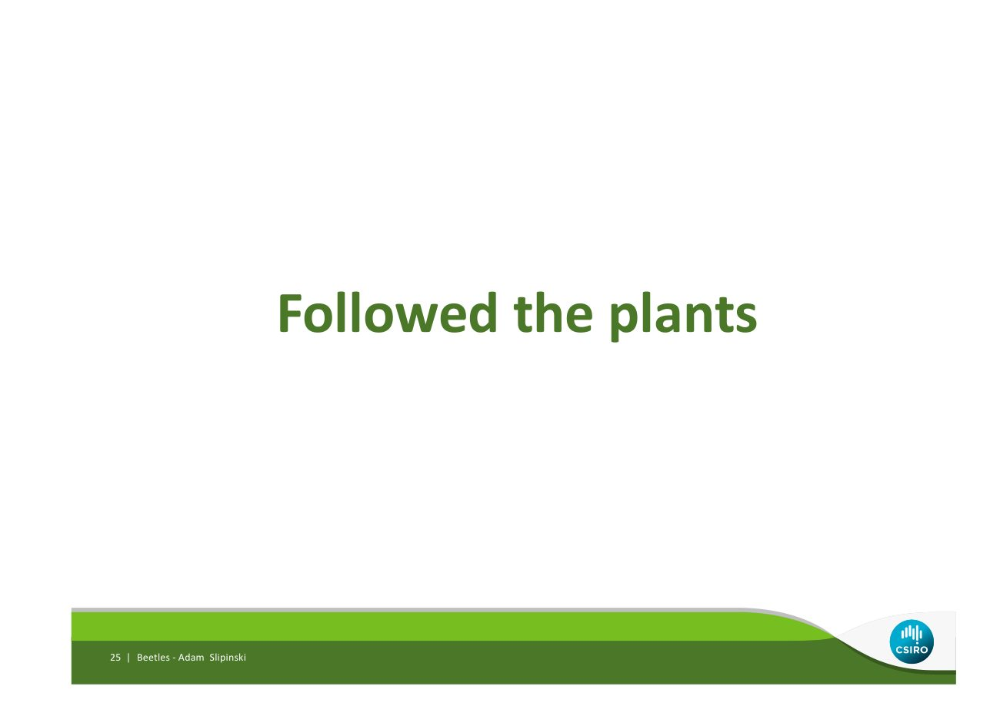](slides/slide-25.jpg)

And those lineages were mostly the beetles that have followed the plants, the whole herbivores because basically all the flowering plants have developed in the Cretaceous post Cretaceous, and they diversified enormously what we know right now, and the beetles and many other organisms, including lepidopterans and other things. They follow them up and they diversified with them.

[↑ Slides](#slides) · [Course index](../../README.md)

## Slide 26

[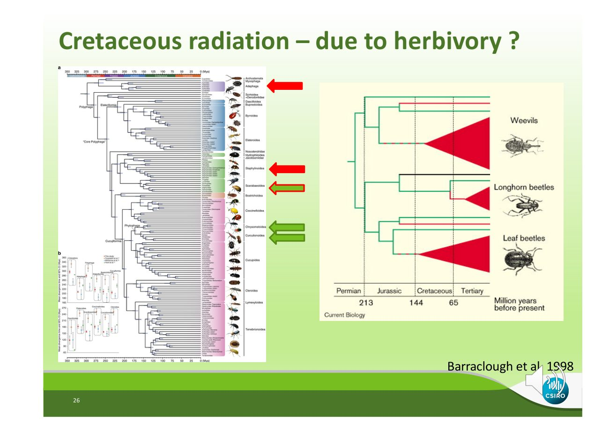](slides/slide-26.jpg)

And we have several independent huge diversification in the beetle world and including the weevils, including the long horn beetles and the leaf beetles. Each of them is probably, 50 60,000 species, if not more. And the special We just are, puzzled.

By the numbers of those beetles. So that is probably why there are so many of them there.

[↑ Slides](#slides) · [Course index](../../README.md)

## Slide 27

[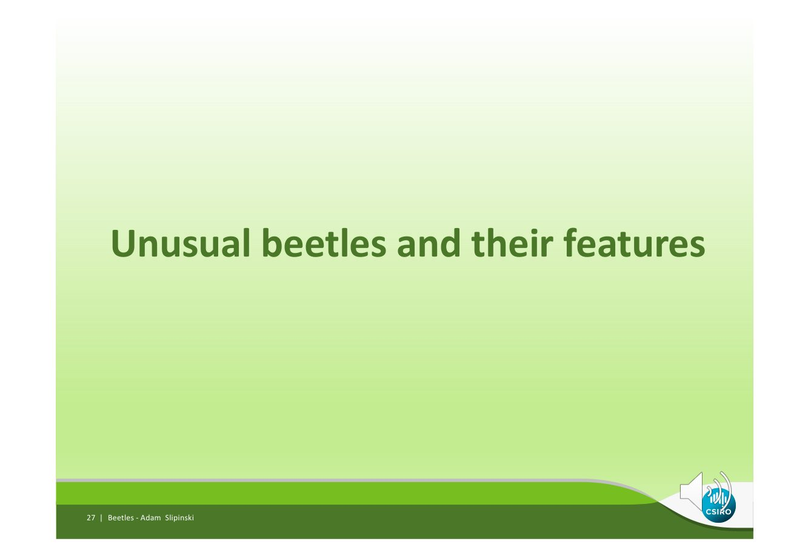](slides/slide-27.jpg)

But also they are puzzling because they have such a wonderful, different features.

[↑ Slides](#slides) · [Course index](../../README.md)

## Slide 28

[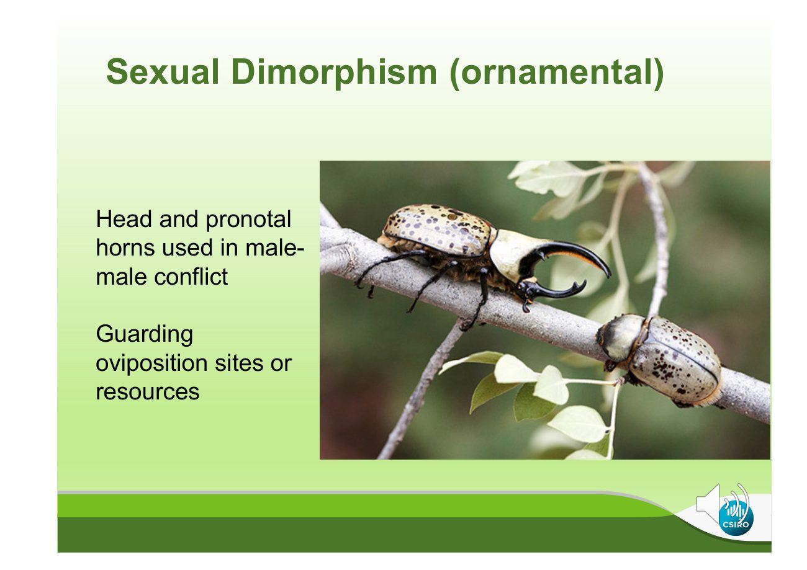](slides/slide-28.jpg)

We have such a staggering sexual dimorphism there the males and the females different and obviously the male they often trying to defend their stands they try to defend the way the place that the female lie like in the [stag beetles, as illustrated] here. The male is actually there and waiting for the female to come over and they have to fight with other males to actually dislodge them from the log or the of the things, because they just know that the female has to come over there.

[↑ Slides](#slides) · [Course index](../../README.md)

## Slide 29

[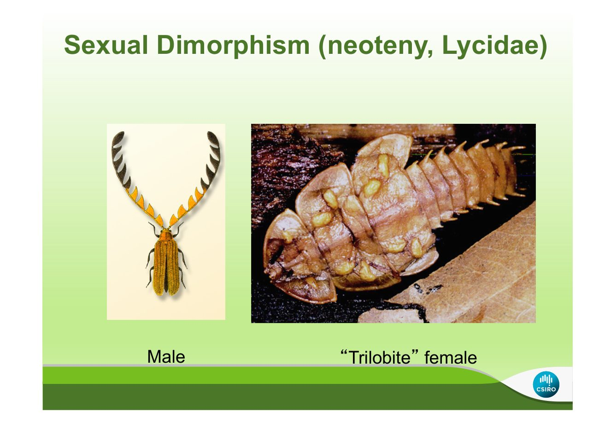](slides/slide-29.jpg)

*No separate passage can be confidently assigned to this slide. [Nearby discussion: slide 28](#slide-28).*

> **Editorial note:** No distinct passage about Lycidae is recoverable from the supplied transcript.

[↑ Slides](#slides) · [Course index](../../README.md)

## Slide 30

[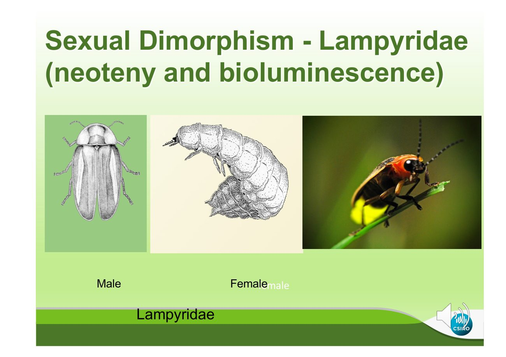](slides/slide-30.jpg)

There are definitely several independent, again cases of the beetles producing light, bioluminescence, and they can be produced by the male. They could be produced by larvae female.

[↑ Slides](#slides) · [Course index](../../README.md)

## Slide 31

[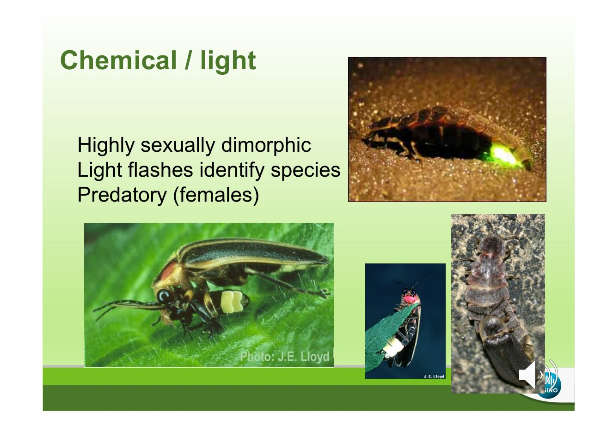](slides/slide-31.jpg)

And they can communicate. They can actually use the alphabet. How to communicate with each other.

It's enormous. And those light codes can be broken. I mean, we have the case in North America when one of the species, the much bigger species and they all they're all pretty strong predators.

The one of the species, the female is breaking the code of a completely different genus and is starting flashing the light of a different genus, and the male being duped comes over to that female and being actually devoured by it. It's it's a the female eats that male, build up the [unclear] and start emitting the normal code to attract the male of their own species. It's a it's a it's a puzzling, amazing thing.

[↑ Slides](#slides) · [Course index](../../README.md)

## Slide 32

[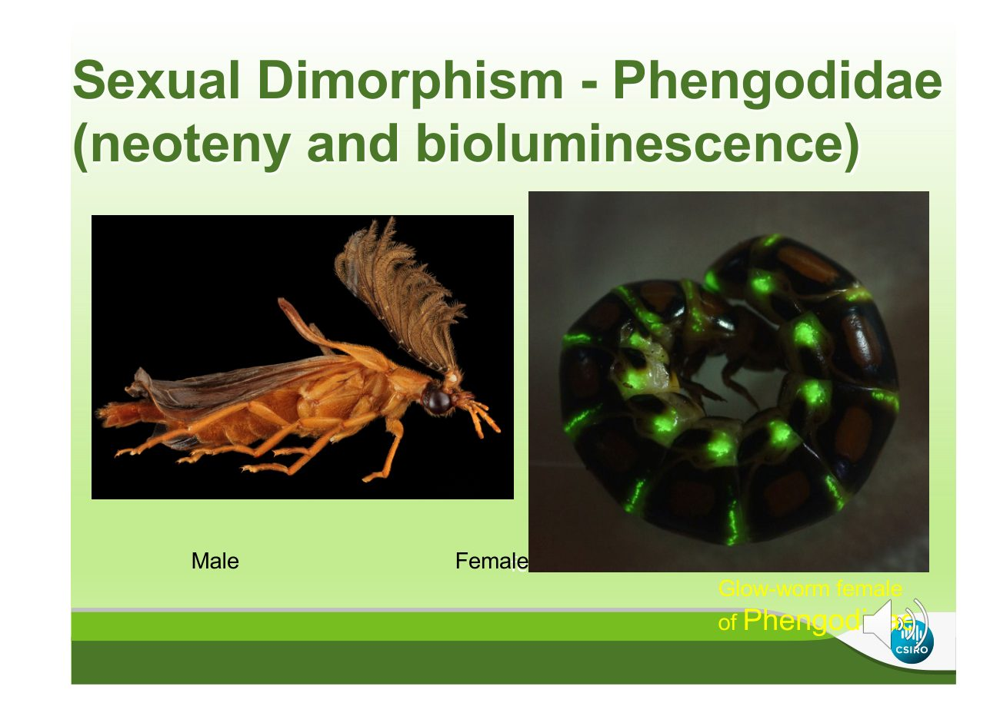](slides/slide-32.jpg)

But there are other groups that are called [Phengodidae], and those are the railroad worms. They're quite large. The female, the male is small, [unclear description] living maybe a couple of hours.

The female looks like a big worm with flashing lights when they walk.

[↑ Slides](#slides) · [Course index](../../README.md)

## Slide 33

[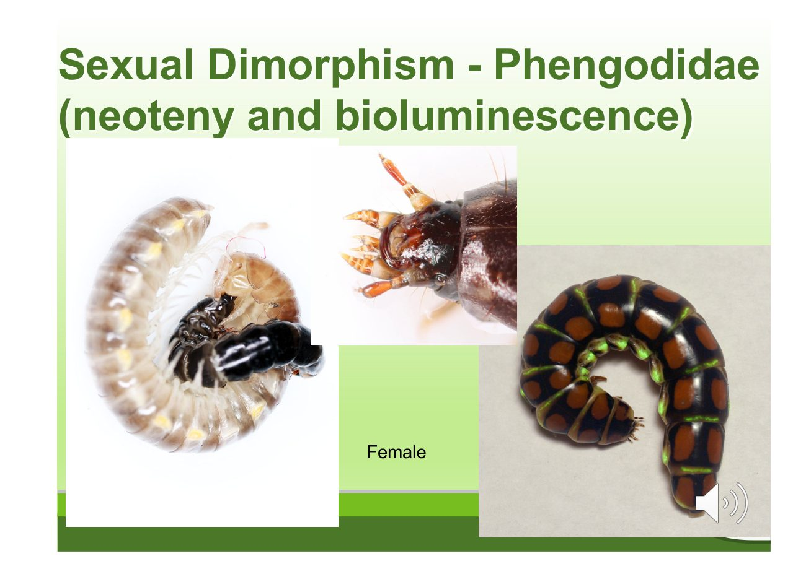](slides/slide-33.jpg)

And we didn't know exactly what was going on for a long time until somebody in Ecuador, has been able to photograph them in copula so we can see that huge female and the male copulating each other.

[↑ Slides](#slides) · [Course index](../../README.md)

## Slide 34

[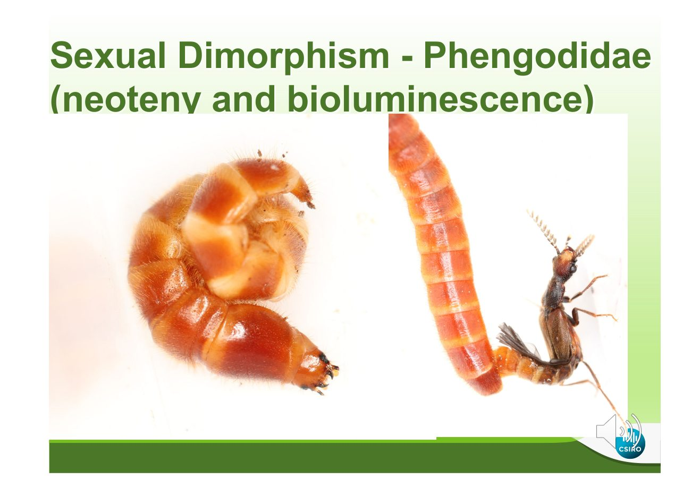](slides/slide-34.jpg)

Jim McLaren. This is the amazing man living in Ecuador and, putting all those wonderful pictures on the Web.

[↑ Slides](#slides) · [Course index](../../README.md)

## Slide 35

[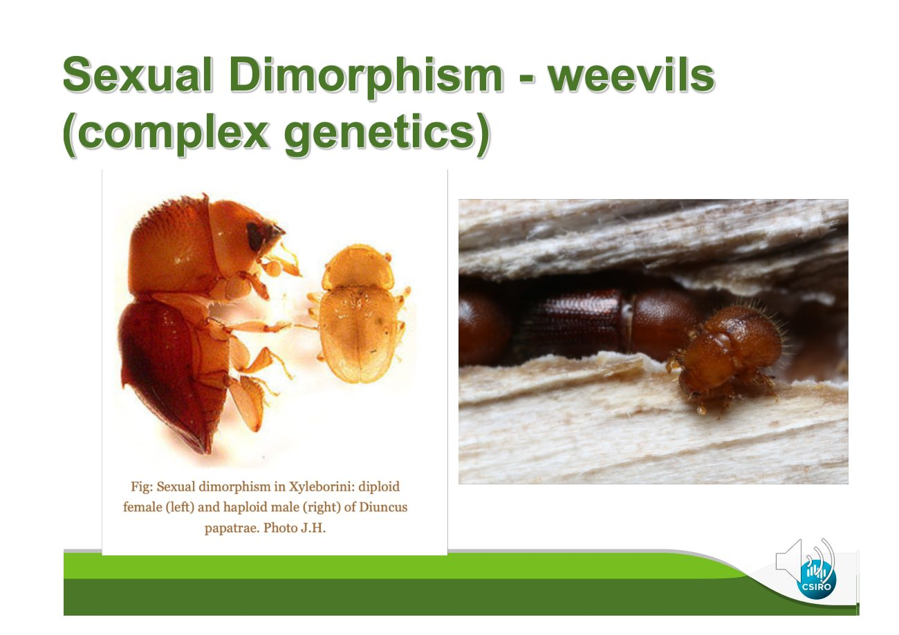](slides/slide-35.jpg)

There's there's another. There's another group of, fascinating weevils, which are basically, the bark beetles. Those are the weevils that they don't have really very long snout, but what they do.

They actually have such a complex lifestyle when they start manipulating their genetics. When the males are haploid, the females are diploid and they form a kind of a commune. They often there.

It's a and that could go to the point where the male just basically is reduced to the kind of a larviform form when we normally see in the females.

[↑ Slides](#slides) · [Course index](../../README.md)

## Slide 36

[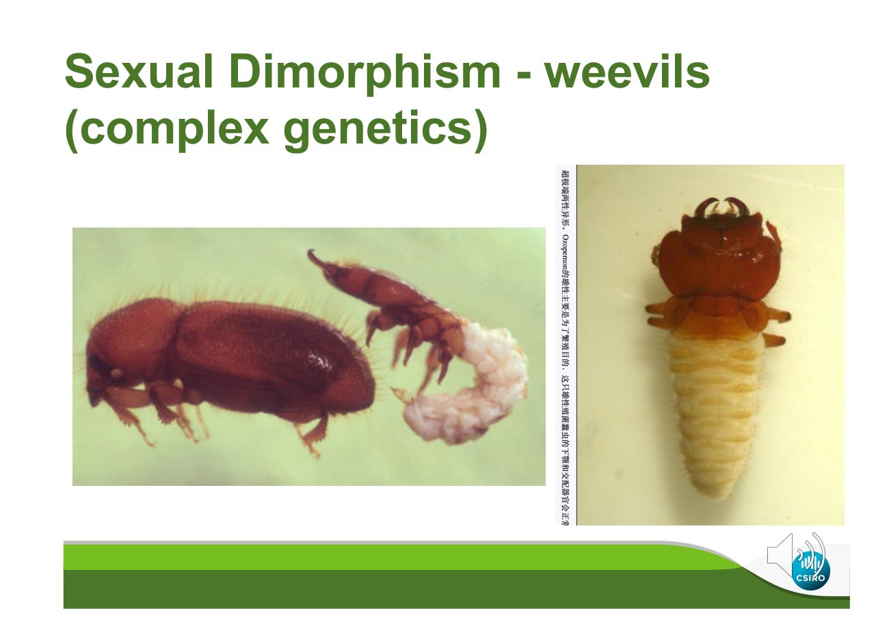](slides/slide-36.jpg)

But here, this whole function has been completely turned around where the male is actually there to just copulate, with many females in the same galleries.

[↑ Slides](#slides) · [Course index](../../README.md)

## Slide 37

[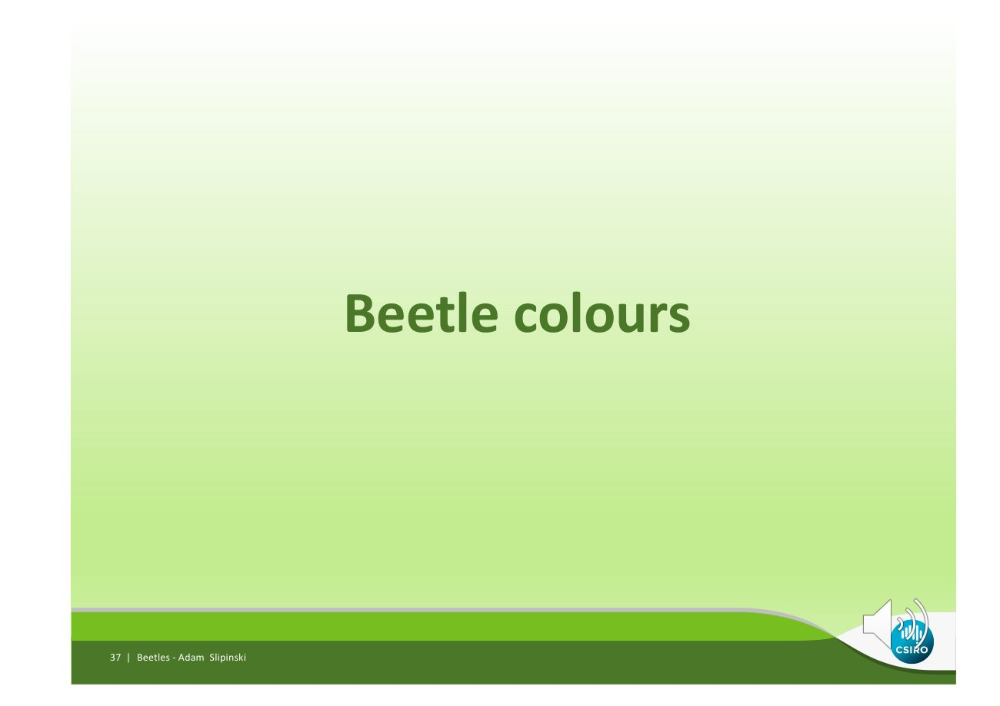](slides/slide-37.jpg)

Interestingly, also, the beetles are very beautiful, very colourful. And that's why there are so many people collecting them and putting them into the collections. And thank goodness, because we have such a wonderful collections because of the attraction.

There are people collecting everything, but there are people collecting all the big showy things as well.

[↑ Slides](#slides) · [Course index](../../README.md)

## Slide 38

[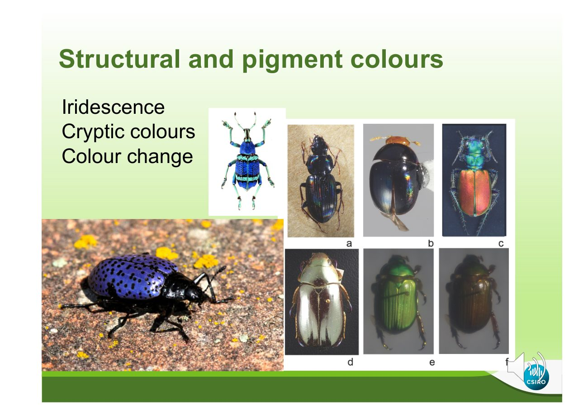](slides/slide-38.jpg)

So when we look at the colours of the beetles, we have many different way that the beetle can be coloured, there could be a situation when we have the situation where they have actual colour, a pigmented colour, they could have light, actually, on the iridescent on the on their epicuticle, and they can also have a very different crystals inside of their bodies. And, so there is a so many different ways and those colours differ because if you have the pigment colour, the pigment stays with the beetle. And unfortunately, when it is very often exposed to the light, it will fade and it will fade away.

[↑ Slides](#slides) · [Course index](../../README.md)

## Slide 39

[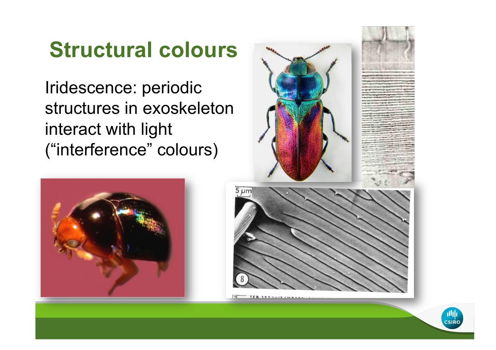](slides/slide-39.jpg)

The things which are, because of the iridescent because of the incident light, they only are iridescent only when the light is on.

[↑ Slides](#slides) · [Course index](../../README.md)

## Slide 40

[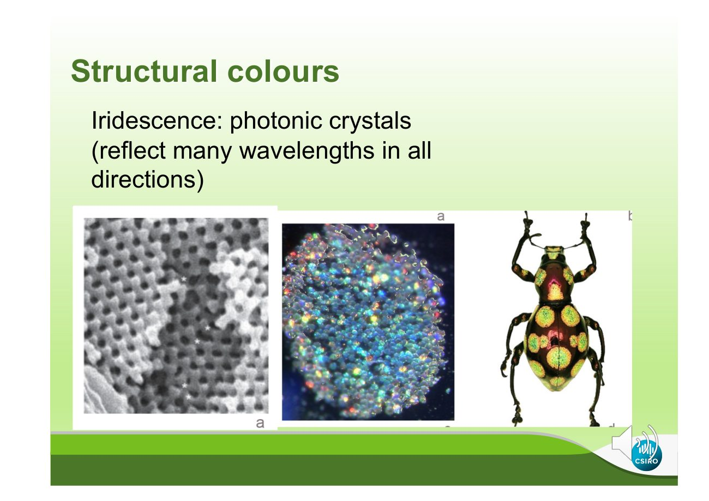](slides/slide-40.jpg)

But there are also the situation when we have a pigment below the cuticle and forming the crystals. And those crystals are kind of This is the structural colour that we say the crystals have a different angle, that they actually are able to, disperse the light.

[↑ Slides](#slides) · [Course index](../../README.md)

## Slide 41

[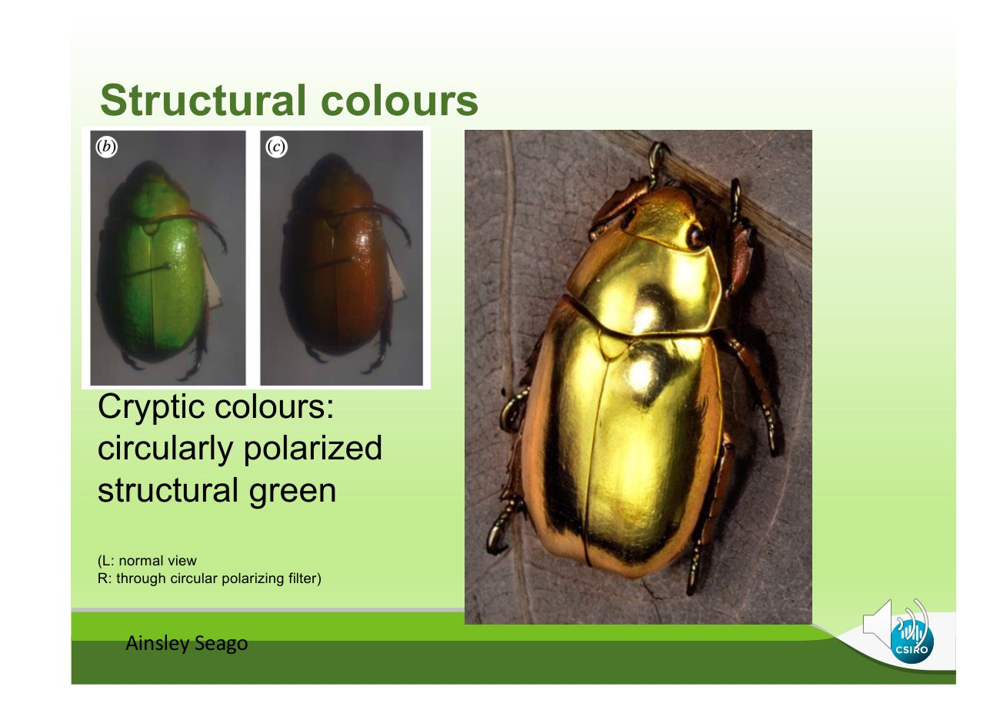](slides/slide-41.jpg)

And some of those are, so amazing. But when actually you they are because they are polarising the light. When you take the glasses which have the polarising filter, you actually see the beetle is actually brown.

It doesn't have any polarising colours.

[↑ Slides](#slides) · [Course index](../../README.md)

## Slide 42

And thank you very much. This will be the end of our first lecture.

[↑ Slides](#slides) · [Course index](../../README.md)

## Source notice

this material has been reproduced and communicated to you by or on behalf of the Australian National University In accordance with section 113 P of the Copyright Act 1968. The material in this communication may be subject to copyright under the act. Any further reproduction or communication of this material by you must be consistent with the provisions of the act. Do not reproduce this material. Do not remove this notice.

[← Previous lecture](../21-hymenoptera-part-4-biosecurity/README.md) · [Course index](../../README.md) · [Next lecture →](../23-coleoptera-part-2-ecology-natural-history/README.md)
