# Diptera Part 2 - Evolution  Classification

[← Previous lecture](../24-diptera-part-1-morphology/README.md) · [Course index](../../README.md) · [Next lecture →](../26-diptera-part-3-ecology-economic-impact/README.md)

**Slides + cleaned transcript** · 19 slides

English transcript with fillers and repeated false starts removed. Technical terms are corrected using the slides and context. Bracketed wording marks reconstruction or uncertainty. Slide boundaries are inferred from content; the transcripts have no slide timestamps.

[Original transcript](original-transcript.txt) · [Text-only version](cleaned-transcript.md) · [Editing notes](../../EDITING-NOTES.md) · [Correction record](corrections.md)

[Searchable slide text](slide-text.md). Click a slide image to open it at full size.

## Slides

[1](#slide-1) · [2](#slide-2) · [3](#slide-3) · [4](#slide-4) · [5](#slide-5) · [6](#slide-6) · [7](#slide-7) · [8](#slide-8) · [9](#slide-9) · [10](#slide-10) · [11](#slide-11) · [12](#slide-12) · [13](#slide-13) · [14](#slide-14) · [15](#slide-15) · [16](#slide-16) · [17](#slide-17) · [18](#slide-18) · [19](#slide-19)

## Slide 1

[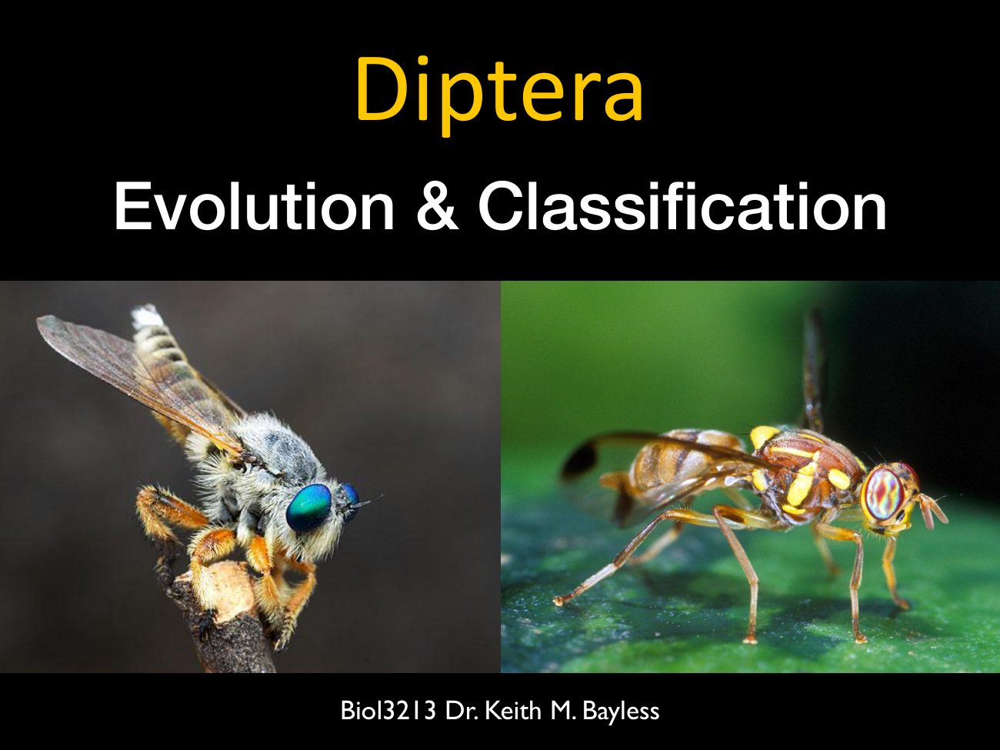](slides/slide-01.jpg)

We're going to go into the evolutionary history of flies in the sense of the classification the how the major groups are arranged and also understanding where those major morphological innovations occurred throughout the evolution of flies.

[↑ Slides](#slides) · [Course index](../../README.md)

## Slide 2

[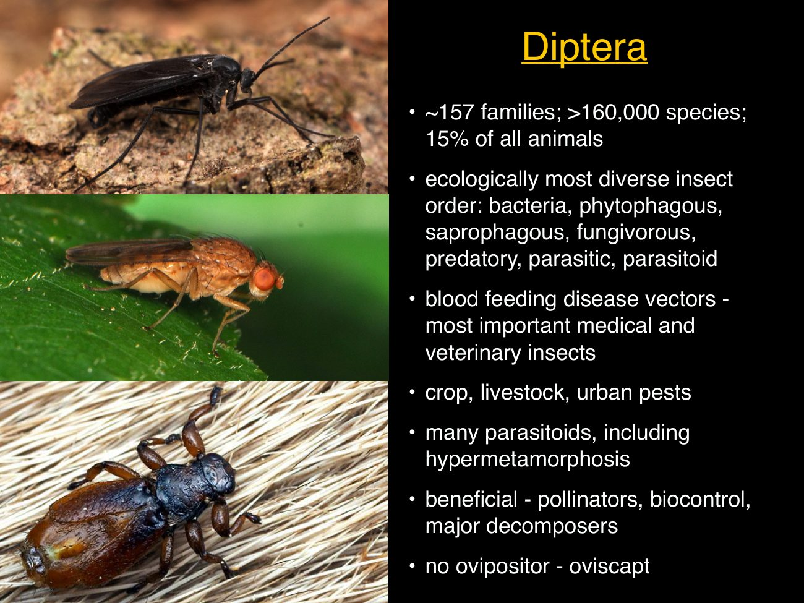](slides/slide-02.jpg)

Again. This is a hugely diverse group of insects right now, the third most diverse order of insects after, beetles and Lepidoptera, but probably the most poorly studied and with the most undescribed species, particularly in Australia. There's maybe less than a quarter of the species that exist in nature are, described and known.

There's a lot left to be discovered and unlike other insects, they are really variable, really diverse in terms of what they do in their ecosystems. Parasitoids plant feeders. [preceding word unclear].

[↑ Slides](#slides) · [Course index](../../README.md)

## Slide 3

[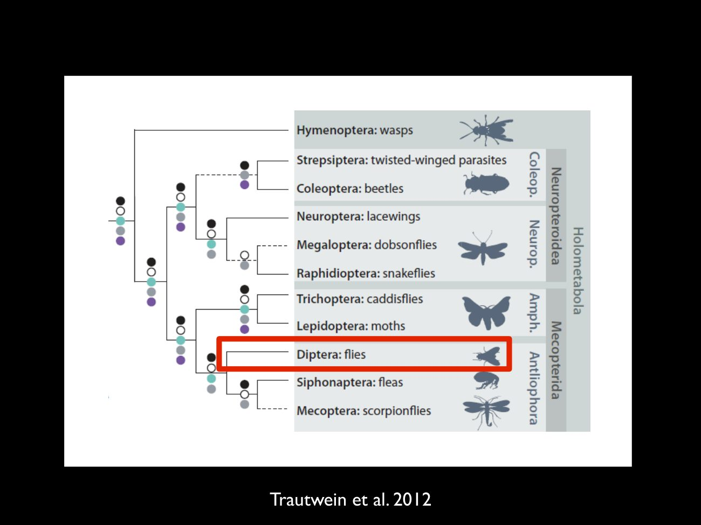](slides/slide-03.jpg)

Flies are holometabolous, insects. They have true metamorphosis with a larvae, pupal and adult stage. They're closely related to fleas and scorpion flies and form a clade that includes moths and caddisflies as well.

[↑ Slides](#slides) · [Course index](../../README.md)

## Slide 4

[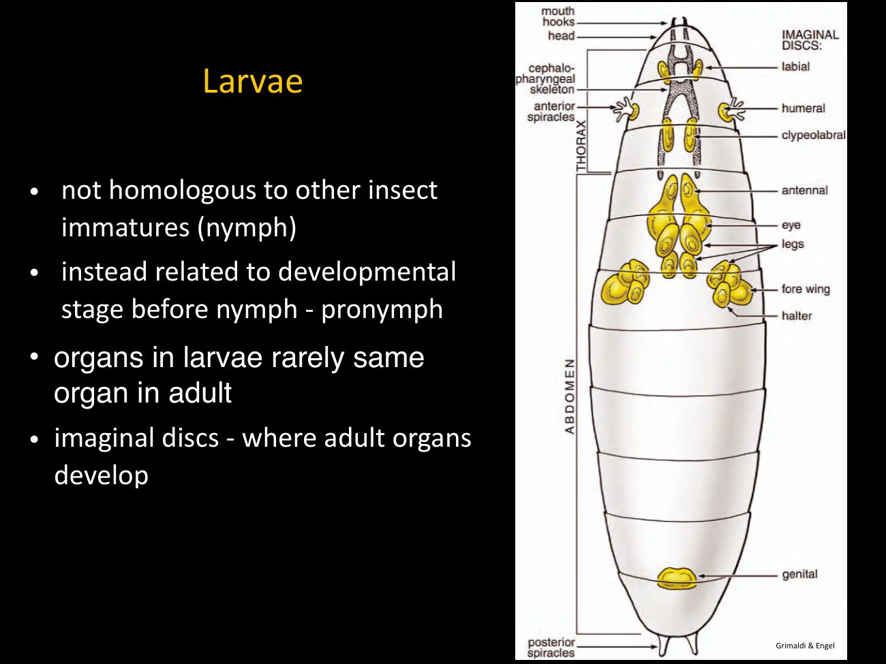](slides/slide-04.jpg)

Holometabolous insects all have a larval stage that is not homologous to the nymph in other, insects.

> **Editorial note:** Larva–pronymph homology is a developmental interpretation presented by the lecturer.

[↑ Slides](#slides) · [Course index](../../README.md)

## Slide 5

[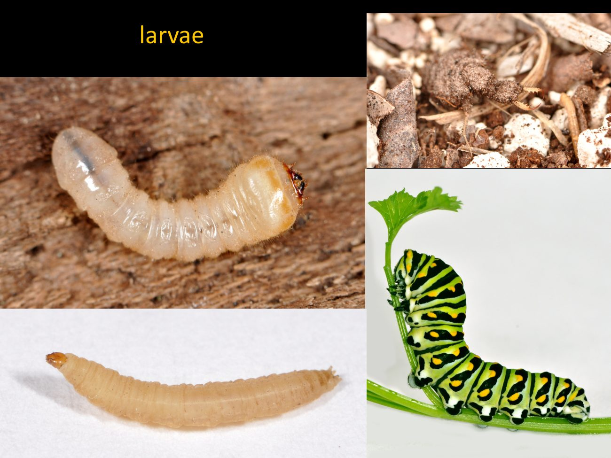](slides/slide-05.jpg)

Flies. There's one fly larvae in the bottom corner. They don't have, legs.

Unlike most other insects, which have true leg and may even have, soft, non segmented prolegs pseudo pseudopods on the [abdomen]

[↑ Slides](#slides) · [Course index](../../README.md)

## Slide 6

[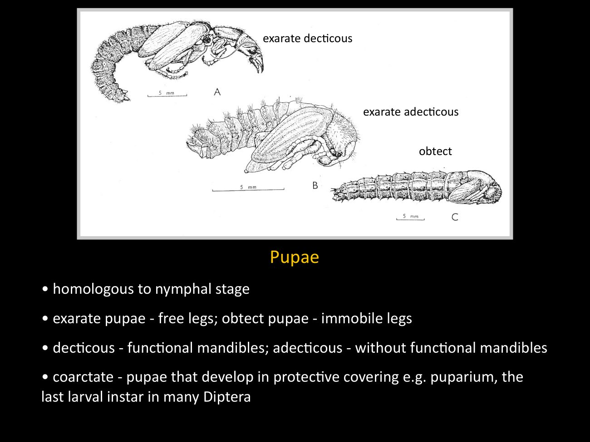](slides/slide-06.jpg)

The pupal stage is also really important for holometabolous, insects and many insects. You can see the legs and mouth parts being called exarate and decticous, but in flies, many of them are coarctate pupate in a structure called the puparium, formed from the last larval skin. And you can't see any of those adult characters externally.

[↑ Slides](#slides) · [Course index](../../README.md)

## Slide 7

[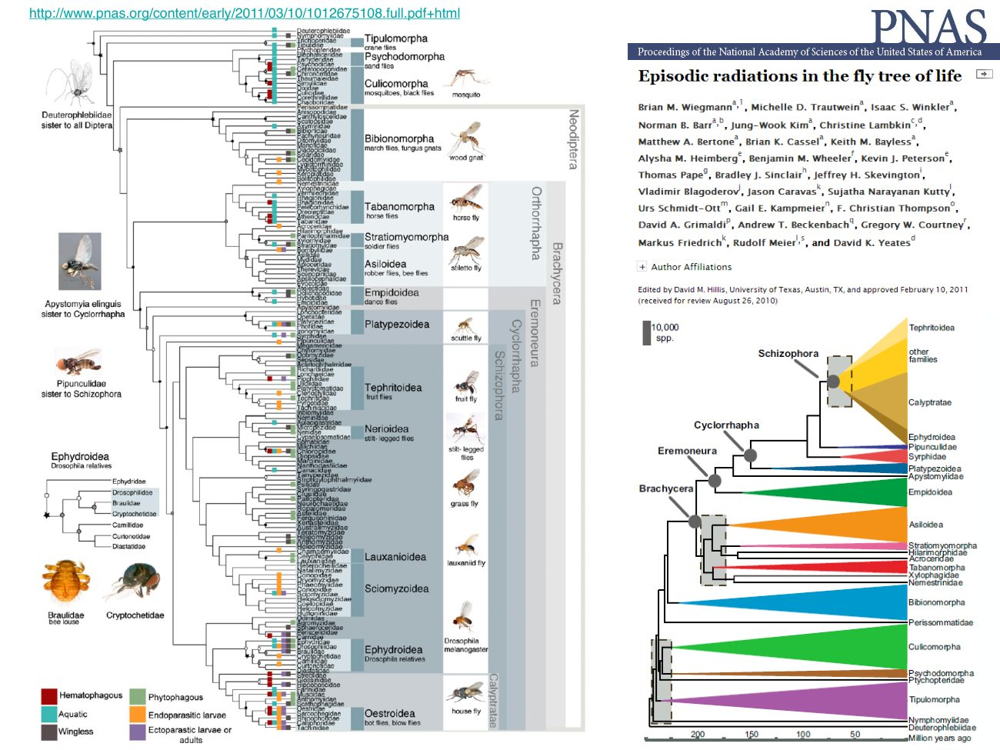](slides/slide-07.jpg)

This is the most recent, comprehensive phylogeny of flies. And there's still a lot left to be, understood. There's a lot of progress to be made in the higher level phylogenetics of flies, but the main takeaways I want you to see from this.

Is that unlike some other groups of insects, for instance, moths or Hymenoptera, where the early diverging major lineages are species poor and there's one or two major areas of rapid evolution and radiations, which has led to high, species diversity in flies. The species diversity, shown by the width of those triangles, is quite evenly distributed across the border. And a lot of that diversity has originated in three major episodes of rapid radiation, which occurred around 220 million years ago and then about 100 and 60 million years ago.

And then about 50 million years ago, where, there were major, evolutionary or ecological innovations within flies that had led to very short branch lengths and a lot of extant diversity. And now it's very difficult to understand their evolutionary relationships based on, the extant diversity along with that, in the larger tree, on the left, there's little squares denoting the ecology of a lot of these flies, so blue for aquatic red for blood feeding, et cetera. And what you can see from there is that, most of these major life histories have likely evolved multiple times throughout the evolution of flies.

There's some tendencies, so most of the early emerging flies are aquatic, but there still are reversals to aquatic larvae throughout the, Diptera. And then a lot of those more derived flies are parasitoids. However again there's so the, evolution of these major life history traits plant feeding parasitoid.

All those have occurred 10 or more times throughout the evolution of flies, so that's to contrast with other groups. For instance, Hymenoptera the wasps. There was one point in the evolutionary history of wasps where they, had an evolutionary innovation to be parasitoid and the vast majority of the species diversity is in that, parasitic parasitoid lineage of, Hymenoptera.

Similarly, in beetles, there's a group called Phytophaga, where there's a huge species diversity of beetles that are mostly plant feeding. However, in flies, the diversity is distributed throughout the order, and a lot of those major life history traits have evolved multiple times.

[↑ Slides](#slides) · [Course index](../../README.md)

## Slide 8

[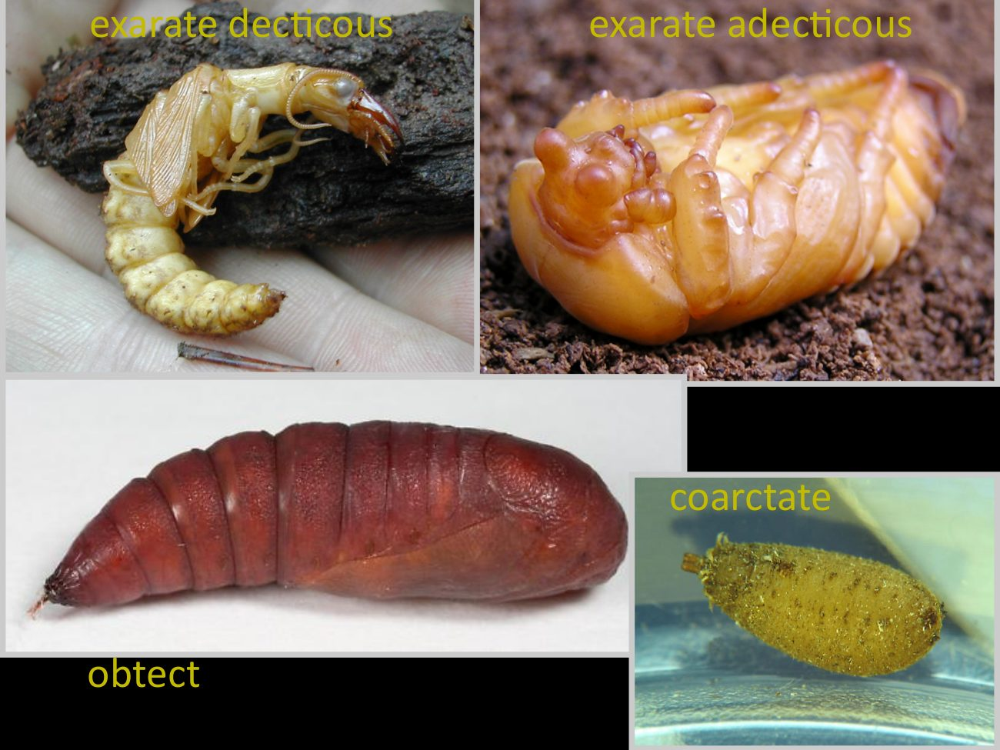](slides/slide-08.jpg)

So let's get into the some of these subgroups. So the lower flies, which are mostly aquatic. And that's the first major radiation of insects and then the lower Brachycera, which have more robust adult, stages and larvae that are, well adapted for dry terrestrial environments.

And then the higher flies the Schizophora, which, have novel innovations for emerging from their pupa in faster generation times and are really ecologically diverse.

[↑ Slides](#slides) · [Course index](../../README.md)

## Slide 9

[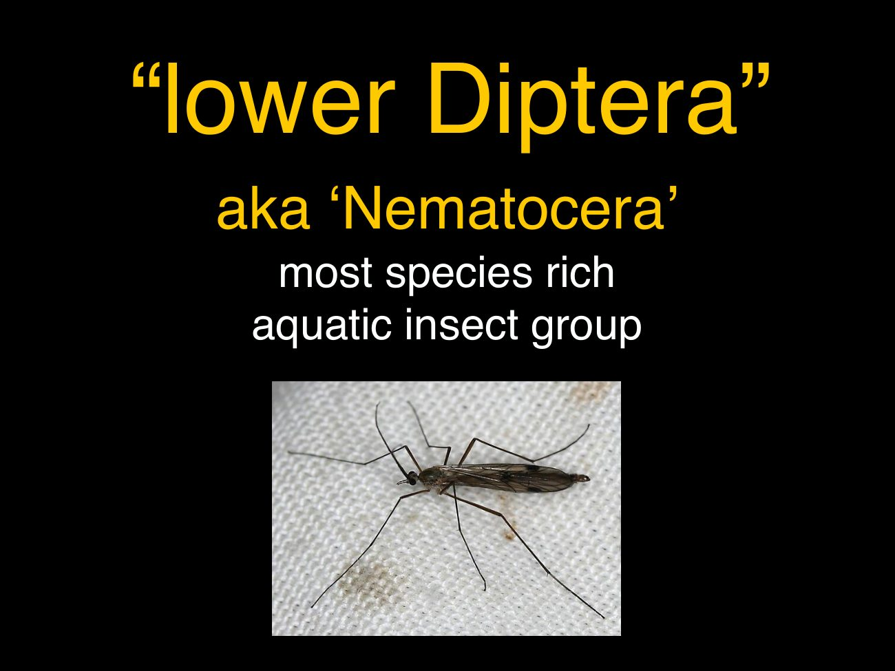](slides/slide-09.jpg)

So the lower Diptera, these are in quotes because it's not a monophyletic group. It's a series of successive sister groups to the rest of flies, many of which are aquatic. Likely the ancestral fly was a freshwater aquatic insect.

Adults are gracile, have more complete wing venation, longer legs, long antennae. And within this group, they, moved onto land and then in the brachyceran flies. There was another major radiation.

So just listing some important families in this group, Tipulidae the crane flies, biting flies in the Ceratopogonidae. And sandflies in Psychodidae and mosquitoes, Culicidae, have some house pests and some blood feeding. Chironomidae are incredibly diverse.

Aquatic and then the last three [Mycetophilidae, Sciaridae and Cecidomyiidae] are terrestrial. Cecidomyiidae are mostly plant feeding on galls, and [Mycetophilidae and Sciaridae] are mostly on fungus.

[↑ Slides](#slides) · [Course index](../../README.md)

## Slide 10

[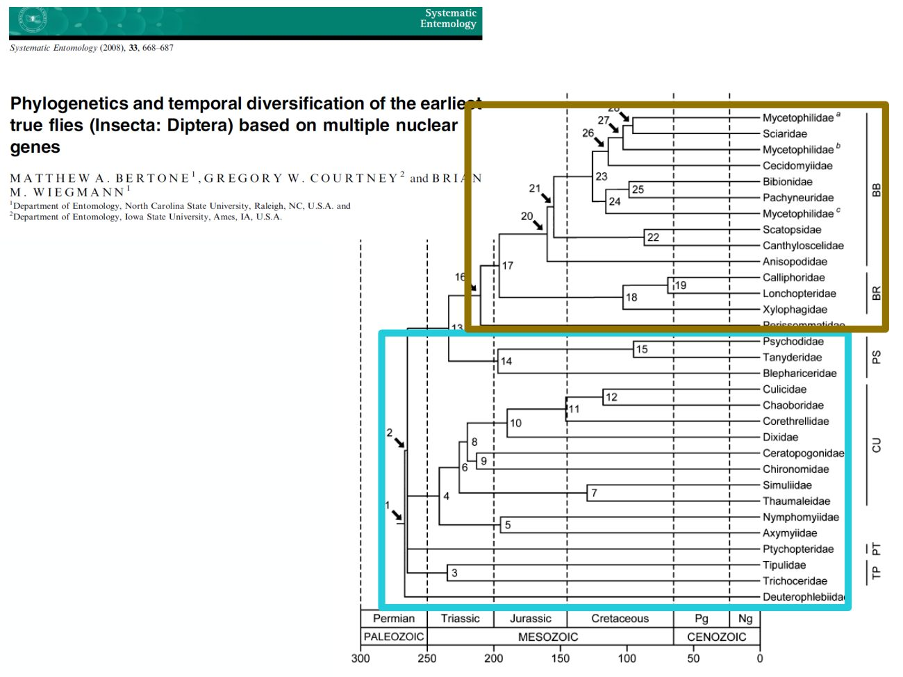](slides/slide-10.jpg)

So this is, an evolutionary hypothesis of the lower Diptera. And the main takeaway is that there was a evolutionary transition from aquatic larvae towards terrestrial and in the lower the terrestrial lower Diptera. Those are mostly on things like rotting fungus or, rotting plants or plant galls.

Whereas in the brachyceran flies there, the larvae are parasites or predators and open soils.

[↑ Slides](#slides) · [Course index](../../README.md)

## Slide 11

[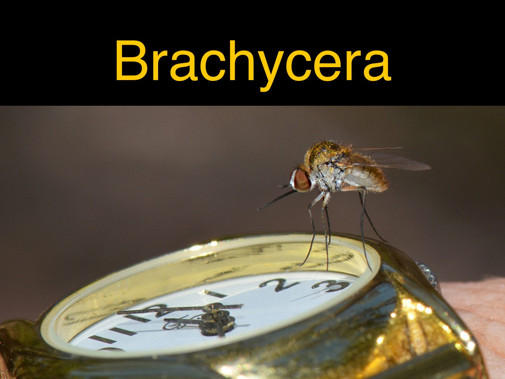](slides/slide-11.jpg)

So here we're moving on to [Brachycera]. This is one major clade of flies that includes a lot of families. These groups are kind of successive nested, lineages in the.

[↑ Slides](#slides) · [Course index](../../README.md)

## Slide 12

[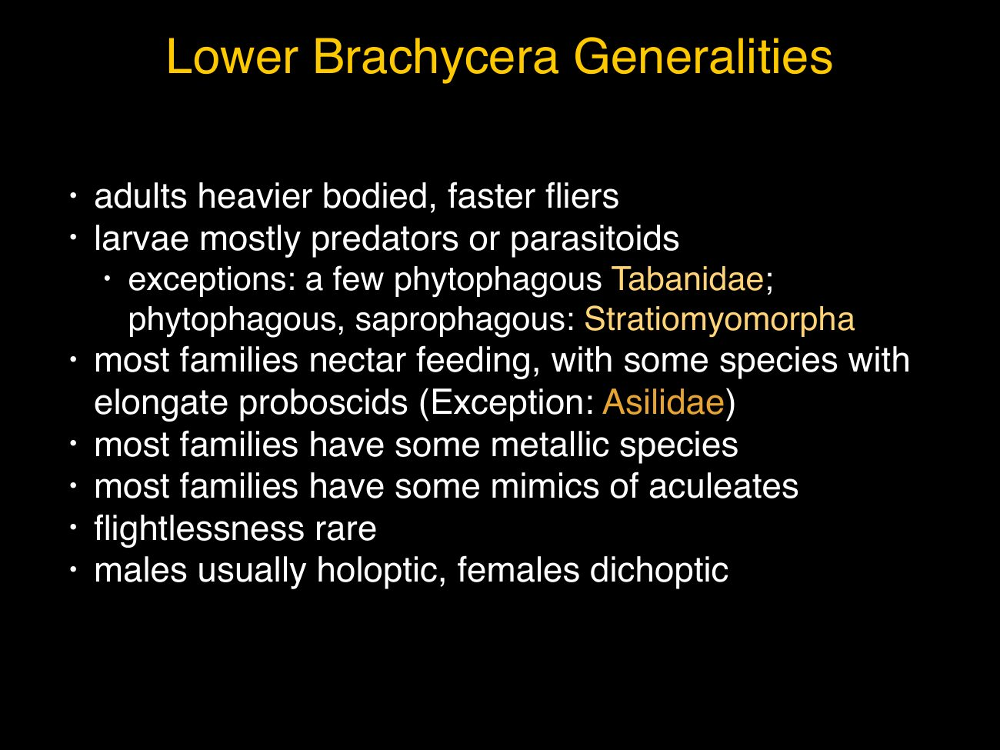](slides/slide-12.jpg)

They generally are heavy bodied and faster, many parasitoids. Many larvae are predators. Or parasitoids, there's not as many predator, predatory and parasitoids larvae in the, lower Diptera.

There's some plant feeding ones, some saprophagous ones. A lot of the adults are nectar feeding and can have elongate proboscises. That's a little bit more rare in the lower Diptera, except for things like large crane flies.

But some have, some are heavily adapted for, predation as adults. A lot of lower [Brachycera] are metallic or are mimics of, stinging Hymenoptera. And usually this is a group that usually has that holoptic male where the males have, morphologically derived eyes that touch in the middle.

Here's a couple, a list of the important families in the lower [Brachycera]. You might come across the Tabanidae, the march flies, horse flies [Stratiomyidae], the soldier flies. [Asilidae], the robber flies, which are predatory Bombyliidae the bee [flies] are parasitoids and [Empididae and Dolichopodidae].

There's a reversal to aquatic life histories. They're they're mostly predatory and Phoridae is incredibly diverse. Ecologically, Syrphidae are the flower flies again?

Diverse as larvae can be plant feeding or saprophagous or predatory who.

[↑ Slides](#slides) · [Course index](../../README.md)

## Slide 13

[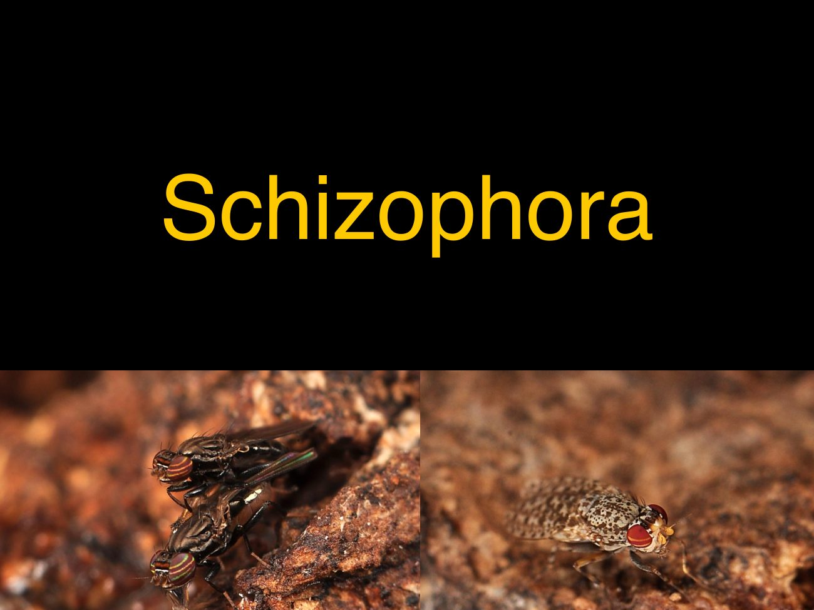](slides/slide-13.jpg)

Nested within Brachycera. One lineage of Brachycera led to the Schizophora, which is the, most recent of these major radiations of flies. And, the most, difficult to understand is evolutionary history.

There's a lot of small geographical restricted, and morphologically diverse, higher level lineages, and it's hard to place everything in a clear context.

[↑ Slides](#slides) · [Course index](../../README.md)

## Slide 14

[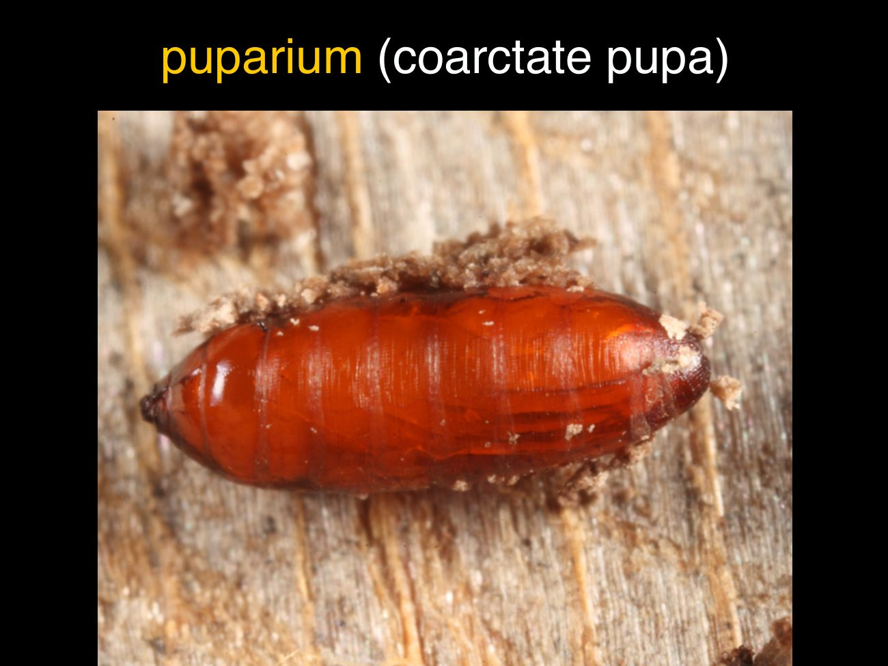](slides/slide-14.jpg)

The major innovation in the Schizophora flies is that they have a, pupa, so they pupate in the last larval skin you can't see. Any external adult morph morphology. What that means is that they can pupate in more inhospitable environments.

And maybe faster as well.

> **Editorial note:** Puparia occur more broadly in Cyclorrhapha, not only Schizophora. Schizophora is distinguished by the ptilinum, discussed on slide 16.

[↑ Slides](#slides) · [Course index](../../README.md)

## Slide 15

[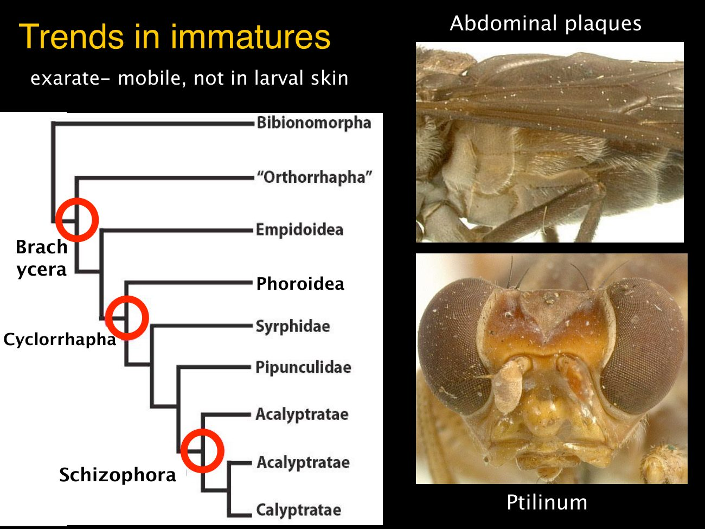](slides/slide-15.jpg)

So just to go through the major lineages here. So Bibionomorpha [following words unclear] is one of those lower Diptera the terrestrial one, Then sister to that is the brachyceran flies, which includes several, major lineages. The [Lower Brachycera] are the ones we were talking about that are large and robust.

Of often metallic or B mimic a lot of predatory parasitoid ones and then the Cyclorrhapha, So Cyclorrhapha that mean what? What that means is that they emerge from their pupa in a circular, hole. So they inflate their head.

The lower Brachycera emerge from their pupa using their abdomen. So they have these abdominal plaques along the bottom edge of each tergite and top edge of each sternite that fasten to the pupa. The abdomen, is inflated with hemolymph [verb unclear], the pupa to emerge, whereas in higher flies they inflate their head.

And in the Schizophora, they go one step further and have an evolutionary innovation for a new organ that's used to emerge from the pupa that's called the ptilinum.

[↑ Slides](#slides) · [Course index](../../README.md)

## Slide 16

[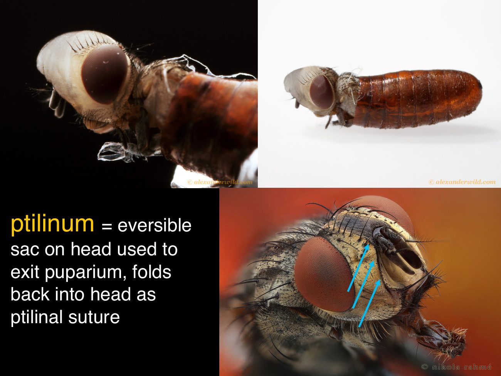](slides/slide-16.jpg)

And the ptilinum is a essentially a balloon that comes out of the head of, dorsal to the antennae, is inflated with hemolymph and pops a circular hole in the puparium. That's how they emerge the pupa so they can pupate in more inhospitable environments but still can emerge from the pupa without their chewing mouth parts. That ptilinum then, folds back into the head, and it's visible in adult flies as the ptilinal suture on the antennae.

So that's a very important character to observe, to tell apart these major groups of flies. Some of these, groups, families that are really important Tephritidae the agriculture fruit flies, chloropid frit, or grass flies, which are incredibly diverse. Eco, ecologically and also have a tonne of undescribed species in Australia.

Agromyzidae are leaf mining flies, and then the Drosophilidae include, genetic model organisms like Drosophila, but many fungus feeding plant feeding parasitoid species. So all these families, tend to have a lot of ecological variation.

[↑ Slides](#slides) · [Course index](../../README.md)

## Slide 17

[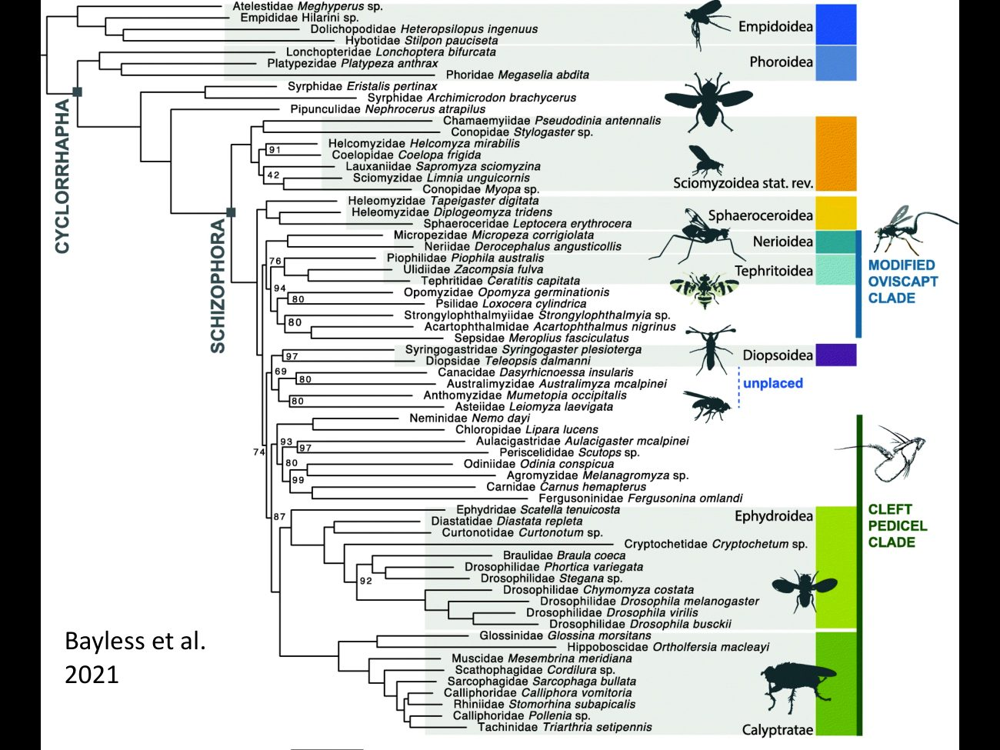](slides/slide-17.jpg)

This is the particular group of flies that I, study the most these acalyptrate flies and the most recent major, phylogenics hypothesis for this group, was published a few years ago, on a project that I was leading The major thing I want you to take away here is that there's a few major lineages in the Schizophora, one of which includes many, lineages that have modified female egg laying devices. At the end of the abdomen, there's no ovipositor in adult flies oviscapt. And there's another major group that have modified antenna.

The pedicel is modified, in this other large lineage of, acalyptrate flies of Schizophora that have that [ptilinum] to emerge from their pupa.

[↑ Slides](#slides) · [Course index](../../README.md)

## Slide 18

[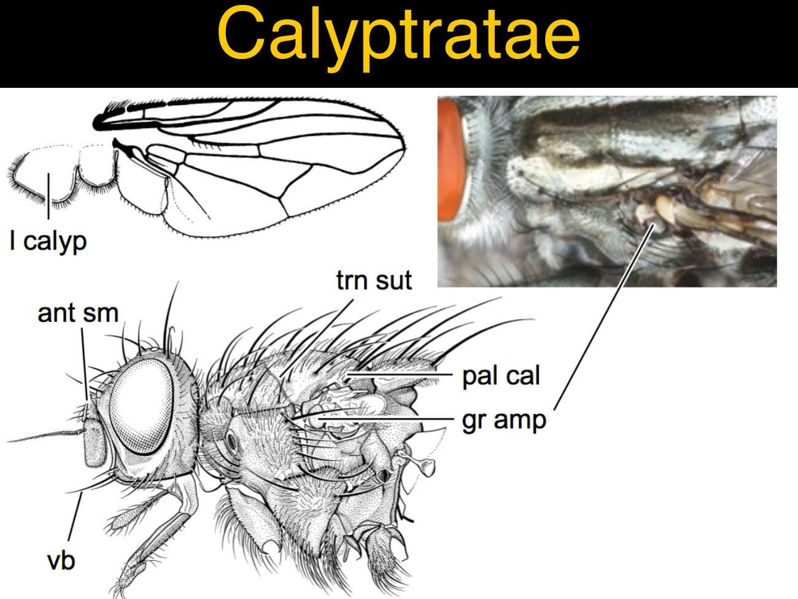](slides/slide-18.jpg)

Two more important lineages of flies. So, in the bottom of that tree, there's a lineage called Calyptratae. So again, these are all kind of nested major lineages Calyptratae are part of [Schizophora, within Brachycera], but we treat these as, important major lineages.

So the calyptrates These are large, heavy bodied flies, often kind of grey or brown and include things like, muscid house flies. Blow flies. These have a number of, morphological differences.

Compared to other flies they have, the lower calypter is present, so there's an extra lobe at the base of the wing. They have that cleft pedicel that antennal seam on the pedicel. A suture going dorsally across the, top of the thorax across the notum.

And they have, additional sclerites surrounding the wing base. Including that [greater ampulla]. So these are large flies and very good flyers and very ecologically diverse.

So some major groups include muscid house flies and bush flies. Calliphoridae are the blow flies Sarcophagidae flesh flies. Tachinidae is the, group major group of parasitoid flies that attack a lot of other invertebrates and Oestridae are bot flies that mainly attack mammals.

[↑ Slides](#slides) · [Course index](../../README.md)

## Slide 19

[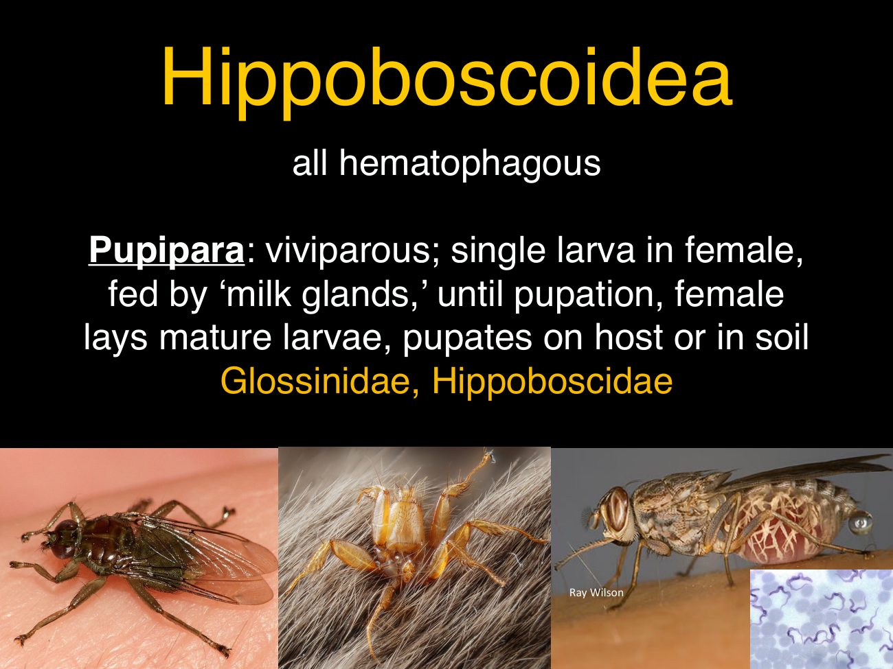](slides/slide-19.jpg)

The last major lineage to talk about, which is inside the calyptrates are the Hippoboscoidea. Hippoboscoids are a important and very strange derived group of flies. So these are also called Pupipara.

All Hippoboscoidea are blood feeding, on mainly on birds and mammals. There's three kind of large lineages, of Hippoboscoidea with things like bat flies keds, tsetse flies. So all of these flies the larvae develops inside the adult female.

She has milk glands that feed the larva. And then when the larva is ready for pupation, she lays a late instar larva that immediately pupates into an adult. So essentially the larva stage is not relevant for the ecology of these groups.

Instead, the adults are doing all the feeding, And, they can do that because they're they're quite specialised in terms of blood feeding on their hosts or generally on mammals on, there's a lot that are on bats, but along with that, some are vectors of, important diseases, protozoan diseases. [Nested classification recap partially unclear.] Calyptratae is one important group of the Schizophora, which is nested within [Brachycera], which is one lineage of the Diptera. So the diversity of Diptera is spread throughout, and these major, ecological strategies have evolved multiple times.

And finally we're at the Hippoboscoidea. It's a Pupipara that are among the most derived and specialised lines of flies.

> **Editorial note:** A mature larva pupates and subsequently emerges as an adult; it does not become an adult immediately upon pupation.

[↑ Slides](#slides) · [Course index](../../README.md)

## Source notice

this material has been reproduced and communicated to you by or on behalf of the Australian National University in accordance with Section 103 P of the Copyright Act 1968. The material in this communication may be subject to copyright under the act. Any further or communication of this material by you must be consistent with the provisions of the act. Do not reproduce this material. Do not remove this notice.

[← Previous lecture](../24-diptera-part-1-morphology/README.md) · [Course index](../../README.md) · [Next lecture →](../26-diptera-part-3-ecology-economic-impact/README.md)
