# Diptera Part 3 - Ecology, Economic Impact

[← Previous lecture](../25-diptera-part-2-evolution-classification/README.md) · [Course index](../../README.md) · [Next lecture →](../27-diptera-part-4-diversity-pdf-only-no-recording-for-this-one/README.md)

**Slides + cleaned transcript** · 21 slides

English transcript with fillers and repeated false starts removed. Technical terms are corrected using the slides and context. Bracketed wording marks reconstruction or uncertainty. Slide boundaries are inferred from content; the transcripts have no slide timestamps.

[Original transcript](original-transcript.txt) · [Text-only version](cleaned-transcript.md) · [Editing notes](../../EDITING-NOTES.md) · [Correction record](corrections.md)

[Searchable slide text](slide-text.md). Click a slide image to open it at full size.

## Slides

[1](#slide-1) · [2](#slide-2) · [3](#slide-3) · [4](#slide-4) · [5](#slide-5) · [6](#slide-6) · [7](#slide-7) · [8](#slide-8) · [9](#slide-9) · [10](#slide-10) · [11](#slide-11) · [12](#slide-12) · [13](#slide-13) · [14](#slide-14) · [15](#slide-15) · [16](#slide-16) · [17](#slide-17) · [18](#slide-18) · [19](#slide-19) · [20](#slide-20) · [21](#slide-21)

## Slide 1

[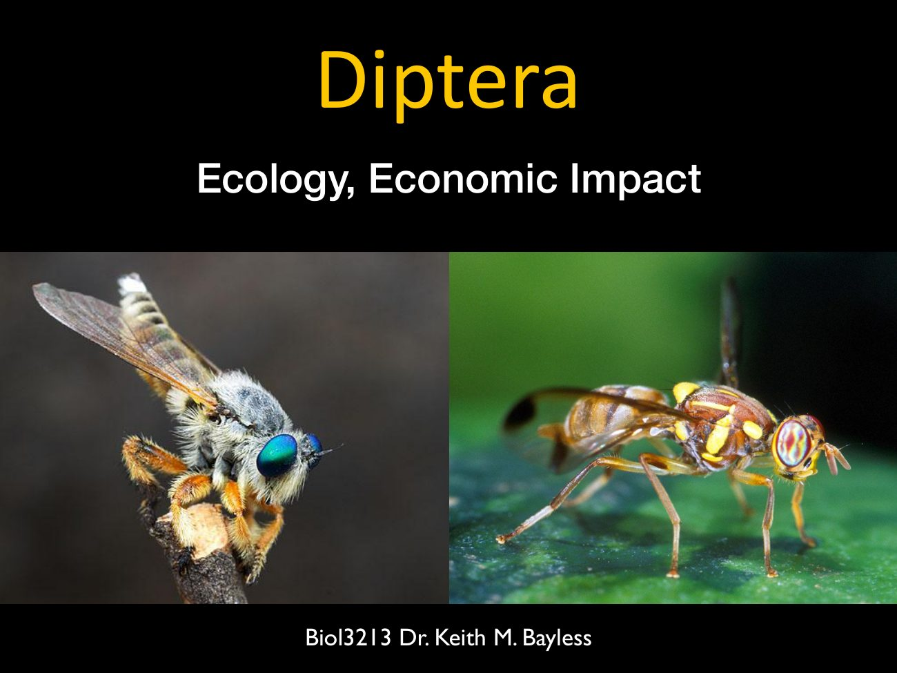](slides/slide-01.jpg)

OK, we're going to move on to the ecology of flies, talk about what they're doing in the environment and in some cases, how that affects us. So just these two examples here the fuzzy grey one is a predatory robber fly that, can be a beneficial attacking, plant feeding insects. Or it can be, a pest, a predator of honeybees and honeybee hives the same with the more colourful one.

In some cases, some fruit flies are pests of fruits that humans consume, and in other cases they're species used as biocontrol for weeds.

[↑ Slides](#slides) · [Course index](../../README.md)

## Slide 2

[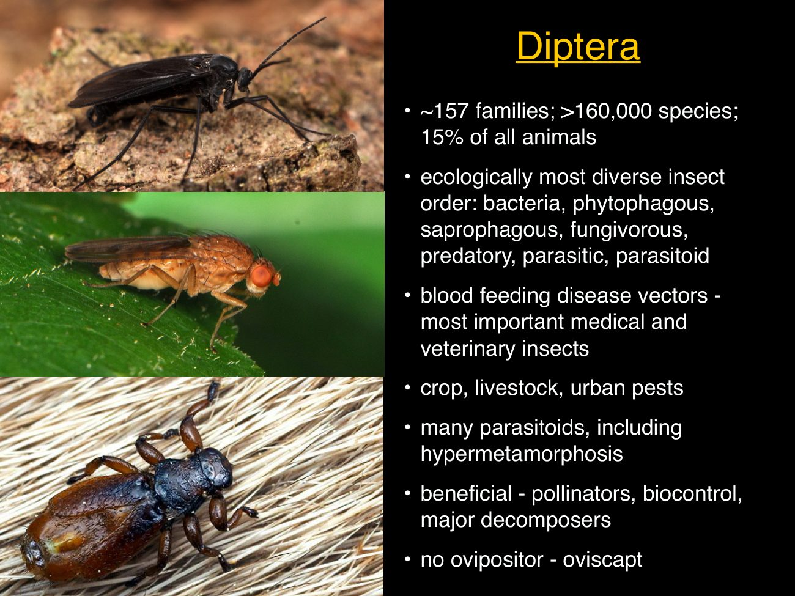](slides/slide-02.jpg)

Flies are incredibly diverse. Ecologically, there's a lot of species that are plant-feeding, [parasitoids, and feeding] on fungus. A lot of saprophages the group of insects with the most aquatic species is flies Diptera.

[↑ Slides](#slides) · [Course index](../../README.md)

## Slide 3

[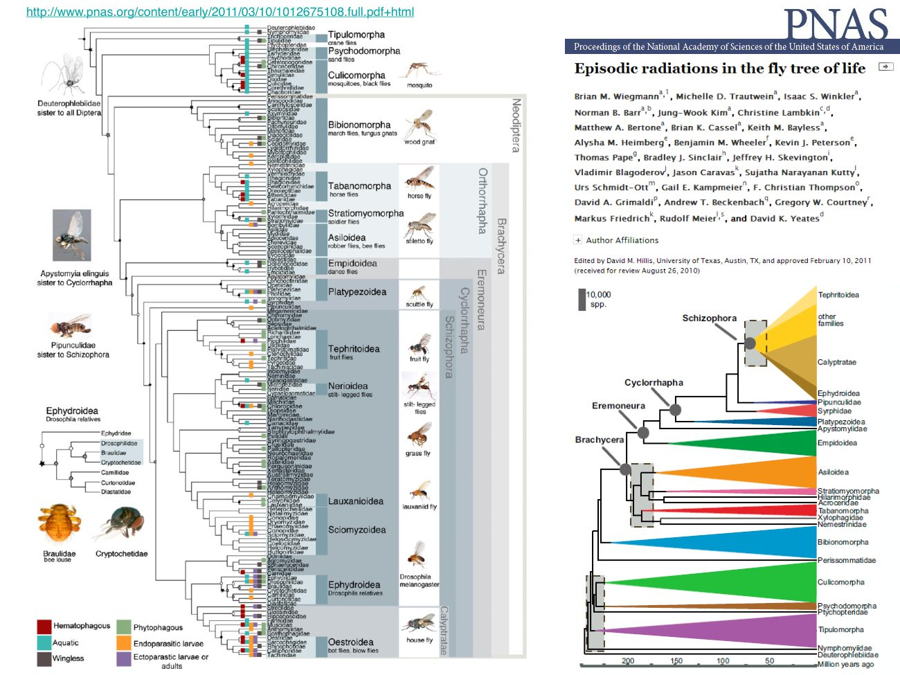](slides/slide-03.jpg)

And those ecologies are spread throughout the evolutionary history of flies. Most of the early branching lineages are aquatic. There was a major transition to land, but there was a lot of reversals back to freshwater and even marine aquatic ecosystems.

Parasitoids have evolved, many times throughout flies as larvae and blood feeding adults have evolved at least 12 times. And plant feeding also is spread throughout, with many families having some, plant feeding, members.

[↑ Slides](#slides) · [Course index](../../README.md)

## Slide 4

[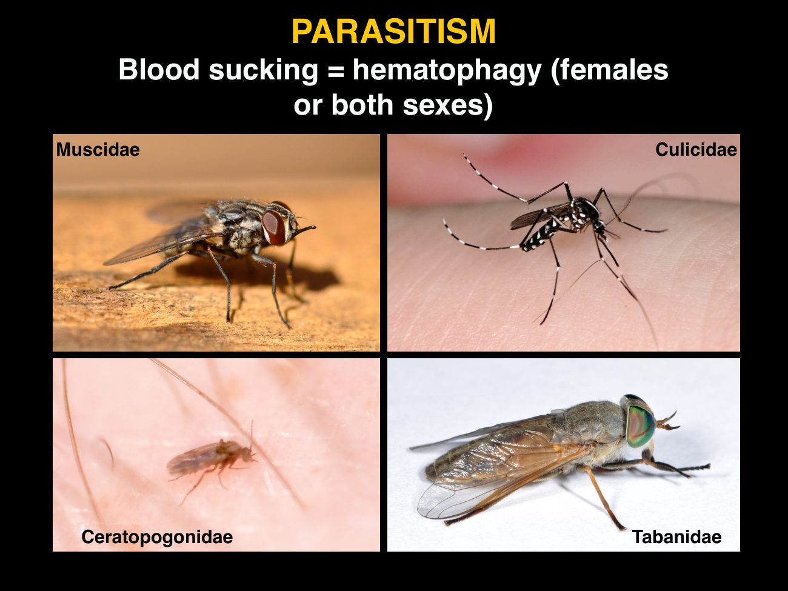](slides/slide-04.jpg)

Parasitism can be divided into multiple different areas in terms of, he hematophagous blood feeding adults, larvae that can be parasites of vertebrates or larvae that can be parasitoids [of insects] and relatives. Some examples of some blood feeding flies, biting, stable flies, a group of muscids. Other muscids, like Bush flies and house flies don't bite.

But there's a subfamily that includes species that suck blood Mosquitoes in [Culicidae], which transmit a lot of, very dangerous diseases. [Biting midges] in the Ceratopogonidae and March flies and [horseflies] in [Tabanidae] are four examples of blood feeding flies. Some of these blood feeding flies, only bite as females, and in other groups, males and females both bite.

Generally, what the females are doing is getting, protein from the blood to form more eggs. There's some species that need a blood feed. Use the blood meal to make any eggs so they need to feed in order to reproduce.

And there's other groups that if they can get a blood meal, they'll produce a lot more eggs or higher quality eggs. But they're able to, reproduce without a blood meal if one is not available.

[↑ Slides](#slides) · [Course index](../../README.md)

## Slide 5

[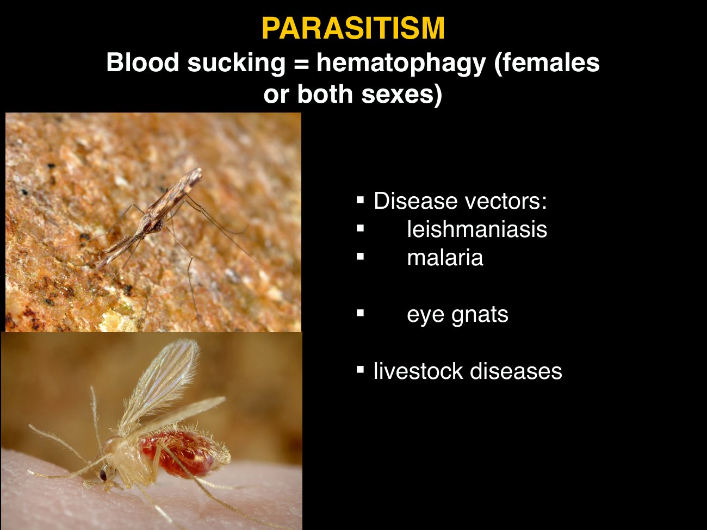](slides/slide-05.jpg)

These blood feeding flies can vector some of the most important diseases, including malaria. And a lot of viruses. This the one on the bottom is a psychodid sand fly.

That is, a fuzzy little hairy fly that, some of those vector leishmaniasis, which is a protozoan [disease], a very dangerous protozoan [disease]. Some instead, are what are called [eye gnats] where they're they're pests of humans, because they, don't suck blood. But they try to get tears from eyes, and then they can mechanically vector, diseases that way.

There's also a lot of these blood feeding flies that, cause damage to livestock. So there's some diseases that don't necessary necessarily affect humans directly but can, cause damage to agricultural, livestock.

[↑ Slides](#slides) · [Course index](../../README.md)

## Slide 6

[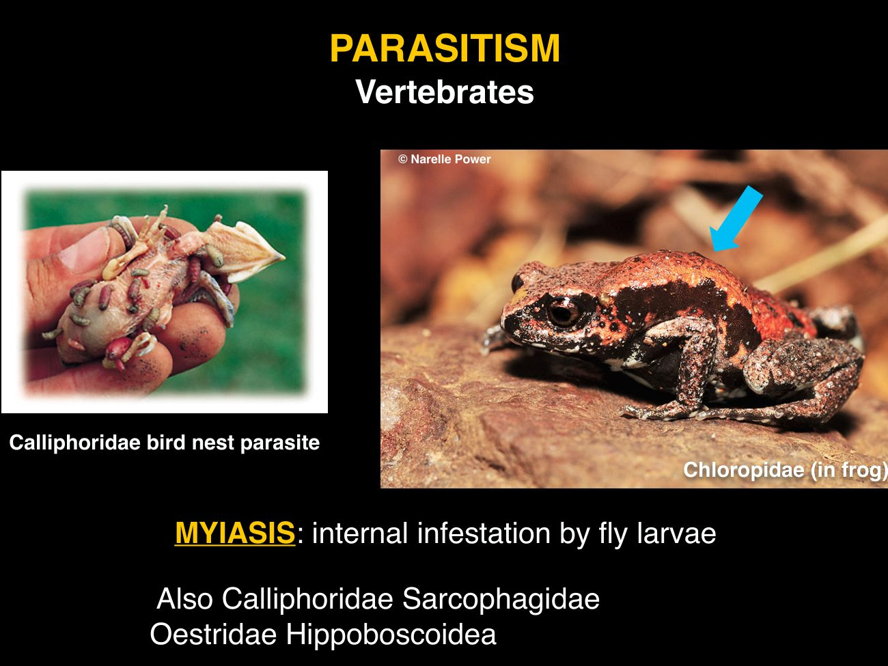](slides/slide-06.jpg)

In some groups, the larvae are, instead attacking their vertebrate hosts. So this is quite diverse in a lot of different groups. They attack mammals and birds and lizards.

Frogs that chloropid in the frog is an Australian endemic that only occurs in Australia. There is an Australian-endemic, chloropid fly genus that, attacks frogs lives under their skin. And there's a lot of other groups that attack birds and different mammals throughout Diptera, particularly in the Calyptratae and things like [Calliphoridae and Oestridae].

So the term for a fly larva being inside a vertebrate host is myiasis the Maya MYI A is, a Greek word for fly. So that's essentially invasion by body tissue by flies is myiasis. Some of these are quite species specific and have a complex ho host cycle.

And other groups can be quite opportunistic. Where they can damage, living tissue along with eating dead tissue. And some of those can be major pests of livestock.

Where If a livestock gets a wound, then if a parasitic fly called a screwworm larva will move from the wound into the living tissue and, hurt the livestock animal reduce yields.

[↑ Slides](#slides) · [Course index](../../README.md)

## Slide 7

[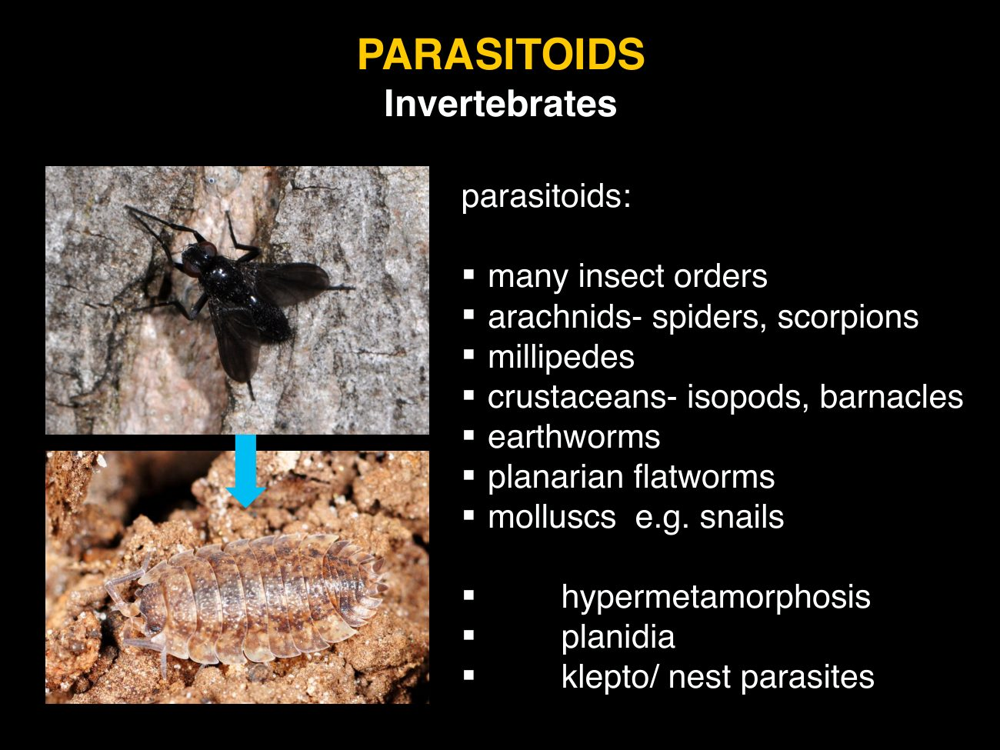](slides/slide-07.jpg)

Parasitoids are insects, that attack other insects. And the major difference is that a parasitoid will usually kill the host parasites. Don't, and usually there's many parasites per host, whereas there's usually one parasitoid per host.

So parasitism is also very important in Hymenoptera, and there's some beetles and moths that do it. But in flies, it's evolved many times, and they have quite a broad host range, so each species of fly tends to be quite specific. But across the order they attack a lot of different kinds of invertebrates, including other insects.

Other flies. But they also will go after arachnids and millipedes. Terrestrial crustaceans.

[isopods]. There are [annelids]. Earthworms are attacked by several different groups of flies planarian, and there's, since there's aquatic flies, there's even flies that are parasitoids of aquatic organisms, including things like mollusks and barnacles.

This a this parasite Life history in flies is associated with some additional, ecological, innovations. So in some cases, the first instar, is a planidium. And it's mobile.

And then once it finds the host, it undergoes hyper metamorphosis. So the next instar will be completely different body shape to enter the host and be a parasitoid Some of these parasitoids, instead of killing the host, are going after the provisions that the host has So things like, wasps and bees that provision their larvae with, things like pollen or dead caterpillars. The parasitoid flies are kleptoparasites and will get into the nest and steal those provisions for themselves.

A lot of these parasitoids will find their host by laying eggs nearby. Or the eggs have to be consumed by the host or the larvae. The first-instar larvae can move around to find the host.

> **Editorial note:** Parasitoids can attack non-insect hosts too, as the lecturer subsequently explains. “Usually one per host” is a simplification; gregarious parasitoids also occur.

[↑ Slides](#slides) · [Course index](../../README.md)

## Slide 8

[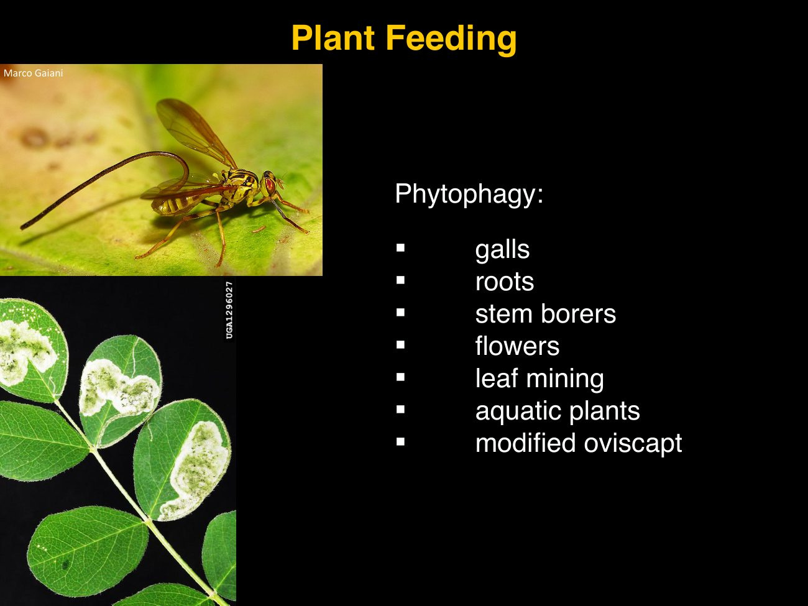](slides/slide-08.jpg)

Plant feeding is another, major life history throughout Diptera that's evolved multiple times and through since this has evolved so many times, the plants that are attacked are really diverse and also the method in which the larvae invade the plant tissue and what they do to the plant. Tissue is really diverse, so some form galls are also present in some hymenopteran things like mites, where essentially the larva invades the plant tissue and then modifies it into some kind of structure for the benefit of the larvae to give it more food and protection. There's a lot of fly larvae in the soil that are phytophagous and attack roots.

Those can be major pests of crops and turf grass. There's some fly larvae that enter the plant through the stems and the trunk. So it's very difficult to see the damage they're doing externally.

There's there's fly larvae that are particularly, a large, composite flowers. The larvae will be inside the flower head, consuming that tissue leaf mining is another major trait. So leaf mining is also found in, some beetles and some, moths.

But essentially what that means is the larvae stays inside the leaf inside the top and bottom layer of the leaf and consumes the plant tissue, but leaves the le overall leaf structure present. So, that one on the bottom are examples of leaf mines and leaves where the larva fed on that tissue but stayed inside the leaf to protect itself from desiccation and from parasitoids. And then, when it's done it pupates and leaves the leaf to find hosts in a new food source.

Since there's a lot of aquatic larvae, there's also, aquatic phytophagous flies. Or the larvae will attack aquatic plants and another, major character in some groups of flies. And particularly in the acalyptrate groups that I study is that the oviscapt is heavily modified to lay eggs inside the plant host so that one on the top is a, fruit flyer that attacks, papayas.

And it has that very long elaborate oviscapt to, deposit eggs.

[↑ Slides](#slides) · [Course index](../../README.md)

## Slide 9

[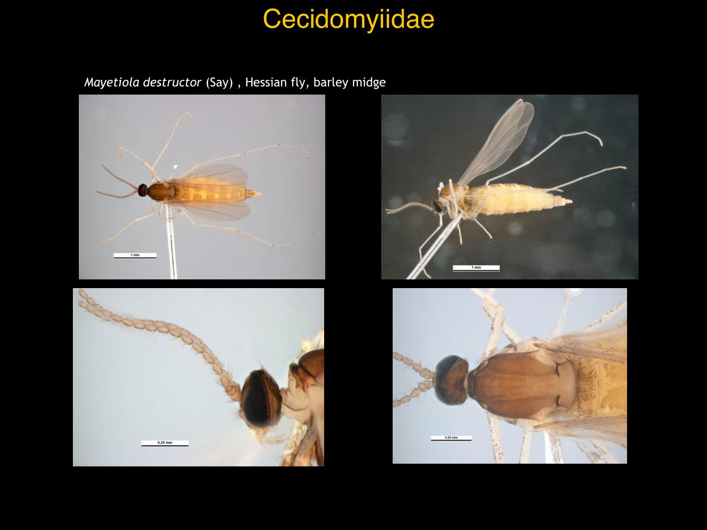](slides/slide-09.jpg)

Some a really important, group of plant feeding flies are [gall midges, Cecidomyiidae]. This is a really important, fly for, Australian Agriculture and biosecurity. The Hessian fly.

This particularly attacks wheat, and is A huge worldwide pest of wheat crops.

[↑ Slides](#slides) · [Course index](../../README.md)

## Slide 10

[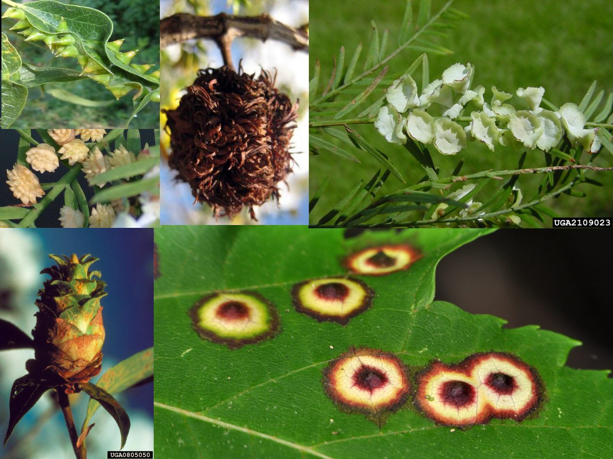](slides/slide-10.jpg)

These cecidomyiids and other relatives, some of them form, galls and galls are, among the most mysterious ecological niches in nature. How exactly? Biochemically they, coerce the plant into forming these structures is still not well understood and probably is really variable across different groups of insects and plants, and what those structures are used for is also fascinating.

So some of them are kind of mimicking flowers or spiky, perhaps to deter. Large plant feeding herbivores and other ones are kind of cryptic, probably to try to, avoid parasitism of the galls. And these galls can also be their own little micro ecosystem, where there's, inquilines that enter the galls and don't damage the original insect.

Once the insect leaves the galls insect, other species will come in to feed on the leftovers. And it really, gets very complex the number of species associated with these plant galls.

[↑ Slides](#slides) · [Course index](../../README.md)

## Slide 11

[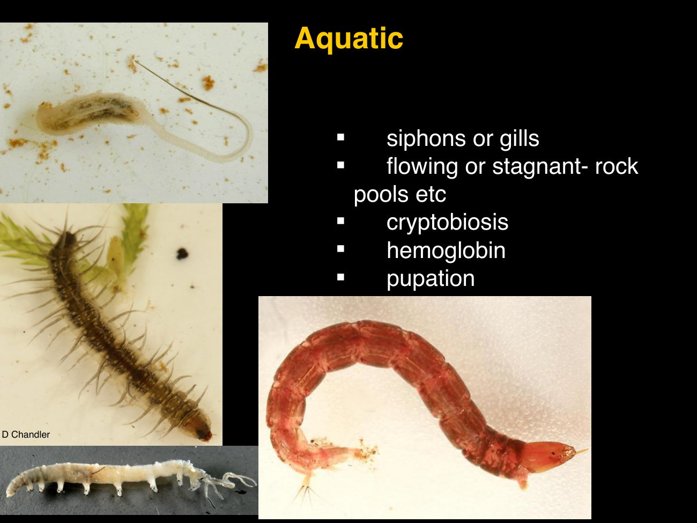](slides/slide-11.jpg)

As I mentioned before, the insect group with the most aquatic species is Diptera the flies and along with that, they're quite diverse in terms of their ecology, their different specialisations in that aquatic ecosystem. So these are all various, aquatic, Diptera. They can either breathe through syphons that come out of the water on the long tube or have true gills to help them, gather oxygen from the water.

And there's one group of chironomid midges that have independently evolved haemoglobin for oxygen transfer inside the body. So that's this red, bloodworm midge larva on the bottom that can live in really stagnant or polluted water. And it can get its oxygen through, haemoglobin going through the cells and not gills.

They aquatic in aquatic flies can be in lakes and large flowing rivers, but can also be in quite small or ephemeral bodies of water, including things like rock pools or stagnant water. So that's an issue because some of the most damaging mosquitoes their larvae eat algae in things like rock pools, but can easily move on to, temporary human caused pools of water like in tyres and buckets. And then the adults.

The adult mosquitoes will, suck blood and spread disease when those bodies of water dry up. There's a lot of flies that are very effective at cryptobiosis, where they can, slow down their metabolic processes until they're exposed to water again. And can kind of hibernate, to survive.

Seasons that are that were where less water is available. There's a number of flies that have really specialised aquatic, life histories and things like in the canopy and [bromeliads; word uncertain] or in salt lake, or including, in hot springs. And some flies will pupate in the body of water and other ones will leave, to pupate on the surface.

But things like mosquitoes the pupae are also swimming around in the water, and the adult flies can pupate and, eclose so develop their sclerotised body structures Just sitting on the surface of the water.

> **Editorial note:** Haemoglobin binds oxygen obtained from the environment; it does not replace the need to take oxygen into the body.

[↑ Slides](#slides) · [Course index](../../README.md)

## Slide 12

[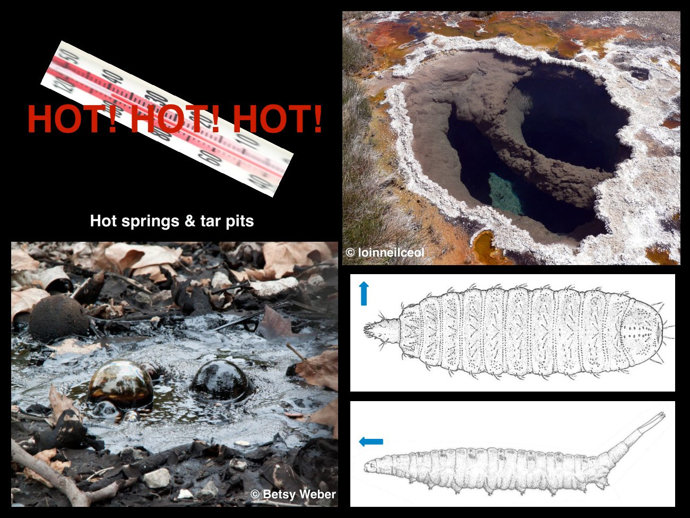](slides/slide-12.jpg)

Flies are, the most diverse and important insects in some of these extreme habitats. So the, most southerly, macroscopic animal is an aquatic fly that lives in moss mats in an Antarctica. The some of the insects that live in the hottest or most acidic environments, including hot springs in Yellowstone, are these soldier fly larvae.

And there's also aquatic, shore fly larvae that are specialised for tar pits. So they move around in the tar pit, use their syphon to breathe and then eat other insects that have fallen into the tar. So along with that, these aquatic, insects are, have a lot of specialisation and a lot of diversity in terms of what they're up to.

[↑ Slides](#slides) · [Course index](../../README.md)

## Slide 13

[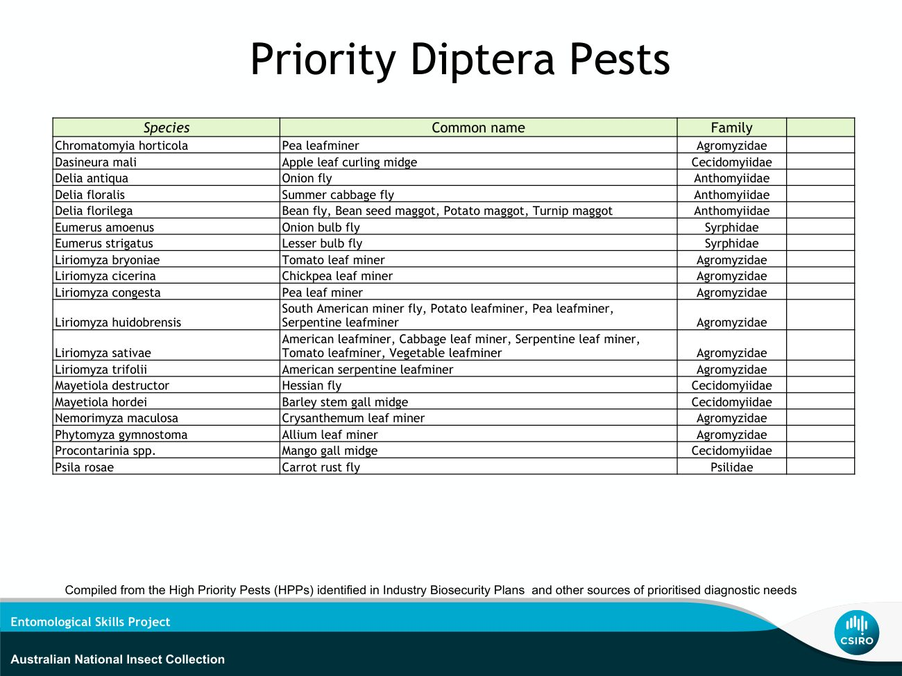](slides/slide-13.jpg)

So now let's move a little bit into the, realm of economic impact. So here is just a list of, some of the priority pests for Australian agriculture and biosecurity. So a lot of these are families I might have mentioned already.

Things like Agromyzidae or the leaf miners, syrphids include, some bee mimics and are quite diverse. Some are aquatic.

[↑ Slides](#slides) · [Course index](../../README.md)

## Slide 14

[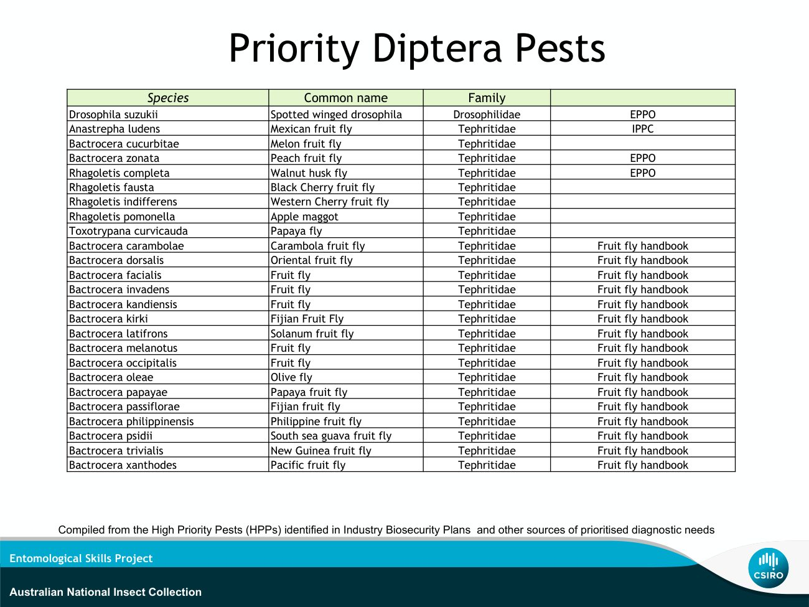](slides/slide-14.jpg)

And then a lot of tephritid fruit flies. And these all can damage this. These are plant pests.

That can damage various crops in Australia. Some are present, and some are not and are trying to be controlled and prevented from entering.

[↑ Slides](#slides) · [Course index](../../README.md)

## Slide 15

[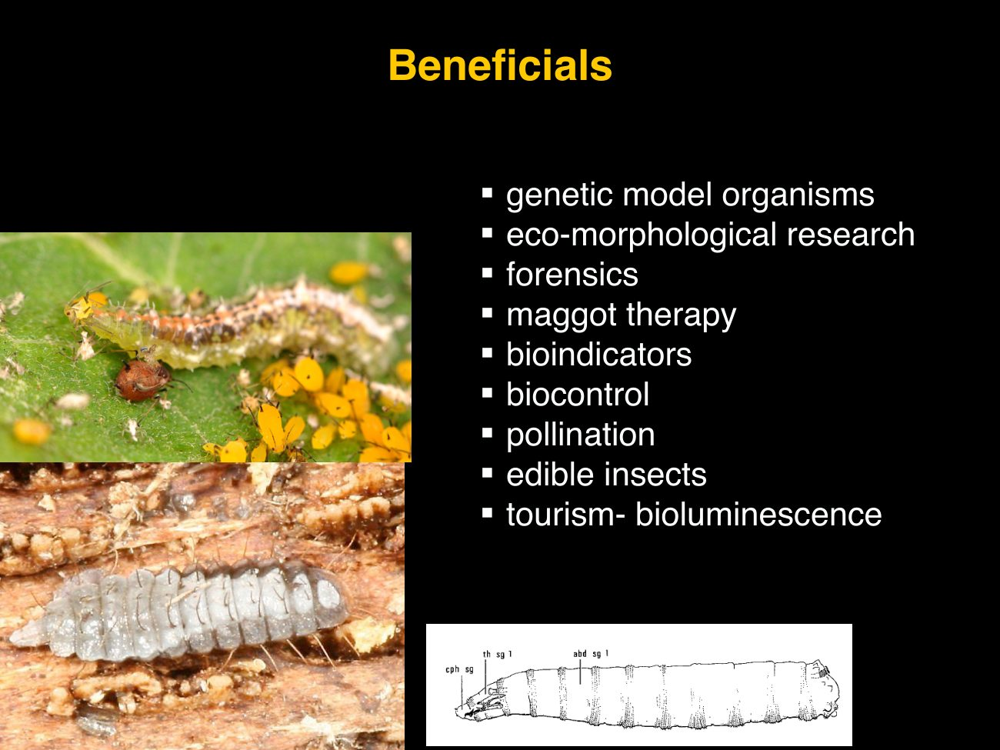](slides/slide-15.jpg)

But beyond that, those blood feeding, flies or plant pests there's a lot of ways that flies can positively contribute to human society beyond just appreciating their beauty and diversity, which is my major motivation. And that is, through various functions that the adults in larvae have in their ecosystems. So, flies since some develop very quickly and, are easy to lab rear, they have been used at genetic model organisms.

The most famous of those is Drosophila melanogaster and relatives. But there's other, fly groups that are used as lab animals. Where we can do detailed experiments on their genetics behaviour, ecology, development, based on keeping lab colonies that are easy to manipulate.

Along with that, there's interest in various aspects of their, ecology and morphology. There's species radiations in Hawaii that have been well studied, and different, radiations in some in some of these plant feeding lineages, [gall midges, Cecidomyiidae], where there's ecological studies looking at how they've adapted different hosted hosts and, their host range and including how the how things like, Rhagoletis apple maggots have, switched host plants. There's a lot of research in into those aspects.

Forensics is another area where flies are the most important group of insects. So, when, human remains are found often some information about the timing and circumstances of the death can be gleaned based on the insects associated with those remains, which in most cases will be fly larvae in the Calliphoridae and relatives. Another, use for those, Calliphoridae flight is for maggot therapy.

So some calliphorids are parasites and will attack some species will attack certain hosts. Some are facultative parasites where they're they're happy to eat rotting, meat. But when?

If they're on a living organism, they'll move from a wound into the body, and other ones are purely, saprophagous. And those can be beneficial because the fly larvae are eating and competing with bacterial decomposition. So they're very good at managing, the growth of bacteria.

So wounds that are not responding to antibiotics. Often maggot therapy can help debride clean those wounds and render them, safe and easier to heal. Bio indicators.

It means the species present in certain ecosystems can indicate how preserved or polluted that ecosystem will be. So those chironomid aquatic midges are among the most important insects as bio indicators because they're really diverse and species will have narrow tolerances. For various potential pollutants.

And some will be found in polluted water, some won't. And so the species composition of different bodies of water can give information on, conservation and clean up of, ecological issues. Environmental, damage.

Biocontrol is another aspect where flies are often used. Both plant feeding flies will be biocontrol aimed at weeds and parasitoid flies can be used for biocontrol of, pest insects. So the same way in closely related insects can be a pest or a beneficial, depending on their host what they're doing.

There's a There's several groups of flies, including black soldier flies and, house flies that are being considered for, insect diet supplements either to feed livestock and aquaculture or to directly supplement, human diets. And then another great example is that bioluminescent flies, mainly in New Zealand, but also they are also present in other places are tourist attractions in and of themselves. So that major, point, I didn't mention there is pollination.

A lot of adult flies are pollinators, even things that are blood feeding can also be pollinators. So, for instance, most horse flies. The, males will visit flowers as pollinators, and the females will both suck blood and visit flowers as pollinators.

So along with that, things like a mosquito where the larvae is an aquatic situation, Adults are pollinating flowers and sucking blood. They're really important in the ecosystem because they're getting exposed to so many different aspects.

[↑ Slides](#slides) · [Course index](../../README.md)

## Slide 16

So one major bene be benefit of flies in terms of their pollination is what they're doing. So the cacao plant has tiny flowers that can only be pollinated by really tiny ceratopogonid and midges.

[↑ Slides](#slides) · [Course index](../../README.md)

## Slide 17

[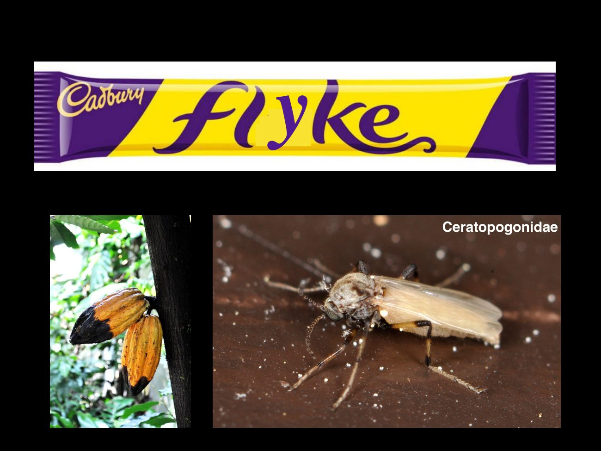](slides/slide-17.jpg)

So the next time you go for a flake, just give a little credit to the organism that, helped that chocolate come into existence.

[↑ Slides](#slides) · [Course index](../../README.md)

## Slide 18

[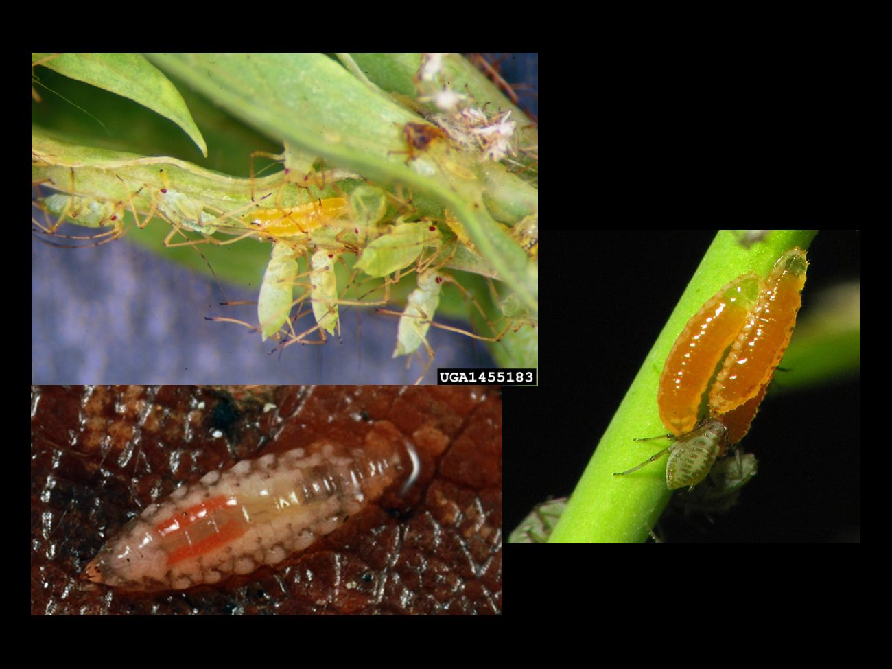](slides/slide-18.jpg)

Biocontrol in flies is really important. There's several different groups of flies that are both predators and, parasites that will attack other, pest insects. These are, syrphids and cecidomyiids that, are voracious predators of pests like aphids.

So, really important for helping out in gardens and agricultural systems.

[↑ Slides](#slides) · [Course index](../../README.md)

## Slide 19

[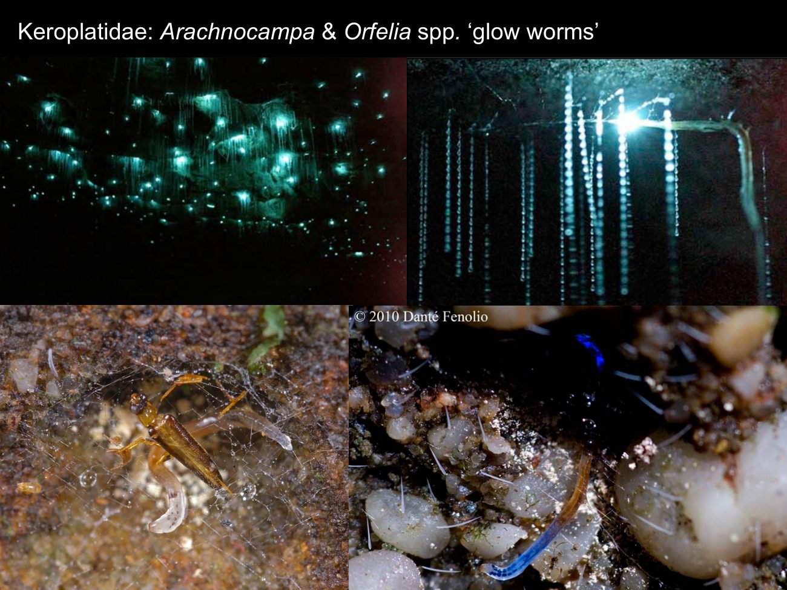](slides/slide-19.jpg)

Those, tourism flies that I mentioned. So it's it's a fly that, makes people do whole trips to come see them. Are larvae of keroplatid?

Fungus gnats. So this is a group of fungus gnats where the larvae are predatory and you can find these right here in Canberra, although probably not the bioluminescent one. So there's many of these that make these webs in rotten logs or overhangs.

And they capture prey and kill them. And then a few different groups of these predatory fungus gnats will bioluminescent. So they have this pale blue light that lights up at night and tricks, things like May flies and chironomid midges to land in their webs.

And then they are consumed by the, maggot. And these are really beautiful. The there's there's some in down in Victoria, there's some in the US, but the most famous, are in, New Zealand.

Beautiful, caves and hikes you can do to see these glow worms which are actually flies.

[↑ Slides](#slides) · [Course index](../../README.md)

## Slide 20

[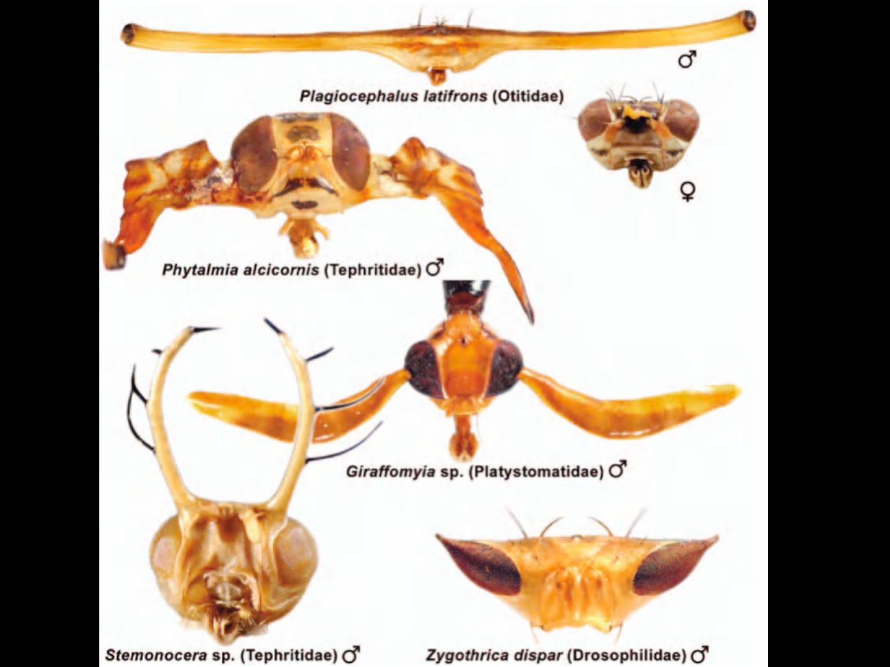](slides/slide-20.jpg)

As I was mentioning before, in terms of the ecology and morphology, study the sexual behaviour of flies is really diverse and involves a lot of specialised morph morphology, so stalk eyes have evolved at least nine times within flies. And then there's various groups that have, projections and antlers and horns for sexual conflict. So there's a There's a lot of room for research to understand, the evolution of these, comp competitive sexual systems.

And this is probably one because the head is already modified to emerge from the pupa in this group of flies. And two, these flies tend to use ephemeral resources that are really abundant and then gone quickly. So, in a short span of time, a lot of choices have to occur for mating.

Which leads to these exaggerated morphologic. And this is an area that I'm I'm very invested in discovering more, and including describing new species of stalk-eyed flies.

[↑ Slides](#slides) · [Course index](../../README.md)

## Slide 21

[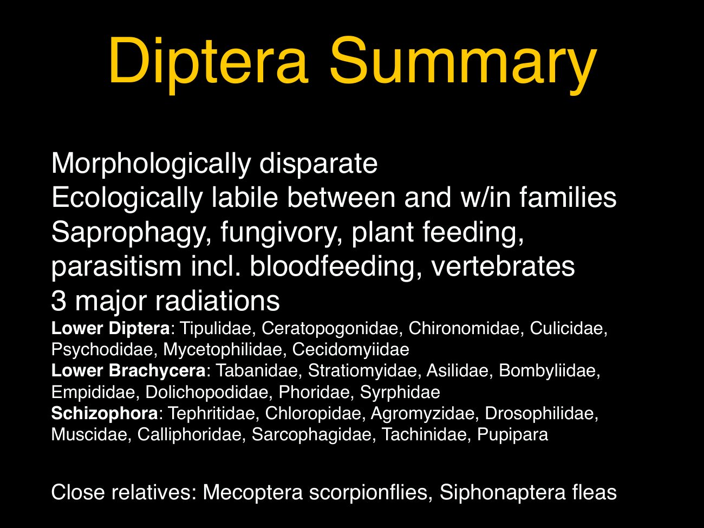](slides/slide-21.jpg)

So to wrap up about flies, among all insects, they're probably the most morphologically disparate have the most different body shapes. As adults in larvae, they are labile ecologically, so some families will be really diverse what they're doing, but a across families, and things like, saprophagy fungus feeding, plant feeding parasitoids Adult blood feeders have all evolved multiple times throughout flies. The overall phylogeny of flies includes three major radiations.

So the lower Diptera that have longer antennae, they're they're more thin, mostly aquatic larvae, including things like Tipulidae Crane flies the lower Brachycera where they have these reduced antennae, and are larger, heavy bodied. The larvae are more adept at living in dry environments. There's more predators and parasites, including things like, tabanid march flies and asilid robber flies.

And then the Schizophora that have this major innovation to emerge from their pupa. They pupate in a puparium, and these are really ecologically diverse, including a lot of, forensically important species plant feeding, pests and beneficial. And that those pupiparous flies that, don't even feed as larvae out outside of the mother.

Their closest relatives are scorpion flies and fleas. Scorpion flies share with flies. This long rostrum.

Although there's chewing mouthparts at the [end of] the rostrum and fleas also have legless larvae. They're all parasitic, so that's the major points for flies. I hope I've explained why they're so diverse and interesting.

And, I would love to talk with any students, in terms of, potential future research issues or, projects, since there's a lot left to be discovered about Australian flies in many of these aspects, including very basic research, discovering and describing the fauna of Australia.

[↑ Slides](#slides) · [Course index](../../README.md)

## Source notice

this material has been reproduced and communicated to you by or on behalf of the Australian National University In accordance with section 103 P of the Copyright Act 1968. The material in this communication may be subject to copyright under the act. Any further reproduction or communication of this material by you must be consistent with the provisions of the act. Do not reproduce this material. Do not remove this notice.

[← Previous lecture](../25-diptera-part-2-evolution-classification/README.md) · [Course index](../../README.md) · [Next lecture →](../27-diptera-part-4-diversity-pdf-only-no-recording-for-this-one/README.md)
