# Amphiesmenoptera Part 1 - Trichoptera

[← Previous lecture](../27-diptera-part-4-diversity-pdf-only-no-recording-for-this-one/README.md) · [Course index](../../README.md) · [Next lecture →](../29-amphiesmenoptera-part-2-lepidoptera-morphology/README.md)

**Slides + cleaned transcript** · 11 slides

English transcript with fillers and repeated false starts removed. Technical terms are corrected using the slides and context. Bracketed wording marks reconstruction or uncertainty. Slide boundaries are inferred from content; the transcripts have no slide timestamps.

[Original transcript](original-transcript.txt) · [Text-only version](cleaned-transcript.md) · [Editing notes](../../EDITING-NOTES.md) · [Correction record](corrections.md)

[Searchable slide text](slide-text.md). Click a slide image to open it at full size.

## Slides

[1](#slide-1) · [2](#slide-2) · [3](#slide-3) · [4](#slide-4) · [5](#slide-5) · [6](#slide-6) · [7](#slide-7) · [8](#slide-8) · [9](#slide-9) · [10](#slide-10) · [11](#slide-11)

## Slide 1

[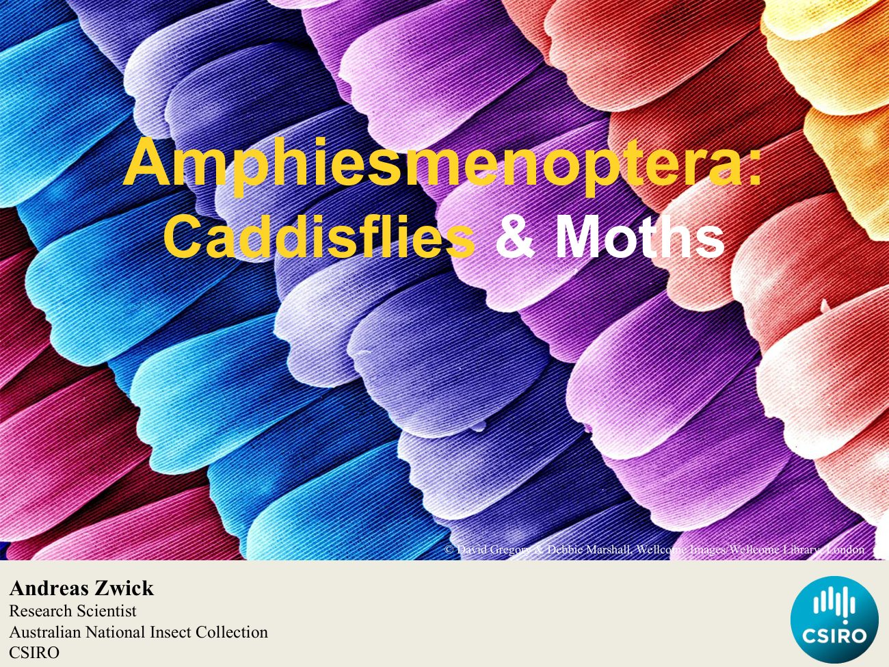](slides/slide-01.jpg)

Hello, everyone. My name is Andreas. I'm a research scientist at the Australian National Insect Collection CSIRO Today I'm talking to you about the Amphiesmenoptera the caddisflies and moths.

[↑ Slides](#slides) · [Course index](../../README.md)

## Slide 2

[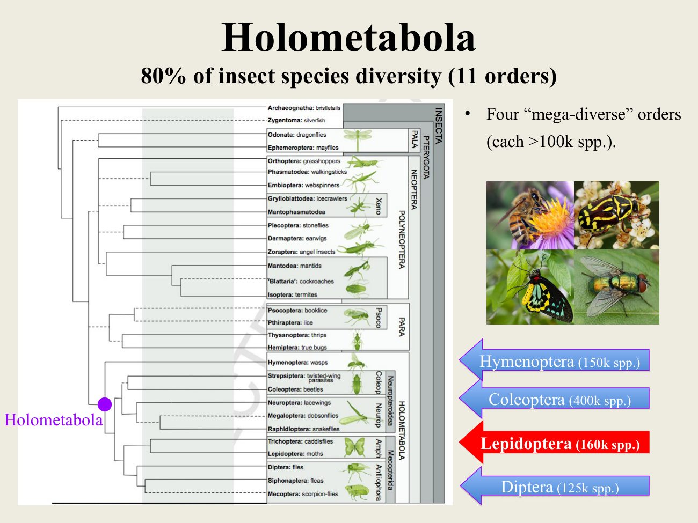](slides/slide-02.jpg)

The Amphiesmenoptera belong to the holometabolous insects which comprise about 80% of all the species in 11 orders. Four of those orders are considered mega diverse because they include more than 100,000 species each. Those other orders are [Hymenoptera], the wasps and ants; Coleoptera, or beetles the Lepidoptera, or butterflies and the Diptera the flies.

[↑ Slides](#slides) · [Course index](../../README.md)

## Slide 3

[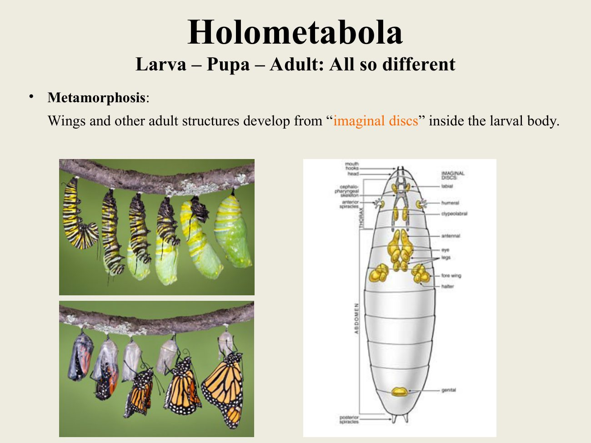](slides/slide-03.jpg)

Holometabolous insects are those where complete metamorphosis occurs, so larva changes by a pupa to an adult and the morphology of larvae and adults is completely different. These adult structures already form inside the larva body as imaginal discs.

[↑ Slides](#slides) · [Course index](../../README.md)

## Slide 4

[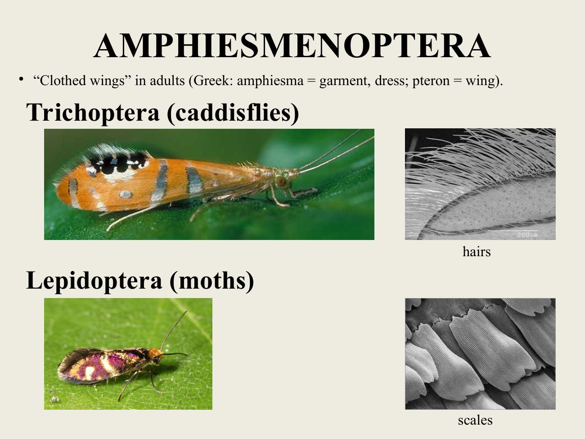](slides/slide-04.jpg)

The term means clothed wings and stems from the Greek words [amphiesma], garment, and pteron, wing, the two orders that are included in Amphiesmenoptera. The Trichoptera caddisflies, which are entirely covered with hairs as adults, and the Lepidoptera or moths, and butterflies, which are covered in scales.

[↑ Slides](#slides) · [Course index](../../README.md)

## Slide 5

[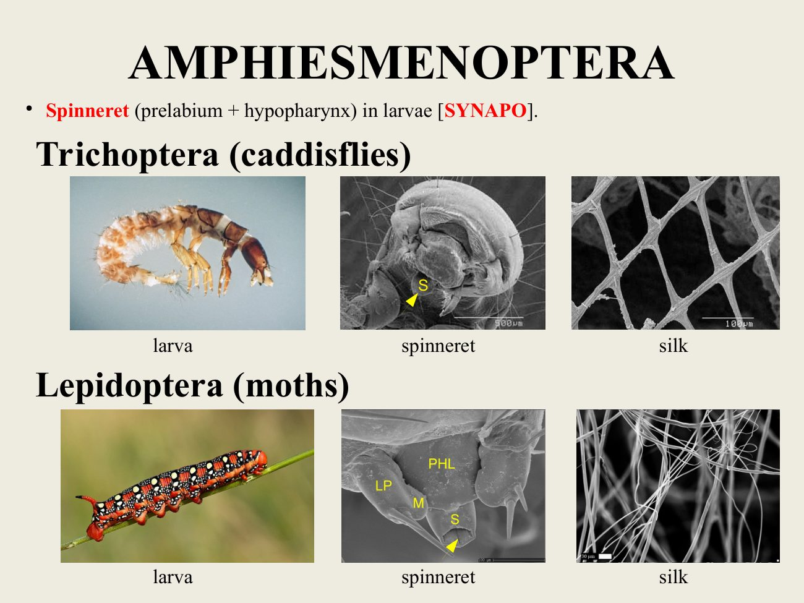](slides/slide-05.jpg)

The Amphiesmenoptera are defined by the presence of a spinneret in the larva, which is formed by the prelabium and [hypopharynx], and is used to produce silk.

[↑ Slides](#slides) · [Course index](../../README.md)

## Slide 6

[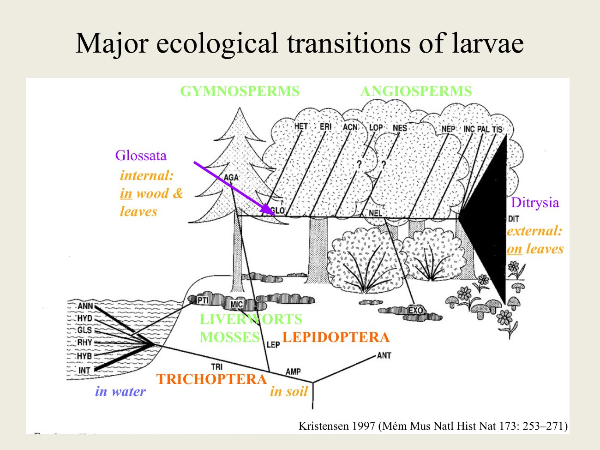](slides/slide-06.jpg)

The Amphiesmenoptera are hypothesised to have originated from soil dwelling larvae, and they transitioned in the case of Trichoptera to living in fresh water, while for the Lepidoptera. They transitioned to feeding on liverworts and mosses and from there onto gymnosperms, pine trees. And then they radiated on the angiosperms when they evolved, and in particular, the Ditrysia.

When they shifted from internal feeding on angiosperms, [Ditrysia] to external feeding on angiosperms, they radiated, greatly. Lots of species evolved.

[↑ Slides](#slides) · [Course index](../../README.md)

## Slide 7

[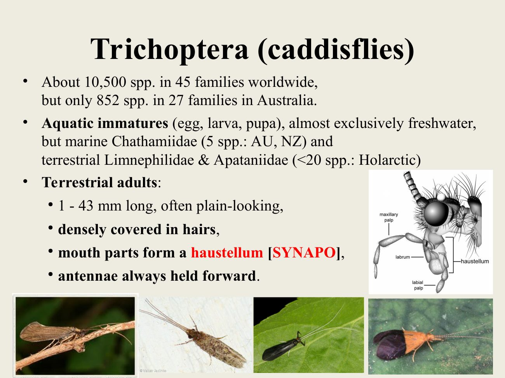](slides/slide-07.jpg)

The Trichoptera are relatively small order of insects, with only 10,000 species worldwide in Australia, a mere 852 species in 27 families. The larvae of this group are aquatic also, the eggs and pupa in water, and it is fresh water they're in. There's also one family, the [Chathamiidae], which occurs only in Australia and New Zealand, with only five species.

And they are marine, which is very unusual for insects. If you go down to [locality unclear] and go to the rock shells there, you can find the larvae in the rock pools. There's also a very small group of terrestrial, Trichoptera with terrestrial larvae.

[Limnephilidae and Apataniidae]. The adults are terrestrial and relatively small, ranging from 1 to 43 millimetres, and most of them are other plain looking. They are densely covered in hairs and, most importantly, their mouth parts form a haustellum.

That's a synapomorphy of this group. When you find them in the field, you can typically easily recognise them because they hold the antennae forward, and often they also vibrating the antennae.

[↑ Slides](#slides) · [Course index](../../README.md)

## Slide 8

[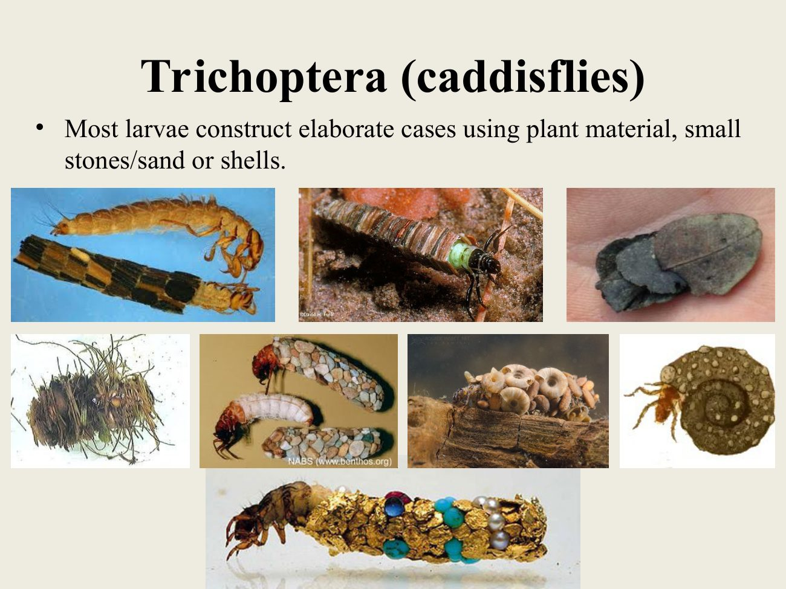](slides/slide-08.jpg)

The larva. Most of them live inside cases that are built from plant material and small stones or sands and shells. If you ever find one of the larvae at the bottom, keep looking in that creek.

It will be worth it.

[↑ Slides](#slides) · [Course index](../../README.md)

## Slide 9

[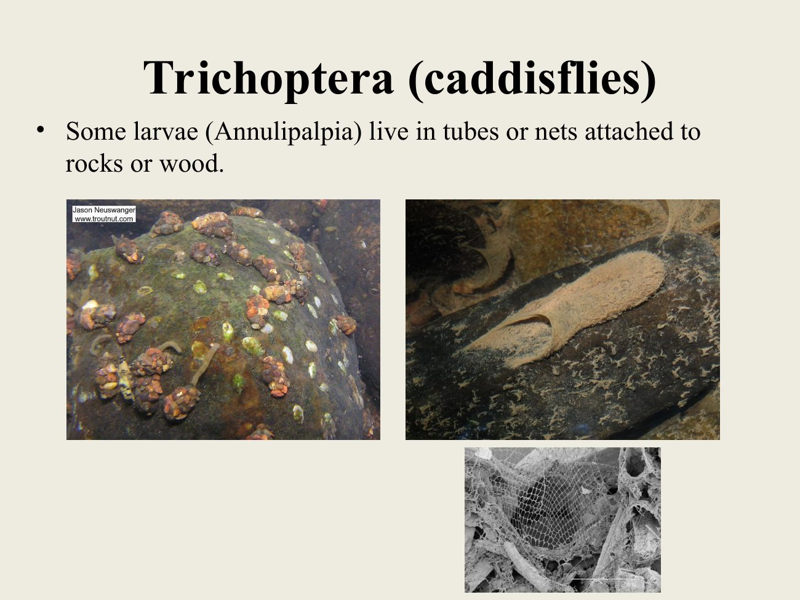](slides/slide-09.jpg)

Some of the larvae of Trichoptera in the group Annulipalpia live in tubes and nets that they attach to rocks or wood, and they are philtre feeders. They are capturing detritus or arthropods.

[↑ Slides](#slides) · [Course index](../../README.md)

## Slide 10

[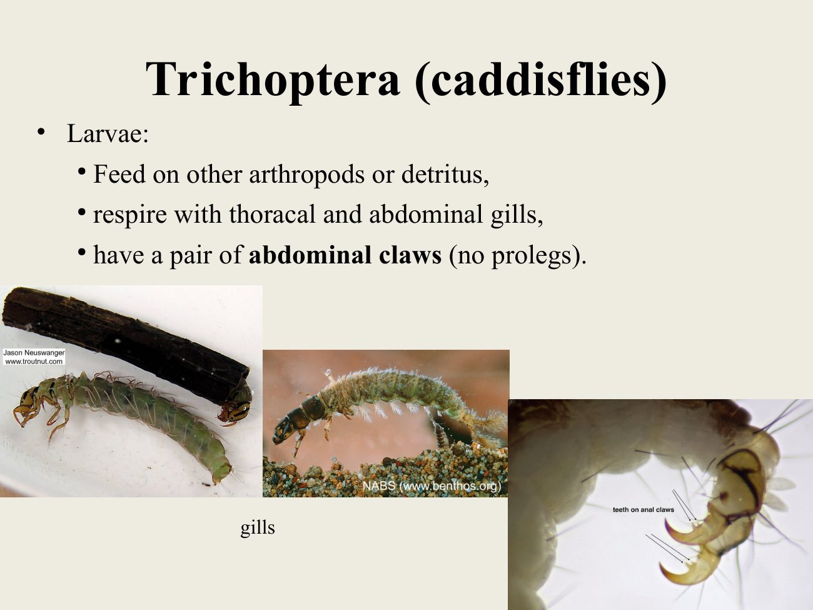](slides/slide-10.jpg)

The larvae of Trichoptera have abdominal and [thoracic] gills with which they're breathing underwater, and larvae of Trichoptera can always be easily recognised by the presence of abdominal claws. They don't have prolegs like, butterfly larvae.

> **Editorial note:** The slide contrasts the terminal hooked appendages with caterpillar abdominal prolegs. Caddisfly terminal appendages are also commonly called anal prolegs.

[↑ Slides](#slides) · [Course index](../../README.md)

## Slide 11

[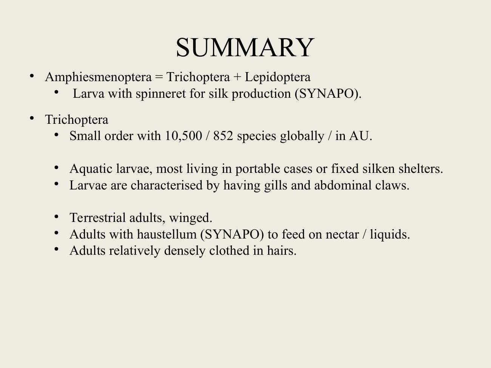](slides/slide-11.jpg)

So to sum it up, the Amphiesmenoptera comprised the Trichoptera and Lepidoptera. The larva has a spinneret for silk production, which is a synapomorphy, and the Trichoptera, a small group of only about 10,000 species worldwide, and 850 species in Australia with aquatic larvae that most of them live in cases. But some are also in fixed silken shelters, and the larvae are characterised by having gills and claws.

The adults are terrestrial and winged, and these wings are densely covered in hairs, and the adults are characterised by having a [haustellum], to feed on nectar and liquids, which is a synapomorphy of this order.

[↑ Slides](#slides) · [Course index](../../README.md)

## Source notice

this material has been reproduced and communicated to you by or on behalf of the Australian National University in accordance with section 113 P of the Copyright Act 1968. The material in this communication may be subject to copyright Under the act. Any further reproduction or communication of this material by you must be consistent with the provisions of the act. Do not reproduce this material. Do not remove this notice.

[← Previous lecture](../27-diptera-part-4-diversity-pdf-only-no-recording-for-this-one/README.md) · [Course index](../../README.md) · [Next lecture →](../29-amphiesmenoptera-part-2-lepidoptera-morphology/README.md)
