# Amphiesmenoptera Part 2 - Lepidoptera - Morphology

[← Previous lecture](../28-amphiesmenoptera-part-1-trichoptera/README.md) · [Course index](../../README.md) · [Next lecture →](../30-amphiesmenoptera-part-3-lepidoptera-identification-taxonomy/README.md)

**Slides + cleaned transcript** · 11 slides

English transcript with fillers and repeated false starts removed. Technical terms are corrected using the slides and context. Bracketed wording marks reconstruction or uncertainty. Slide boundaries are inferred from content; the transcripts have no slide timestamps.

[Original transcript](original-transcript.txt) · [Text-only version](cleaned-transcript.md) · [Editing notes](../../EDITING-NOTES.md) · [Correction record](corrections.md)

[Searchable slide text](slide-text.md). Click a slide image to open it at full size.

## Slides

[1](#slide-1) · [2](#slide-2) · [3](#slide-3) · [4](#slide-4) · [5](#slide-5) · [6](#slide-6) · [7](#slide-7) · [8](#slide-8) · [9](#slide-9) · [10](#slide-10) · [11](#slide-11)

## Slide 1

[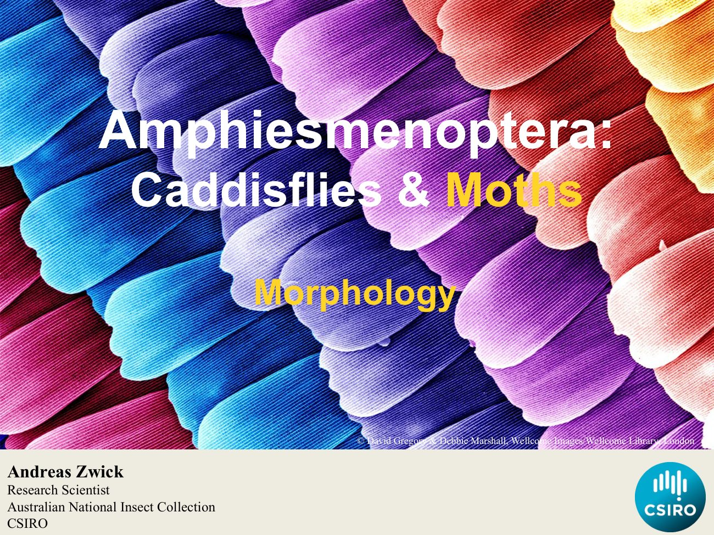](slides/slide-01.jpg)

In this lecture, I talk to you about the morphology of moths and butterflies.

[↑ Slides](#slides) · [Course index](../../README.md)

## Slide 2

[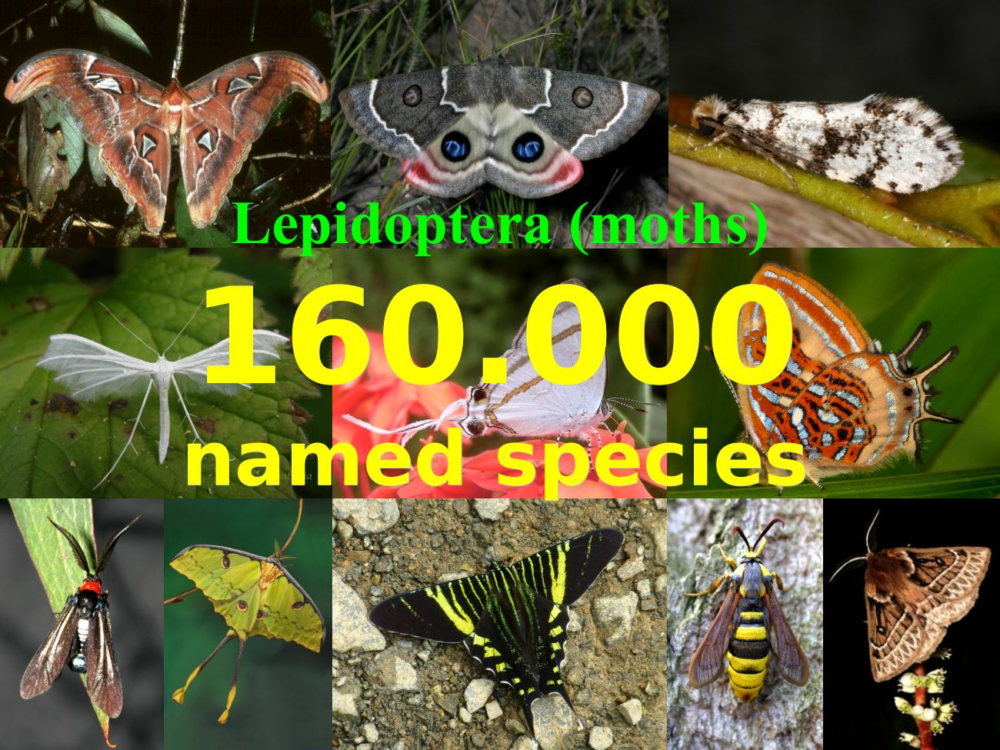](slides/slide-02.jpg)

The Lepidoptera or moths Butterflies comprise about 100 and 60,000 named species, and they come in all sorts of sizes and, shapes and colours and patterns. Only the one in the middle right is a butterfly, all other some moths.

[↑ Slides](#slides) · [Course index](../../README.md)

## Slide 3

[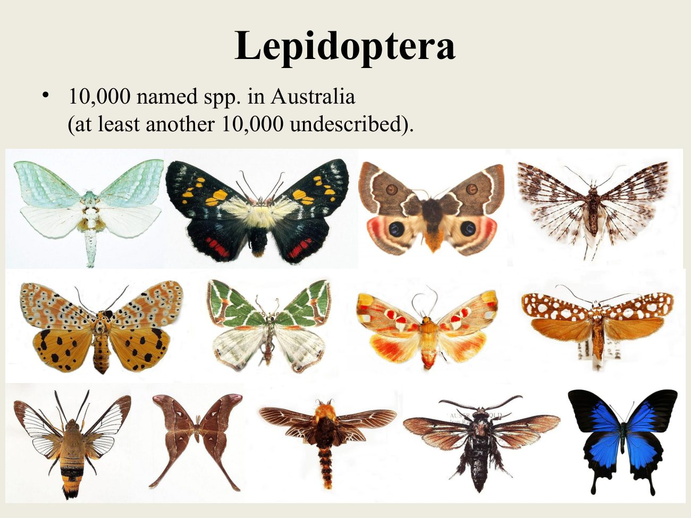](slides/slide-03.jpg)

In Australia, we have about 10,000 named species, and we know already from our collections that there's another 10,000 unnamed species out there and again, you can see a lot of diversity in terms of wing patterns and coloration and wing shapes and body shapes.

[↑ Slides](#slides) · [Course index](../../README.md)

## Slide 4

[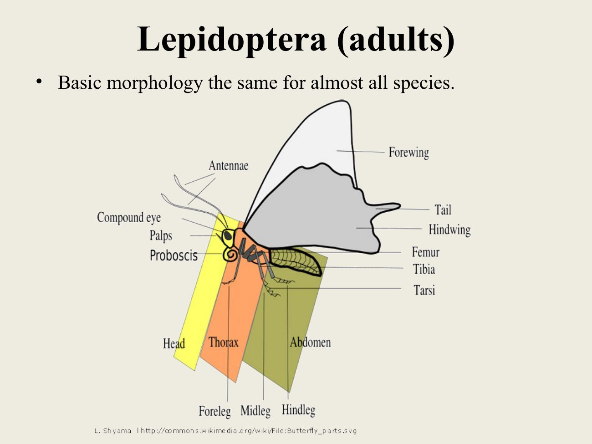](slides/slide-04.jpg)

But overall, the basic morphology of adults is highly conserved. They look very similar, so it will be always easy to recognise a lepidopteran in the field. They all have a head that carries antenna compound eyes, palpi and proboscis.

The thorax carries two pairs of wings and three pairs of legs, and then they have an abdomen.

[↑ Slides](#slides) · [Course index](../../README.md)

## Slide 5

[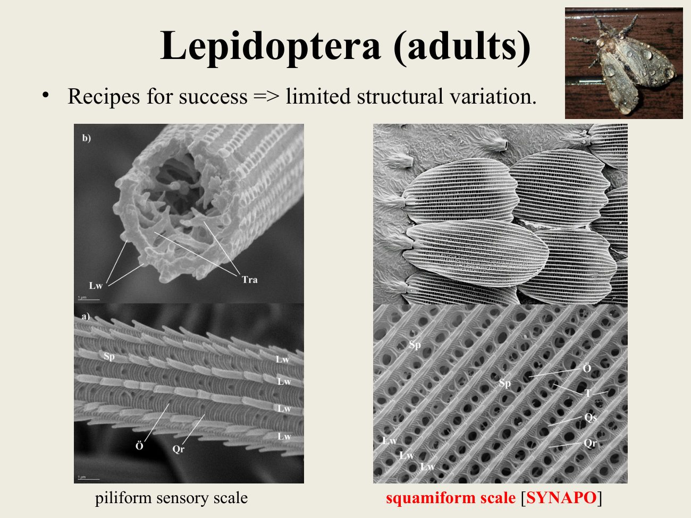](slides/slide-05.jpg)

So why is it that we have such conserved morpho adult morphology? Well, I think the Lepidoptera evolved some key structures that were highly successful, and there are strong evolutionary pressure on them to retain those. One of them is the scale, So all lepidopterans are covered in scales and scales are derived from sensory hairs, and we do still have some piliform.

Scales, which are hollow, have [unclear internal structure] inside, and they're covered in ridges and grooves [wording inferred from figure]. Most of the scales that we see in Lepidoptera are, however, squamiform scales, which are no longer innervated and just flat structures that cover the body and the wings. There's a lot of hypothesis out there.

What's the function of them? And, probably multiple functions can be ascribed to these scales, so this includes carrying the wing pattern and colours. But it's also hypothesised to be important for aerodynamics and for thermodynamics.

I think a lot of it has to do with being able to fly in rain. So unlike many other insects, Lepidoptera do fly during rain so you can see a picture of a moth up there to the top, right where you can see raindrops on the moth. And instead of getting soaked and wings stuck together, the raindrops are just running off like rain on a roof of with shingles.

Like these scales.

[↑ Slides](#slides) · [Course index](../../README.md)

## Slide 6

[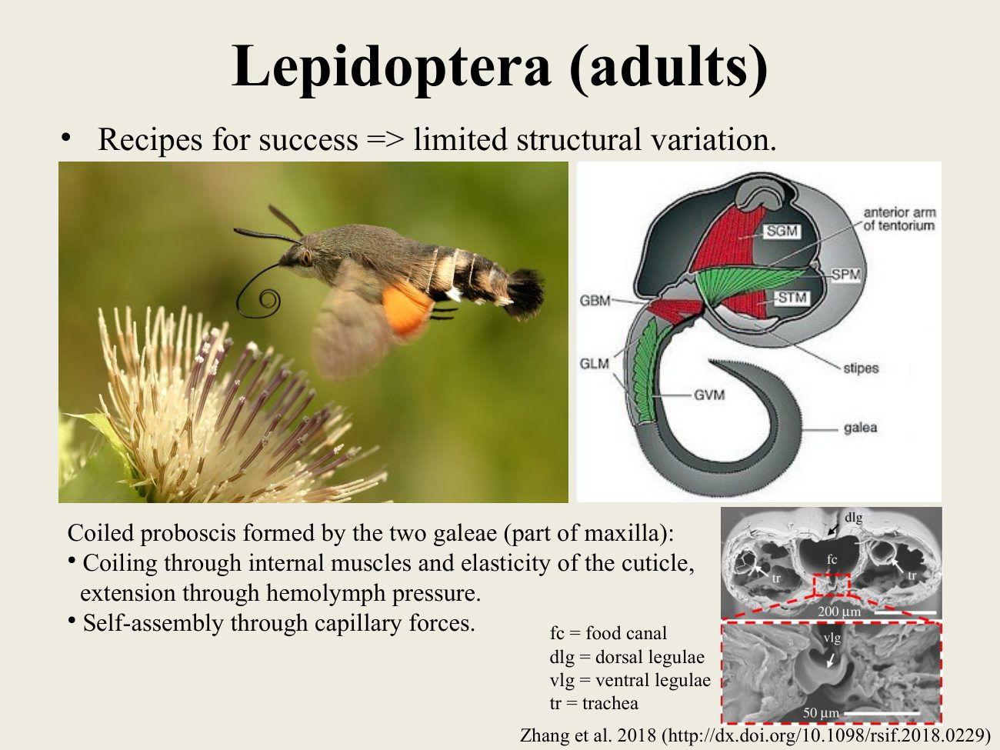](slides/slide-06.jpg)

Another structure that is highly successful is the proboscis. So Most Lepidoptera possess a coiled proboscis, which is formed by the two galeae, which are part of the maxilla. And this proboscis is coiled up, with internal muscles and the elasticity of the cuticle of the proboscis.

And it gets extended with hemolymph pressure that's obviously used for, getting nectar and taking up water. It's the mouth parts of Lepidoptera when they eclose from the pupa. This proboscis is self assembling, through capillary forces.

So these two parts are separated and they self assemble into the coiled proboscis. You can see in the lower right picture the food canal that runs in the middle, and you can see this sort of flaps the legulae that close it off.

[↑ Slides](#slides) · [Course index](../../README.md)

## Slide 7

[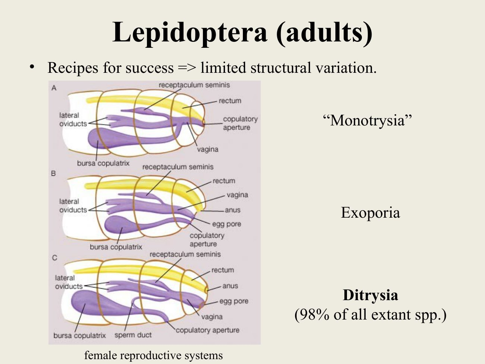](slides/slide-07.jpg)

Another really important evolutionary structure is the mating system in females. So we have a group that we call the Monotrysia. And in that group, we have, only a single opening for the rectum and for mating and for egg laying, we have another group, the Exoporia, where the all three are separated into rectum and egg and then the opening form.

But the vast majority of Lepidoptera, 98% of them have a ditrysian system where the sperm doesn't have to move on the outside through a groove as an Exoporia. But instead, there is now an internal, little, duct that is connecting the [bursa copulatrix], with the [oviduct].

> **Editorial note:** The opening arrangements are presented as the lecturer’s simplified comparison; “Monotrysia” is a historical grouping, not a single natural clade.

[↑ Slides](#slides) · [Course index](../../README.md)

## Slide 8

[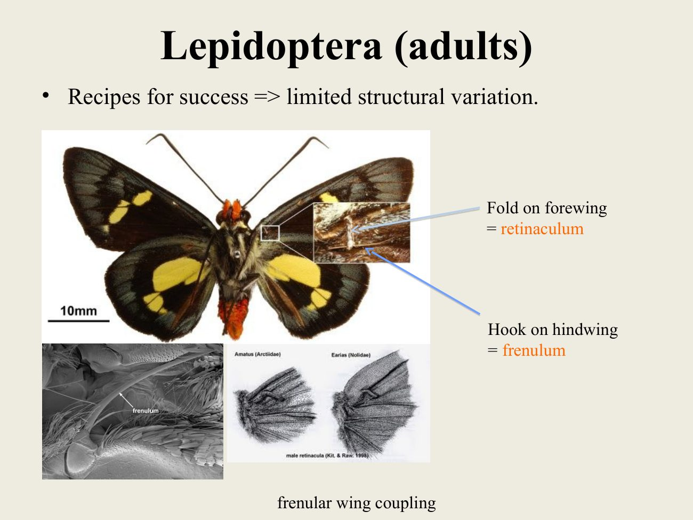](slides/slide-08.jpg)

And then another recipe for success is wing coupling. So Lepidoptera have two pairs of wings, and, combining them into a single wing area is much more efficient. For flight.

So most Lepidoptera have a wing coupling system where bristle attached the hind wing [frenulum] hooks beneath a [retinaculum], which is a membraneous, little flap on the forewing.

[↑ Slides](#slides) · [Course index](../../README.md)

## Slide 9

[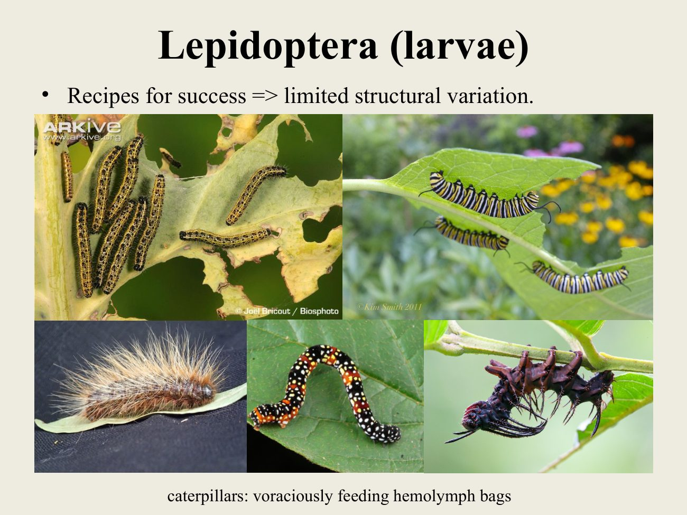](slides/slide-09.jpg)

The situation is similar in larvae, where also the morphology of larvae does not vary greatly. Well, we have again a lot of different colours, and some are hairy and some are naked. The overall structure is the same.

They are voraciously feeding hemolymph bags, and they possess a head of thorax that carries three pairs of true legs and an abdomen that very often carries abdominal prolegs and an anal proleg.

[↑ Slides](#slides) · [Course index](../../README.md)

## Slide 10

[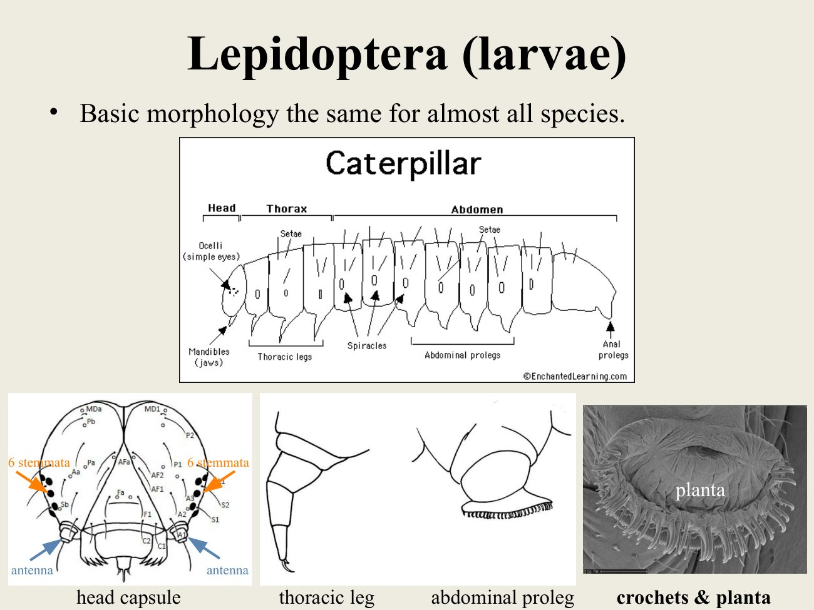](slides/slide-10.jpg)

These, abdominal prolegs are basically eversions of the body wall, and they carry crochets and the planta is like a little balloon. And as it gets pushed out, it's changing the orientation of these little hooks. So these hooks the crochets and they can unhook and hook into the material.

Hold on the head capsule carries six stemmata as eyes. It has an antenna and have mandibles. And the spinneret that I mentioned earlier.

[↑ Slides](#slides) · [Course index](../../README.md)

## Slide 11

[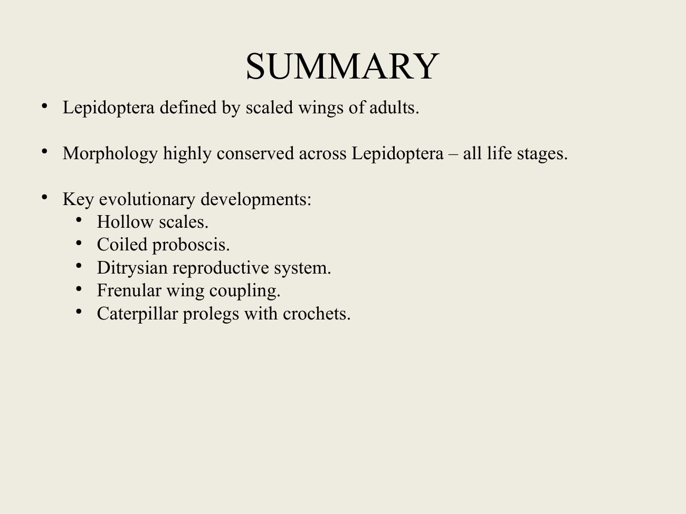](slides/slide-11.jpg)

So in summary Lepidoptera are defined by possessing these scaled wings in adults, and the morphology of Lepidoptera is highly conserved across all life stages because of key evolutionary developments. Some of them are hollow scales, the proboscis, then the ditrysian reproductive system, the wing-coupling system and then caterpillars. Having prolegs with [crochets; ending truncated]

> **Editorial note:** The supplied transcript ends abruptly; the final term is supplied from the slide.

[↑ Slides](#slides) · [Course index](../../README.md)

## Source notice

this material has been reproduced and communicated to you by or on behalf of the Australian National University in accordance with Section 113 P of the Copyright Act 1968. The material in this communication may be subject to copyright Under the act. Any further reproduction or communication of this material by you must be consistent with the provisions of the act. Do not reproduce this material. Do not remove this notice.

[← Previous lecture](../28-amphiesmenoptera-part-1-trichoptera/README.md) · [Course index](../../README.md) · [Next lecture →](../30-amphiesmenoptera-part-3-lepidoptera-identification-taxonomy/README.md)
