# Amphiesmenoptera Part 3 - Lepidoptera - Identification  Taxonomy

[← Previous lecture](../29-amphiesmenoptera-part-2-lepidoptera-morphology/README.md) · [Course index](../../README.md) · [Next lecture →](../31-amphiesmenoptera-part-4-lepidoptera-phylogeny-natural-history/README.md)

**Slides + cleaned transcript** · 26 slides

English transcript with fillers and repeated false starts removed. Technical terms are corrected using the slides and context. Bracketed wording marks reconstruction or uncertainty. Slide boundaries are inferred from content; the transcripts have no slide timestamps.

[Original transcript](original-transcript.txt) · [Text-only version](cleaned-transcript.md) · [Editing notes](../../EDITING-NOTES.md) · [Correction record](corrections.md)

[Searchable slide text](slide-text.md). Click a slide image to open it at full size.

## Slides

[1](#slide-1) · [2](#slide-2) · [3](#slide-3) · [4](#slide-4) · [5](#slide-5) · [6](#slide-6) · [7](#slide-7) · [8](#slide-8) · [9](#slide-9) · [10](#slide-10) · [11](#slide-11) · [12](#slide-12) · [13](#slide-13) · [14](#slide-14) · [15](#slide-15) · [16](#slide-16) · [17](#slide-17) · [18](#slide-18) · [19](#slide-19) · [20](#slide-20) · [21](#slide-21) · [22](#slide-22) · [23](#slide-23) · [24](#slide-24) · [25](#slide-25) · [26](#slide-26)

## Slide 1

[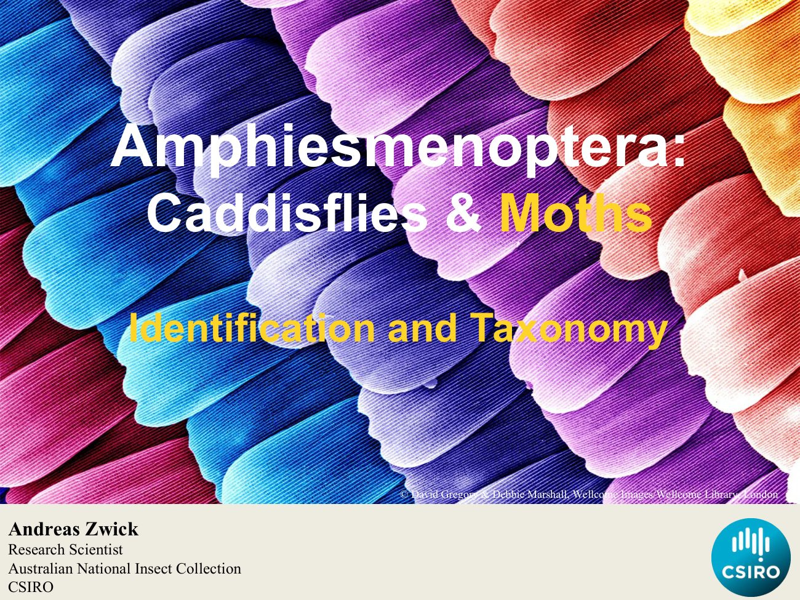](slides/slide-01.jpg)

This lecture is about the identification and taxonomy of moths.

[↑ Slides](#slides) · [Course index](../../README.md)

## Slide 2

[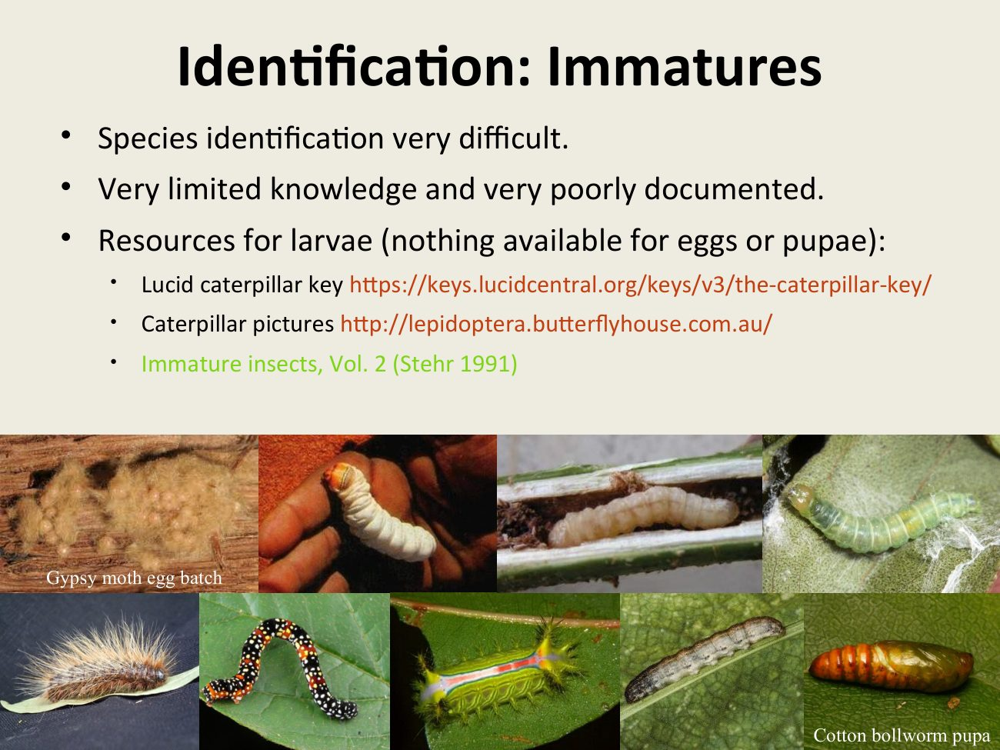](slides/slide-02.jpg)

If you have to identify immatures, you're out of luck. It's really difficult to identify them because we have very limited knowledge of the immatures, and that's also very poorly documented. Don't even try to identify eggs or pupae.

You have basically no chance to get this right. If you want to identify the larvae, the caterpillars, then there are a few resources you can try. There is, for example, a key to families, an illustrated key, an electronic key on the lucid portal.

And then there are some Caterpillar pictures on the Butterfly House website, and of course, you can resort to a book by Stehr on Immature Insects to go to family level.

[↑ Slides](#slides) · [Course index](../../README.md)

## Slide 3

[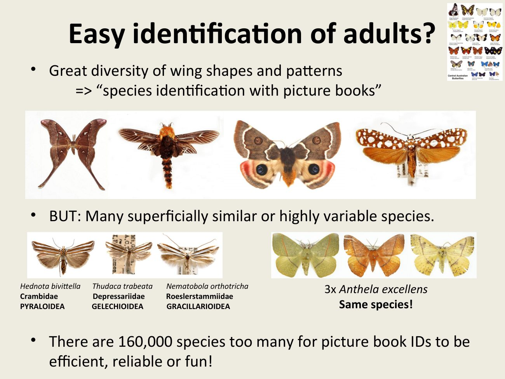](slides/slide-03.jpg)

You could be forgiven for thinking that with this great diversity of wing shapes and patterns, it would be easier to identify the adults. And yes, it is easier. But it is not easy.

Actually, species identification is very difficult in the, mainly because they are more similar superficially similar species than you would think. So you can see, for example, here these three specimens on the bottom left. They look superficially similar, but they belong to three different super families.

On the other hand, you can also have highly variable species like this, Anthela [excellens] on the right. They all look quite different, and yet all belong to the same species. And at the end of the day, if you have 100 and 60,000 species, there are far too many for a picture book identification, as you would do.

Maybe for butterflies. And, it's not efficient to try to just identify with those pictures. It's not reliable, either, and it's not fun in the end.

[↑ Slides](#slides) · [Course index](../../README.md)

## Slide 4

[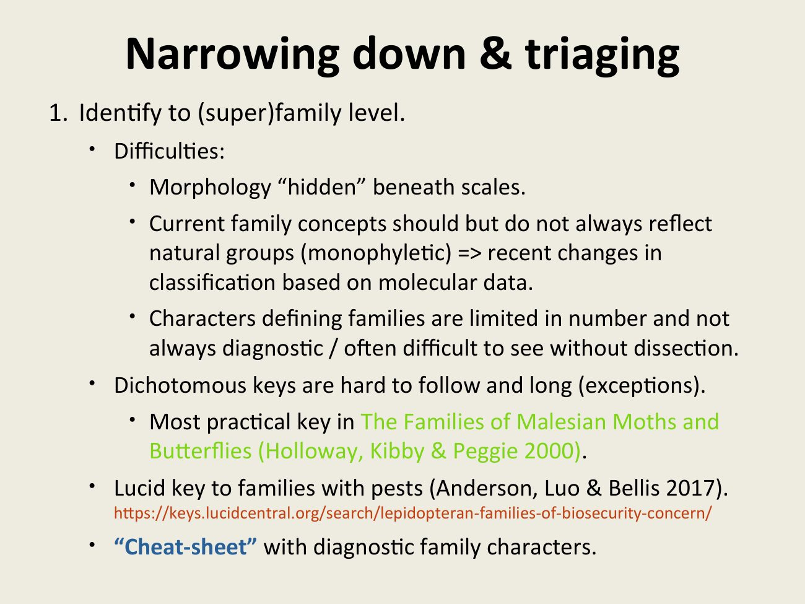](slides/slide-04.jpg)

So what can you do about it? Well, we try to narrow things down, do a bit of triaging. So first of all, try to identify to the Super Family or family level.

That's more easily said than done, because a lot of the morphology that you would need to see is hidden behind these scale these scales beneath the scales. If you remove the scales, which was quite tedious, you lose the characters that you need for later genus and species identification On top of it, a lot of the current family concepts are evolving. They are changing because they're not yet really reflecting monophyletic natural groups.

And there's a lot of changes in the classification happening now based on molecular data. And then if we have a family that is monophyletic, the number of characters that is used to define them is usually rather limited. And these characters are not always diagnostic and often difficult to see without dissecting the specimens.

If you try to follow a classical dichotomous key, it is often difficult because the key is very long to cover For a lot of these exceptions, if you do want to try, have a look at the key that is in the book about Malesian Moths, that's the best key. I think that's most practical to use. There's also a lucid key and electronic key to families that contain pests that you can try.

But I think your best bet will be a cheat sheet that we will hand out for the practical part of this course that has some shortcuts and some diagnostic family characters.

[↑ Slides](#slides) · [Course index](../../README.md)

## Slide 5

[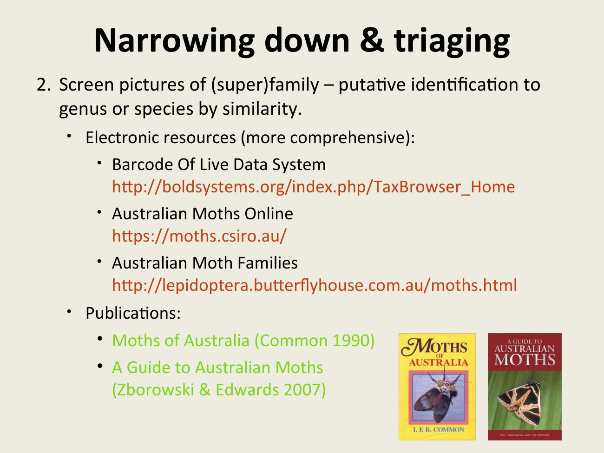](slides/slide-05.jpg)

Once you've narrowed it down to the super family or family, you will probably have to screen for pictures, to get a putative identification to genus or, if you're lucky, to a species just simply based on similarity, your best bet are probably some electronic resources, like the Bar Code of Life data system that has not only sequence data but also shows images of representatives of all these. There's also a website, Australian Moths online that has a few selected and properly identified representatives for all the families. And then there is again the Butterfly House website that shows various species of Australian moth families in terms of publications.

There's only two books there that, show, moths identification Moths of Australia and the guide to the Australian moths. But none of them are comprehensive. They always show just a few representatives.

[↑ Slides](#slides) · [Course index](../../README.md)

## Slide 6

[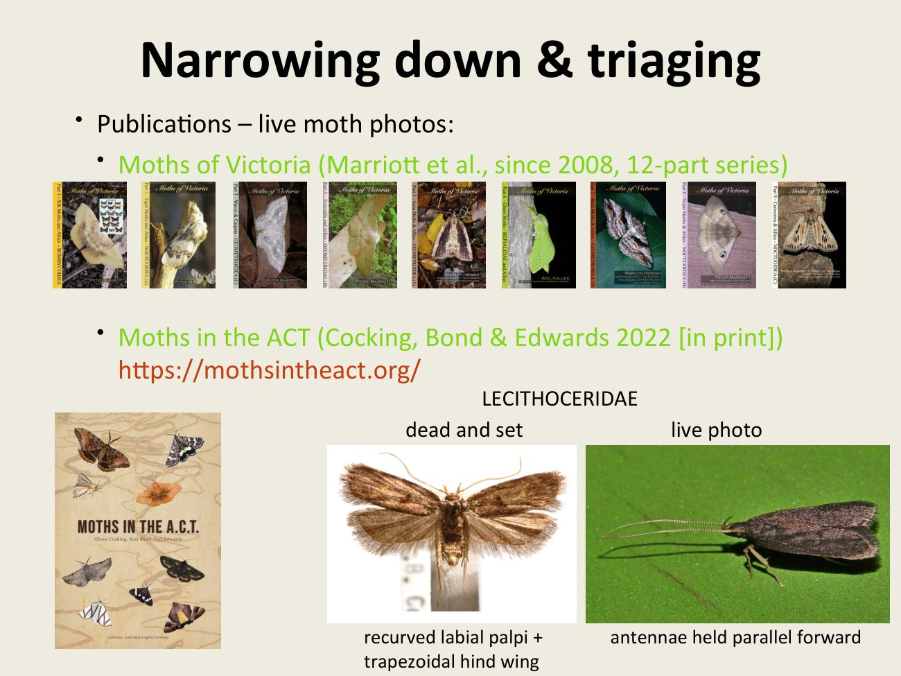](slides/slide-06.jpg)

There are a few books that also show moths that are alive based on live pictures. So there's a series of booklets for moths of Victoria that I can recommend you and another book that just came out recently. That's the moths in the AC T.

It's a great book for identification. What's around here in Canberra, and it's not comprehensive, but it covers all those species that you're likely to see. Why is it important to have some live images as well?

Well, it can be quite difficult to identify some dead and pin specimens as here. There's, at the bottom. It's much easier to recognise the family in a live picture when you have a live specimen because they hold antennae parallel forward, which is very rare in Lepidoptera.

[↑ Slides](#slides) · [Course index](../../README.md)

## Slide 7

[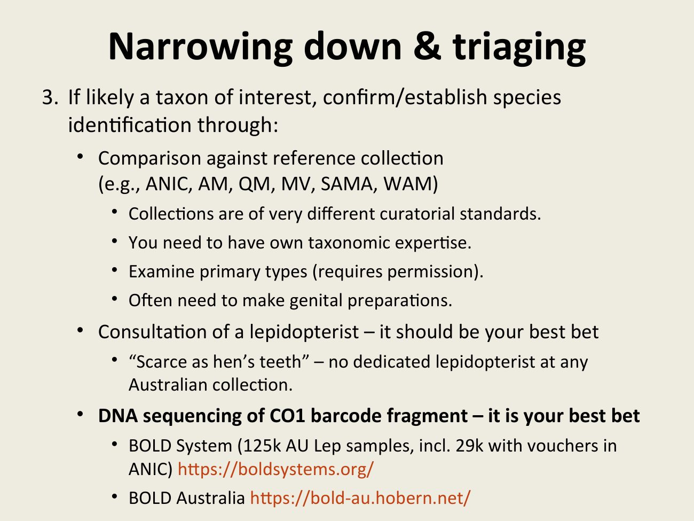](slides/slide-07.jpg)

Once you found a family super family, and this is still a family where your tax of interest is in there, for example, from a biosecurity concern perspective, then it's time to compare against reference collections. So we have insect collections for in the Australian National Insect Collection and then, collections in all the different states. But the diff the collections differ quite a lot in the curatorial standards, and you need to have some taxonomic expertise to be able to work with those collections.

At the end of the day, you would need to examine the primary types, and that's not always easy to request permission. Many of them are also overseas, and you often would need to make some preparations. So it's quite a challenge to use morphology to get to a reliable species identification.

Of course, the best bet would be to talk to a lepidopterist, but unfortunately they are very rare in Australia. There is not a single dedicated lepidopterist left, that would be employed by a collection. So at the end of the day, DNA sequencing of the COI barcode fragment is likely to be your best bet.

There's the bold system that has about 100 25,000 sequences for Australian Lepidoptera, including 29,000, which come from our Australian National Insect Collection and are in there. And you should also know about the website by Donald Hobern, which limits the, tax to the Australian fauna.

[↑ Slides](#slides) · [Course index](../../README.md)

## Slide 8

[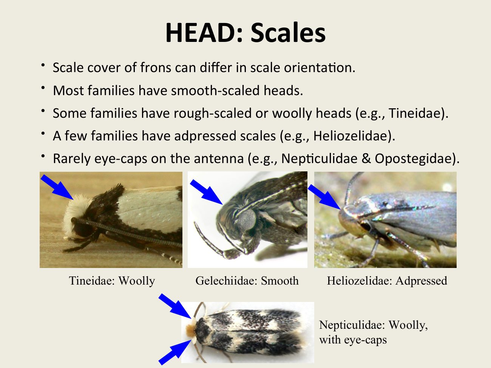](slides/slide-08.jpg)

So I'd like to talk to you a little bit about characters that you should see, in the that help you to identify to family or super family level. First of all, there's the head on the cover of the head with scales. So especially the frons of the head can be covered in different ways.

So most families have a smooth scaled head. But there are some families, like [Tineidae] and psychids that have a rough scaled or woolly head. There are also some families that have adpressed scales like in the Heliozelidae, and in a few there are some eye caps present.

These are look like little scale umbrellas, attached to the base of the antenna that cover the eyes as, for example, in [Nepticulidae] and [Opostegidae]

[↑ Slides](#slides) · [Course index](../../README.md)

## Slide 9

[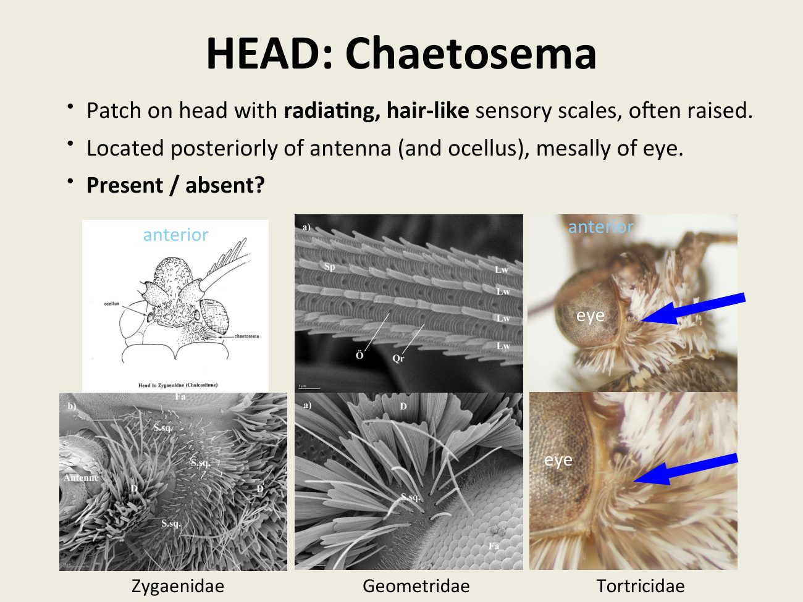](slides/slide-09.jpg)

A really important character on the head is the chaetosema, or plural chaetosemata. So these chaetosemata are patches, with hair like sensory scales radiating from them, and they are often a little bit raised. So in some way they look a little bit like a pincushion.

They are located posteriorly of the antenna and [ocelli, if] are present and mesally of the eye. So you need to figure out whether chaetosemata are present or absent. You can see some examples of chaetosemata there.

Sometimes they're easy to recognise because they look a little bit like a bald patch with, hairs radiating from them. In other cases, like in the Geometridae, they are much more hidden between other scales on the head and difficult to see.

[↑ Slides](#slides) · [Course index](../../README.md)

## Slide 10

[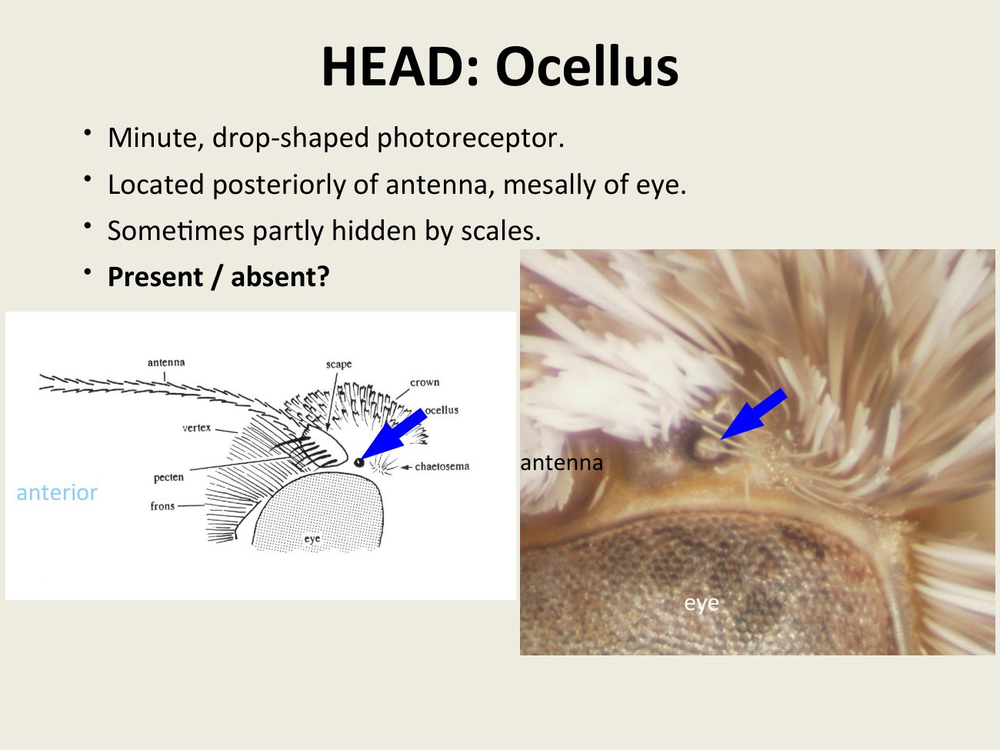](slides/slide-10.jpg)

I already mentioned the ocellus. That's a minute drop shaped photoreceptor, which is located posteriorly of the antenna and mesally of the eye. So if chaetosemata are present very close to chaetosemata, unfortunately, this is often hidden by some scales.

So you will have to look very carefully to the person of it to look at different angles, see if it's present or absent.

[↑ Slides](#slides) · [Course index](../../README.md)

## Slide 11

[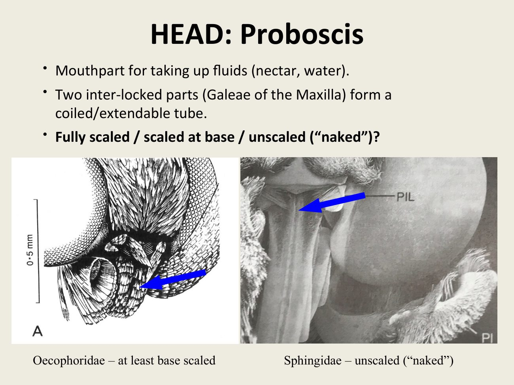](slides/slide-11.jpg)

The proboscis is if it's present a rather prominent structure, easy to find, sitting between the [labial palpi], and, What is important is not so much, whether it is absent or present, but the scaling of it so the proboscis can be fully scaled or it can be scaled only at the base. Or it can be unscaled or naked in.

[↑ Slides](#slides) · [Course index](../../README.md)

## Slide 12

[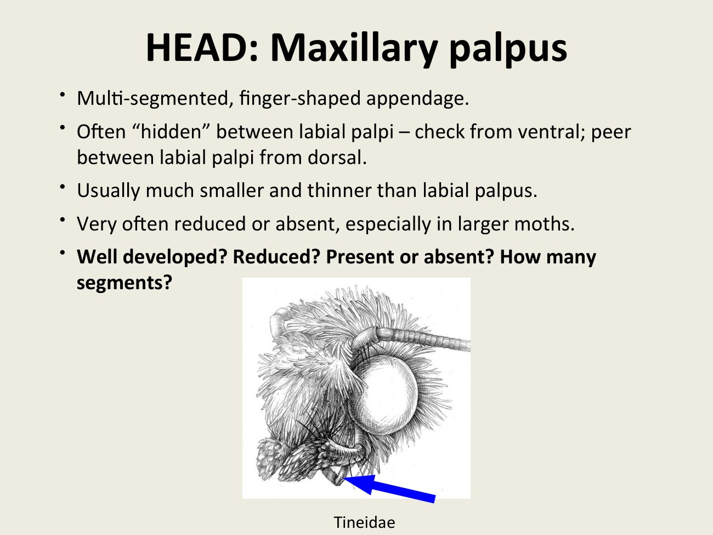](slides/slide-12.jpg)

Another structure to look for our maxillary palpi. So these maxillary palpi are finger shaped, multi segmented appendages, and in many cases they are hidden between the labial palpi, very small and reduced. And, you will have to look how well they are developed.

If they are present or absent And if you have bad luck, you also have to figure out how many segments are present of these.

[↑ Slides](#slides) · [Course index](../../README.md)

## Slide 13

[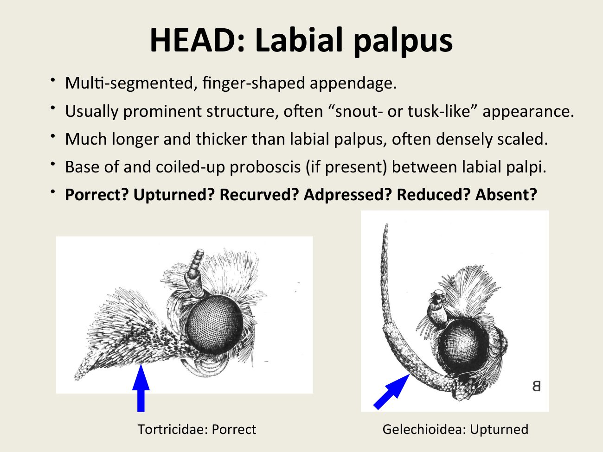](slides/slide-13.jpg)

The labial palpus is a much more prominent structure which is up to three segments, typically three segmented, finger shaped appendage on the head. Very often you will see them easily because they seem to form something like a little snout. Or they can be tusk like elephant tusks.

And they're much longer and thicker than the [maxillary] palps. That you will see the proboscis are sitting between them. So when examining the palpi, you want to check if they are porrect or straightforward if they upturned or recurve even if they are adpressed or if they've been reduced or lost.

> **Editorial note:** The slide compares labial palpi with “labial” palpi, apparently a slide typo. The comparison is with maxillary palpi.

[↑ Slides](#slides) · [Course index](../../README.md)

## Slide 14

[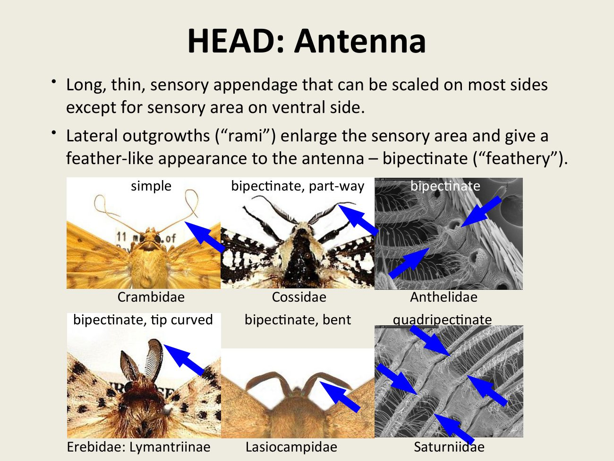](slides/slide-14.jpg)

The antenna is always easy to locate on the head of adults. Pair structure long and thin, covered in sensory structures, and it can be scaled on most sites except for the sensory area and mostly the antennae are [filiform] the simple antennae, but they can also be [pectinate], which case, every segment of the antenna carries, some lateral extension, some out growths that are called rami. So you will find bipectinate antennae that are all the way to the tip.

You have some that are only part-way pectinate, and you have some where the tip is curved in like in Lymantriinae. Or you have, bipectinate antennae that's bent, in [Lasiocampidae], and sometimes they can be [quadripectinate], so, you have four rami on every segment, which is the case for Saturniidae.

[↑ Slides](#slides) · [Course index](../../README.md)

## Slide 15

[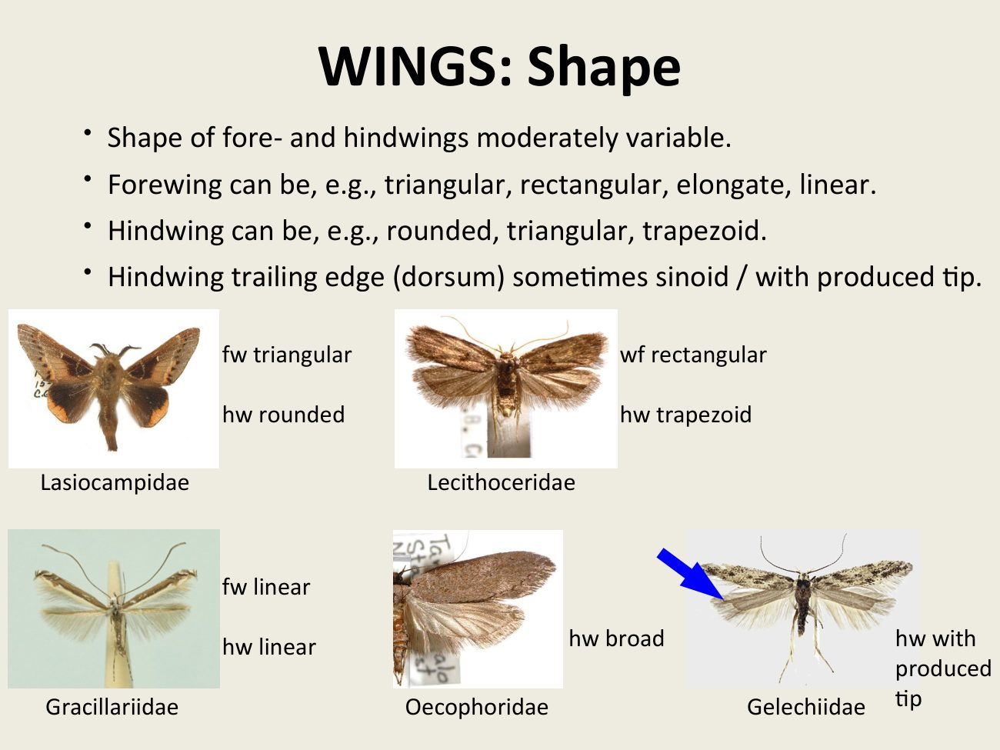](slides/slide-15.jpg)

The wings are prominent structures, and we do look at the shape of them, but it's only moderately variable and not a terribly reliable character, so the forewing can be triangular. It can be rectangular can be elongated or linear, and the hindwing can be round a triangular trapezoid. Sometimes we have a trailing edge, of the being drawn out into the tip, as in these on the bottom.

Right side.

[↑ Slides](#slides) · [Course index](../../README.md)

## Slide 16

[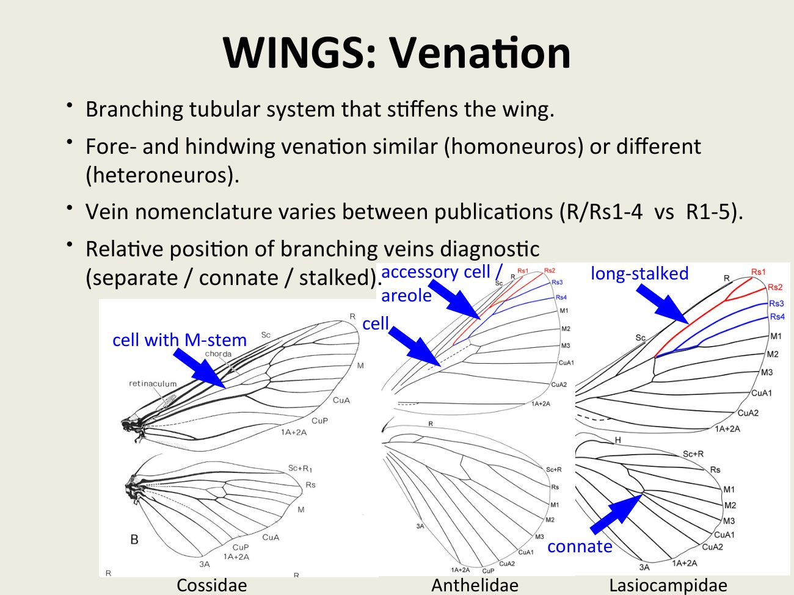](slides/slide-16.jpg)

Wing Venation is something that is very frequently used in keys and especially in older literature. But it's really difficult to see wing venation and livid if you have to examine it, use some alcohol and a brush, and put some alcohol on the ventral on the lower side of the wing and wet. The wing will enable you to see we have transmitted light the wing venation.

But it is damaging wings a bit, and it's difficult to do so The venation of the fore- and the hind wing can be either very similar, in which case we call it homoneurous. Or it can be quite different, in which case we refer to heteroneurous. Unfortunately, the nomenclature for venation varies a fair bit in publications, especially with older literature.

And so there can be either a radius and then radial sector 1 to 4 or just, radius 1 to 5. Nomenclature for this, similar for some of the other veins. When using vein venation, it is often about the relative position and the branching of the veins that is used as a diagnostic character.

So very often you will see that certain wings are separated from each other or they are [connate]. That means they arise side by side or they can be even stalked, have a little bit of a stem leading up to them before they separate out. And there's an a like a larger cell, in the wing and, pet species and often family diagnostic as well.

[↑ Slides](#slides) · [Course index](../../README.md)

## Slide 17

[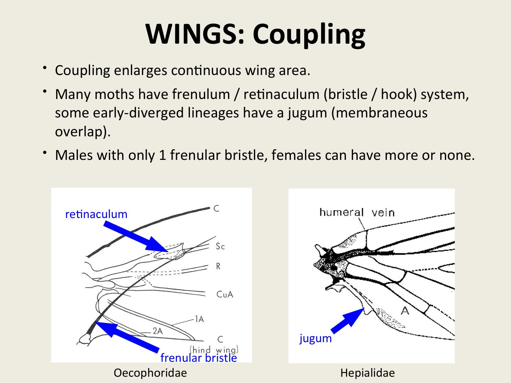](slides/slide-17.jpg)

There's the wing coupling that I mentioned before, and the wing coupling is used to enlarge the wing area for more efficient flight, and this is typically achieved by a system like a bristle-and-hook system. But there are also some moths like [Hepialidae], where there is a [jugum] present that's just the membrane fold. There's also [amplexiform] wing coupling, as in [Lasiocampidae], where the hind wing has an enlarged area.

It's overlapping with the forewing coupling this way. In males, these frenular bristles are always limited to just one. But in females you can have multiple bristles.

[↑ Slides](#slides) · [Course index](../../README.md)

## Slide 18

[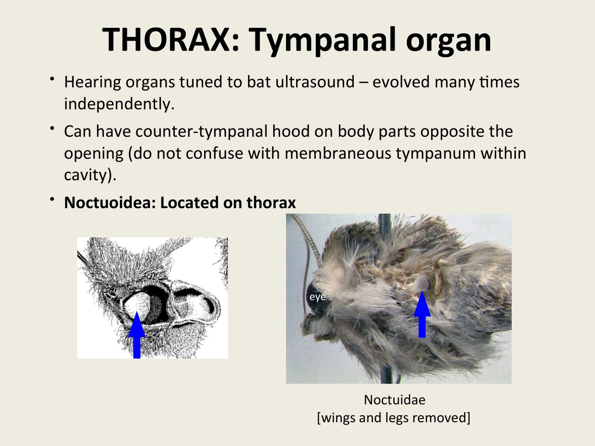](slides/slide-18.jpg)

Really important are tympanal organs. These tympanal organs are hearing organs that are tuned to the ultrasound that bats produce, and they evolve many times independently. So when looking for a tympanal organ, you have to watch out a little bit.

Very often they have a counter-tympanal hood. It's a little bit like our ear lobe that is used to direct the sound, and it's easy to confuse the actual opening with this counter-tympanal hood. So I need to look very carefully for the membrane to see the real tympanum Because what is important is the location of the tympanum.

If the tympanum is located on the thorax or on the abdomen, and unfortunately, you can have the, on the thorax or the counter-tympanal hood can be on the abdomen. So we need to watch out for this. What you see here is a [tympanal organ] of a [noctuoid] moth, and they are located on the thorax.

[↑ Slides](#slides) · [Course index](../../README.md)

## Slide 19

[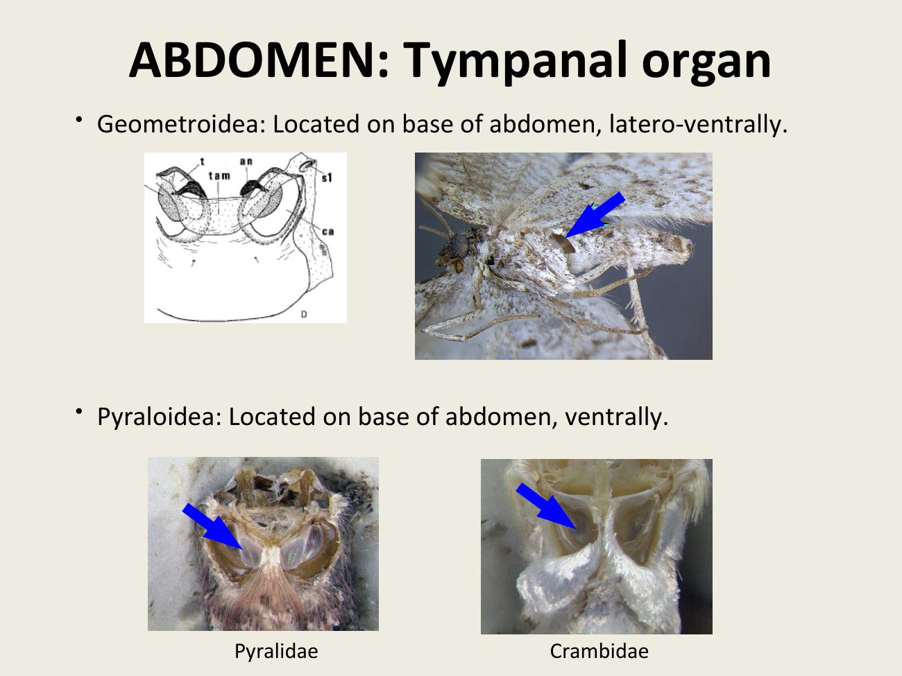](slides/slide-19.jpg)

In other moths, they can be located on the abdomen, like in this Geometroidea. They are located at the base of the abdomen in a lateral ventral position, or they can be located in a ventral position in these [Pyraloidea], I apologise for these pictures. Being very small, they shouldn't have been.

Don't know why they're shown that small.

[↑ Slides](#slides) · [Course index](../../README.md)

## Slide 20

[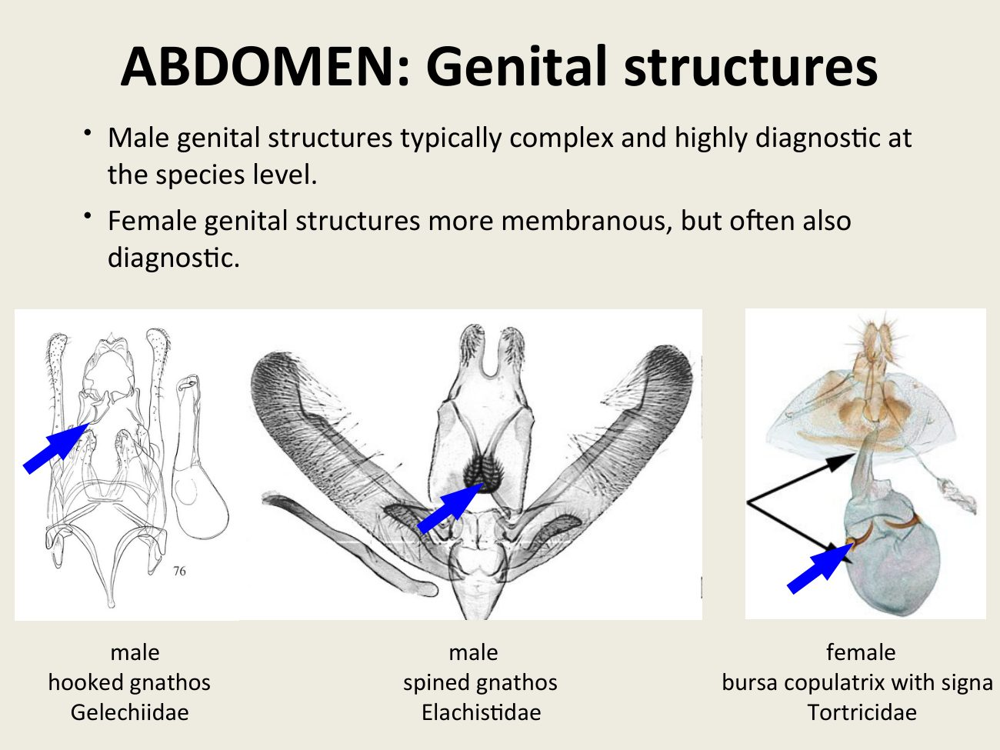](slides/slide-20.jpg)

Finally, they are genitalia structures. I'm not going to go into any great detail. For them, but if you want to arrive at a species identification, you typically have to make a genital preparation.

This is the ultimate reference for species identifications, especially for male genital structures. And I just want to mention that there are other complex have a clasping structures a lot of spines and hairs and the shape and spines and all of that together will be used to have a species diagnostic. Character also in the female that can be characters.

But female genital structures are much more membranous and, are often less diagnostic.

[↑ Slides](#slides) · [Course index](../../README.md)

## Slide 21

[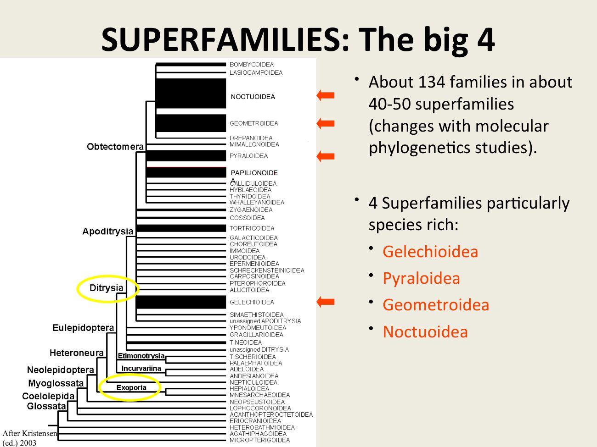](slides/slide-21.jpg)

So if you think about the taxonomy of moths, these 160,000 species have been grouped in about 100 and 34 families in roughly 40 to 50 super families, and this is changing a bit depending on which study you're looking at. And, a lot of it has changed at the moment with molecular phylogenetic studies. So rather than to bore you with all these different families, I just like to point out the really important super families to you.

So in the diagram on the left, you can see that some of these, branches are much thicker than others, and they represent the number of that are included in the super family. And so there are four super families that are particularly species rich. These are [Gelechioidea, Pyraloidea], Geometroidea and Noctuoidea, I will only talk to you about those four super families here.

[↑ Slides](#slides) · [Course index](../../README.md)

## Slide 22

[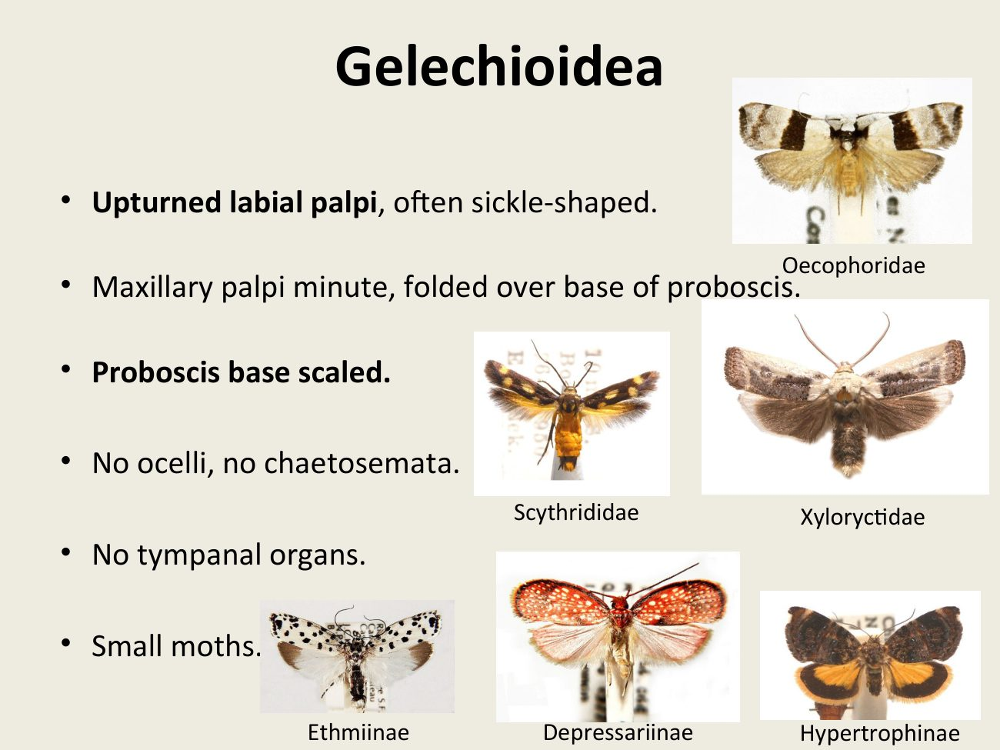](slides/slide-22.jpg)

The Gelechioidea are particularly species rich and abundant in Australia. So every time you run a light at night, time to attract moths guaranteed you will have Gelechioidea at that light. Fortunately, the super family is relatively easily recognised because they have upturned labial palpi, which are often sickle-shaped so they look like elephant tusks.

The maxillary palpi are [minute] and often hidden in there. And, the proboscis in the super family has the base of its scale, which is together with this, the key character combination to recognise them. They have no [ocelli, chaetosemata or tympanal organs].

And they are generally small moths.

[↑ Slides](#slides) · [Course index](../../README.md)

## Slide 23

[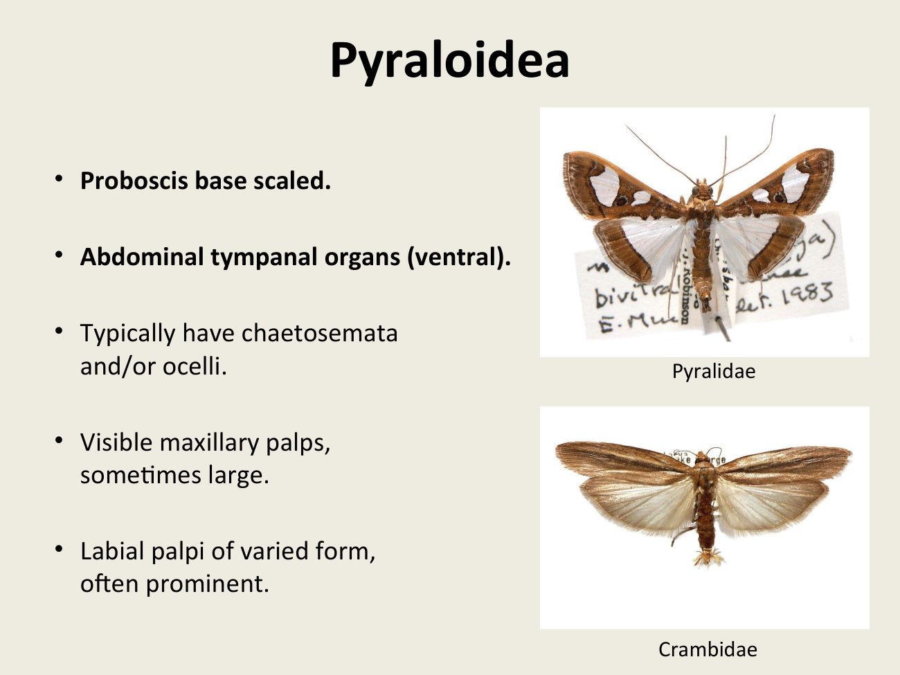](slides/slide-23.jpg)

The Pyraloidea, another super family that has a scale proboscis, or at least the base of it is scaled. And they carry tympanal organs, at the base of the abdomen on the ventral side. They very often have [chaetosemata] and/or [ocelli] and the maxillary palpi are often visible, sometimes even large, which is unusual in Lepidoptera.

And the labial palpi are very often prominent, but variously shaped.

[↑ Slides](#slides) · [Course index](../../README.md)

## Slide 24

[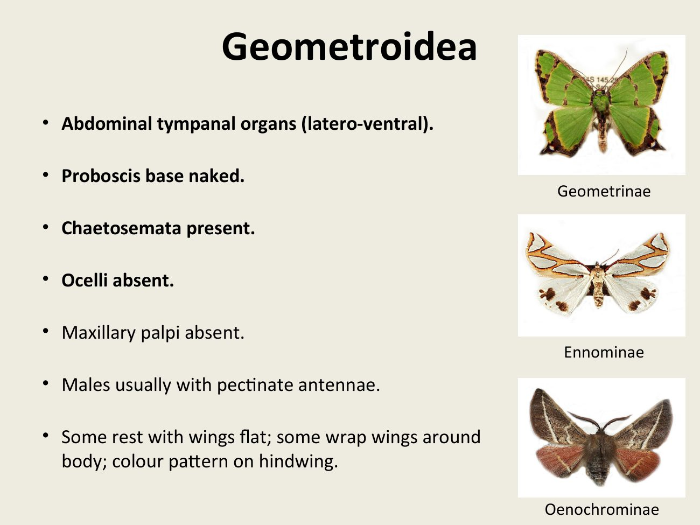](slides/slide-24.jpg)

So than the Geometroidea. They also carry an abdominal tympanal organ. But it is in a more lateroventral position at the base of the abdomen than in the Pyraloidea.

The proboscis is naked, not scaled, as in the Pyraloidea and chaetosemata are present very often. [Ocelli are absent, per slide; transcript wording unclear]. The maxillary palpi are typically absent.

And, many males have pectinate antennas. So they have these rami attached to the antenna. When they at rest, they can hold the wings flat or wrap them around the body.

And very often you have a colour pattern on the hind wing.

> **Editorial note:** The slide explicitly says ocelli absent. The supplied transcript’s “So cellos is present” is ambiguous and is flagged in the cleaned passage.

[↑ Slides](#slides) · [Course index](../../README.md)

## Slide 25

[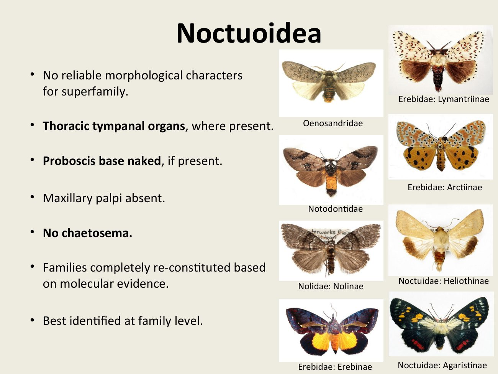](slides/slide-25.jpg)

Finally, the Noctuoidea, super diverse super family, is the most species rich super family in. And unfortunately, there are no reliable morphological characters to really pin down this superfamily. Most of them have a thoracic tympanal organ, and that is, characteristic for that superfamily.

But in some families, this organ has been secondarily reduced. The proboscis base is always naked, but sometimes the proboscis isn't even present. The maxillary palpi are missing, and they have no chaetosemata.

And, at the moment, the classification of these families is changing a lot due to molecular evidence. And, it is probably easier to identify these, to family level rather than to super family level.

[↑ Slides](#slides) · [Course index](../../README.md)

## Slide 26

[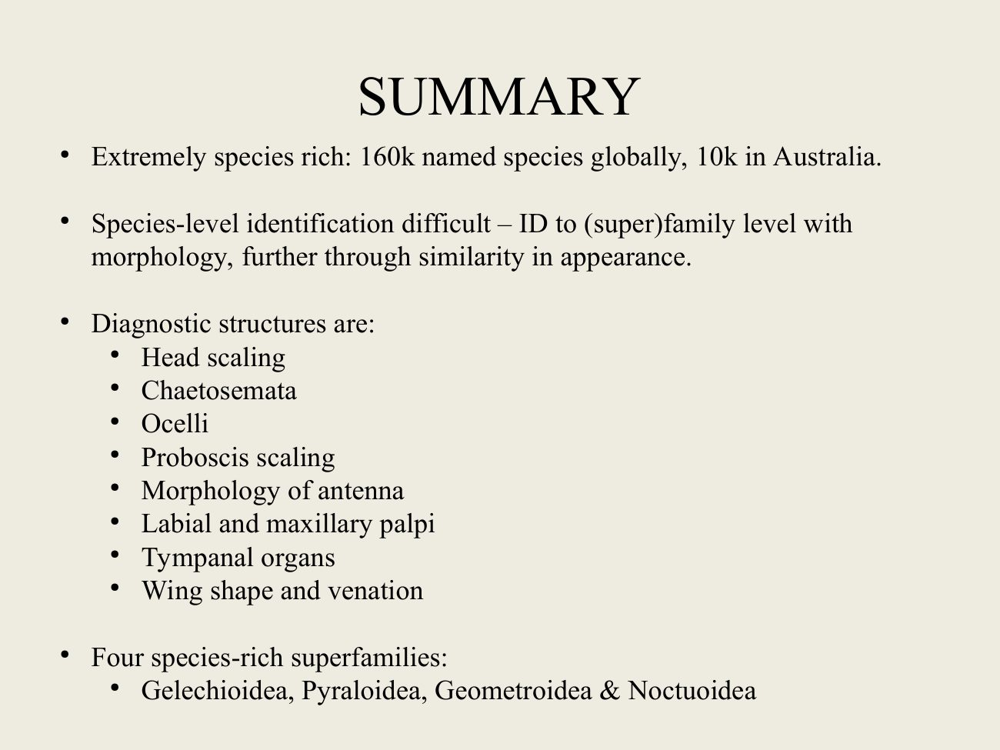](slides/slide-26.jpg)

So to sum this up, Lepidoptera are extremely species rich, with about 100 and 60,000 named species worldwide and about 10,000 in Australia. The species identification is unfortunately very difficult. And you're best off trying to identify with morphology to the super family or family level.

And after that, just look for similarities and appearance. When you do this, identification to family or super family level, try to use the [cheat sheet] that we will hand out and you look for some diagnostic structures, which include the head scaling the [chaetosemata, ocelli] or proboscis scaling the morphology of the antenna. If it has rami or not.

All sorts of characters there, then the morphology of the labial and maxillary palpi the location of tympanal organs and then the wing shape and wing [venation]. I would like you to remember that there are four particularly species which super families, Gelechioidea, Pyraloidea, Geometroidea and Noctuoidea.

[↑ Slides](#slides) · [Course index](../../README.md)

## Source notice

this material has been reproduced and communicated to you by or on behalf of the Australian National University in accordance with Section 113 P of the Copyright Act 1968. The material in this communication may be subject to copyright Under the act. Any further reproduction or communication of this material by you must be consistent with the provisions of the act. Do not reproduce this material. Do not remove this notice.

[← Previous lecture](../29-amphiesmenoptera-part-2-lepidoptera-morphology/README.md) · [Course index](../../README.md) · [Next lecture →](../31-amphiesmenoptera-part-4-lepidoptera-phylogeny-natural-history/README.md)
