# Amphiesmenoptera Part 4 - Lepidoptera - Phylogeny  Natural History

[← Previous lecture](../30-amphiesmenoptera-part-3-lepidoptera-identification-taxonomy/README.md) · [Course index](../../README.md) · [Next lecture →](../32-amphiesmenoptera-part-5-lepidoptera-applied-issues/README.md)

**Slides + cleaned transcript** · 28 slides

English transcript with fillers and repeated false starts removed. Technical terms are corrected using the slides and context. Bracketed wording marks reconstruction or uncertainty. Slide boundaries are inferred from content; the transcripts have no slide timestamps.

[Original transcript](original-transcript.txt) · [Text-only version](cleaned-transcript.md) · [Editing notes](../../EDITING-NOTES.md) · [Correction record](corrections.md)

[Searchable slide text](slide-text.md). Click a slide image to open it at full size.

## Slides

[1](#slide-1) · [2](#slide-2) · [3](#slide-3) · [4](#slide-4) · [5](#slide-5) · [6](#slide-6) · [7](#slide-7) · [8](#slide-8) · [9](#slide-9) · [10](#slide-10) · [11](#slide-11) · [12](#slide-12) · [13](#slide-13) · [14](#slide-14) · [15](#slide-15) · [16](#slide-16) · [17](#slide-17) · [18](#slide-18) · [19](#slide-19) · [20](#slide-20) · [21](#slide-21) · [22](#slide-22) · [23](#slide-23) · [24](#slide-24) · [25](#slide-25) · [26](#slide-26) · [27](#slide-27) · [28](#slide-28)

## Slide 1

[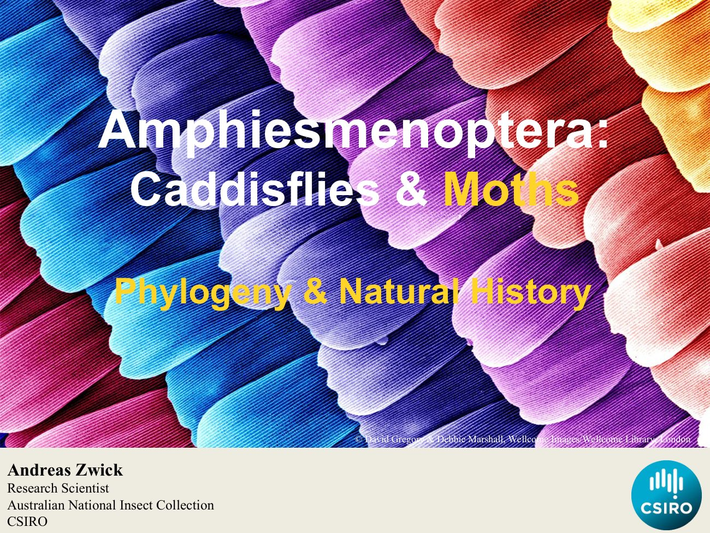](slides/slide-01.jpg)

This lecture is about the phylogeny and natural history of moths.

[↑ Slides](#slides) · [Course index](../../README.md)

## Slide 2

[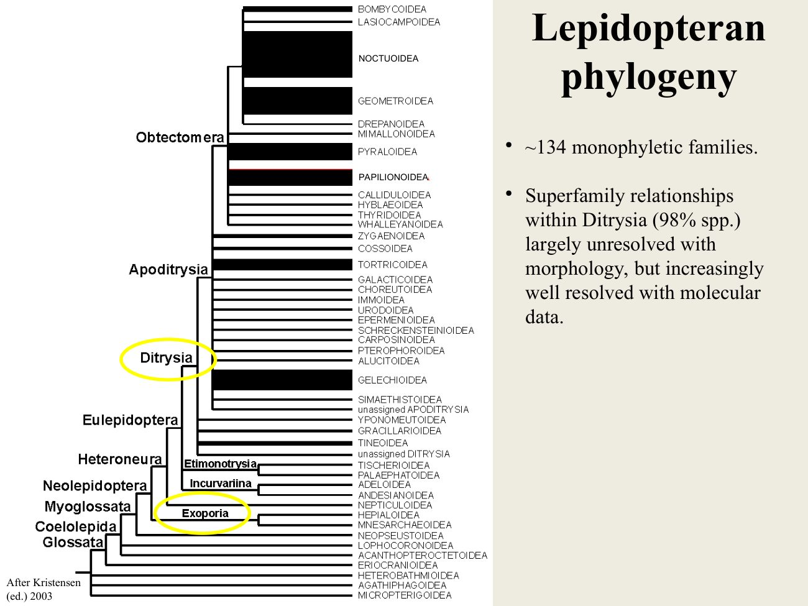](slides/slide-02.jpg)

I told you about this great diversity of 100 and 60,000 species named species of moths and butterflies that have been grouped in about 100 and 34 more or less monophyletic families and they have been grouped into 40 to 50 super families. And unfortunately, we really struggle to resolve relationships between these different super families or families, especially with morphological characters. But with molecular data, we increasingly manage to resolve it.

So using morphology, the initial divergences have been pretty well predicted. There are major structural differences, many of which have been named so, for example, the Glossata are those that have a probosces. The Neoglossata are those that have a proboscis that has muscles in it and so on.

You can also see the Ditrysia that I mentioned earlier. But then, with in the Ditrysia it gets really difficult to, work out relationships between the different families and super families. They're all very similar in major structures.

[↑ Slides](#slides) · [Course index](../../README.md)

## Slide 3

[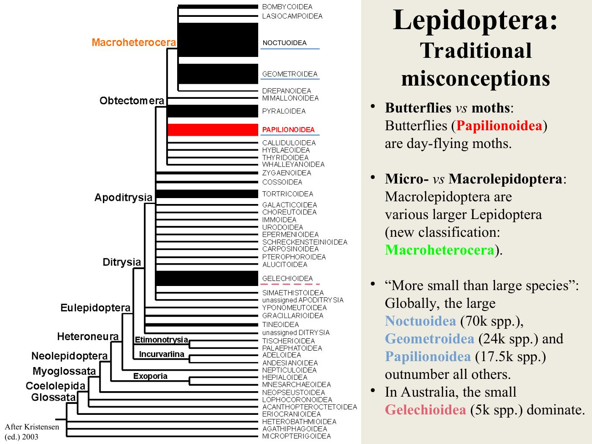](slides/slide-03.jpg)

So rather than to talk about all the different advances that have been made in, I'd just like to point out some major misconceptions. So, for example, butterflies versus moths. It's a question that comes up again and again.

What are butterflies? How do they differ from moths? Well, actually, butterflies are just day-flying moths, and I'll talk about that in a moment.

There's also often a distinction made between micro- (small) versus macro- (large) Lepidoptera. And while there are some very large Microlepidoptera, they are not forming a monophyletic group. There are various smaller groups that are, also having large specimens, like, for example, and so, based on molecular data, in the end, new classification has been, proposed.

That's the [Macroheterocera]. It's a more restricted group that doesn't include the butterflies, which are also relatively large and then there's also the perception that there are many more small, the large species worldwide. That's not the case if you take these super families [Noctuoidea, Geometroidea and Papilionoidea] together, they together have already more species than they are smaller species.

But in Australia, it's the reverse. We have a super-diverse superfamily [Gelechioidea], which has about 5000 species, and they dominate the Australian fauna. So if you look here at this molecular phylogeny at the top, you can see that initially, as I said before for morphology, there are these clear steps with high support values leading up to the great radiation of Ditrysia.

So there has been an explosive radiation, with very short branches between the different families and super families, and it is very difficult to disentangle these.

[↑ Slides](#slides) · [Course index](../../README.md)

## Slide 4

[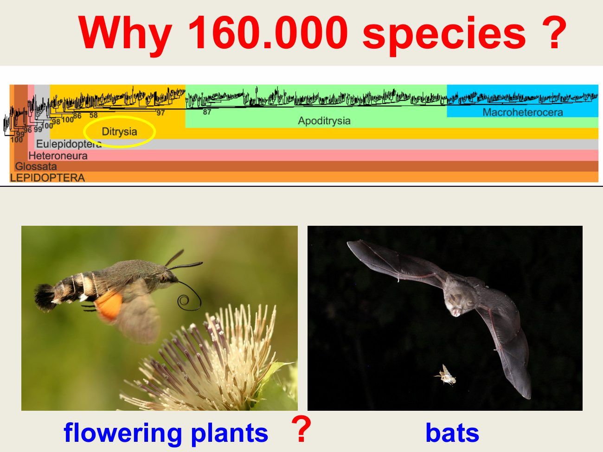](slides/slide-04.jpg)

So why do we have this rapid radiation of these 160,000 species while they are competing hypotheses, some around flowering plant, coevolution and others around the bats. So bats have been shown time and again to be a major factor in the evolution of insects. There's there's a lot of evidence that not only lepidoptera are affected, but also, other groups like mantises and Beetles.

Hearing has evolved again and again to avoid them and Lepidoptera.

[↑ Slides](#slides) · [Course index](../../README.md)

## Slide 5

[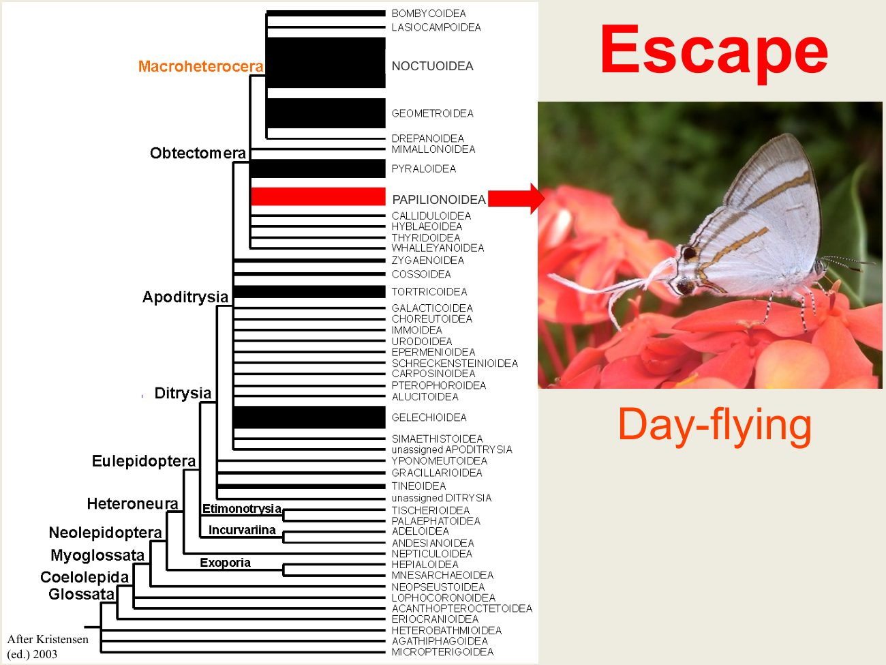](slides/slide-05.jpg)

One obvious strategy to avoid bats is to fly during the day. So these butterflies that we hear about again and again are basically day flying moths. You can see them here in the phylogeny deeply nested within the moths.

[↑ Slides](#slides) · [Course index](../../README.md)

## Slide 6

[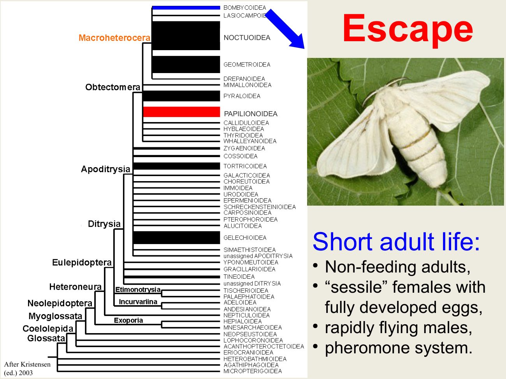](slides/slide-06.jpg)

Another way to avoid bats is to simply shorten the adult life. So you see here a silk moth, that has a female. That doesn't really move around much.

It doesn't fly. It just sits on the tree. You have these, [sessile] females, which only start to really move once they have laid a large part of the eggs.

And these eggs are already fully developed by the time the moth, ecloses from the pupa. And so you have these rapidly flying males that fly towards the females, guided by a pheromone system. And if a bat eats the male well, there's always another male, no big deal.

And this is how they avoid the bats. If the moth doesn't move, the bat doesn't really detect the moth.

[↑ Slides](#slides) · [Course index](../../README.md)

## Slide 7

[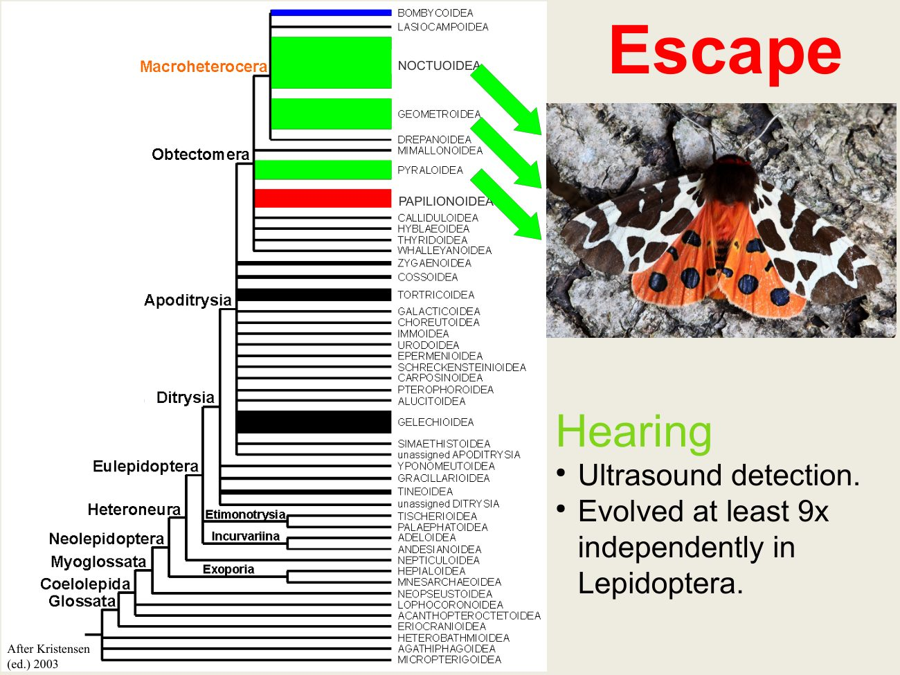](slides/slide-07.jpg)

And then I mentioned multiple times already about the hearing. So hearing has evolved independently in Lepidoptera at least nine times, as we know now based on molecular phylogenetics. And it's not a coincidence.

I believe that you can see here these particularly species rich major groups like the Noctuoidea and that they have evolved the hearing.

[↑ Slides](#slides) · [Course index](../../README.md)

## Slide 8

[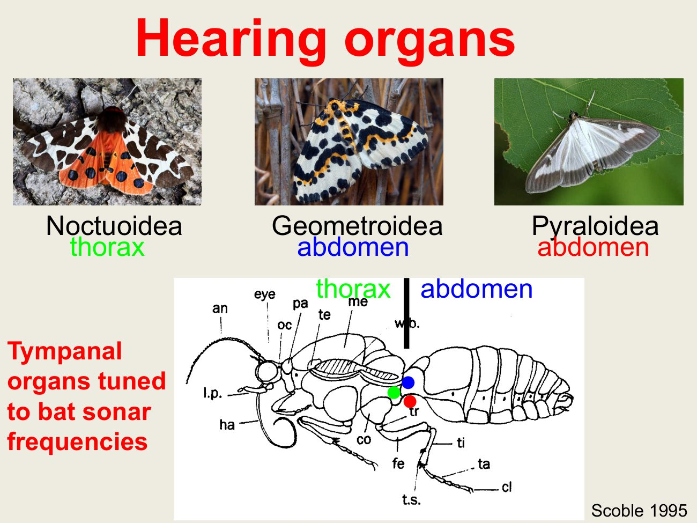](slides/slide-08.jpg)

So as mentioned before in Noctuoidea the organ, the hearing structure is located on the thorax, but in Geometroidea, it's on the at the base of the abdomen here in blue, and it's a little bit more dorsal than it is in [Pyraloidea] where it is a ventral position in red.

[↑ Slides](#slides) · [Course index](../../README.md)

## Slide 9

[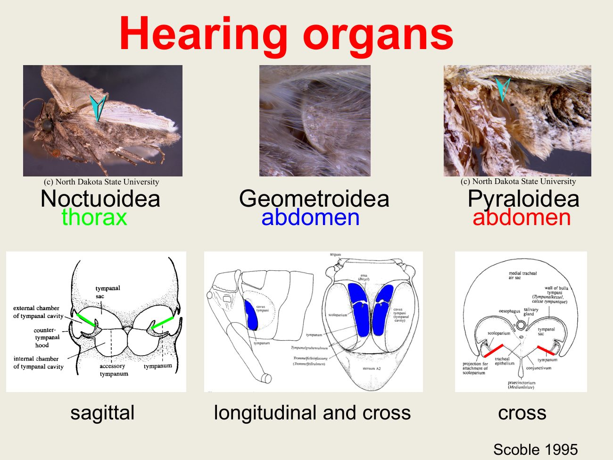](slides/slide-09.jpg)

You see some more details of these, hopefully making up for these small pictures in the previous, lecture. We can see the organ and the counter-tympanal hood, in the Geometroidea.

[↑ Slides](#slides) · [Course index](../../README.md)

## Slide 10

[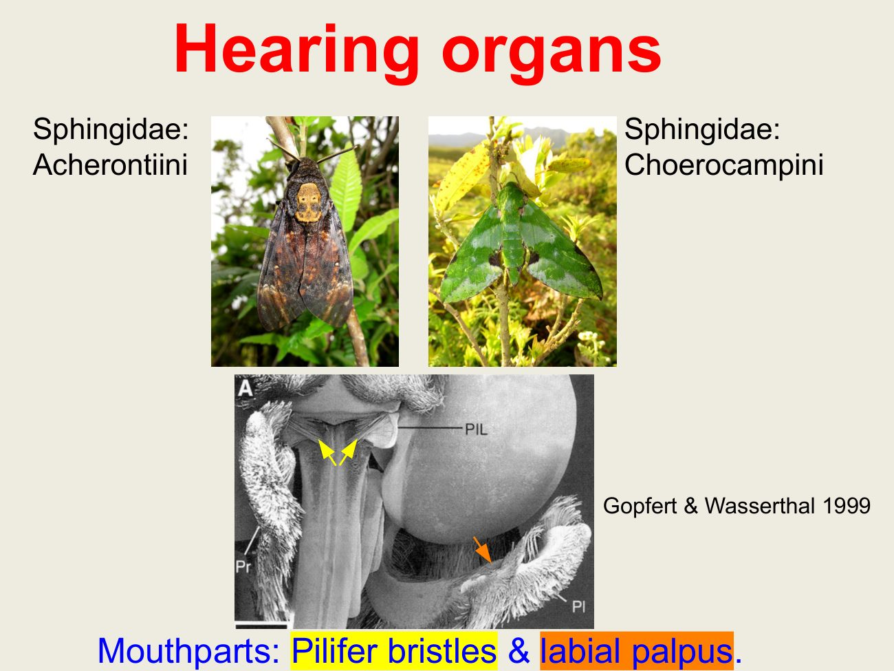](slides/slide-10.jpg)

Hearing organs have not only evolved as a [tympanal organ], where you have a membrane, with some stretch receptors, coupled. But, you also have hearing organ evolve in other body parts. So, for example, in [Sphingidae], it evolved two times independently that, sphingids are hearing with their mouth parts.

So you have pilifer bristles which scrape along the palpus. And that vibration is triggering reception by a nerve, and they can hear via the labial palpi in these bristles whenever a bat gets detected. These moths have an evasive behaviour, so they might just drop to the ground or fold the wings and fly a curve, whatever to get away from bats.

[↑ Slides](#slides) · [Course index](../../README.md)

## Slide 11

[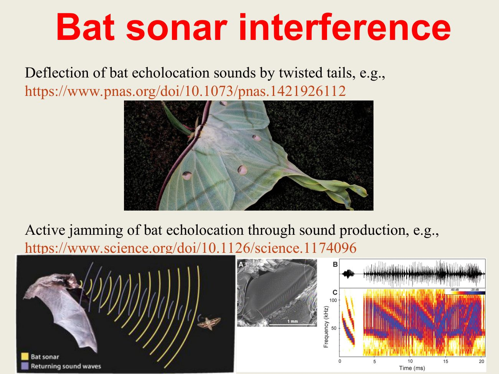](slides/slide-11.jpg)

But, moths are also interfering directly, with the bat sonar system. So, for example, there's a nice study that shows that the twisted tails of these silk moths, actually deflect the sound in different directions. So when a bat tries to grab a flying silk moth with these tails and will just grab the tails and rip them off and the moth escapes, and we have here some very large hepialids in Australia, and they seem to have a similar system at the tip of their forewings, but that has not yet been fully examined in detail.

And then, of course, there's also active jamming of the, bat echolocation system. So some moths, when they get pinged by the bat, they produce sound of the right frequency themselves, and they basically jam the sonar system, of that bat.

[↑ Slides](#slides) · [Course index](../../README.md)

## Slide 12

[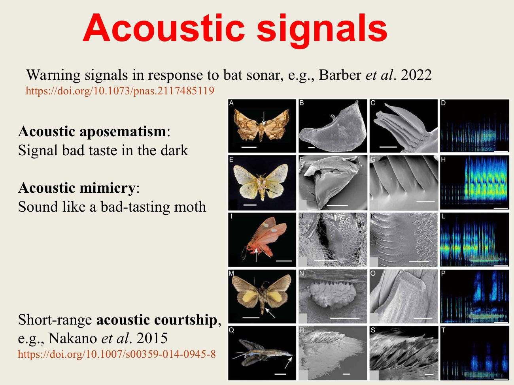](slides/slide-12.jpg)

Now, the acoustic signals have for a long time been just considered. As a mechanism to avoid the bats. But in fact, it turns out, in more recent studies that maybe even more, it's a matter of telling the bat that you are not tasty.

So there is acoustic aposematism where moths produce an ultrasound not to jam the sonar, but just to tell the bat. I'm not tasty. They will try a few times, presumably.

And, then figure out associate that this sound is linked to not very tasty. And whenever you have such a system, with [aposematism], you also have some mimicry. So there's acoustic mimicry where some moths just produce the sound and pretend to be bad tasting moths.

And it also turns out that there is short range acoustic courtship, where males and females produce sound, for mating.

[↑ Slides](#slides) · [Course index](../../README.md)

## Slide 13

[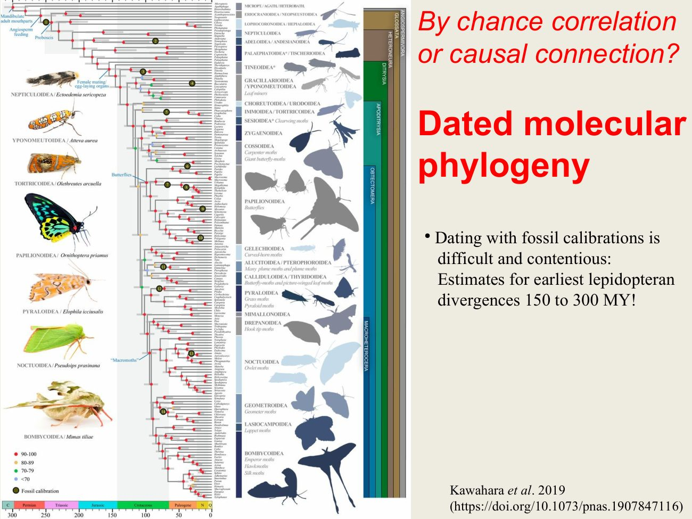](slides/slide-13.jpg)

So there's a fair bit of correlation, between defence mechanisms that, most and butterflies evolved and, the occurrence of insectivorous bats. And so are we just looking at, by chance, correlation or is there actually a causal connection. So to investigate this, we've been building a molecular phylogeny.

There's a study by [Kawahara et al. 2019], and, for transparency, I should say that I'm also co-authored this study. And in this study, we, dated a phylogeny using fossil calibration and then, estimated the age of the divergence of this different lepidopteran [lineages]. And this fossil dating is a rather contentious business.

I'm personally not the biggest friend of it. I think that often the fossil dates are very difficult to assign properly to the tree. And additionally, the priors that are set, often a bit contentious, which values to use.

So I would take these dating analysis even though they're very popular with a grain of salt. So keep that in mind at the next pages.

[↑ Slides](#slides) · [Course index](../../README.md)

## Slide 14

[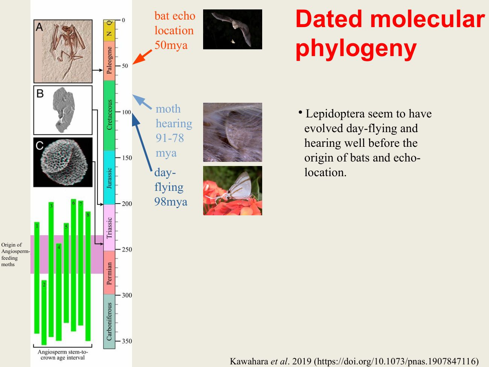](slides/slide-14.jpg)

So in our study, we found that day flying evolved about 100 million years ago, and moth hearing evolved 78 to 91 million years ago, while other studies that looked at the evolution of bats figured out that the bat echolocation system evolved only 50 million years ago. So moth hearing and day flying actually evolved long before, bat echolocation systems were in place. So this will argue against evidence that these mechanisms evolved primarily, as a defence against bats.

But at the same time, they might have evolved for other reasons, like, the courtship that we heard about before. And, nevertheless, they clearly have now, coevolutionary aspect. It's an arms race between bats and moths.

[↑ Slides](#slides) · [Course index](../../README.md)

## Slide 15

[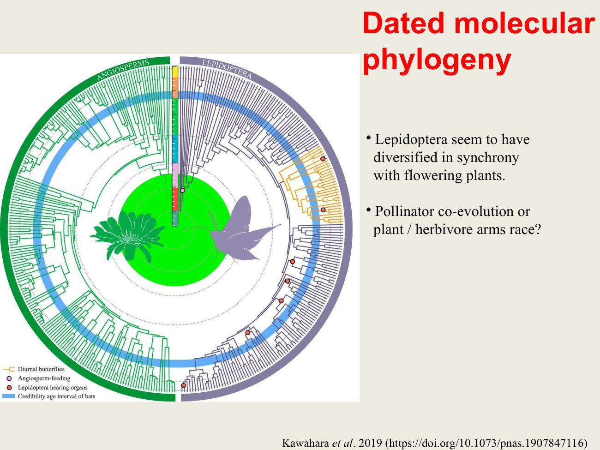](slides/slide-15.jpg)

If you look at this, molecular phylogeny in the dating and we correlate that with, molecular phylogeny of the flowering plants, the angiosperms, then we see that there's actually a synchrony between the evolution of flowering plants and Lepidoptera. And so there might be a pollinator coevolution or maybe a plant herbivore arms race in place.

[↑ Slides](#slides) · [Course index](../../README.md)

## Slide 16

[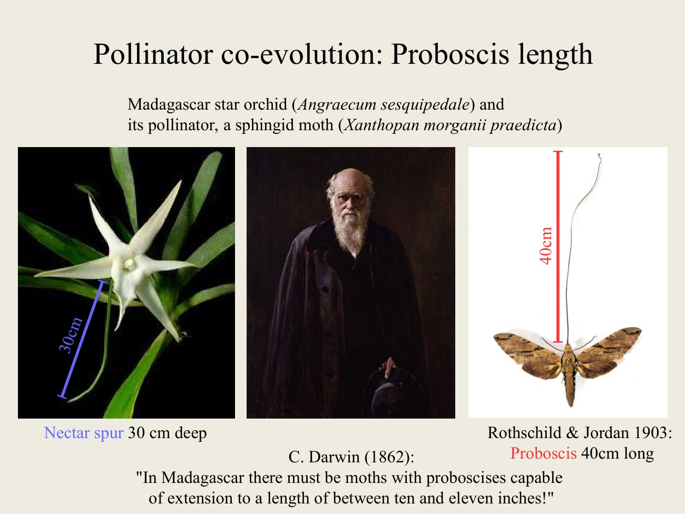](slides/slide-16.jpg)

So what is co evolution in Lepidoptera and plants? Well, for example, pollinators probosces length. There's an orchid in Madagascar that has a particularly long nectar spur about 30 centimetres.

And so, Darwin [predicted] that there somewhere must be a moth that has a matching proboscis. And, Then, about 40 years later, Rothschild and Jordan, described the moth that has a 40 centimetre long proboscis, which is actually pollinating this particular orchid species. And so there is, some benefit, for the moth and having an exclusive nectar resource.

Or there's a benefit for the plant that there is a moth that will visit exclusively. These, orchids. And so pollen is transferred directly between the different flowers.

[↑ Slides](#slides) · [Course index](../../README.md)

## Slide 17

[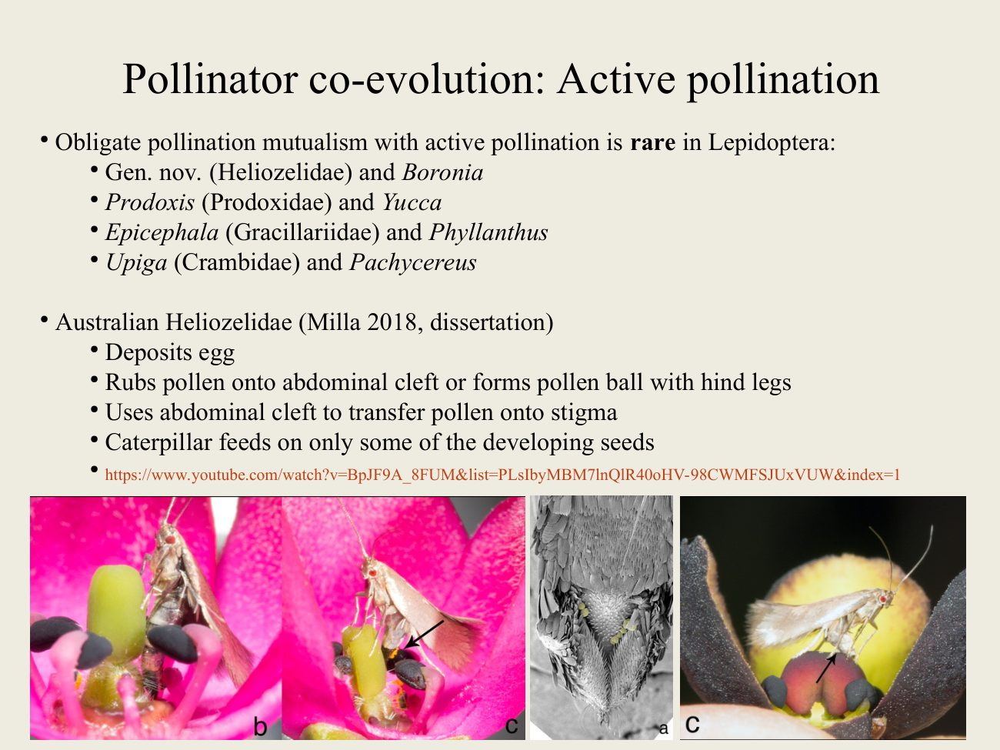](slides/slide-17.jpg)

There's another, there's some other examples of pollinator co evolution. There's obligate pollination. So where a plant is only pollinated by a certain species of Lepidoptera or group of Lepidoptera, which actively pollinate this plant, But this is rather rare in Lepidoptera.

So there is, for example, in Australia, a [new genus] of Heliozelidae, that is actively pollinating Boronia plants. There's the [Prodoxidae] that is exclusively pollinating, yucca plants. There's a tiny leaf-miner, [Epicephala (Gracillariidae)], which is pollinating [Phyllanthus].

And there's a [crambid, Upiga], that is pollinating [Pachycereus]. These heliozelids that I just mentioned, have been studied in more detail about [Liz Milla], here at the Australian National Insect Collection Now, and she wrote a dissertation about them, and she produced some very nice, video sequences that you should have a look at, so you can see in there that this heliozelid moth is, depositing in an egg, on the flower. And then it rubs the pollen, into an abdominal cleft.

That has a lot of, spiky trichomes on it. And some of them are also forming pollen balls with their hind legs, and then they actively deposit them onto another flower. And, they lay only a small number of eggs into each flower.

So in the end, you have a caterpillar that feeds not on all of these seeds that develop, but only on some of them.

> **Editorial note:** The slide’s “Prodoxis” label is problematic: active yucca pollination is associated with Tegeticula and Parategeticula (Prodoxidae), not Prodoxus. The cleaned transcript uses the family where the spoken name is unclear.

[↑ Slides](#slides) · [Course index](../../README.md)

## Slide 18

[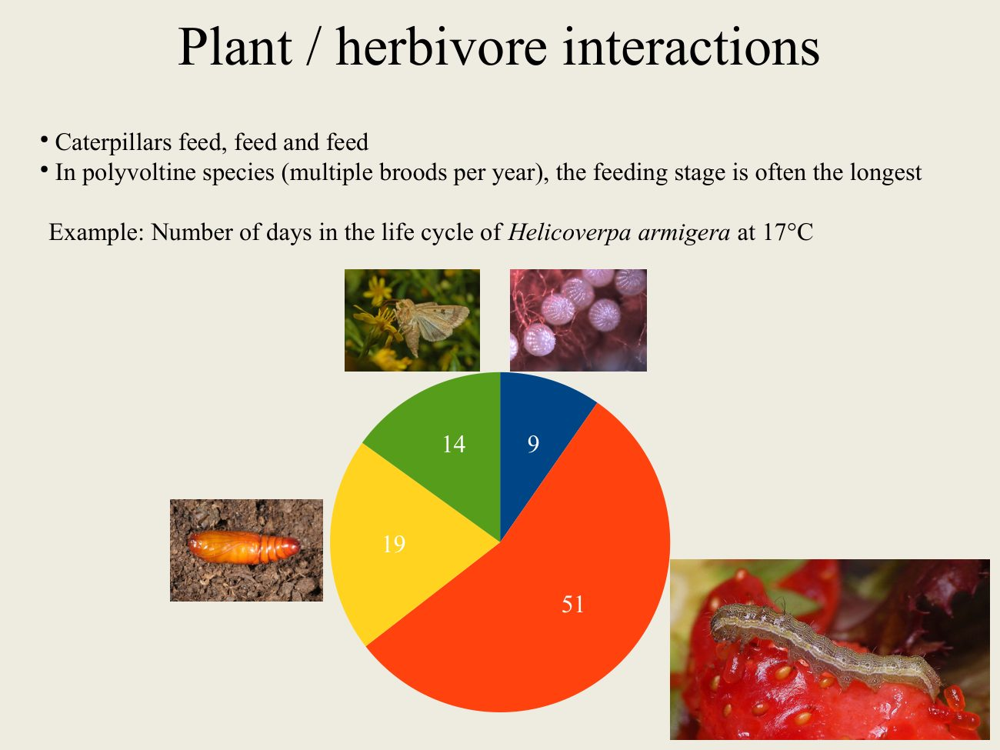](slides/slide-18.jpg)

There are also other plant herbivore interactions rather than, pollination beneficial to the plant. They are the caterpillars, and they are feeding and feeding. So if you think about polyvoltine species, that those are the ones that have multiple generations per year, then the feeding stage is often the longer stage in this life cycle.

So you can see for [Helicoverpa armigera], that the [larval] stage makes up about half of the life cycle, so larvae are really important. When it comes to plant interactions, that's the dominant part of the life cycle.

[↑ Slides](#slides) · [Course index](../../README.md)

## Slide 19

[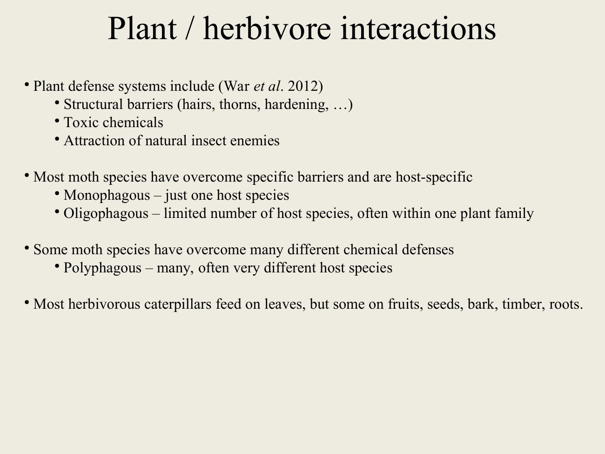](slides/slide-19.jpg)

And so plants have evolved all sorts of defence systems against, herbivores, including caterpillars. And so there are some structural barriers, like development of horns and thorns and, tissue getting harder. Woody And, of course, there's the development of, toxic chemicals, semiochemicals that are protecting the plants.

And there are even cases where plants actively attract, natural insect enemies, like some ants. On the other hand, you have Lepidoptera and also other insects, of course. And in Lepidoptera, most species have overcome some specific barriers, and as a consequence, they are host specific.

So you have most species that feed only just on one host or a few on one host, which would be called monophagous. And, if you have oligophagous, larvae, then they feed on limited number of species of within a genus of family of plants. That's the most common scenario.

But there are also some Lepidoptera that have overcome quite a variety of different chemical defence systems. And so we call these caterpillars polyphagous they are feeding on a broad range of hosts and you'll hear about them when we talk about pest species. And in general, most caterpillars feed on leaves, but there are also some that are feeding on fruits and seeds or bark or timber inside the roots.

[↑ Slides](#slides) · [Course index](../../README.md)

## Slide 20

[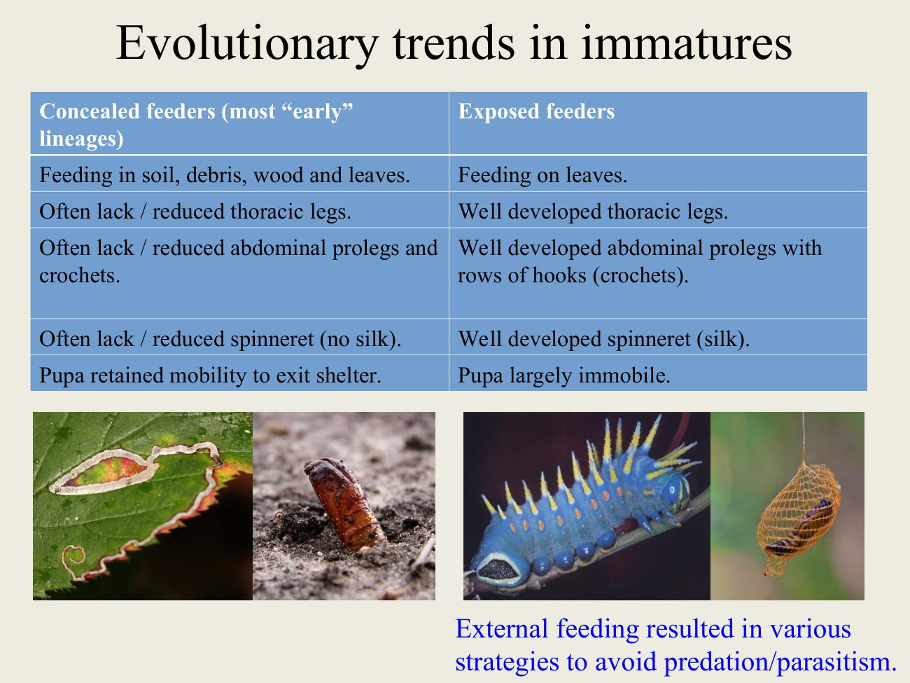](slides/slide-20.jpg)

So I mentioned, in one of the earlier lectures about evolutionary trends in immatures and larvae. And so I talked about the concealed feeders, that, were on the gymnosperms and then on angiosperms And how they then, radiated in the Ditrysia exposed feeders. And so you have these concealed feeders that live inside leaves inside stems, in the soil.

And, because of that microhabitat that they're living in they often lack or have reduced thoracic legs the same for the abdominal prolegs and [crochets], and they often lack or have reduced spinnerets and can't produce silk any longer. But unlike other Lepidoptera they have pupae, that have some mobility? Because these pupae need to make their way out of the shelter before the moth can eclose from it.

On the other hand, you have these exposed feeders that are feeding externally on leaves, and, they have what I described earlier these very well developed thoracic legs, and then these abdominal prolegs with crochets to really clamp onto their substrate so they can't fall off easily. And they have a well developed spinneret and then the pupae are largely immobile. So when you are an exposed feeder, which is possibly majority of Lepidoptera, you need to as a larva, have various mechanisms to avoid predation and parasitism.

[↑ Slides](#slides) · [Course index](../../README.md)

## Slide 21

[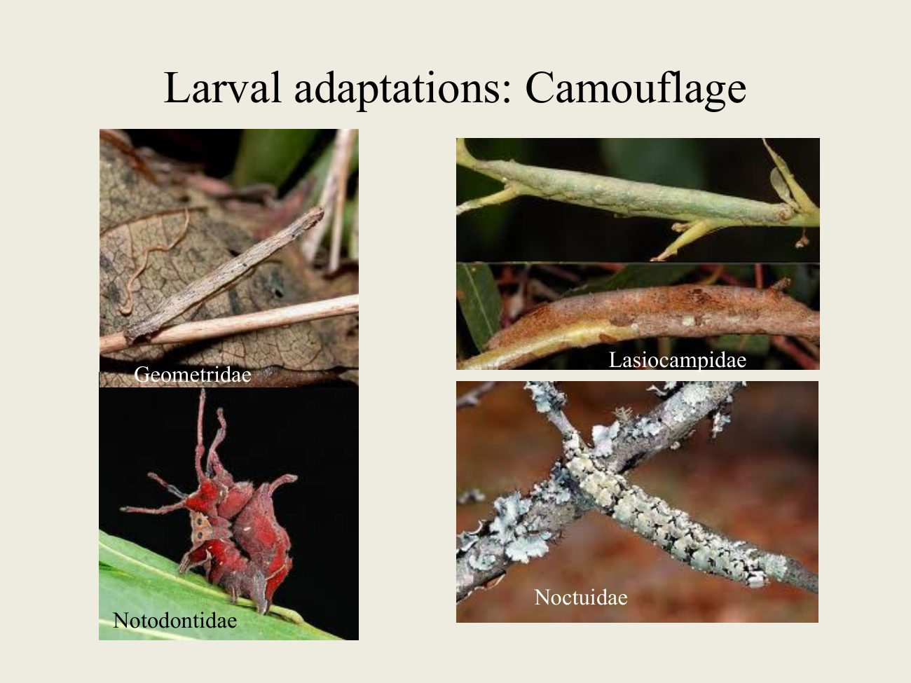](slides/slide-21.jpg)

So there is, on one hand, a camouflage, so you can see here geometrid, that looks like a little stick. You see some lasiocampids that are smoothly pressed to the little branch, the twig, and, they have fringes of hairs that dissolve the outline of the caterpillar. You've got this, notodontid here, as an example that pretends to be a dry leaf.

And then there's a noctuid that looks just like the lichens that grow on that plant.

[↑ Slides](#slides) · [Course index](../../README.md)

## Slide 22

[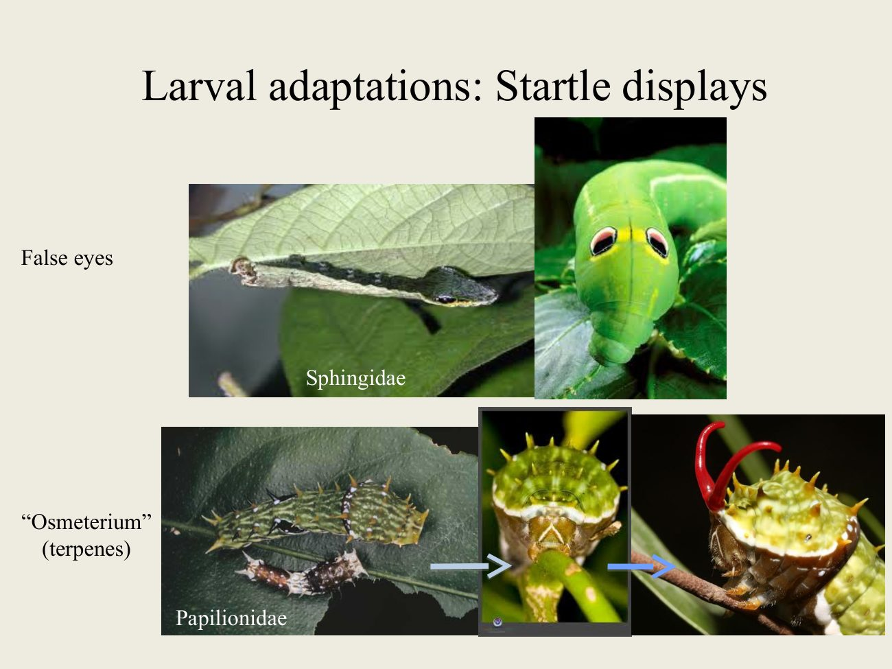](slides/slide-22.jpg)

If you can't fool your predators, you can't hide. Then, for some predators, it works to shock them. So you have startle displays.

So here is a sphingid larva that has some, false eyes that it can suddenly expose. They're hidden inside a fold, a membrane fold. They can open that up and have some eyes, stare at a potential predator or there's an osmeterium.

That is a tubular structure with a colour that can secrete some terpenes some nasty chemicals that are stinky in bad taste. And so here you have this papilionid, caterpillar that can suddenly produce this osmeterium. So you can try that yourself if you have a Citrus plant and in summer, you'll find these, caterpillars on your Citrus.

These are typically papilionids, and they have this osmeterium and you can try to poke them and see if they will extrude that from, close to the head.

[↑ Slides](#slides) · [Course index](../../README.md)

## Slide 23

[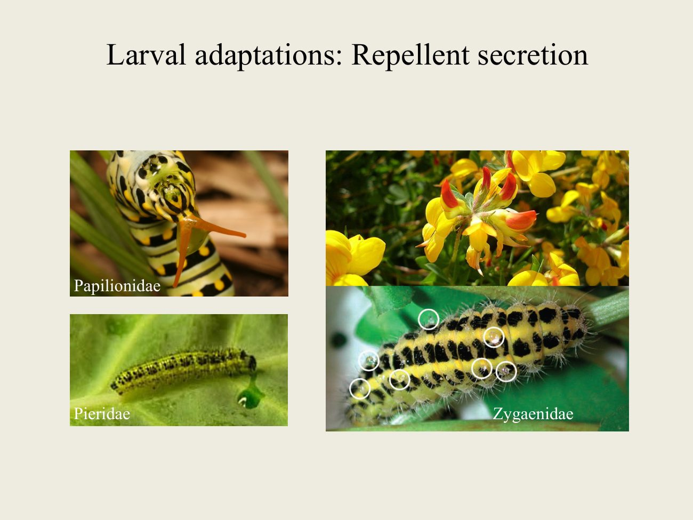](slides/slide-23.jpg)

Oh, another slide in slide show, Tiny pictures. Sorry for that. So I was just showing on that slide.

And again, I don't know why in the slide show, they are not tiny. Well, they're not in the normal view. The osmeterium already mentioned.

Then there are [Pieridae], as an example that regurgitate, foods in this case, [unclear secretion], and then there are, zygaenid. That's this other squashed image Bottom. Right.

Zygaenid larvae, can actively produce [repellent secretion], and have this little droplet on the outside. So there's chemical defence.

[↑ Slides](#slides) · [Course index](../../README.md)

## Slide 24

[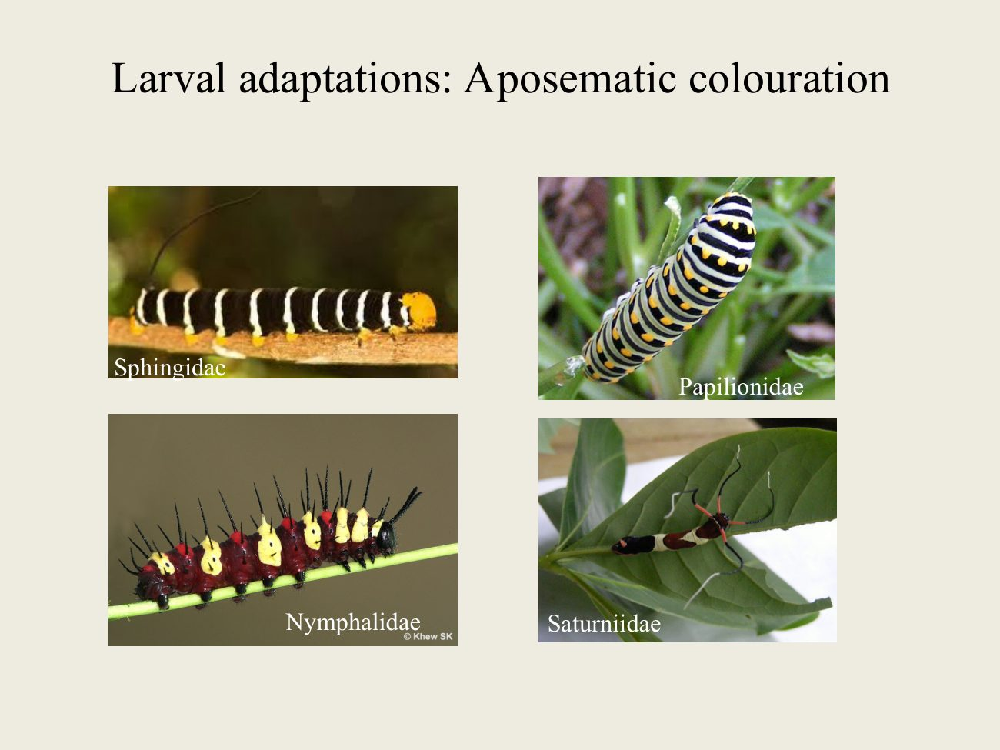](slides/slide-24.jpg)

If you have any kind of defence. You it is very common for, animals to display, that they have a defence mechanism. So you have [aposematic] coloration in many of the larvae and showcasing that, or showing that they have, some defence system and are not palatable.

[↑ Slides](#slides) · [Course index](../../README.md)

## Slide 25

[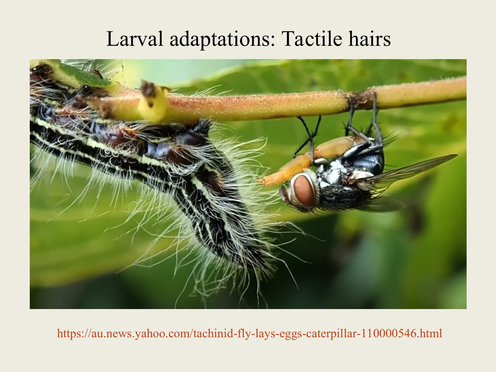](slides/slide-25.jpg)

If that fails, which is something that might work, especially with vertebrate predators. Then many caterpillars resort to tactile hairs. And, so it's It's a very nice video that you might want to watch on YouTube, where you can see this fly extremely extending its abdomen to place an egg onto that caterpillar, trying to get the tip of that abdomen between the hairs that cover the caterpillar.

And the caterpillar uses those hairs to sense that there's actually something happening and makes a move.

[↑ Slides](#slides) · [Course index](../../README.md)

## Slide 26

[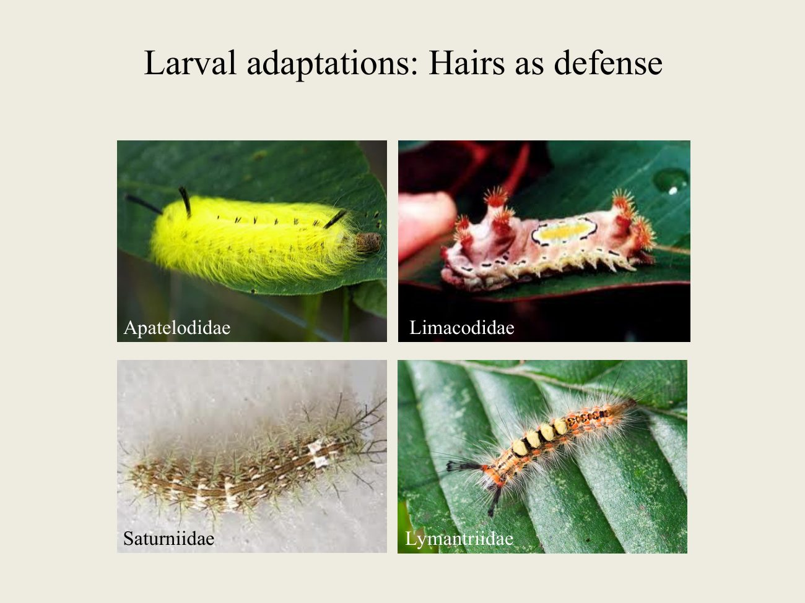](slides/slide-26.jpg)

And, of course, there are also hairs as defence as in mechanical and chemical defence. So here you can see some apatelodids, which is a New [World] taxon very densely covered in hairs, and you've got some limacodids that have hairs that are highly urticating and nasty.

[↑ Slides](#slides) · [Course index](../../README.md)

## Slide 27

[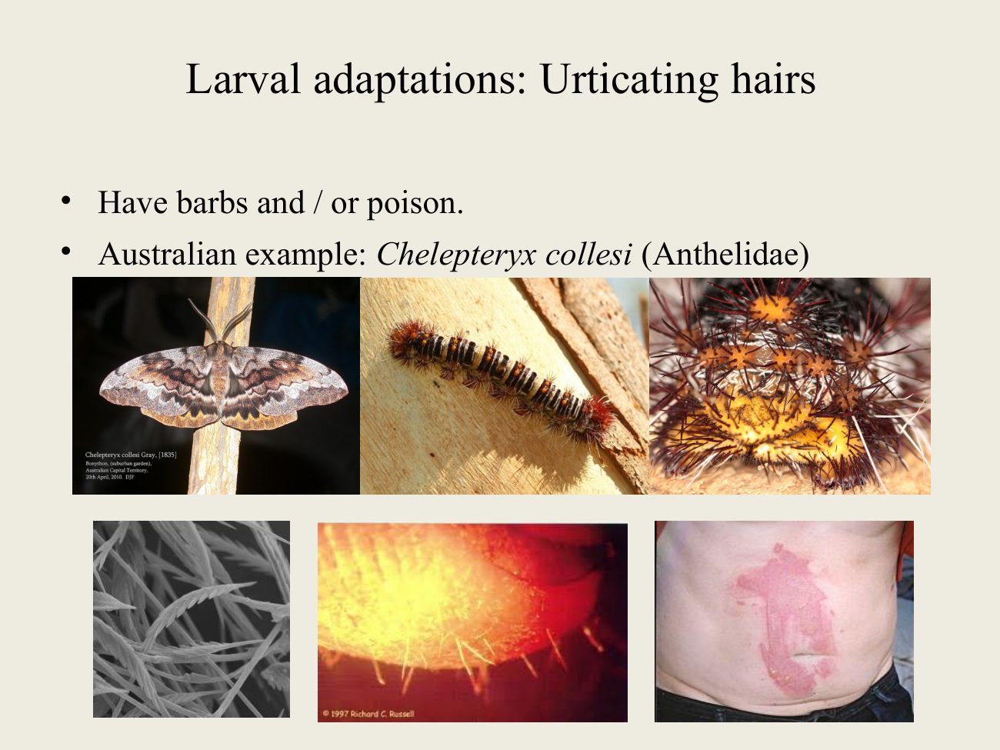](slides/slide-27.jpg)

So talking about urticating hairs, this can be either, mechanical, causing irritation due to mechanical damage to the skin. Or there might even be some poison involved. So in Australia And also here in Canberra, we have a hand-sized moth species called [Chelepteryx collesi], which is [Anthelidae], and, on Christmas time in January, you can see these very large, probably 10 centimetre larvae wandering around, through the suburbs.

And, they are looking for hiding places where they can spin the cocoon and pupate in it. And so looking for shelters and often, unfortunately take mailboxes and shelter, and they make their cocoon, and then they push these hairs through the wall of that cocoon, and so the cocoon is also protected. And, we can see some closer pictures of those hairs.

They have a lot of barbs on there, but the part that actually enters the skin is not the barbs, but it's the place where the hair snaps off. It's very sharp, like a glass capillary, and the barbs help to push it deeper and deeper into the skin and so they can result to quite some rash.

[↑ Slides](#slides) · [Course index](../../README.md)

## Slide 28

[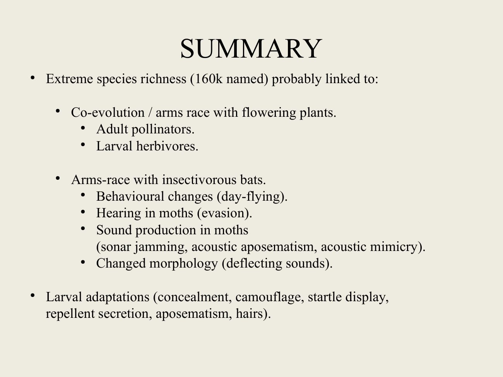](slides/slide-28.jpg)

So to sum this up, the extreme species richness of Lepidoptera is probably linked to most of all co evolution and arms race the flowering plants. So they are adult pollinators. And then there are the larval herbivores and the arms race between plants and these larvae.

And, Then there's also the arms race with insectivorous bats, where we can see some behavioural changes like daytime flying or not flying at all. The evasive behaviour in hearing moths in sound production in moths for jamming or also acoustic aposematism and then acoustic mimicry and then changes in the morphology to deflect the sound. And finally, there are, of course, larval adaptations that I just talked about the concealment camouflage startle, display, producing repellent, secretions, [aposematism] and [hairs] as well.

[↑ Slides](#slides) · [Course index](../../README.md)

## Source notice

this material has been reproduced and communicated to you by or on behalf of the Australian National University in accordance with Section 113 P of the Copyright Act 1968. The material in this communication may be subject to copyright under the act. Any further reproduction or communication of this material by you must be consistent with the provisions of the act. Do not reproduce this material. Do not remove this notice.

[← Previous lecture](../30-amphiesmenoptera-part-3-lepidoptera-identification-taxonomy/README.md) · [Course index](../../README.md) · [Next lecture →](../32-amphiesmenoptera-part-5-lepidoptera-applied-issues/README.md)
